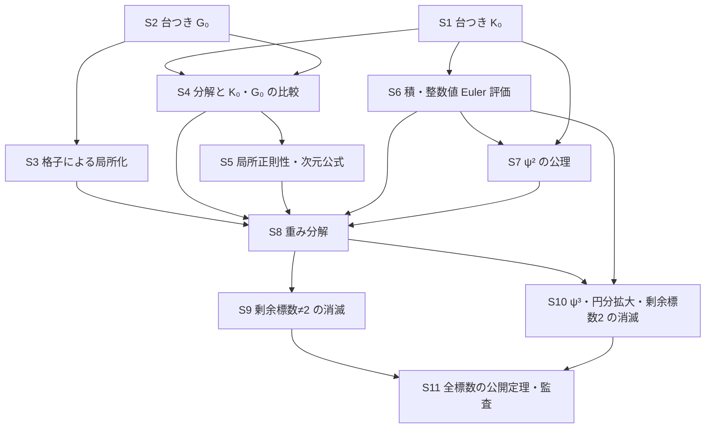

# 外部引用5：交点重複度の消滅定理を Adams 作用素で証明する計画

作成：2026-10-14。改訂：2026-10-14（S1–S11 全段の小段・証明契約・実装順序を具体化）。状態：S1.1–S1.6、S2.1–S2.4 実装・検証済み。S3 以降は計画。
対象は [Inputs/IntersectionTheory.lean](../SerrePositivity/Inputs/IntersectionTheory.lean) の
`Inputs.intersectionVanishing`（Roberts–Gillet–Soulé の消滅定理）。
並行する Chow 群の経路は [サイクルの計画](intersection-vanishing-cycles.md)。

## 0. 決めたこと（2026-10-14、利用者と相談）

- 引用5は、まず **Adams 作用素の経路**（Gillet–Soulé、巡回 Adams 作用素による初等版）で外す。
- **K2 は最初から証明する**。比較同型・局所化の完全性を新しい未証明引用へ移す進め方は採らない。
- **閉集合で台を指定する版は既存の基盤を拡張する**。列版の公開 API を保ち、
  台の条件と有限射影版を一般化して、列版からの比較を既存の比較写像へ接続する。
- Roberts の経路（局所 Chern 指標）と Chow 群の基盤は、BlochConjecture と共有する基盤として並行して進める。
- 経緯：原典の精読（§6）で、局所 Chern 指標を graph construction なしに作る完結した構成は見つからなかった。
  一方、巡回 Adams 作用素を使えば、Chow 群・Grassmann 束・Riemann–Roch なしに消滅定理まで届く見込みがある。

## 1. 主張

正則局所環 `R`（混標数・分岐を含む）と有限生成加群 `M, N` について、
`ℓ(M ⊗ N) < ∞`、`dim M + dim N < dim R` なら `χ^R(M, N) = 0`。

## 2. 証明の骨格（Walker の講義ノート、Gillet–Soulé）

`K_0^Z(R)`：台が閉集合 `Z` に入る有界有限射影複体の Grothendieck 群。
既存のホモトピー同値・写像錐の関係を使う。擬同型・次数ごとの短完全列による定義との一致も示す。
局所環では各項が自由なので既存の有限自由版と一致するが、局所化や巡回作用の固有部分の構成では
有限射影版を使う。
カップ積 `K_0^Y × K_0^Z → K_0^{Y∩Z}` はテンソル積。

1. **Adams 作用素**：各 `Z` 上の `ψ^k : K_0^Z(R) → K_0^Z(R)` で、
   (A1) 加法的、(A2) カップ積と乗法的、(A3) 平坦な環準同型と可換、
   (A4) 長さ 1 の Koszul 複体で `ψ^k[K(a)] = k·[K(a)]`。
2. **重みの評価（Gillet–Soulé）**：`K_0^{V(I)}(R)_ℚ` は `∏_{ht I ≤ j ≤ d} (ψ^k − k^j)` で消える。
   本計画では高さが最小の生成点全体で半局所化し、局所化の完全性と Koszul 生成を使って
   余次元の下降帰納法で示す（§4.4）。円分体係数の作用素には同じ議論をその係数体上で行う。
3. **結論**：`[F_M] ∈ K_0^{Supp M}` は重み `≥ d − dim M`、`[F_N]` は重み `≥ d − dim N`。
   積は (A2) で重みが足され、`K_0^{m}(R)_ℚ ≅ ℚ` は純粋に重み `d`（Koszul 複体が生成、(A2)(A4)）。
   `d − dim M + d − dim N > d` なので積は零、`χ(M, N) = 0`。
   正則局所環では `ht p = d − dim R/p` を使う。

## 3. 段階

| 段 | 内容 | 原典 | 既存の資産・見込み |
| --- | --- | --- | --- |
| K1 | 閉集合で台を指定する有限射影版、列版との比較、カップ積、整数値 `χ`、正則局所環で `K_0^{m}(R) ≅ ℤ` | Walker §2 | `Support`、`HomotopyCategory`、`K0Comparison`、`KoszulGeneration` を拡張。§4.2 |
| K2 | `K_0^Z(A) ≅ G_0^Z(A)`、`G_0^{V(J)}(A) ≅ G_0(A/J)`、台つき局所化の右完全列 | Walker Thm 2.19、Weibel | **最初から証明**。まず `A` は正則局所環の局所化に限定。§4.3 |
| K3 | 巡回作用 `C_p ↷ T^p(X)`（Koszul 符号つき）と固有空間分解（`1/p`、`ζ_p` を含む環） | BMTW-cyc §2–3（p.5–9） | 新規。符号の検証が手間 |
| K4 | 巡回 Adams 作用素 `ψ^p_cyc[X] = Σ_j ζ^j [T^p(X)^{(ζ^j)}]` と公理：(1) 加法性（擬同型・短完全列）、(2) 乗法性、(3) 自然性、(4) Koszul での正規化 | BMTW-cyc Thm 3.7（p.9–12、一般の素数 `p` で完全な証明） | 新規。乗法性は `T^p(X ⊗ Y) ≅ T^p X ⊗ T^p Y` の同変性（符号）が山。正規化は外積代数の基底変換 |
| K5 | 重み分解：`Z` の余次元が `c` なら固有値は `p^c, …, p^d` | Gillet–Soulé 5.3、Walker Thm 3.7 | 高さ `c` の全生成点での半局所化と下降帰納法。§4.4 の証明案を補題化 |
| K6 | 剰余標数と異なる素数 `p` を選び、円分代数の `m` 上の極大イデアルでの局所化へ上げ、重みと平坦局所拡大の保存則で `χ(M, N) = 0` | BMTW-cyc Cor 3.13、Gillet–Soulé 5.4・5.6 | `IntersectionMultiplicity/BaseChange` を使用。拡大環の正則性・台次元の保存も証明する |

**素数 `p` の選び方**：剰余標数が 2 でなければ `p = 2`（`ζ_2 = −1` なので拡大も不要）。剰余標数が 2 のときだけ `p = 3`。
したがって **`p = 2` で先に全体を通し**、そのあと `p = 3` で剰余標数 2 を閉じる。
任意の素数への一般化は、公開定理の完成に必須ではない。

**簡略化の方針（精読で確認）**：

- BMTW の `Σ_n` 作用と ⋆ 積（Thm 2.2）は回避し、`T^p` の対象の水準で `ψ` を定義する。
  擬同型の不変性は「射影複体の擬同型はホモトピー同値」から、短完全列の加法性は次数ごとの分裂と
  `X''` の個数によるフィルトレーション（部分商は `0 < i < p` で `C_p` が自由に作用して寄与 0）から示す。
- 係数は円分体 `ℚ(ζ_p)` に取り、Lemma 3.3（原始根による値の独立性）を避ける。
  使う関係は `Σ ζ^j = 0`、`Π (1 − ζ^j) = p` だけ。

## 4. 進め方

1. K1 の台・関係式・比較を拡張する。有限射影版を非局所環でも使えるようにする。
2. K2 の台つき加群の Grothendieck 群、分解との比較、局所化の完全性を証明する。
3. K5 の前提となる、素イデアルでの局所化の正則性と高さ・次元公式を証明する（§4.7）。
4. K1 の積と整数値 Euler 評価、K3・K4 の `p = 2`、K5 を証明する。
5. 剰余標数 2 以外の消滅を示し、`p = 3` の作用素と K6 で全標数を閉じる。
   全標数の公開定理には `p = 2, 3` で十分なので、任意の素数への一般化は追加の成果とする。

## 4.1 未決事項

証明経路と段階分けは以下で指定する。残る不確実性は主に実装上の接続であり、
Lean での検証を終えたことを意味しない。

- **外部証明コードの移植適合性**：S5.4–S5.6。ソース確認までで、現在の環境でのビルド・公理監査は未実施。
- **複体のテンソル API**：S6.1。整数添字での totalization と符号・錐の比較の接続を確認する。
- **自然同型の整合性**：S7.7、S10.8。対象での基底計算に加え、鎖写像・同変性・台を証明する。
- **名前と配置**：予定名は実装時に確定するが、証明の入力・出力と依存順序は本計画に合わせる。

## 4.2 K1：既存の台・有限射影版を拡張する

**既存コードで確認したこと**：

- `Support.lean` の `HasHomologySupport I P` は既に `Supp Hⁱ(P) ⊆ V(I)`。
  `isSupported_iff_homologySupport` は有界有限射影複体で列による零ホモトピー条件との同値を証明済み。
- `HomotopyCategory.lean` に `strictlyPerfectComplex`、`PerfectHomotopy`、`SupportedPerfectHomotopy z` がある。
- `K0Comparison.lean` に任意の環での `freeToPerfectK0` と、局所環での `freePerfectK0Equiv` がある。
  後者を非局所環にも適用できるとは仮定しない。
- `KoszulGeneration.lean` は極大イデアルの Koszul 類による生成と Euler 値 `1` を証明済み。
  `OrdinaryEuler.lean` の値域は `ℝ` なので、整数値版との比較を追加する。

**定義と補題の順序**：

1. 閉集合 `Z : TopologicalSpace.Closeds (PrimeSpectrum R)` に対し、
   `HasHomologySupportOn Z P := ∀ i, Module.support R (P.homology i) ⊆ Z` を定義する。
   `Z = V(I)` の特殊化は既存の `HasHomologySupport I P` と同値。
   イデアルの選択や生成列の選択を `K₀` の定義に入れない。
2. 有界有限射影複体での、ホモトピー同値・シフト・写像錐に対する台の保存、
   `Z ⊆ W` による台の拡大、平坦基底変更での逆像への台の移動を証明する。
3. `SupportedPerfectHomotopyOn Z` を既存の `PerfectHomotopy` の部分圏として定義し、
   `K0WithSupport R Z := TriangulatedK0 (SupportedPerfectHomotopyOn Z)` とする。
   普遍性・類の外延性・錐の関係を既存の `TriangulatedK0` から使う。
   列版 `SupportedPerfectHomotopy z` との比較を作り、局所環では
   `K0Supported R z ≃+ K0WithSupport R (V(span(range z)))` を得る。
   既存の `K0Supported R z`、`K0.mk`、`K0.map` の利用先は保つ。
4. 有界有限射影複体の間の擬同型がホモトピー同値であること、および次数ごとの短完全列の
   加法関係と錐の関係との一致を示す。K4 はこの接続を使って既存の関係式へ降ろす。
5. テンソル複体が有限射影で、台が `Y ∩ Z` に入ることを証明する。
   局所化後に片方が完全なら、有限射影複体として可縮であることを使う。
   片側を固定したテンソルが錐の関係を保つことから双加法的なカップ積を作り、
   台の拡大・平坦基底変更との可換性を証明する。
6. 極大イデアルの台で `χℤ(P) = Σᵢ (-1)ⁱ ℓ_R Hⁱ(P)` を定義し、
   `χℤ : K0WithSupport R {m} →+ ℤ` に降ろす。
   既存の Koszul 生成と `χℤ(K(parameters)) = 1` から `K₀^{m}(R) ≃+ ℤ` を構成する。
   `ℤ → ℝ` による既存 `chiOrd` との比較、分解のテンソルに対する `chi R M N` との比較も示す。

有限自由複体の直和因子が自由であるとは一般にはいえない。巡回作用の固有部分は有限射影なので、
K3・K4 の対象を有限射影版へ統一することも、この拡張の目的に含める。

## 4.3 K2：比較と局所化を最初から証明する

**適用範囲**：まず正則局所環 `R` と、その任意の局所化 `A = S⁻¹R` を扱う。
K6 で作る正則局所拡大環にも同じ結果を適用する。
一般の正則 Noether 環についての分解存在は、この経路の前提にしない。

| 小段 | 構成・証明する内容 | 主な証明作業 |
| --- | --- | --- |
| K2a | 台つき有限生成加群の群 `G0WithSupport A Z`、`G0 A`、類・普遍性・台の拡大 | 同型と短完全列を関係式とする。台の条件が部分加群・商・拡大で保たれることを示す |
| K2b | 局所化上の有限表示加群の降下 | 有限表示行列の分母を払って `A ⊗_R M₀ ≃ M` を構成。Noether 性から有限生成なら有限表示。既存 `PresentationBaseChange` を再利用 |
| K2c | `A` 上の有界有限自由分解の存在 | `M₀` の既存 `regularResolution` を平坦局所化。降下元 `M₀` が同じ台をもつ必要はなく、分解のホモロジーの台で判定する |
| K2d | `res : G0WithSupport A Z →+ K0WithSupport A Z` | 比較写像・ホモトピー同値で選択独立性。短完全列の単射を分解間に持ち上げ、その錐が商の分解となることで加法性を証明 |
| K2e | `eulerH : K0WithSupport A Z →+ G0WithSupport A Z` と `res` との逆性 | `Σᵢ (-1)ⁱ[Hⁱ(P)]`。長完全列を有限区間で切って錐の関係を示す。逆性は各ホモロジーの分解と切り詰めの三角形で示す |
| K2f | `G0(A/J) ≃+ G0WithSupport A V(J)` | 台条件から有限生成加群を消す `J` の冪を得る。`J` 冪フィルトレーションの商は `A/J` 加群。フィルトレーションの精密化と加法性で dévissage の逆写像を証明 |
| K2g | 台つき局所化の全射性と核 | §4.6 の有限生成格子で商群への逆写像を構成。局所化で零になる有限生成加群は `S` の一元で消される |
| K2h | K2e による `K₀` の完全列への移送 | 比較写像と局所化・台の拡大の可換図式を証明。係数拡張後の完全性も示す |

K2f は `Hⁱ(P)` をそのまま `A/J` 加群とみなす構成ではない。
台が `V(J)` に入るだけでは `J Hⁱ(P) = 0` はいえないため、冪による dévissage が必要。
K2g はまず `G0WithSupport` で示し、K2f に依存させなくてもよい。

**K2g・K2h の最終インターフェース**：

- 一元 `g` を反転した場合：
  `K₀^{Z∩V(g)}(A) → K₀^Z(A) → K₀^{ι⁻¹Z}(A_g) → 0` が右完全。
  左端の写像の単射性は要求しない。
- 任意の乗法的集合 `S` の場合：局所化写像は全射で、核の各元はある `s ∈ S` に対して
  `K₀^{Z∩V(s)}(A)` からの像になる（または有限和として表し、その積で一元にまとめる）。
  これは K5 の半局所化に必要なので、一元局所化だけで K2 を完了扱いにしない。
- 台つき加群の降下には、局所化加群内の有限生成格子を使う。`J` 冪による消去は格子にも成り立つ。
  短完全列は中央の格子との交わり・像で降ろす（§4.6）。
- 核の証明は `S` torsion の類で割った商群への逆写像を使う。
  最後にその部分群の元の有限和表示を使い、消去元の積により一つの閉集合へまとめる。

## 4.4 K5：半局所化による重み評価の証明案

以下は原典の引用ではなく、Walker のスケッチを補うための証明案。
Lean 実装前に、K2 の核の記述と半局所環での生成点評価を個別に証明する。
係数体 `E` は `p = 2` では `ℚ`、一般の `p` では `ℚ(ζ_p)` とする。

`d = dim R` とし、**すべての閉集合 `Z` で `codim Z ≥ c`** に対して
`P_c(ψ) = ∏_{j=c}^d (ψ − pʲ)` が `K₀^Z(R)_E` を消すことを、`c` の下降帰納法で示す。
空集合は群が零。高さは非空の閉集合に対してだけ定義し、空集合の最小値は使わない。

1. `codim Z ≥ c+1` の場合は帰納法で処理する。残る場合、高さ `c` の生成点をすべて
   `q₁, …, qᵣ` とし、`S = R \ ⋃ᵢ qᵢ`、`B = S⁻¹R` とする。
   Noether 性による生成点の有限性と素イデアル回避から、`B` の極大イデアルが
   ちょうど `qᵢB` で、`Z_B` がその有限集合であることを証明する。
2. `K₀^{Z_B}(B) → ⊕ᵢ K₀^{qᵢR_{qᵢ}}(R_{qᵢ})` は同型。
   K2e で有限長加群の群へ移し、半局所環での組成列と、単純加群の分類を使って示す。
   各局所環 `R_{qᵢ}` は次元 `c` の正則局所環なので、Koszul 生成と A2・A4 により
   `ψ = pᶜ`。A3 とこの同型の単射性から、`B` 上でも `ψ = pᶜ`。
3. `x ∈ K₀^Z(R)_E` に対し `(ψ − pᶜ)x` は `B` への局所化で零。
   K2h の核の記述から、ある `s ∈ S` と `y ∈ K₀^{Z∩V(s)}(R)_E` の像になる。
   `s` は高さ `c` の全生成点を避けるので `codim(Z∩V(s)) ≥ c+1`。
4. 帰納法により `P_{c+1}(ψ)y = 0`。
   **台の拡大写像も `ψ` と可換**であることを K4 で示しておき、
   `P_{c+1}(ψ)(ψ − pᶜ)x = 0` を得る。
5. `p⁰, …, pᵈ` は `E` 内で相異なる。有限個の相異なる根をもつ消去多項式から、
   Lagrange 多項式による射影を作って固有空間の直和分解を得る。
   ベクトル空間自体の有限次元性は仮定しない。

**消滅定理への接続**：`[F_M]` 自体が一つの固有ベクトルだとは主張しない。
重み `i ≥ d − dim M` の成分と、重み `j ≥ d − dim N` の成分に分解し、各積に A2 を適用する。
積の台は `Supp M ∩ Supp N = Supp(M ⊗ N)` で、有限長の仮定から `{m}` に含まれる。
非零の積なら固有値は `p^{i+j}` だが、標的は純粋に重み `d` であり `i+j > d` なので零。
最後に `K₀^{m}(R) ≃ ℤ` と `ℤ → E` の単射性で整係数の積が零と分かり、Euler 評価で `χ = 0` を得る。
零加群の場合と `d = 0` の場合は先に分岐する。

## 4.5 実装の区切りと完了判定

1. **台の拡張**：閉集合版と列版の比較、非局所環での有限射影版。
   既存の列版・Euler 評価の利用先がそのままビルドできる。
2. **K2 の証明**：K2a–K2h。比較同型と一元・任意の乗法的集合の完全性に新規 `sorry` がない。
3. **積・評価**：双加法性、台の交わり、整数値 Euler 同型と Tor による `chi` の比較。
4. **`p = 2` の作用素**：符号つき交換の二乗が恒等、`(1±τ)/2` の直和分解、
   `ψ² = [T²(P)^+] − [T²(P)^−]`、関係式への降下、A1–A4、台の拡大との可換性。
5. **重みと消滅**：§4.4 の各補題を証明し、剰余標数が 2 でない場合を閉じる。
6. **剰余標数 2**：`p = 3` の作用素と円分拡大を作り、公開定理を全標数で閉じる。

K6 の局所拡大 `B` については、平坦性・正則性・`m_R B = m_B`・次元と加群の台次元の保存を
明示的に証明する。既存 `chi_baseChange_of_map_maximalIdeal` はこの仮定で **`χ_B = χ_R`** を与える。
この局所環の長さ比較に剰余体拡大次数を掛ける必要はない。円分代数全体で係数制限して長さを測る場合と区別する。

上記の区切りに加え、局所正則性・次元公式を §4.7 の独立した区切りとして検証する。
実際の実装順序・依存関係は §4.9 の 11 ステップで管理する。
各区切りで対象モジュールのビルドと公理監査を行い、最終段階で利用先をまとめて検証する。
S1・S2 の定義・証明は実装済み。実装の対応と検証記録は §4.18・§4.20 を参照。

## 4.6 K2g：有限生成格子による局所化の核の直接証明

ここは **任意の可換 Noether 環 `A`**、乗法的集合 `S`、`B = S⁻¹A`、閉集合 `Z = V(J)` で示す。
正則性や分解存在は使わない。閉集合から `J` を選ぶのはこの証明内だけで、公開型には入れない。
`G = G0WithSupport A Z`、`G' = G0WithSupport B Z_B` とする。

`H ≤ G` を、`S⁻¹T = 0` となる台つき有限生成 `A` 加群 `T` の類で生成する部分群とし、
`Q = G/H` と置く。局所化準同型は `λ̄ : Q →+ G'` に降りる。
これが同型であることを、次の順序で示す。

1. **有限生成加群の消去元**：`S⁻¹T = 0` なら、有限生成元ごとの消去元の積により
   `∃ s ∈ S, sT = 0`。逆も示す。したがって `Supp T ⊆ V(s)`。
2. **格子の存在と台**：台が `Z_B` に入る有限生成 `B` 加群 `N` の有限生成元を選び、
   その `A` 線形包 `L ⊆ N` をとる。これをここで格子と呼ぶ。自由性や torsion-free 性は要求しない。
   `S⁻¹L ≃ N`。Noether 性と台条件から `(JB)ⁿN = 0` を得て、`JⁿL = 0`、従って `Supp_A L ⊆ Z`。
3. **格子の選択独立性**：同じ `N` 内の二つの格子 `L,L'` に対し `U=L+L'` も格子。
   `U/L` と `U/L'` は局所化で零なので、短完全列から `Q` 内で `[L]=[U]=[L']`。
   `B` 線形同型で格子を移した場合も `A` 線形同型になるため、同型不変性が得られる。
4. **短完全列での加法性**：`0→N₁→N₂→N₃→0` の中央に格子 `L₂` を選ぶ。
   `L₁=L₂∩N₁`、`L₃=image(L₂→N₃)` とする。
   `L₁` は Noether 性で有限生成、`L₃` は有限生成加群の商。
   局所化の完全性からそれぞれ `N₁,N₃` の格子になる。台は部分加群・商で保たれ、
   `0→L₁→L₂→L₃→0` から `[L₂]=[L₁]+[L₃]`。
5. **逆写像**：`N ↦ [L] mod H` を普遍性で `ν : G' →+ Q` に降ろす。
   `λ̄ν=id` は `S⁻¹L ≃ N`。
   `νλ̄=id` は、元の `A` 加群 `M` の `S⁻¹M` 内の像を格子として選び、
   `ker(M→S⁻¹M)` の類が `H` に入ることから示す。この核の有限生成性にも Noether 性を使う。
6. **核の有限和を一元にまとめる**：`ker λ = H` が得られた。
   `x ∈ H` は有限和 `Σ nᵢ[Tᵢ]` と書ける。各 `Tᵢ` の消去元 `sᵢ ∈ S` を選び、
   `s=∏sᵢ` とする。各 `Tᵢ` は `Z∩V(s)` に台を持つので、同じ有限和が
   `G0WithSupport A (Z∩V(s))` の元を定め、その像が `x`。
7. **係数拡張と K₀ への移送**：`Q≃G'` から右完全列を得る。
   `E` は `ℤ` 上平坦なので、テンソル後も核は `H⊗E` の像。
   その元の有限和表示に同じ積の議論を適用し、`E` 係数でも一つの `s` を選べる。
   K2e の比較同型と局所化の可換性で `K₀` に移す。

この証明は一般の Serre 商圏を構築せず、加群と Grothendieck 群の水準で完結させる。
参考となる一般定理は [Weibel, K-book II, Localization Theorem 6.4](https://www.math.rutgers.edu/~weibel/Kbook/Kbook.II.pdf)。
上の格子による特殊化は、本計画で実装する証明案である。
`0 ∈ S` の場合は `B` が零環となり、全加群が `S` torsion なので最初に分岐する。

**予定する補題の契約**（名前は仮）：

| 補題 | 入力 | 出力 |
| --- | --- | --- |
| `exists_annihilating_mem_of_localized_zero` | 有限生成 `T`、`S⁻¹T=0` | `s∈S` と `sT=0` |
| `exists_supported_lattice` | 有限生成 `N`、`Supp_B N⊆Z_B` | 有限生成格子 `L`、`Supp_A L⊆Z` |
| `latticeClass_eq` | 同じ加群内の格子二つ | `Q` での類の一致 |
| `latticeClass_shortExact` | `B` 加群の短完全列 | 格子の類の加法性 |
| `g0LocalizationQuotientEquiv` | 上の Noether・局所化の設定 | `G/H ≃+ G'` |
| `k0Localization_kernel_supported` | 局所化で零となる `x` | `s∈S`、`Z∩V(s)` 上の前像 |

## 4.7 K5 の前提：局所正則性と高さ・次元公式

**新たに確認した不足**：使用中の mathlib の `RegularLocalRing/Defs.lean` は
「正則局所環は `IsRegularRing`」を TODO としている。
既存 `regularResolution` とその局所化から分解存在は得られるが、これだけで
`IsRegularLocalRing R_p` のインスタンスや、長さ `ht p` の正則パラメータ系が自動的に得られるわけではない。
ここを未証明のまま K5 に進まない。

**R1：正則局所環の素イデアルでの局所化は正則**。
一般の Noether 局所環について「極大イデアルに有限射影分解があるなら正則」を証明する経路を主案にする。
`pR_p` 自体を有限生成加群として K2b–K2c で分解すれば適用できる。
これにより global dimension 全体や `embedding dimension ≤ pd κ` の新規構築を必須にしない。
この判定には既存の Lean 証明ソースが見つかった（§4.11）。

**R2：`ht p + dim(R/p) = dim R`**。
一般の Cohen–Macaulay 理論を全体導入する前に、既存の
`RegularSequenceUnmixedness.dimension_eq` を使う正則局所環向けの直接証明を主案にする。
`p` 内の最長正則列を選び、その商の関連素イデアル `q⊇p` をとる。
正則列の局所化と素イデアル鎖の連結により `q=p` を示し、既存の次元等式を適用する（§4.11）。

R1・R2 は紙上の証明経路を具体化済みだが、Lean の証明は未実装。
とくに外部コードの現在の API への移植可能性は、ソースを読んだだけでは確認済みとしない。

## 4.8 K3・K4 と K6 の具体化

**`p=2` の補題の順序**（環で `2` が可逆）：

1. 有界有限射影複体の全テンソル積と、その結合・交換同型を作る。
   次数 `i,j` の交換に `(-1)^{ij}` を付け、微分との可換性と `τ²=id` を検証する。
2. チェイン射影 `e±=(id±τ)/2` の像を複体として作り、
   `T²(P)≃T²(P)^+⊕T²(P)^−`、各項の有限射影性・台の保存を示す。
3. 擬同型不変性を示す。次数ごとの短完全列にはテンソル平方のフィルトレーションを使い、
   混合部分 `(P'⊗P'')⊕(P''⊗P')` の正・負固有部分が同型な複体となるので差が零。
   これで `ψ²[P]=[T²(P)^+]−[T²(P)^−]` を `K₀` に降ろす。
   単に「テンソル平方は加法的」とは主張しない。
4. 並べ替え同型 `T²(P⊗Q)≃T²(P)⊗T²(Q)` の符号を確認する。
   正固有部分は `(+,+)⊕(−,−)`、負固有部分は `(+,-)⊕(-,+)` となり、A2 が出る。
5. 平坦基底変更が射影の像を保つことから A3、同じ構成を台の拡大で使うことからその自然性を示す。
6. 長さ 1 の `K(a)` で固有部分を明示し、シフトの符号を使って `ψ²[K(a)]=2[K(a)]`。
   コチェインの次数規約と Walker のチェイン規約を合わせて同型を書く。

**`p=3` の必要最小限の一般化**：

- 環の原始三乗根 `ζ_B` と係数体 `E=ℚ(ζ₃)` の元 `ζ_E` を区別する。
  環の根は固有部分の定義、係数体の根はその類の重みづけに使う。
- 符号つき巡回射 `τ` に対し `τ³=id`、
  `e_j=(1/3)Σ_{r=0}² ζ_B^{-jr}τ^r` の直交射影と直和分解を示す。
- 短完全列の混合語は長さ 3 の軌道になる。その各固有部分が同型なので
  `1+ζ_E+ζ_E²=0` により寄与が消える。並べ替えの同変性で乗法性を示す。
- Koszul 正規化はテンソル立方の外積代数を指標ごとの基底に変え、
  非自明な指標の寄与の積 `(1−ζ_E)(1−ζ_E²)=3` に帰着する。
  環でこの基底変換が可逆であることも証明する。
- K5 の線形代数を `ℚ` 固有の実装にせず、標数零の係数体 `E` に統一して再利用する。

**K6 の拡大環**：剰余標数 2 では `3` が可逆。
`C=R[t]/(t²+t+1)` を具体的に使う。モニック多項式の商なので有限自由（階数 2）。
剰余体上の多項式は分離的で、極大イデアル `n` を `m_R` 上に選び `B=C_n` とすると
`B/m_RB` は体となり、`m_RB=m_B`。この過程で根 `t` の原始三乗根性と `1−t` の可逆性も確認する。

`C` の有限自由性と局所化から平坦性、有限代数の局所化から Noether 性を得る。
その後は **証明済み**の `FlatLocalDimension.lean` にある
`isRegularLocalRing_of_flat_of_map_maximalIdeal`、
`ringKrullDim_eq_of_flat_of_map_maximalIdeal`、
`supportDim_baseChange_of_map_maximalIdeal` を使う。
前の段階で未確認だったこの三つの保存則は新規に証明し直す必要がない。
既存のテンソル長・`chi` の保存則と合わせて元の `R` に消滅を戻す。

## 4.9 全体の実装ステップと依存関係

各成果物は、記載した主要命題に新規 `sorry` を置かず、対象ファイルのビルドと依存公理監査まで通す。
S1–S11 は実装単位。紙上証明が未完成の箇所は先にその証明を完成させてから実装する。

| ステップ | 何を作るか | 必要な前段 | 完了時に使えるもの |
| --- | --- | --- | --- |
| S1 | 閉集合による台と有限射影 `K₀` を既存基盤へ追加 | 既存 `Support`・`HomotopyCategory`・`K0Comparison` | 列版との比較、台の拡大、錐・シフトの関係 |
| S2 | 台つき加群の `G₀` と普遍性 | 加群の台・短完全列 | `G0WithSupport`、局所化準同型、部分加群・商の台 |
| S3 | 格子による局所化の全射性・核 | S2 | 任意の `S` の核を `Z∩V(s)` の像として表す |
| S4 | 局所化上の分解、`K₀≃G₀`、商環の dévissage | S1・S2、既存 `regularResolution` | K2b–K2f。S3 と合わせ K2h の `K₀` の完全性 |
| S5 | 素イデアル局所化の正則性と高さ・次元公式 | S4 の分解存在、既存の正則列商の unmixedness・深さ | R1・R2。詳細は S5.1–S5.7（§4.11） |
| S6 | カップ積と整数値 Euler 評価 | S1、既存 Koszul 生成・Tor 比較 | `K₀^Y×K₀^Z→K₀^{Y∩Z}`、`K₀^m≃ℤ`、`χ` との一致 |
| S7 | 符号つきテンソル平方と `ψ²` の A1–A4 | S1・S6 | `2` 可逆な環とその局所化での Adams 作用素 |
| S8 | 半局所化での評価、消去多項式、重み分解 | S3–S7 | 余次元以上の重みだけが現れる定理。作用素の公理を入力にして証明 |
| S9 | 剰余標数が 2 でない場合の消滅 | S5・S6・S7・S8 | 元の公開型に追加仮定「剰余標数≠2」を付けた完全証明 |
| S10 | `ψ³` と二次円分代数の局所拡大 | S1・S6・S8、既存平坦局所保存則 | 剰余標数 2 の消滅。S8 を係数体 `ℚ(ζ₃)` で再利用 |
| S11 | 全標数の公開定理を接続し利用先を監査 | S9・S10 | `Inputs.intersectionVanishing` の直接の `sorry` を除去 |

依存関係の概略：

S3 と S4 は内容上は独立して進められ、K2h で合流する。S6 も S5 の完成を待たずに進められる。
これは依存関係の説明であり、複数エージェントへの委任や同時実装を前提にしない。

S1–S11 の番号は維持し、詳細化には `S4.1` のような小段番号を使う。
S3 の詳細は §4.6、S4 は §4.10、S5 は §4.11。証明案の確定と Lean 実装完了を区別する。

## 4.10 S4 の小段：K₀ と G₀ の比較を錐による帰納法で証明する

比較の一般部分では「Noether 環 `A` 上の有限生成加群は有界有限射影分解を持つ」を入力にする。
正則局所環とその局所化について、この入力を S4.1 で構成する。
**S5 の局所正則性を比較同型の前提にしない**。S4→S5 の依存に循環を作らない。

| 小段 | 作業 | 完了条件 |
| --- | --- | --- |
| S4.1 | 有限表示の分母を払い、元の正則局所環上へ加群を降ろす。既存分解を局所化 | 各有限生成 `A` 加群について有界有限自由分解を構成 |
| S4.2 | 分解の比較射とホモトピー同値、シフトとの整合性 | 加群の類 `resClass M` が分解の選択によらない |
| S4.3 | 短完全列の単射を分解間に持ち上げ、その錐を商の分解と比較 | `resClass M₂=resClass M₁+resClass M₃`、従って `res : G₀^Z→K₀^Z` |
| S4.4 | 有限なホモロジー長完全列から交代和を作る | `eulerH : K₀^Z→G₀^Z`、`eulerH(resClass M)=[M]` |
| S4.5 | 非零ホモロジーの次数の個数で帰納 | `[P]=Σᵢ(-1)ⁱ resClass(Hⁱ(P))`、従ってもう一方の逆性 |
| S4.6 | 台の拡大・局所化との可換性、S3 の核を移送 | 任意の `S` に対する台つき `K₀` の右完全性 |
| S4.7 | `J` 冪フィルトレーションとその精密化 | `G₀(A/J)≃G₀^{V(J)}(A)`。S4.6 の前提にはしない |

**S4.3 の証明**：`0→M₁→M₂→M₃→0` に有界有限射影分解 `F₁,F₂` を選ぶ。
`M₁→M₂` を鎖写像 `f:F₁→F₂` に持ち上げる。長完全列により `Cone f` のホモロジーは
`0` 次の `M₃` のみなので、これは `M₃` の有界有限射影分解。
錐の関係から `[F₃]=[F₂]−[F₁]`。
既存 `ConeResolution.lean` の手法を使い、horseshoe の新規構築を避ける。

**S4.5 の帰納法を具体化**：

1. `ν(P)=#{i | Hⁱ(P)≠0}` を自然数として定義する。有界性により有限。
   `ν(P)=0` なら有界射影複体は可縮で、類は零。
2. 非零ホモロジーの最大次数を `b` とする。`b` より上の完全な末尾を順に除去して、
   `P` とホモトピー同値で `b` より上の項が零となる有限射影複体を得る。
   最上段の全射を射影性で分裂し、その核が有限射影になることを使う。
   既存 `exists_homotopyEquiv_truncate` は局所環・有限自由版なので、ここでは有限射影版への拡張が必要。
3. `P→Hᵇ(P)[−b]` を最上段の商写像で作る。
   `F_b=res(Hᵇ(P))[−b]` の augmentation に沿って `f:P→F_b` を持ち上げる。
   `P` の K-projective 性を使う。augmentation との可換性はホモトピーの水準で十分で、
   `Hᵇ(f)` が恒等を誘導することを示す。
4. `C=(Cone f)[−1]` と置く。長完全列から
   `Hᵇ(C)=0`、`i≠b` で `Hⁱ(C)≃Hⁱ(P)`、従って `ν(C)=ν(P)−1`。
   `C` は有限射影・有界で、台は引き続き `Z` に入る。
5. 錐とシフトの関係から `[P]=[C]+[F_b]`。
   帰納法と `[F_b]=(-1)ᵇresClass(Hᵇ(P))` を合わせる。

錐をとると項の幅は増えることがあるので、主帰納法は項の幅ではなく `ν(P)` で行う。
末尾の除去だけに項の幅による有限帰納法を使う。
一般の切り詰め複体を、その項の射影性の証明なしに `K₀` の対象に入れない。

S4.7 では、各商が `J` で消される有限フィルトレーションの交代しない和を使う。
二つのフィルトレーションの交わりによる共通精密化を作り、商が引き続き `A/J` 加群であることを示す。
短完全列には部分加群との交わりと商の像のフィルトレーションを使い、逆写像の加法性まで証明する。

## 4.11 S5 の小段：次元公式と局所正則性の証明経路

### S5.1–S5.3：既存の正則列商の unmixedness から次元公式へ

| 小段 | 作業 | 完了条件 |
| --- | --- | --- |
| S5.1 | 有限次元の数値化と素イデアル鎖の連結 | `ht q + dim(R/q)≤d`、有限高さで `p⊊q⇒ht p<ht q` |
| S5.2 | `p` 内の最長正則列を選び、関連素イデアルを捕まえる | 長さ `r` の列 `rs⊆p`、`q∈Ass(R/(rs))`、`p⊆q`、`r≤ht p` |
| S5.3 | 既存 `RegularSequenceUnmixedness.dimension_eq` と不等式を合わせる | `q=p`、`ht p=r`、`ht p+dim(R/p)=d`、加群の余次元公式 |

この三段は **S5 の局所正則性判定を使わずに証明する**。

1. `R` の次元を `d : ℕ` とし、素イデアル `p` に入る正則列の長さの集合をとる。
   空列があり、すべての長さは `d` 以下なので最大値 `r` が存在する。最大を実現する `rs` を選ぶ。
   `Q=R/(rs)` は非零有限生成加群。
2. もし `a∈p` が `Q` 上正則なら、`rs` の末尾に `a` を付けて長さを増やせる。
   `a∈m` による Nakayama で追加後の商も非零なので、これは最大性に反する。
   従って `p` は `Q` の零因子の集合、すなわち関連素イデアルの有限合併に含まれる。
3. 有限素イデアル回避により `p⊆q` となる `q∈Ass(Q)` を得る。
   既存の **証明済み** `RegularSequenceUnmixedness.dimension_eq` で
   `dim(R/q)+r=d`。
4. `rs` の全要素は `p` に入るので、その局所化は `R_p` 上の正則列になる。
   平坦性で弱正則性を保ち、生成イデアルが極大イデアルに含まれることから商の非零性を得る。
   任意の Noether 局所環での「正則列の長さ≤次元」と
   `dim R_p=ht p` により `r≤ht p`。ここで `R_p` の正則環としての正則性は使わない。
5. 素イデアル鎖を `q` で連結する一般の不等式から
   `ht q+dim(R/q)≤d=r+dim(R/q)`、従って `ht q≤r`。
   これと `r≤ht p≤ht q` を合わせてすべて等号。
   厳密な包含なら有限高さが増えるので `p=q`。
6. 従って `ht p+dim(R/p)=d`。
   非零有限生成加群の台の有限個の生成点に適用して、
   `codim Supp M=d−supportDim R M` を得る。零加群の台は空集合として別扱い。

**この経路の利点**：新たに一般の Cohen–Macaulay 型や、その全局所化理論を実装しなくてもよい。
新規部分は最長正則列・関連素イデアル回避・鎖の連結の接続補題。
次元公式を仮定して関連素イデアルの高さを計算する循環は避け、
既存の商の **次元** の等式から高さを後で求める。

### S5.4–S5.7：極大イデアルの有限射影次元による正則性

| 小段 | 作業 | 完了条件 |
| --- | --- | --- |
| S5.4 | 有限生成加群の Auslander–Buchsbaum 公式 | 有限 `pd M` に対し `pd M+depth M=depth A` |
| S5.5 | 共通正則元で割るときの射影次元比較 | `pd_A M=pd_{A/(x)}(M/xM)`（`x` は `A,M` 上正則、`x∈m`） |
| S5.6 | 有限 `pd m` から正則生成列を構成 | `m=(rs)`、`rs` 正則、従って `IsRegularLocalRing A` |
| S5.7 | 元の正則局所環の分解を `pR_p` に適用 | `R_p` が正則、長さ `ht p` の Koszul 分解と重み評価 |

**S5.4 の核心を分ける**：

- 非零有限自由加群の深さは環の深さ。有限直和に対する Ext の計算で示す。
- `pd M=1` では、既存 `MinimalGenerators.π_surjective` と `ker_coordinate_mem` を使い、
  `0→K→F→M→0` で有限自由な `K,F`、`image(K→F)⊆mF` を得る。
- 有限自由な始域について、この包含から `K→F` が `m·Hom(K,F)` に入ることを示す。
  `m` が剰余体を消すので `Extⁱ(k,K)→Extⁱ(k,F)` は零。
  Ext の長完全列と深さの定義から `depth M+1=depth A`。
  `Ext(k,−)` の共変写像と、既存の `Ext.postcomp_smul_id_eq_zero_of_mem_annihilator` の向きを区別し、
  必要な共変版または Ext の左右のスカラー作用の一致を接続する。
- `pd M≥2` は自由被覆の核へ移り、射影次元の下降と深さの長完全列で帰納する。
  深さ `0`・零核・零加群を別に処理し、拡張自然数の減算を無条件に使わない。

**S5.5 の証明**：有限自由被覆 `F→M` の核を `K` とする。
`x` が `M` 上正則なので、`0→K/xK→F/xF→M/xM→0` は完全。
射影次元の上界 `n` について帰納する。
`n=0` は局所環での有限射影加群の自由性と、正則元による商からの自由性の持ち上げ。
`n+1` は核に対する帰納法と短完全列の dimension shifting。
この定理を `M=k` に適用してはならない。S5.6 では `M=m` に適用する。

**S5.6 の帰納法**：環の極大イデアルの最小生成元数 `e` で帰納する。

1. `e=0` は `m=0`、環は体。
2. `e>0` で `pd m<∞`。`0→m→A→k→0` から `pd k<∞` を得る。
   もし `depth A=0` なら S5.4 と `depth k=0` から `pd k=0`。
   剰余体が自由になるとその annihilator が零なので `m=0` に矛盾。
   従って `depth A>0`。
3. 関連素イデアルと `m²` を同時に避け、`x∈m\m²` で `A` 上正則な元を選ぶ。
   `m²` は素イデアルとは限らないため、適切な素イデアル回避の版を使う。
   剰余体が無限であるとは仮定しない。
4. `A'=A/(x)`、`m'=m/(x)` とする。S5.5 を `M=m` に適用して `m/xm` の `A'` 上の有限射影次元を得る。
   `0→(x)/(xm)→m/(xm)→m/(x)→0` で `(x)/(xm)≃k`。
   `x∉m²` の余接空間の座標を使ってこの列を分裂し、`m'` を `m/xm` の直和因子にする。
   従って `pd_{A'}m'<∞`。`xm` と `(x)` を取り違えない。
5. `edim A'=e−1` を示して帰納法を適用し、`m'` の正則生成列を持ち上げ、先頭に `x` を付ける。
   `m` の正則生成列を得る。生成元数≤列の長さ≤`depth A`≤`dim A` から、
   既存 `IsRegularLocalRing.of_spanFinrank_maximalIdeal_le` で正則性を得る。

**S5.7 の接続**：`m_{R_p}=pR_p` は有限生成 `R_p` 加群。
S4.1 の分解存在を直接適用し、有限分解から `HasProjectiveDimensionLE` の証拠へ変換する。
S5.6 で正則性を得て、既存の正則パラメータ生成・Koszul 分解を適用する。
S5 は S4.2–S4.7 の比較同型全体を必要とせず、分解存在 S4.1 だけに依存する。

### S5 の外部証明ソースと移植の区切り

Guan–Hu の [形式化論文 arXiv:2510.24818v3](https://arxiv.org/html/2510.24818v3) と、
固定コミット `9c971a554fb6265f06b80bc62c7b314f4f2d33ec` の以下のソースを確認した：

- [Depth/AuslanderBuchsbaum.lean](https://raw.githubusercontent.com/leanprover-community/mathlib4/9c971a554fb6265f06b80bc62c7b314f4f2d33ec/Mathlib/RingTheory/Depth/AuslanderBuchsbaum.lean)：S5.4 の証明。
- [RegularLocalRing/AuslanderBuchsbaumSerre.lean](https://raw.githubusercontent.com/leanprover-community/mathlib4/9c971a554fb6265f06b80bc62c7b314f4f2d33ec/Mathlib/RingTheory/RegularLocalRing/AuslanderBuchsbaumSerre.lean)：
  `projectiveDimension_eq_quotient`、`generate_by_regular`、`of_maximalIdeal_hasProjectiveDimensionLE`。
- [RegularLocalRing/Localization.lean](https://raw.githubusercontent.com/leanprover-community/mathlib4/9c971a554fb6265f06b80bc62c7b314f4f2d33ec/Mathlib/RingTheory/RegularLocalRing/Localization.lean)：
  局所化の結論もあるが global dimension を経由する。主案では必要な極大イデアルの判定までに範囲を絞る。

現在の mathlib は `e6bbacd0e1b7307ff6e17da09cd2455f60804fa6`、Lean は `v4.35.0-rc4`。
外部ソースの import には現在の mathlib にないファイルがある。リポジトリ全体や mathlib の版を入れ替えず、
必要な証明の依存を調べ、現在の既存定理への置換と不足補題の追加で接続する。
移植する際は元の Apache-2.0 ライセンス・著者表記・固定コミットを保持する。

初回の import・API 確認結果：

| 外部ソースの依存 | 現在の環境 | 接続方針 |
| --- | --- | --- |
| AB の直接 import 7 本（Shrink、Ext.DimensionShifting、ModuleCat.Products、Projective.Dimension、Depth.Basic、LocalRing.Module、ENatToNat） | すべてファイルあり | 個々の使用補題の API は別途照合 |
| `Depth.AuslanderBuchsbaum` | ファイルなし | S5.4 で必要な証明を移植・再構成 |
| `Depth.Ischebeck` | ファイルなし | 主案で要る深さの上界を既存 `AssociatedPrimeDepth` から接続。一般定理全体を必須にしない |
| `GlobalDimension` | ファイルなし | `of_maximalIdeal_hasProjectiveDimensionLE` までを使い、global dimension 経由の系は取り込まない |
| `RegularLocalRing.Basic` | ファイルなし | `Defs` の判定 API、極大イデアル・余接空間の既存補題へ接続。不足を小段ごとに列挙 |
| 有限自由被覆の極小性 | 既存 `MinimalGenerators` に証明あり | `π_surjective`・`ker_coordinate_mem` を S5.4 で再利用 |

ファイルの存在はビルド適合性を意味しない。上表は P2 の入口までの確認である。

| 検証の区切り | 確認すること | 現在の状態 |
| --- | --- | --- |
| P1 ソース確認 | 必要な定理の型と証明本文が存在する | 上記三ファイルは確認済み |
| P2 依存の整理 | 各 import・補題を現在の資産／追加対象へ分類 | 一部確認。全依存は未整理 |
| P3 接続のビルド | 現在の Lean・mathlib で証明が通る | 未実施 |
| P4 公理監査 | `sorryAx` や新規公理へ依存していない | 未実施 |

S5 の公開命題の契約と不足補題の依存表は §4.13 にまとめる。
実装前には、それを実際の Lean の引数・型・API へ接続する。
S4.5 は錐による主帰納法が具体化したので、末尾除去の有限射影版を独立補題にするところから着手できる。

## 4.12 S1–S3：台・群・局所化の小段

| 小段 | 成果物 | 証明の要点 |
| --- | --- | --- |
| S1.1 | `HasHomologySupportOn Z P` とイデアル版との比較 | `∀i, Supp Hⁱ(P)⊆Z`。閉集合の表現の選択は公開定義に入れない |
| S1.2 | 零・シフト・錐・ホモトピー同値による台の保存 | ホモロジーの同型と長完全列。空の台では複体が完全になる |
| S1.3 | `SupportedPerfectHomotopyOn Z`、`K0WithSupport R Z` | 既存の有限射影ホモトピー圏の部分圏と `TriangulatedK0` を使う |
| S1.4 | 列版との比較 | `Z=V(span(range z))` の同値を対象・射に拡張。局所環で `freePerfectK0Equiv` に接続 |
| S1.5 | 台の拡大 `K₀^Z→K₀^W` と基底変更 | 拡大の恒等・合成、平坦基底変更の恒等・合成、両者の可換性 |
| S1.6 | 関係式の比較 | 擬同型＝ホモトピー同値、次数ごとの短完全列から錐の関係へ。既存利用先のビルド |
| S2.1 | 台つき有限生成加群の対象型 | 同型、部分加群、商、拡大で台条件が保たれる。Noether 性を明示 |
| S2.2 | 同型・短完全列による `G₀` | 自由アーベル群の商。`mk`・`lift`・`hom_ext`・零・直和の類 |
| S2.3 | 台の拡大と局所化の準同型 | 局所化の完全性、有限生成性、台の逆像。恒等・合成と可換性 |
| S2.4 | `S` torsion の類で生成する部分群 `H` | `S⁻¹T=0` は部分加群・商・拡大で保たれる |
| S3.1 | 有限生成 `S` torsion の一元消去 | 有限生成元の消去元を掛け合わせる |
| S3.2 | 台つき格子の存在 | 局所化加群の生成元の `A` 線形包。`J` 冪の消去が格子にも成り立つ |
| S3.3 | 格子の類の選択独立性 | 二格子の和、商の `S` torsion 性 |
| S3.4 | 短完全列での格子の加法性 | 中央の格子の逆像・像。Noether 性で逆像も有限生成 |
| S3.5 | `G/H≃G'` と局所化の全射性 | §4.6 の逆写像。元の加群の像格子と torsion 核も扱う |
| S3.6 | 核の一つの台からの前像 | 有限和の消去元の積で `Z∩V(s)` にまとめる |
| S3.7 | 標数零の係数体への拡張 | `ℤ` 上の平坦性とテンソルの有限和表示。S4.6 で `K₀` に移す |

**S1 の環の範囲**：台・有限射影複体の定義は任意の可換環で作る。
ホモロジーの有限生成性を使う `G₀` 比較・Euler 評価・Adams のフィルトレーションでは Noether 性を仮定する。
当面の基底変更契約は平坦写像に限定すれば足りる。既存の列版 `K0.map` の公開型は変更しない。

**S2 の大きさ**：既存 `K₀` と同じ universe の方針を使い、加群対象の型に合わせた自由アーベル群を作る。
小さい骨格を選ぶ構成は、この証明の必須前提にしない。

## 4.13 S5：公開補題の契約と不足補題の依存表

以下は数学的な型の契約であり、Lean の名前・暗黙引数をコンパイル確認した宣言ではない。

| 小段 | 公開する命題の契約 | 新規に接続する補題 |
| --- | --- | --- |
| S5.1 | 有限次元可換環、素イデアル `q`：`(q.height : WithBot ℕ∞)+ringKrullDim(R/q)≤ringKrullDim R` | `q` 以下の鎖と `R/q` の鎖の連結。有限高さの厳密単調性 |
| S5.2 | 正則局所環、素イデアル `p`：`∃rs, IsRegular R rs ∧ rs⊆p ∧ ∀s, IsRegular R s → s⊆p → s.length≤rs.length` | 長さの集合の最大値。追加元による正則列の延長。関連素イデアルの有限性と素イデアル回避 |
| S5.3 | 正則局所環、素イデアル `p`：`(p.height : WithBot ℕ∞)+ringKrullDim(R/p)=ringKrullDim R` | S5.2 の列の局所化、正則列の長さの次元上界、既存 `dimension_eq` |
| S5.4 | Noether 局所環、非零有限生成 `M`、`pd M<∞`：`pd M+depth M=depth R` | 有限自由直和の Ext、Hom のイデアル倍、共変 Ext 射の零性、深さの最初の非零 Ext による判定 |
| S5.5 | 同じ環、有限生成 `M`、`x∈m` が環と `M` 上正則：`pd_R M=pd_{R/(x)}(M/xM)` | 商の短完全列、共通正則元による自由性の持ち上げ、dimension shifting |
| S5.6 | Noether 局所環、`∃n, HasProjectiveDimensionLE m n`：`IsRegularLocalRing R` | 正則元と `m²` の回避、`m/(xm)` 内の `m/(x)` の retract、余接次元の一段減少 |
| S5.7 | 正則局所環、素イデアル `p`：`IsRegularLocalRing (Localization.AtPrime p)` | 有界分解から射影次元の上界、S5.6、既存の極大イデアルの同定 |

依存の順序は `S5.1→S5.2→S5.3` と `S5.4→S5.5→S5.6→S5.7` の二本。
S5.2 が使う `dim R_p=ht p` は任意の環の局所化の次元同定であり、S5.7 の正則性に依存しない。
S5.7 は S4.1 の分解存在を使うが、S5.3 の次元公式を使って正則性を仮定しない。

Ext の補助層は `ModuleCat.Ext.Basic` のスカラー作用と
`DerivedCategory.Ext.Linear` の双線形な合成を使う。
共変・反変の名前の差は、誘導する写像の始域・終域で照合する。
`Extⁱ(k,K)→Extⁱ(k,F)` の零性を示す補題は、有限和 `f=Σa_jf_j` と `a_jk=0` に帰着する。
一般の Ischebeck 定理をこの補助層に追加する必要はない。

## 4.14 S6–S7：積・Euler 評価・テンソル平方

| 小段 | 成果物 | 証明の要点 |
| --- | --- | --- |
| S6.1 | 整数添字の有限射影複体の全テンソル積 | `d(x⊗y)=dx⊗y+(-1)^i x⊗dy`。有界性で各次数の直和は有限 |
| S6.2 | テンソルの台の交わりとホモトピー不変性 | 台の外で片方を局所化すると完全な有界射影複体なので可縮 |
| S6.3 | 双加法的カップ積 | 片側を固定したテンソルが錐とシフトを保つ。台の拡大・基底変更との可換性 |
| S6.4 | 整数値 `χℤ : K₀^{m}→+ℤ` | 各ホモロジーが有限長。有界交代和と長完全列で加法性 |
| S6.5 | `K₀^{m}≃+ℤ` | 既存の Koszul 生成、`χℤ[K(parameters)]=1`。生成と評価から両逆性 |
| S6.6 | `χℤ([F_M]∪[F_N])=chi R M N` | `F_M⊗F_N→M⊗F_N` の擬同型と `H^{-i}≃Tor_i`。符号・添字・有限和を合わせる |
| S7.1 | 符号つき交換 `τ:T²(P)→T²(P)` | 鎖写像で `τ²=id`。S6.1 の結合・交換の規約を使う |
| S7.2 | `e±=(id±τ)/2` の像の複体 | 直交冪等射影、直和分解、有限射影性、台の保存 |
| S7.3 | ホモトピー同値・擬同型への不変性 | テンソル平方の擬同型と、同変射の固有部分をとる操作の完全性 |
| S7.4 | 短完全列に対する加法性と完全複体での値零 | 二段のテンソルフィルトレーション、混合部分の正負固有部分の相殺 |
| S7.5 | `ψ²` を `K₀` の関係式へ降ろす | `Cone(id)` の値零からシフトの符号、`0→Q→Cone(f)→P[1]→0` から錐の関係 |
| S7.6 | Koszul 正規化 | 長さ 1 の固有部分の具体的基底、単元倍の Koszul 同型。長い列は積を通して扱う |
| S7.7 | 乗法性 A2 | `T²(P⊗Q)≃T²(P)⊗T²(Q)` の同変性、固有部分の符号の積 |
| S7.8 | 自然性 A3 と台の拡大との可換性 | 基底変更は冪等射影の像と可換。`K₀` の類で外延性を使う |

**S6.1 の実装方針**：まず mathlib の `Homology/Monoidal`・`TotalComplex`・`TotalComplexSymmetry` を照合し、
既存の totalization を再利用する。整数添字のテンソル積・交換が直接提供されているとは未確認のまま断定しない。
必要な橋は、有界な二重複体の有限直和、微分、並べ替え、錐の同型までに範囲を絞る。
テンソルが三角関手であることを抽象的に仮定せず、具体的な錐同型を証明して `K₀` に降ろす。

**S6.6 の不足の境界**：既存 `DerivedTensor.lean` は片側の分解を使う定義で、
両側の分解の比較は扱っていない。既存 `ordinaryTorIso` は片側の分解との比較に使えるが、
`chiOrd_baseChange_resolution` は環準同型による係数拡大の定理であり、任意の加群対の結論としてそのまま適用しない。
有限射影複体のテンソルが擬同型を保つことを、有界二重複体の完全な列の totalization から証明する。
得た同型で Tor の定義に接続する。

**S7.3–S7.5 の関係式を明示**：固有部分の操作は同変射の圏で完全。
テンソル平方の射が擬同型なら、その錐の正・負部分は完全なので各部分の射も擬同型。
任意の次数ごとの短完全列は次数ごとに分裂するが、複体としての分裂は仮定しない。
フィルトレーションの各次数の商は有限射影で、微分と巡回作用に対して安定であることを証明する。
完全な `P` では `T²(P)` も完全で、直和因子も完全だから `ψ²(P)=0`。
これと加法性からシフト・錐の関係を導き、S1.6 の比較を介して三角圏版へ降ろす。

**S7.7 の符号検証**：`x₁⊗y₁⊗x₂⊗y₂` を並べ替える写像の符号は `(-1)^{deg(y₁)deg(x₂)}`。
この符号を含む同型で、対角交換が `τ_P⊗τ_Q` に対応することを純テンソル上で検算する。
正部分は `(+,+)⊕(−,−)`、負部分は `(+,-)⊕(-,+)` で、差を展開すると積の公式になる。

## 4.15 S8–S9：重み評価から消滅へ

**S8 の公開入力**：正則局所環 `R`、次元 `d : ℕ`、標数零の係数体 `E`、整数 `p≥2`。
`R` とその局所化に対する `K₀⊗ℤ E` の作用素の族を入力とし、
加法性・カップ積の乗法性・局所化の自然性・台の拡大の自然性・Koszul 正規化を要求する。
`p=2` と `p=3` の構成自体を S8 に埋め込まない。

| 小段 | 成果物 | 証明の要点 |
| --- | --- | --- |
| S8.1 | `K₀_E=E⊗ℤK₀`、作用素と積の `E` 線形拡張 | 係数拡張の普遍性。射影は有限次元性を仮定せず扱う |
| S8.2 | 極大イデアルの台の純粋重み | Koszul 積、正規化、S6.5 の生成。次元 0 は空の Koszul 列 |
| S8.3 | 最小高さの全生成点による半局所化 | 有限個の生成点、素イデアル回避、`B` の極大イデアルの同定 |
| S8.4 | 半局所環の有限長加群の群の評価同型 | 各極大点での長さで `G₀≃ℤʳ`。組成因子の局所化で標準基底に対応 |
| S8.5 | 半局所化後に `ψ=pᶜ` | S4 の比較、S8.4 の単射性、S5.7 の局所正則性、S8.2 と自然性 |
| S8.6 | `P_c(ψ)=∏_{j=c}^d(ψ−pʲ)` による消去 | S3.7・S4.6 の核の記述で台を高さ `c+1` 以上へ移し、下降帰納法 |
| S8.7 | 消去多項式から有限個の重み射影 | 相異なる根による Lagrange 多項式。和が恒等、直交冪等、像が固有空間 |
| S8.8 | 積の重みの和と台の拡大の整合性 | A2 で重み `i,j` の積の固有値を `p^{i+j}` と計算 |
| S9.1 | 零加群・次元 0 の分岐と `2` の可逆性 | 剰余体で `2≠0` なら局所環で `2` は単元。剰余標数 0 も含む |
| S9.2 | `[F_M],[F_N]` を適切な台に入れ、重みを分解 | S5.3 の余次元公式、S8.7 の射影 |
| S9.3 | 積を極大イデアルの台へ送る | `Supp M∩Supp N=Supp(M⊗N)⊆{m}`。台の拡大写像を明示 |
| S9.4 | 純粋重み `d` と `i+j>d` の矛盾 | `(p^{i+j}−p^d)z=0`、係数が非零なので `z=0` |
| S9.5 | 整数係数へ戻して Euler 評価 | S6.5 で `K₀^m≃ℤ`、`ℤ→E` は単射、S6.6 で `chi=0` |

**S8.6 の型**：最小余次元を空集合にも定義するのではなく、
`HeightAtLeast Z c := ∀q∈Z, c≤ht q` を入力に使う。
`c=d+1` では台は空、従って群は零。`c=d,…,0` へ下降する。
台に高さ `c` の点がなければ、整数性から `HeightAtLeast Z (c+1)` となる。
高さ `c` の点があるときは、それらは生成点なので有限個。同じ高さの点をすべて反転集合で避ける。
核の前像に使う `s` はそれら全点の外にあり、`Z∩V(s)` の全点の高さは `c+1` 以上。
`P_{c+1}(ψ)(ψ−pᶜ)` と `P_c(ψ)` の一致まで示す。

**S8.4 の証明**：Noether 半局所環で有限個の極大点に台を持つ有限生成加群は有限長。
単純加群は各剰余体で、`[M]=Σ_i length_{B_{n_i}}(M_{n_i})[κ(n_i)]` を組成列で示す。
他の極大点への局所化では対応しない単純加群が零になる。
したがって長さのベクトル評価と剰余体の類が互いに逆になる。
対象加群自体を局所化加群の直和と同型にする証明は必須にしない。

**S8.7 の射影式**：`j∈{c,…,d}` に対し
`e_j(t)=∏_{l≠j}(t−pˡ)/(pʲ−pˡ)` と置く。
多項式の合同式を消去多項式を法として証明し、`t=ψ` で評価する。
`x=Σ_j e_j(ψ)x` と各項の固有値を得る。`K₀_E` の有限次元性は使わない。

**S9.3–S9.5 の注意**：`K₀^{Y∩Z}→K₀^{m}` は一般に単射とは仮定しない。
消滅に必要なのは、極大イデアルの台へ送った積の零性とその Euler 評価。
有理化で任意の `K₀` の元が零なら整数係数でも零、とは主張せず、
標的 `K₀^m≃ℤ` に対してだけ単射性を使う。

## 4.16 S10–S11：剰余標数 2 と公開定理の完成

| 小段 | 成果物 | 証明の要点 |
| --- | --- | --- |
| S10.1 | `C=R[t]/(t²+t+1)` と根 `t` | モニック商の有限自由性、`t³=1`、`3` と `1−t` の可逆性 |
| S10.2 | `m_R` 上の極大イデアル `n` と `B=C_n` | 剰余体上の多項式の既約因子を一つ選ぶ。逆像で極大イデアルを構成 |
| S10.3 | `m_RB=m_B`、平坦性、Noether 性 | 閉ファイバーの局所化が体。有限自由性と局所化で平坦性 |
| S10.4 | 次元・正則性・台次元・長さ・`chi` の保存 | 既存 `FlatLocalDimension` と `IntersectionMultiplicity/BaseChange` |
| S10.5 | 符号つき巡回射 `τ:T³(P)→T³(P)` | 結合と交換から作り、鎖写像・`τ³=id` を純テンソル上で示す |
| S10.6 | 三つの射影 `e_j` と固有部分 | `e_j=(1/3)Σ_{r=0}²t^{-jr}τ^r`。和は恒等、直交、有限射影・台の保存 |
| S10.7 | `ψ³_E` の加法性と `K₀_E` への降下 | 三乗のフィルトレーション。混合語の三元軌道で各固有部分が同型となり重みの和が零 |
| S10.8 | 乗法性・自然性・Koszul 正規化 | テンソル因子の並べ替えの符号、射影の基底変更、下記の明示的基底変換 |
| S10.9 | 剰余標数 2 の消滅を元の環へ戻す | S8 を `p=3,E=ℚ(ζ₃)` で適用。S9.2–S9.5 の共通議論と `chi` 保存 |
| S11.1 | 剰余標数による場合分け | `2` が剰余体で零か非零かの二分。S9 または S10.9 を適用 |
| S11.2 | `Inputs.intersectionVanishing` の証明を置換 | 引数・型・名前を保つ。引用という docstring と記録を現状に合わせる |
| S11.3 | 専用のビルド・公理監査 | 補助定理、公開定理、利用先、ルートのビルド。`assert_no_sorry` を追加 |
| S11.4 | 引用台帳・計画状態の更新 | 直接の引用だけでなく新規補助層の未証明依存がないことを確認して完了扱い |

**S10.2–S10.3 の閉ファイバー**：剰余体 `k` の標数が 2 なので `f=t²+t+1` の導関数は `1`。
既約因子 `g|f` を選ぶと重複せず、残りの因子は `(g)` での局所化で単元。
従って `(k[t]/(f))_{(g)}` は `k[t]/(g)` と同型な体。
`n` をこの極大イデアルの `C` への逆像として選び、商と局所化の交換から `B/m_RB` が体となる。
局所環 `B` のこの商の核は極大イデアルで、`m_RB=m_B`。
全閉ファイバーの体の積分解や、全素数についての étale 理論は前提にしない。

**S10.1 の単元計算**：`t²+t+1=0` と `3∈Rˣ` から
`(1−t)(1−t²)=3`。従って `1−t` は単元で `t≠1`、かつ `t³=1` なので原始三乗根。
この性質は局所化後も保たれる。係数体の根 `ζ_E` と環の根 `t` を区別して定義する。

**S10.7 の降下**：作用素はまず複体の類を
`[T³(P)^{(1)}]+ζ_E[T³(P)^{(t)}]+ζ_E²[T³(P)^{(t²)}]`
へ送る関数として作り、短完全列と擬同型を保つことを示して `K₀→K₀_E` に降ろす。
その後 `E` 線形に拡張し `K₀_E` の自己準同型にする。
`S7.5` と同じ錐・シフトの議論を用い、最初から固有部分の重みづけを整数値の写像とみなさない。

**S10.8 の Koszul 正規化を明示**：チェイン次数 1（コチェイン次数 −1）の生成元を
`e_0,e_1,e_2`、`d(e_r)=a`、`τ(e_r)=e_{r+1}` とする。
環の根 `t` を用いて `v_j=(1/3)Σ_{r=0}²t^{-jr}e_r` と置くと、
`τ(v_j)=t^jv_j`、`d(v_0)=a`、`d(v_1)=d(v_2)=0`。
逆変換は `e_r=Σ_j t^{jr}v_j`。次数ごとにこの変換と二次の外積に対応する変換を書き、
rank `1,3,3,1` の複体の同変同型を直接作る。
結果は自明指標の `K(a)` と、零微分の奇次数の二方向からなる。
重みつき類の計算は
`[K(a)] · (1−ζ_E) · (1−ζ_E²)=3[K(a)]`。
一般の dg 外積代数全体を先に形式化せず、必要な基底・微分・巡回射の一致を証明する。

巡回作用素の公理と正規化の原典は
[BMTW, Cyclic Adams operations, Theorem 3.7](https://arxiv.org/html/1601.05072)。
ここでは `p=2,3` に必要な構成を対象の水準で実装し、原典の公理を未証明入力にはしない。

## 4.17 実装順序・配置・検証を確定する

**実装順序**：次の区切りで進める。S1–S11 の番号自体は変えない。

1. S1.1–S1.6、S2.1–S2.4：台と二つの群を用意。
2. S3.1–S3.6、S4.1–S4.6：局所化と比較を完成。S3.7 の係数拡張も接続。
3. S4.7：商環との比較を完成し、K2 の全受入条件を満たす。
4. S5.1–S5.3：既存の関連素イデアルの次元定理から次元公式を完成。
5. S5.4–S5.7：正則性判定と局所化の正則性を完成。
6. S6.1–S6.6：積・整数値 Euler・Tor 比較を完成。
7. S7.1–S7.8：`ψ²` の公理をすべて完成。
8. S8.1–S8.8：作用素の公理を入力とする重み定理を完成。
9. S9.1–S9.5：剰余標数 2 以外の消滅を完成。
10. S10.1–S10.9：剰余標数 2 の消滅を完成。
11. S11.1–S11.4：公開定理・利用先・引用台帳を更新し完了。

**共通化する接続**：S9.2–S9.5 は `p=2` に依存する部分を持たない。
まず標数零の係数体上の Adams 公理から消滅を導く一般補題にまとめ、
S9 は `ψ²`、S10.9 は `ψ³_E` をその入力に使う。
剰余標数による場合分けと拡大環の構成はこの一般補題の外に置く。

**予定するファイル単位**（まだ作成しない）：

| 層 | 配置する内容 |
| --- | --- |
| `PerfectComplex` の既存層の拡張 | 閉集合による台・ホモトピー圏・列版比較。既存の公開型を維持 |
| `KTheory/G0Supported`・`LatticeLocalization`・`ResolutionComparison` | S2–S4 の新規加群・比較・局所化層 |
| `CommutativeAlgebra/RegularPrimeDimension`・`RegularLocalization` | S5 の次元公式と局所化の正則性 |
| `HomologicalAlgebra` の補助層 | 有限射影末尾除去、Ext による有限射影次元判定、テンソル擬同型の保存 |
| `PerfectComplex/Tensor`・`IntegerEuler`・`TensorTorComparison` | S6。片側分解の既存 API との橋 |
| `KTheory/Adams/CyclicTwo`・`CyclicThree`・`Weights` | S7–S8 と S10 の作用素。符号・射影は共通補助層へ |
| `IntersectionMultiplicity/AdamsVanishing`・`CyclotomicExtension` | 共通の消滅、剰余標数別の適用、拡大環 |
| `Inputs/IntersectionTheory` と監査スクリプト | 最終接続と利用先の受入条件 |

新規の物理ファイル名は実装開始時に既存の名前との衝突を確認する。
証明の抽象部分は `Inputs/IntersectionTheory` を import しない。
分解は `HomologicalAlgebra/RegularLocalResolution` を直接 import して、
消滅定理自身への循環依存を防ぐ。

**検証の区切り**：各小段で対象モジュールを `lake build`、各ステップ末で主要定理の
`#print axioms` と `assert_no_sorry` を実行する。
既存の `scripts/audit_axioms.lean` の方式に合わせて新規層の監査を追加する。
最終段では `Devissage`・`FiniteExtension`・`EqualCharZeroPositivity`、既存列版の利用先、ルートをビルドする。
計画文書だけを編集した段階では Lean ビルドを実施済みと報告しない。

**計画の状態の扱い**：各小段は「証明契約・経路を指定」「Lean 実装」「ビルド・公理監査」の三段階で記録する。
全小段の契約・経路を記載し、S1 の小段は実装・ビルド・公理監査を完了した。
S2 も実装・ビルド・公理監査を完了した。S3 以降は未実装で、S5 の外部コード適合性・S6 の totalization API・S7/S10 の同変同型には実装時の検証が残る。

## 4.18 S1 の実装・検証記録（2026-10-14）

| 小段 | 実装ファイル・主要 API | 状態 |
| --- | --- | --- |
| S1.1 | `PerfectComplex/ClosedSupport`：`HasHomologySupportOn`、`supportZeroLocus`、イデアル版との一致 | 完了。コミット `bd1641a` |
| S1.2 | 同ファイル：シフト・錐・ホモトピー同値での保存、空の台と完全性 | 完了。コミット `eec35a3` |
| S1.3 | `ClosedSupportK0`：`SupportedPerfectHomotopyOn`、`K0WithSupport`、`lift`・`hom_ext` | 完了。コミット `98c3ef9` |
| S1.4 | `ClosedSupportComparison`：三角同値、`scalarClosedSupportK0Equiv`、局所環での `freeClosedSupportK0Equiv` | 完了。コミット `db41fc7` |
| S1.5 | `ClosedSupportFunctoriality`：`supportPullback`、`enlarge`・`map`、恒等・合成・可換性、旧 `K0.map` との整合性 | 完了。コミット `b198748` |
| S1.6 | `ClosedSupportRelations`：擬同型・短完全列・錐の関係、任意の評価に対する関係式の同値 | 完了。この記録を含むコミット |

既存の列版の型・定義を保ったまま、閉集合版をルートの公開 import に追加した。
S1.5 の台の保存は平坦写像に限定せず、任意の環準同型について証明した。
閉集合・有限射影版の公開 API では環は `Z` から推論するので、型は `K0WithSupport Z` と書く。

検証：

- 各小段の対象モジュールの `lake build` と `scripts/audit_adams_support.lean` が成功。
- 最終版で `lake build SerrePositivity SerrePositivity.PerfectComplex.K0Functoriality SerrePositivity.Paper.Lemma3_5` が成功（4307 jobs）。
- 既存の `scripts/audit_axioms.lean` も成功。
- 新規層の主要定理を `assert_no_sorry` で監査。普遍性・比較同型・写像の合成・短完全列の加法性・空の台の消滅・関係式の同値の公理は `propext`、`Classical.choice`、`Quot.sound` のみ。
- S1 完了時点では S2–S11 の定理はまだ追加していなかった。`Inputs.intersectionVanishing` の既存の引用は、この S1 の成果物の依存には入らない。

## 4.19 残りの計画：設計判断と着手・完了の契約

この節は S2–S11 の実装時の判断を具体化する。小段番号は §4.12–§4.16 を維持する。
以下の「採用」は設計方針の決定であり、Lean での型検査・証明の完了を意味しない。

### ステップ S2：加群の対象型と関係式を固定する

1. **S2.1 対象**：`ModuleCat.{u} A` の対象に有限生成性と `Supp M⊆Z` を付けた
   full subcategory を採用する。射は元の加群の線形写像。
   公開型の環は S1 と同様に `Z` から推論する。
   同型・商・有限生成加群の拡大の閉性は必要な最小仮定で証明し、
   任意の部分加群の有限生成性には Noether 性を明記する。
2. **S2.2 関係式**：上の対象を生成元とする自由アーベル群から、同型と
   `[M₂]=[M₁]+[M₃]` を関係式として割る。
   短完全性の証明は包含先の `ModuleCat A` で与え、部分圏全体の
   Abelian インスタンスの構築をこの小段の必須作業にしない。
   `lift` の入力は同型不変性・短完全列の加法性、`hom_ext` の入力は各生成元での一致。
3. **S2.3 写像**：平坦な環準同型の基底変更から群準同型を作り、局所化を特殊化する。
   `supportPullback` を S1 と共有する。
   加群の実装モデルは基底変更 `B⊗_A M` を基準とし、
   `LocalizedModule S M` との線形同型を橋として用意する。
   恒等・合成を対象の定義的等式に頼らず、自然同型と同型関係から証明する。
4. **S2.4 torsion 部分群**：`S⁻¹T=0` と要素ごとの消去条件の同値を用意し、
   部分加群・商・拡大での保存を証明する。`H` はその類が生成する加法部分群。
   この段では `H⊆ker λ` までを受け渡し、逆包含は S3.5 で証明する。

**入口の API 確認**：現在の mathlib に `ModuleCat.extendScalarsId`、
`extendScalarsComp`、`preservesFiniteLimits_extendScalars_of_flat`、
`localizedModuleFunctor` があることをソースで確認した。
S2 の台つき対象・有限生成性・群写像の型検査と検証結果は §4.20 を参照。

**S2 の完了条件**：四小段の API と、零・直和・空の台・全台の特殊化が使える。
局所化準同型の存在だけでは局所化定理の完成とはしない。

### ステップ S3：格子の選択を商群で消す

1. **S3.1–S3.2**：一元消去と台つき格子の存在を別補題にする。
   格子のデータは有限生成 `A` 部分加群 `L⊆N` と `B⊗_A L≃N`。
   台の証明に使う `J` と冪指数は存在証明の内部に閉じ込める。
2. **S3.3–S3.4**：同じ `N` の二格子は和を介して比較する。
   短完全列の左格子は厳密には、中央格子から `N₃` への写像の核として定義する。
   `N₁` への単射による同一視と、局所化後に元の短完全列へ戻る可換図式も証明する。
3. **S3.5–S3.6**：格子の類から `G'→G/H` を作り両逆性を証明する。
   `ker λ=H` の後で、整数係数を含む有限和の消去元を一つの積にまとめる。
   `x=0` は `s=1` と零の前像で処理できる。
4. **S3.7**：係数拡張後も前像は有限和から作る。
   テンソル全体の元を一個の純テンソルとして扱わない。

**S3 の完了条件**：任意の乗法的集合について全射性と核の一元表示がある。
`0∈S` の零環の場合を含め、S8 の半局所化にそのまま適用できる。

### ステップ S4：分解存在・比較・dévissage を分離する

1. **S4.1**：分母を払うのは有限表示行列。得られる降下元の台には条件を課さない。
   局所化した分解のホモロジーから台を判定する。
   後段には「各有限生成加群に有界有限射影分解が存在する」という証拠を渡す。
2. **S4.2–S4.3**：選んだ分解の比較を先に証明してから `res` を定義する。
   短完全列の加法性は augmentation と可換な比較射とその錐で証明する。
3. **S4.4–S4.5**：`eulerH` の加法性と逆性を分ける。
   長完全列の有限区間は、有界性から得た共通の上下界で切る。
   主帰納法は非零ホモロジーの個数。末尾除去は独立の有限射影補題にする。
4. **S4.6**：局所化前後の比較写像が生成元で可換することを証明し、S3 を移送する。
5. **S4.7**：`J` で消される加群と `A/J` 加群の対応、冪フィルトレーション、
   共通精密化、短完全列の加法性の順に dévissage の逆写像を作る。

**S4 の完了条件**：比較同型、任意の局所化の右完全性、商環の dévissage がそろう。
S5 が必要とする分解存在は S4.1 の時点で独立して利用可能にする。

### ステップ S5：外部コードの接続を先に検証する

- **S5.1–S5.3**：高さ・環次元・台次元の値域と有限性を明示してから自然数へ変換する。
  零加群と空の台は数値変換の外で扱う。
- **S5.4–S5.6**：固定ソースの宣言を、既存で代用できるもの・移植するもの・
  新規補題へ分類する。まず必要な定理の import と型を試す独立の検証ファイルを作る。
  接続が通った証明だけを本体へ移し、深さ・射影次元の有限性と零加群の条件を保持する。
- **S5.7**：S4.1 の分解から有限射影次元の証拠を作り、正則性判定へ渡す。

**判断の区切り**：P2 の依存表、P3 のビルド、P4 の公理監査が通るまで外部コードを移植済みとしない。
接続が難しい宣言は §4.11 の証明経路で補題化する。mathlib 全体の更新はこの計画に含めない。

### ステップ S6–S7：テンソルモデルと符号を一度だけ決める

1. **S6.1**：コチェイン整数添字を標準とする。現在の `Homology/Monoidal` には
   `tensorObj` と `associator` があることをソースで確認したが、
   `ComplexShape.up ℤ` の符号・必要な直和のインスタンスの適合性は未検証。
   最初に整数添字の対象・微分・各次数への包含がコンパイルするかを確認する。
2. 既存構成が接続できればそのモデルを採用する。
   不足があれば、有界複体の有限直和モデルと既存 totalization の比較同型を作る。
   同じテンソルの独立した公開定義を二つ持たない。
3. **S6.2–S6.3**：台、有限射影性、錐・シフトの比較を証明してからカップ積へ降ろす。
   **S6.4–S6.6**：整数 Euler、生成、両側分解と Tor の比較を順に接続する。
4. **S7.1–S7.2**：交換と射影の像を、鎖写像の水準で構成する。
   後の S10 に向け、冪等な鎖写像の像・有限射影性・台の保存を共通補助層へ出す。
5. **S7.3–S7.8**：関係式への降下、正規化、乗法性、自然性を個別に監査する。
   乗法性の並べ替え同型には、微分との可換性と巡回作用との可換性の両方を要求する。

**S6–S7 の完了条件**：積の Euler 値が既存 `chi` に一致し、`ψ²` の A1–A4 と台の拡大の自然性がそろう。
各対象上の射影計算だけでは作用素完成としない。

### ステップ S8–S11：共通の消滅補題を二つの作用素で使う

1. **S8.1–S8.2**：係数拡張と、極大イデアルの台での純粋重みを作る。
   作用素の入力データは、環・局所化・台ごとの作用素と、自然性を含む公理の族。
2. **S8.3–S8.6**：高さの最小値の生成点を全て避ける半局所化を構成する。
   群の長さ評価の同型、局所化後のスカラー作用、核の前像、下降帰納法の順に証明する。
3. **S8.7–S8.8**：Lagrange 射影と積の重みを接続する。
   係数体上のベクトル空間の有限次元性は入力に追加しない。
4. **S9.2–S9.5 共通部分**：Adams 公理と余次元条件から `chi=0` を導く補題にまとめる。
   S9.1 で `2` の可逆性を確保した後、`ψ²` を代入する。
5. **S10.1–S10.4**：円分局所拡大の根・閉ファイバー・極大イデアル・保存則を完成する。
   **S10.5–S10.8**：その環上で `ψ³` を作り、全公理を検証する。
   **S10.9**：共通部分と `chi` 保存から元の環へ戻す。
6. **S11.1–S11.4**：二つの場合を統合し、公開定理を置換して利用先と依存公理を監査する。

**最終完了条件**：全標数・分岐を含む元の公開型で証明が通り、
`Inputs.intersectionVanishing` と新規補助層の依存に `sorryAx` がない。

### 次に着手する順序と記録

S2.1–S2.4 は以下の記録のとおり完了した。次の着手点は **S3.1**、続いて S3.2–S3.7。
各小段の記録は「入力／追加した API／対象ビルド／監査結果／残る後段への依存」を含める。
未確定なのは主に S5 の外部 API 接続、S6.1 の整数添字テンソル接続、S7.7・S10.8 の同変同型。
それぞれの判断に必要な検証と代替経路を上で指定した。
本節の追記では Lean コードの追加・ビルド・公理監査は実施していない。

## 4.20 S2 の実装・検証記録（2026-10-14）

| 小段 | 実装ファイル・主要 API | 状態 |
| --- | --- | --- |
| S2.1 | `KTheory/SupportedModule`：`SupportedFGModuleOn`、`finiteModuleSupportedOn.of_iso/of_injective/of_surjective/of_exact`、部分加群・商・空台・全台 | 完了。コミット `66560bf` |
| S2.2 | `KTheory/G0Supported`：`G0WithSupport`、`G0`、`SupportedModuleShortExact`、`mk`・`lift`・`hom_ext`、零・直和・空台の消滅 | 完了。コミット `f187b41` |
| S2.3 | `KTheory/G0Functoriality`：`moduleSupport_extendScalars`、`enlarge`・`map`・`localize`、恒等・合成・台の拡大との可換性 | 完了。コミット `e0f406b` |
| S2.4 | `KTheory/G0Torsion`：`IsModuleSTorsion`、局所化の零との同値、部分加群・商・拡大での保存、`localizationTorsionSubgroup` と核への包含 | 完了。この記録を含むコミット |

対象・群の定義は任意の可換環で使える。任意の部分加群の有限生成性には Noether 性を要求し、
拡大の有限生成性と台の保存には要求しない。
環は閉集合から推論するので、公開型は `G0WithSupport Z` と書く。
短完全列は包含先の加群圏における単射・完全性・全射の証拠で指定する。
基底変更の有限生成性と台の包含は任意の環準同型で証明し、群写像には平坦性を要求する。
`localize` は任意の `IsLocalization S B` を入力にでき、一元局所化に限定しない。

検証：

- 四つの対象モジュールの `lake build` が成功。
- `scripts/audit_adams_g0.lean` で S2 全小段の主要定義・定理を `assert_no_sorry` で監査。成功。
- `lift`、短完全列の関係、写像の合成、局所化写像、torsion 部分群の核への包含の
  `#print axioms` は `propext`、`Classical.choice`、`Quot.sound` のみ。
  torsion の拡大での保存は `propext` のみ。
- ルートの公開 import に S2 を追加した最終版で
  `lake build SerrePositivity SerrePositivity.PerfectComplex.K0Functoriality SerrePositivity.Paper.Lemma3_5`
  が成功（4323 jobs）。既存の `scripts/audit_adams_support.lean` と `scripts/audit_axioms.lean` も成功。
- S3 の `ker λ=H`、局所化の全射性、一元消去・格子の定理はまだ追加していない。
  S2.4 の核への包含を、核の等式と取り違えない。

## 5. 受入条件

- `Inputs.intersectionVanishing` の公開型を保ったまま、直接の `sorry` を除く。
- K2 を含む新規の基盤定理を未証明引用に置き換えない。既存の証明済み資産を再利用し、
  新規定理の依存に `sorryAx` が入らないことを区切りごとに確認する。
- 利用先（`Devissage`、`FiniteExtension`、剰余標数零の正値性）のビルドと公理監査が通る。

## 6. 原典の精読の記録（2026-10-14）

- **Walker の講義ノート**（25 頁、全文）：骨格は軽い。`K_0^Z`、`χ`、`K_0^{m}(R) ≅ ℤ`（Lemma 2.8）、
  `ψ²` の加法性と正規化（`S²K ≅ Kos(2a)`、`Λ²K ≅ Σ Kos(−a)`、検算済み）は証明がある。
  一方、乗法性は `p = 2` でも「not too hard」として省略、奇数の `p` は定義だけ、
  `K_0^{V(J)} ≅ G_0(R/J)` は省略、K2 の局所化と余極限の交換は書かれていない。
- **Walker の重みの評価（Thm 3.7）の穴**：極大な反例 `I` とその極小素イデアル `p` をとり、`g ∉ p` で局所化する議論で、
  `ht(I, g) > ht(I)` を使う。だが同じ高さの極小素イデアルが複数あるとこれは成り立たない
  （`I = q_1 ∩ q_2`、`g ∈ q_2 \ q_1`）。高さ `ht I` の極小素イデアル全体の補集合で半局所化し、
  余次元についての下降帰納法を使えば直る見込み。K5 はこの修正版で組む。
- **BMTW-cyc（arXiv:1601.05072）**：複体での主定義と公理 (1)〜(4) の完全な証明が一般の素数 `p` である（Thm 3.7、約 4 頁と準備の約 2.5 頁）。
  注意点：`x_{σ(1)} ⊗ …` の書き方は右作用（BMTW-mf は `σ^{-1}` で左作用、Lean ではこちら）。
  正規化の証明の「`K_0^{V(a)}(Q; C_p)` の類」は、実際には `R_Q(C_p)` の作用と読むべき。
  重み分解（Cor 3.12）は Gillet–Soulé 5.3 の引用のみ。正則局所環の消滅（Cor 3.13）を導いている。
- **Fulton 第17〜18章・第20章、Roberts 1989、Gillet の総説**：Roberts の経路の記録は [サイクルの計画](intersection-vanishing-cycles.md) を参照。
- **取得できなかった資料**：Roberts 1985（Bull. AMS）、Gillet–Soulé の原論文、Roberts の本の本文。

## 7. 参照

- M. Walker, *Adams operations in commutative algebra*（講義ノート、https://www.math.utah.edu/ca/Walker.pdf）。
- M. Brown, C. Miller, P. Thompson, M. Walker, *Cyclic Adams operations*, arXiv:1601.05072（複体での定義と公理の証明）。
- 同著者, *Adams operations on matrix factorizations*, Algebra & Number Theory 11 (2017), arXiv:1610.09907。
- G. Piepmeyer, M. Walker, arXiv:0706.0201（Adams 作用素の公理 A1–A4）。
- H. Gillet, C. Soulé, *Intersection theory using Adams operations*, Invent. Math. 90 (1987)。
- H. Gillet, *K-Theory and Intersection Theory*（総説、§2.3）。
- K. Kurano, arXiv:math/0304220（局所環の Riemann–Roch）。
- C. Weibel, *The K-book*, Chapter II, §6（dévissage と Localization Theorem 6.4）。
  https://www.math.rutgers.edu/~weibel/Kbook/Kbook.II.pdf
- *Stacks Project*, [Proposition 10.110.5 (00OC)](https://stacks.math.columbia.edu/tag/00OC)、
  [Lemma 10.110.6 (0AFS)](https://stacks.math.columbia.edu/tag/0AFS)（正則性の判定と局所化）、
  [Lemma 10.103.10 (0AAF)](https://stacks.math.columbia.edu/tag/0AAF)（Cohen–Macaulay 局所環の次元公式）。
