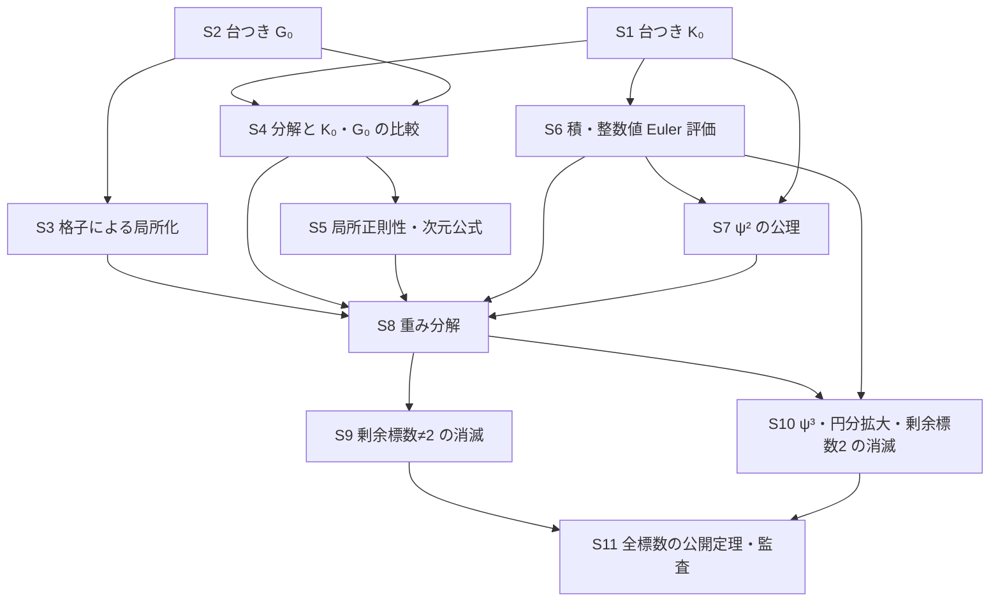

# 外部引用5：交点重複度の消滅定理を Adams 作用素で証明する計画

作成：2026-10-14。改訂：2026-10-15（現在位置から S11 までの残計画を六ステップ・証明契約・座標行列に分けて §4.33 で具体化）。状態：S1.1–S1.6、S2.1–S2.4、S3.1–S3.7 実装・検証済み。S4.1–S4.7 も実装・検証済み（§4.23）。S5.1–S5.7 も実装・検証済み（§4.24）。S6.1–S6.6 も実装・検証済み（§4.25）。S7.1–S7.5 と S7.6a も実装・検証済み（§4.28）。S7.6 も実装・検証済み（§4.28）。S7.7 と S7.8a の個別公理も実装・検証済み（§4.28）。S7.8b の族への接続と S8.1 の係数・契約も実装・検証済み（§4.28）。S8.2 の純粋重みも実装・検証済み（§4.28）。S8.3 の半局所化の幾何と S8.6a の高さ上昇も実装・検証済み（§4.28）。S8.4 の長さ評価同型も実装・検証済み（§4.28）。S8.5 の半局所化後の純粋重みも実装・検証済み（§4.28）。S8.6 の消去多項式も実装・検証済み（§4.28）。S8.7 の重み射影と S8.8 の積の重みも実装・検証済み（§4.28）。S8・S9 は完了、S10–S11 は未完了。
対象は [Inputs/IntersectionTheory.lean](../SerrePositivity/Inputs/IntersectionTheory.lean) の
`Inputs.intersectionVanishing`（Roberts–Gillet–Soulé の消滅定理）。
並行する Chow 群の経路は [サイクルの計画](intersection-vanishing-cycles.md)。
最新の残計画と着手順は **§4.31**。S1–S8 の検証記録は既存の各節、特に §4.28 を参照。

## 0. 決めたこと（2026-10-14、利用者と相談）

- 引用5は、まず **Adams 作用素の経路**（Gillet–Soulé、巡回 Adams 作用素による初等版）で外す。
- **K2 は最初から証明する**。比較同型・局所化の完全性を新しい未証明引用へ移す進め方は採らない。
- **閉集合で台を指定する版は既存の基盤を拡張する**。列版の公開 API を保ち、
  台の条件と有限射影版を一般化して、列版からの比較を既存の比較写像へ接続する。
- Roberts の経路（局所 Chern 指標）と Chow 群の基盤は、BlochConjecture と共有する基盤として並行して進める。
- 経緯：原典の精読（§6）で、局所 Chern 指標を graph construction なしに作る完結した構成は見つからなかった。
  一方、巡回 Adams 作用素を使えば、Chow 群・Grassmann 束・Riemann–Roch なしに消滅定理まで届く見込みがある。

## 1. 主張

正則局所環 `R`（混標数・分岐を含む）と有限生成加群 `M, N` について、
`ℓ(M ⊗ N) < ∞`、`dim M + dim N < dim R` なら `χ^R(M, N) = 0`。

## 2. 証明の骨格（Walker の講義ノート、Gillet–Soulé）

`K_0^Z(R)`：台が閉集合 `Z` に入る有界有限射影複体の Grothendieck 群。
既存のホモトピー同値・写像錐の関係を使う。擬同型・次数ごとの短完全列による定義との一致も示す。
局所環では各項が自由なので既存の有限自由版と一致するが、局所化や巡回作用の固有部分の構成では
有限射影版を使う。
カップ積 `K_0^Y × K_0^Z → K_0^{Y∩Z}` はテンソル積。

1. **Adams 作用素**：各 `Z` 上の `ψ^k : K_0^Z(R) → K_0^Z(R)` で、
   (A1) 加法的、(A2) カップ積と乗法的、(A3) 平坦な環準同型と可換、
   (A4) 長さ 1 の Koszul 複体で `ψ^k[K(a)] = k·[K(a)]`。
2. **重みの評価（Gillet–Soulé）**：`K_0^{V(I)}(R)_ℚ` は `∏_{ht I ≤ j ≤ d} (ψ^k − k^j)` で消える。
   本計画では高さが最小の生成点全体で半局所化し、局所化の完全性と Koszul 生成を使って
   余次元の下降帰納法で示す（§4.4）。円分体係数の作用素には同じ議論をその係数体上で行う。
3. **結論**：`[F_M] ∈ K_0^{Supp M}` は重み `≥ d − dim M`、`[F_N]` は重み `≥ d − dim N`。
   積は (A2) で重みが足され、`K_0^{m}(R)_ℚ ≅ ℚ` は純粋に重み `d`（Koszul 複体が生成、(A2)(A4)）。
   `d − dim M + d − dim N > d` なので積は零、`χ(M, N) = 0`。
   正則局所環では `ht p = d − dim R/p` を使う。

## 3. 段階

| 段 | 内容 | 原典 | 既存の資産・見込み |
| --- | --- | --- | --- |
| K1 | 閉集合で台を指定する有限射影版、列版との比較、カップ積、整数値 `χ`、正則局所環で `K_0^{m}(R) ≅ ℤ` | Walker §2 | `Support`、`HomotopyCategory`、`K0Comparison`、`KoszulGeneration` を拡張。§4.2 |
| K2 | `K_0^Z(A) ≅ G_0^Z(A)`、`G_0^{V(J)}(A) ≅ G_0(A/J)`、台つき局所化の右完全列 | Walker Thm 2.19、Weibel | **最初から証明**。まず `A` は正則局所環の局所化に限定。§4.3 |
| K3 | 巡回作用 `C_p ↷ T^p(X)`（Koszul 符号つき）と固有空間分解（`1/p`、`ζ_p` を含む環） | BMTW-cyc §2–3（p.5–9） | 新規。符号の検証が手間 |
| K4 | 巡回 Adams 作用素 `ψ^p_cyc[X] = Σ_j ζ^j [T^p(X)^{(ζ^j)}]` と公理：(1) 加法性（擬同型・短完全列）、(2) 乗法性、(3) 自然性、(4) Koszul での正規化 | BMTW-cyc Thm 3.7（p.9–12、一般の素数 `p` で完全な証明） | 新規。乗法性は `T^p(X ⊗ Y) ≅ T^p X ⊗ T^p Y` の同変性（符号）が山。正規化は外積代数の基底変換 |
| K5 | 重み分解：`Z` の余次元が `c` なら固有値は `p^c, …, p^d` | Gillet–Soulé 5.3、Walker Thm 3.7 | 高さ `c` の全生成点での半局所化と下降帰納法。§4.4 の証明案を補題化 |
| K6 | 剰余標数と異なる素数 `p` を選び、円分代数の `m` 上の極大イデアルでの局所化へ上げ、重みと平坦局所拡大の保存則で `χ(M, N) = 0` | BMTW-cyc Cor 3.13、Gillet–Soulé 5.4・5.6 | `IntersectionMultiplicity/BaseChange` を使用。拡大環の正則性・台次元の保存も証明する |

**素数 `p` の選び方**：剰余標数が 2 でなければ `p = 2`（`ζ_2 = −1` なので拡大も不要）。剰余標数が 2 のときだけ `p = 3`。
したがって **`p = 2` で先に全体を通し**、そのあと `p = 3` で剰余標数 2 を閉じる。
任意の素数への一般化は、公開定理の完成に必須ではない。

**簡略化の方針（精読で確認）**：

- BMTW の `Σ_n` 作用と ⋆ 積（Thm 2.2）は回避し、`T^p` の対象の水準で `ψ` を定義する。
  擬同型の不変性は「射影複体の擬同型はホモトピー同値」から、短完全列の加法性は次数ごとの分裂と
  `X''` の個数によるフィルトレーション（部分商は `0 < i < p` で `C_p` が自由に作用して寄与 0）から示す。
- 係数は円分体 `ℚ(ζ_p)` に取り、Lemma 3.3（原始根による値の独立性）を避ける。
  使う関係は `Σ ζ^j = 0`、`Π (1 − ζ^j) = p` だけ。

## 4. 進め方

1. K1 の台・関係式・比較を拡張する。有限射影版を非局所環でも使えるようにする。
2. K2 の台つき加群の Grothendieck 群、分解との比較、局所化の完全性を証明する。
3. K5 の前提となる、素イデアルでの局所化の正則性と高さ・次元公式を証明する（§4.7）。
4. K1 の積と整数値 Euler 評価、K3・K4 の `p = 2`、K5 を証明する。
5. 剰余標数 2 以外の消滅を示し、`p = 3` の作用素と K6 で全標数を閉じる。
   全標数の公開定理には `p = 2, 3` で十分なので、任意の素数への一般化は追加の成果とする。

## 4.1 未決事項

証明経路と段階分けは以下で指定する。残る不確実性は主に実装上の接続であり、
Lean での検証を終えたことを意味しない。

- **外部証明コードの移植適合性**：S5.4–S5.6 の必要な証明の接続・ビルド・公理監査は完了（§4.24）。残る不確実性から除く。
- **複体のテンソル API**：S6.1 の整数添字 totalization・符号・結合・交換・有限射影性は接続済み。台の保存は S6.2、錐・シフト・基底変更の比較と積は S6.3 で検証済み。
- **自然同型の整合性**：S7.7、S10.8。対象での基底計算に加え、鎖写像・同変性・台を証明する。
- **名前と配置**：予定名は実装時に確定するが、証明の入力・出力と依存順序は本計画に合わせる。

## 4.2 K1：既存の台・有限射影版を拡張する

**既存コードで確認したこと**：

- `Support.lean` の `HasHomologySupport I P` は既に `Supp Hⁱ(P) ⊆ V(I)`。
  `isSupported_iff_homologySupport` は有界有限射影複体で列による零ホモトピー条件との同値を証明済み。
- `HomotopyCategory.lean` に `strictlyPerfectComplex`、`PerfectHomotopy`、`SupportedPerfectHomotopy z` がある。
- `K0Comparison.lean` に任意の環での `freeToPerfectK0` と、局所環での `freePerfectK0Equiv` がある。
  後者を非局所環にも適用できるとは仮定しない。
- `KoszulGeneration.lean` は極大イデアルの Koszul 類による生成と Euler 値 `1` を証明済み。
  `OrdinaryEuler.lean` の値域は `ℝ` なので、整数値版との比較を追加する。

**定義と補題の順序**：

1. 閉集合 `Z : TopologicalSpace.Closeds (PrimeSpectrum R)` に対し、
   `HasHomologySupportOn Z P := ∀ i, Module.support R (P.homology i) ⊆ Z` を定義する。
   `Z = V(I)` の特殊化は既存の `HasHomologySupport I P` と同値。
   イデアルの選択や生成列の選択を `K₀` の定義に入れない。
2. 有界有限射影複体での、ホモトピー同値・シフト・写像錐に対する台の保存、
   `Z ⊆ W` による台の拡大、平坦基底変更での逆像への台の移動を証明する。
3. `SupportedPerfectHomotopyOn Z` を既存の `PerfectHomotopy` の部分圏として定義し、
   `K0WithSupport R Z := TriangulatedK0 (SupportedPerfectHomotopyOn Z)` とする。
   普遍性・類の外延性・錐の関係を既存の `TriangulatedK0` から使う。
   列版 `SupportedPerfectHomotopy z` との比較を作り、局所環では
   `K0Supported R z ≃+ K0WithSupport R (V(span(range z)))` を得る。
   既存の `K0Supported R z`、`K0.mk`、`K0.map` の利用先は保つ。
4. 有界有限射影複体の間の擬同型がホモトピー同値であること、および次数ごとの短完全列の
   加法関係と錐の関係との一致を示す。K4 はこの接続を使って既存の関係式へ降ろす。
5. テンソル複体が有限射影で、台が `Y ∩ Z` に入ることを証明する。
   局所化後に片方が完全なら、有限射影複体として可縮であることを使う。
   片側を固定したテンソルが錐の関係を保つことから双加法的なカップ積を作り、
   台の拡大・平坦基底変更との可換性を証明する。
6. 極大イデアルの台で `χℤ(P) = Σᵢ (-1)ⁱ ℓ_R Hⁱ(P)` を定義し、
   `χℤ : K0WithSupport R {m} →+ ℤ` に降ろす。
   既存の Koszul 生成と `χℤ(K(parameters)) = 1` から `K₀^{m}(R) ≃+ ℤ` を構成する。
   `ℤ → ℝ` による既存 `chiOrd` との比較、分解のテンソルに対する `chi R M N` との比較も示す。

有限自由複体の直和因子が自由であるとは一般にはいえない。巡回作用の固有部分は有限射影なので、
K3・K4 の対象を有限射影版へ統一することも、この拡張の目的に含める。

## 4.3 K2：比較と局所化を最初から証明する

**適用範囲**：まず正則局所環 `R` と、その任意の局所化 `A = S⁻¹R` を扱う。
K6 で作る正則局所拡大環にも同じ結果を適用する。
一般の正則 Noether 環についての分解存在は、この経路の前提にしない。

| 小段 | 構成・証明する内容 | 主な証明作業 |
| --- | --- | --- |
| K2a | 台つき有限生成加群の群 `G0WithSupport A Z`、`G0 A`、類・普遍性・台の拡大 | 同型と短完全列を関係式とする。台の条件が部分加群・商・拡大で保たれることを示す |
| K2b | 局所化上の有限表示加群の降下 | S3 の有限生成格子を再利用して `A ⊗_R M₀ ≃ M` を構成。Noether 性から降下元は有限表示 |
| K2c | `A` 上の有界有限自由分解の存在 | `M₀` の既存 `regularResolution` を平坦局所化。降下元 `M₀` が同じ台をもつ必要はなく、分解のホモロジーの台で判定する |
| K2d | `res : G0WithSupport A Z →+ K0WithSupport A Z` | 比較写像・ホモトピー同値で選択独立性。短完全列の単射を分解間に持ち上げ、その錐が商の分解となることで加法性を証明 |
| K2e | `eulerH : K0WithSupport A Z →+ G0WithSupport A Z` と `res` との逆性 | `Σᵢ (-1)ⁱ[Hⁱ(P)]`。長完全列を有限区間で切って錐の関係を示す。逆性は各ホモロジーの分解と切り詰めの三角形で示す |
| K2f | `G0(A/J) ≃+ G0WithSupport A V(J)` | 台条件から有限生成加群を消す `J` の冪を得る。`J` 冪フィルトレーションの商は `A/J` 加群。フィルトレーションの精密化と加法性で dévissage の逆写像を証明 |
| K2g | 台つき局所化の全射性と核 | §4.6 の有限生成格子で商群への逆写像を構成。局所化で零になる有限生成加群は `S` の一元で消される |
| K2h | K2e による `K₀` の完全列への移送 | 比較写像と局所化・台の拡大の可換図式を証明。係数拡張後の完全性も示す |

K2f は `Hⁱ(P)` をそのまま `A/J` 加群とみなす構成ではない。
台が `V(J)` に入るだけでは `J Hⁱ(P) = 0` はいえないため、冪による dévissage が必要。
K2g はまず `G0WithSupport` で示し、K2f に依存させなくてもよい。

**K2g・K2h の最終インターフェース**：

- 一元 `g` を反転した場合：
  `K₀^{Z∩V(g)}(A) → K₀^Z(A) → K₀^{ι⁻¹Z}(A_g) → 0` が右完全。
  左端の写像の単射性は要求しない。
- 任意の乗法的集合 `S` の場合：局所化写像は全射で、核の各元はある `s ∈ S` に対して
  `K₀^{Z∩V(s)}(A)` からの像になる（または有限和として表し、その積で一元にまとめる）。
  これは K5 の半局所化に必要なので、一元局所化だけで K2 を完了扱いにしない。
- 台つき加群の降下には、局所化加群内の有限生成格子を使う。`J` 冪による消去は格子にも成り立つ。
  短完全列は中央の格子との交わり・像で降ろす（§4.6）。
- 核の証明は `S` torsion の類で割った商群への逆写像を使う。
  最後にその部分群の元の有限和表示を使い、消去元の積により一つの閉集合へまとめる。

## 4.4 K5：半局所化による重み評価の証明案

以下は原典の引用ではなく、Walker のスケッチを補うための証明案。
Lean 実装前に、K2 の核の記述と半局所環での生成点評価を個別に証明する。
係数体 `E` は `p = 2` では `ℚ`、一般の `p` では `ℚ(ζ_p)` とする。

`d = dim R` とし、**すべての閉集合 `Z` で `codim Z ≥ c`** に対して
`P_c(ψ) = ∏_{j=c}^d (ψ − pʲ)` が `K₀^Z(R)_E` を消すことを、`c` の下降帰納法で示す。
空集合は群が零。高さは非空の閉集合に対してだけ定義し、空集合の最小値は使わない。

1. `codim Z ≥ c+1` の場合は帰納法で処理する。残る場合、高さ `c` の生成点をすべて
   `q₁, …, qᵣ` とし、`S = R \ ⋃ᵢ qᵢ`、`B = S⁻¹R` とする。
   Noether 性による生成点の有限性と素イデアル回避から、`B` の極大イデアルが
   ちょうど `qᵢB` で、`Z_B` がその有限集合であることを証明する。
2. `K₀^{Z_B}(B) → ⊕ᵢ K₀^{qᵢR_{qᵢ}}(R_{qᵢ})` は同型。
   K2e で有限長加群の群へ移し、半局所環での組成列と、単純加群の分類を使って示す。
   各局所環 `R_{qᵢ}` は次元 `c` の正則局所環なので、Koszul 生成と A2・A4 により
   `ψ = pᶜ`。A3 とこの同型の単射性から、`B` 上でも `ψ = pᶜ`。
3. `x ∈ K₀^Z(R)_E` に対し `(ψ − pᶜ)x` は `B` への局所化で零。
   K2h の核の記述から、ある `s ∈ S` と `y ∈ K₀^{Z∩V(s)}(R)_E` の像になる。
   `s` は高さ `c` の全生成点を避けるので `codim(Z∩V(s)) ≥ c+1`。
4. 帰納法により `P_{c+1}(ψ)y = 0`。
   **台の拡大写像も `ψ` と可換**であることを K4 で示しておき、
   `P_{c+1}(ψ)(ψ − pᶜ)x = 0` を得る。
5. `p⁰, …, pᵈ` は `E` 内で相異なる。有限個の相異なる根をもつ消去多項式から、
   Lagrange 多項式による射影を作って固有空間の直和分解を得る。
   ベクトル空間自体の有限次元性は仮定しない。

**消滅定理への接続**：`[F_M]` 自体が一つの固有ベクトルだとは主張しない。
重み `i ≥ d − dim M` の成分と、重み `j ≥ d − dim N` の成分に分解し、各積に A2 を適用する。
積の台は `Supp M ∩ Supp N = Supp(M ⊗ N)` で、有限長の仮定から `{m}` に含まれる。
非零の積なら固有値は `p^{i+j}` だが、標的は純粋に重み `d` であり `i+j > d` なので零。
最後に `K₀^{m}(R) ≃ ℤ` と `ℤ → E` の単射性で整係数の積が零と分かり、Euler 評価で `χ = 0` を得る。
零加群の場合と `d = 0` の場合は先に分岐する。

## 4.5 実装の区切りと完了判定

1. **台の拡張**：閉集合版と列版の比較、非局所環での有限射影版。
   既存の列版・Euler 評価の利用先がそのままビルドできる。
2. **K2 の証明**：K2a–K2h。比較同型と一元・任意の乗法的集合の完全性に新規 `sorry` がない。
3. **積・評価**：双加法性、台の交わり、整数値 Euler 同型と Tor による `chi` の比較。
4. **`p = 2` の作用素**：符号つき交換の二乗が恒等、`(1±τ)/2` の直和分解、
   `ψ² = [T²(P)^+] − [T²(P)^−]`、関係式への降下、A1–A4、台の拡大との可換性。
5. **重みと消滅**：§4.4 の各補題を証明し、剰余標数が 2 でない場合を閉じる。
6. **剰余標数 2**：`p = 3` の作用素と円分拡大を作り、公開定理を全標数で閉じる。

K6 の局所拡大 `B` については、平坦性・正則性・`m_R B = m_B`・次元と加群の台次元の保存を
明示的に証明する。既存 `chi_baseChange_of_map_maximalIdeal` はこの仮定で **`χ_B = χ_R`** を与える。
この局所環の長さ比較に剰余体拡大次数を掛ける必要はない。円分代数全体で係数制限して長さを測る場合と区別する。

上記の区切りに加え、局所正則性・次元公式を §4.7 の独立した区切りとして検証する。
実際の実装順序・依存関係は §4.9 の 11 ステップで管理する。
各区切りで対象モジュールのビルドと公理監査を行い、最終段階で利用先をまとめて検証する。
S1–S5 の定義・証明は実装済み。実装の対応と検証記録は §4.18・§4.20・§4.21・§4.23・§4.24 を参照。

## 4.6 K2g：有限生成格子による局所化の核の直接証明

ここは **任意の可換 Noether 環 `A`**、乗法的集合 `S`、`B = S⁻¹A`、閉集合 `Z = V(J)` で示す。
正則性や分解存在は使わない。閉集合から `J` を選ぶのはこの証明内だけで、公開型には入れない。
`G = G0WithSupport A Z`、`G' = G0WithSupport B Z_B` とする。

`H ≤ G` を、`S⁻¹T = 0` となる台つき有限生成 `A` 加群 `T` の類で生成する部分群とし、
`Q = G/H` と置く。局所化準同型は `λ̄ : Q →+ G'` に降りる。
これが同型であることを、次の順序で示す。

1. **有限生成加群の消去元**：`S⁻¹T = 0` なら、有限生成元ごとの消去元の積により
   `∃ s ∈ S, sT = 0`。逆も示す。したがって `Supp T ⊆ V(s)`。
2. **格子の存在と台**：台が `Z_B` に入る有限生成 `B` 加群 `N` の有限生成元を選び、
   その `A` 線形包 `L ⊆ N` をとる。これをここで格子と呼ぶ。自由性や torsion-free 性は要求しない。
   `S⁻¹L ≃ N`。Noether 性と台条件から `(JB)ⁿN = 0` を得て、`JⁿL = 0`、従って `Supp_A L ⊆ Z`。
3. **格子の選択独立性**：同じ `N` 内の二つの格子 `L,L'` に対し `U=L+L'` も格子。
   `U/L` と `U/L'` は局所化で零なので、短完全列から `Q` 内で `[L]=[U]=[L']`。
   `B` 線形同型で格子を移した場合も `A` 線形同型になるため、同型不変性が得られる。
4. **短完全列での加法性**：`0→N₁→N₂→N₃→0` の中央に格子 `L₂` を選ぶ。
   `L₁=L₂∩N₁`、`L₃=image(L₂→N₃)` とする。
   `L₁` は Noether 性で有限生成、`L₃` は有限生成加群の商。
   局所化の完全性からそれぞれ `N₁,N₃` の格子になる。台は部分加群・商で保たれ、
   `0→L₁→L₂→L₃→0` から `[L₂]=[L₁]+[L₃]`。
5. **逆写像**：`N ↦ [L] mod H` を普遍性で `ν : G' →+ Q` に降ろす。
   `λ̄ν=id` は `S⁻¹L ≃ N`。
   `νλ̄=id` は、元の `A` 加群 `M` の `S⁻¹M` 内の像を格子として選び、
   `ker(M→S⁻¹M)` の類が `H` に入ることから示す。この核の有限生成性にも Noether 性を使う。
6. **核の有限和を一元にまとめる**：`ker λ = H` が得られた。
   `x ∈ H` は有限和 `Σ nᵢ[Tᵢ]` と書ける。各 `Tᵢ` の消去元 `sᵢ ∈ S` を選び、
   `s=∏sᵢ` とする。各 `Tᵢ` は `Z∩V(s)` に台を持つので、同じ有限和が
   `G0WithSupport A (Z∩V(s))` の元を定め、その像が `x`。
7. **係数拡張と K₀ への移送**：`Q≃G'` から右完全列を得る。
   `E` は `ℤ` 上平坦なので、テンソル後も核は `H⊗E` の像。
   その元の有限和表示に同じ積の議論を適用し、`E` 係数でも一つの `s` を選べる。
   K2e の比較同型と局所化の可換性で `K₀` に移す。

この証明は一般の Serre 商圏を構築せず、加群と Grothendieck 群の水準で完結させる。
参考となる一般定理は [Weibel, K-book II, Localization Theorem 6.4](https://www.math.rutgers.edu/~weibel/Kbook/Kbook.II.pdf)。
上の格子による特殊化は、本計画で実装する証明案である。
`0 ∈ S` の場合は `B` が零環となり、全加群が `S` torsion なので最初に分岐する。

**予定する補題の契約**（名前は仮）：

| 補題 | 入力 | 出力 |
| --- | --- | --- |
| `exists_annihilating_mem_of_localized_zero` | 有限生成 `T`、`S⁻¹T=0` | `s∈S` と `sT=0` |
| `exists_supported_lattice` | 有限生成 `N`、`Supp_B N⊆Z_B` | 有限生成格子 `L`、`Supp_A L⊆Z` |
| `latticeClass_eq` | 同じ加群内の格子二つ | `Q` での類の一致 |
| `latticeClass_shortExact` | `B` 加群の短完全列 | 格子の類の加法性 |
| `g0LocalizationQuotientEquiv` | 上の Noether・局所化の設定 | `G/H ≃+ G'` |
| `k0Localization_kernel_supported` | 局所化で零となる `x` | `s∈S`、`Z∩V(s)` 上の前像 |

## 4.7 K5 の前提：局所正則性と高さ・次元公式

**新たに確認した不足**：使用中の mathlib の `RegularLocalRing/Defs.lean` は
「正則局所環は `IsRegularRing`」を TODO としている。
既存 `regularResolution` とその局所化から分解存在は得られるが、これだけで
`IsRegularLocalRing R_p` のインスタンスや、長さ `ht p` の正則パラメータ系が自動的に得られるわけではない。
ここを未証明のまま K5 に進まない。

**R1：正則局所環の素イデアルでの局所化は正則**。
一般の Noether 局所環について「極大イデアルに有限射影分解があるなら正則」を証明する経路を主案にする。
`pR_p` 自体を有限生成加群として K2b–K2c で分解すれば適用できる。
これにより global dimension 全体や `embedding dimension ≤ pd κ` の新規構築を必須にしない。
この判定には既存の Lean 証明ソースが見つかった（§4.11）。

**R2：`ht p + dim(R/p) = dim R`**。
一般の Cohen–Macaulay 理論を全体導入する前に、既存の
`RegularSequenceUnmixedness.dimension_eq` を使う正則局所環向けの直接証明を主案にする。
`p` 内の最長正則列を選び、その商の関連素イデアル `q⊇p` をとる。
正則列の局所化と素イデアル鎖の連結により `q=p` を示し、既存の次元等式を適用する（§4.11）。

R1・R2 は紙上の証明経路を具体化済みだが、Lean の証明は未実装。
とくに外部コードの現在の API への移植可能性は、ソースを読んだだけでは確認済みとしない。

## 4.8 K3・K4 と K6 の具体化

**`p=2` の補題の順序**（環で `2` が可逆）：

1. 有界有限射影複体の全テンソル積と、その結合・交換同型を作る。
   次数 `i,j` の交換に `(-1)^{ij}` を付け、微分との可換性と `τ²=id` を検証する。
2. チェイン射影 `e±=(id±τ)/2` の像を複体として作り、
   `T²(P)≃T²(P)^+⊕T²(P)^−`、各項の有限射影性・台の保存を示す。
3. 擬同型不変性を示す。次数ごとの短完全列にはテンソル平方のフィルトレーションを使い、
   混合部分 `(P'⊗P'')⊕(P''⊗P')` の正・負固有部分が同型な複体となるので差が零。
   これで `ψ²[P]=[T²(P)^+]−[T²(P)^−]` を `K₀` に降ろす。
   単に「テンソル平方は加法的」とは主張しない。
4. 並べ替え同型 `T²(P⊗Q)≃T²(P)⊗T²(Q)` の符号を確認する。
   正固有部分は `(+,+)⊕(−,−)`、負固有部分は `(+,-)⊕(-,+)` となり、A2 が出る。
5. 平坦基底変更が射影の像を保つことから A3、同じ構成を台の拡大で使うことからその自然性を示す。
6. 長さ 1 の `K(a)` で固有部分を明示し、シフトの符号を使って `ψ²[K(a)]=2[K(a)]`。
   コチェインの次数規約と Walker のチェイン規約を合わせて同型を書く。

**`p=3` の必要最小限の一般化**：

- 環の原始三乗根 `ζ_B` と係数体 `E=ℚ(ζ₃)` の元 `ζ_E` を区別する。
  環の根は固有部分の定義、係数体の根はその類の重みづけに使う。
- 符号つき巡回射 `τ` に対し `τ³=id`、
  `e_j=(1/3)Σ_{r=0}² ζ_B^{-jr}τ^r` の直交射影と直和分解を示す。
- 短完全列の混合語は長さ 3 の軌道になる。その各固有部分が同型なので
  `1+ζ_E+ζ_E²=0` により寄与が消える。並べ替えの同変性で乗法性を示す。
- Koszul 正規化はテンソル立方の外積代数を指標ごとの基底に変え、
  非自明な指標の寄与の積 `(1−ζ_E)(1−ζ_E²)=3` に帰着する。
  環でこの基底変換が可逆であることも証明する。
- K5 の線形代数を `ℚ` 固有の実装にせず、標数零の係数体 `E` に統一して再利用する。

**K6 の拡大環**：剰余標数 2 では `3` が可逆。
`C=R[t]/(t²+t+1)` を具体的に使う。モニック多項式の商なので有限自由（階数 2）。
剰余体上の多項式は分離的で、極大イデアル `n` を `m_R` 上に選び `B=C_n` とすると
`B/m_RB` は体となり、`m_RB=m_B`。この過程で根 `t` の原始三乗根性と `1−t` の可逆性も確認する。

`C` の有限自由性と局所化から平坦性、有限代数の局所化から Noether 性を得る。
その後は **証明済み**の `FlatLocalDimension.lean` にある
`isRegularLocalRing_of_flat_of_map_maximalIdeal`、
`ringKrullDim_eq_of_flat_of_map_maximalIdeal`、
`supportDim_baseChange_of_map_maximalIdeal` を使う。
前の段階で未確認だったこの三つの保存則は新規に証明し直す必要がない。
既存のテンソル長・`chi` の保存則と合わせて元の `R` に消滅を戻す。

## 4.9 全体の実装ステップと依存関係

各成果物は、記載した主要命題に新規 `sorry` を置かず、対象ファイルのビルドと依存公理監査まで通す。
S1–S11 は実装単位。紙上証明が未完成の箇所は先にその証明を完成させてから実装する。

| ステップ | 何を作るか | 必要な前段 | 完了時に使えるもの |
| --- | --- | --- | --- |
| S1 | 閉集合による台と有限射影 `K₀` を既存基盤へ追加 | 既存 `Support`・`HomotopyCategory`・`K0Comparison` | 列版との比較、台の拡大、錐・シフトの関係 |
| S2 | 台つき加群の `G₀` と普遍性 | 加群の台・短完全列 | `G0WithSupport`、局所化準同型、部分加群・商の台 |
| S3 | 格子による局所化の全射性・核 | S2 | 任意の `S` の核を `Z∩V(s)` の像として表す |
| S4 | 局所化上の分解、`K₀≃G₀`、商環の dévissage | S1・S2、既存 `regularResolution` | K2b–K2f。S3 と合わせ K2h の `K₀` の完全性 |
| S5 | 素イデアル局所化の正則性と高さ・次元公式 | S4 の分解存在、既存の正則列商の unmixedness・深さ | R1・R2。詳細は S5.1–S5.7（§4.11） |
| S6 | カップ積と整数値 Euler 評価 | S1、既存 Koszul 生成・Tor 比較 | `K₀^Y×K₀^Z→K₀^{Y∩Z}`、`K₀^m≃ℤ`、`χ` との一致 |
| S7 | 符号つきテンソル平方と `ψ²` の A1–A4 | S1・S6 | `2` 可逆な環とその局所化での Adams 作用素 |
| S8 | 半局所化での評価、消去多項式、重み分解 | S3–S7 | 余次元以上の重みだけが現れる定理。作用素の公理を入力にして証明 |
| S9 | 剰余標数が 2 でない場合の消滅 | S5・S6・S7・S8 | 元の公開型に追加仮定「剰余標数≠2」を付けた完全証明 |
| S10 | `ψ³` と二次円分代数の局所拡大 | S1・S6・S8、既存平坦局所保存則 | 剰余標数 2 の消滅。S8 を係数体 `ℚ(ζ₃)` で再利用 |
| S11 | 全標数の公開定理を接続し利用先を監査 | S9・S10 | `Inputs.intersectionVanishing` の直接の `sorry` を除去 |

依存関係の概略：

S3 と S4 は内容上は独立して進められ、K2h で合流する。S6 も S5 の完成を待たずに進められる。
これは依存関係の説明であり、複数エージェントへの委任や同時実装を前提にしない。

S1–S11 の番号は維持し、詳細化には `S4.1` のような小段番号を使う。
S3 の詳細は §4.6、S4 は §4.10、S5 は §4.11。証明案の確定と Lean 実装完了を区別する。

## 4.10 S4 の小段：K₀ と G₀ の比較を錐による帰納法で証明する

比較の一般部分では「Noether 環 `A` 上の有限生成加群は有界有限射影分解を持つ」を入力にする。
正則局所環とその局所化について、この入力を S4.1 で構成する。
**S5 の局所正則性を比較同型の前提にしない**。S4→S5 の依存に循環を作らない。

| 小段 | 作業 | 完了条件 |
| --- | --- | --- |
| S4.1 | S3 の有限生成格子で元の正則局所環上へ加群を降ろす。既存分解を局所化 | 各有限生成 `A` 加群について有界有限自由分解を構成 |
| S4.2 | 分解の比較射とホモトピー同値、シフトとの整合性 | 加群の類 `resClass M` が分解の選択によらない |
| S4.3 | 短完全列の単射を分解間に持ち上げ、その錐を商の分解と比較 | `resClass M₂=resClass M₁+resClass M₃`、従って `res : G₀^Z→K₀^Z` |
| S4.4 | 有限なホモロジー長完全列から交代和を作る | `eulerH : K₀^Z→G₀^Z`、`eulerH(resClass M)=[M]` |
| S4.5 | ホモロジーを含む有限区間の幅で帰納 | `[P]=Σᵢ(-1)ⁱ resClass(Hⁱ(P))`、従ってもう一方の逆性 |
| S4.6 | 台の拡大・局所化との可換性、S3 の核を移送 | 任意の `S` に対する台つき `K₀` の右完全性 |
| S4.7 | `J` 冪フィルトレーションとその精密化 | `G₀(A/J)≃G₀^{V(J)}(A)`。S4.6 の前提にはしない |

**S4.3 の証明**：`0→M₁→M₂→M₃→0` に有界有限射影分解 `F₁,F₂` を選ぶ。
`M₁→M₂` を鎖写像 `f:F₁→F₂` に持ち上げる。長完全列により `Cone f` のホモロジーは
`0` 次の `M₃` のみなので、これは `M₃` の有界有限射影分解。
錐の関係から `[F₃]=[F₂]−[F₁]`。
既存 `ConeResolution.lean` の手法を使い、horseshoe の新規構築を避ける。

**S4.5 の実装で採用した帰納法**：

1. ホモロジーが区間 `[a,b]` の外で零となる上下界を選び、その幅について帰納する。
   空の区間では複体は完全であり、`K₀` の類は零。
2. シフトで上端を `0` にする。good truncation は `P→H⁰(P)` の構成の中間対象にだけ使う。
   切り詰めの項の射影性は要求せず、切り詰め自体を `K₀` の対象にはしない。
3. K-projective 性により切り詰めの擬同型の逆をホモトピーの水準で持ち上げ、
   `H⁰` 上で恒等を誘導する `P→H⁰(P)` を得る。さらに有限射影分解 `F₀` へ持ち上げる。
4. `Cone(P→F₀)` のホモロジーは `[a−1,−2]` の外で零。区間の幅が小さくなるので帰納法を適用する。
5. 錐・シフトの関係と、先に証明した Euler 写像の加法性・分解上の逆性を合わせ、
   `[P]=Σᵢ(-1)ⁱ resClass(Hⁱ(P))` と両逆性を得る。

これは当初案の末尾除去と非零ホモロジーの個数の帰納を置き換えたもの。
錐の項の幅は増え得るが、帰納に用いるホモロジー区間の幅は減る。

S4.7 では、各商が `J` で消される有限フィルトレーションの交代しない和を使う。
二つのフィルトレーションの交わりによる共通精密化を作り、商が引き続き `A/J` 加群であることを示す。
短完全列には部分加群との交わりと商の像のフィルトレーションを使い、逆写像の加法性まで証明する。

## 4.11 S5 の小段：次元公式と局所正則性の証明経路

### S5.1–S5.3：既存の正則列商の unmixedness から次元公式へ

| 小段 | 作業 | 完了条件 |
| --- | --- | --- |
| S5.1 | 有限次元の数値化と素イデアル鎖の連結 | `ht q + dim(R/q)≤d`、有限高さで `p⊊q⇒ht p<ht q` |
| S5.2 | `p` 内の最長正則列を選び、関連素イデアルを捕まえる | 長さ `r` の列 `rs⊆p`、`q∈Ass(R/(rs))`、`p⊆q`、`r≤ht p` |
| S5.3 | 既存 `RegularSequenceUnmixedness.dimension_eq` と不等式を合わせる | `q=p`、`ht p=r`、`ht p+dim(R/p)=d`、加群の余次元公式 |

この三段は **S5 の局所正則性判定を使わずに証明する**。

1. `R` の次元を `d : ℕ` とし、素イデアル `p` に入る正則列の長さの集合をとる。
   空列があり、すべての長さは `d` 以下なので最大値 `r` が存在する。最大を実現する `rs` を選ぶ。
   `Q=R/(rs)` は非零有限生成加群。
2. もし `a∈p` が `Q` 上正則なら、`rs` の末尾に `a` を付けて長さを増やせる。
   `a∈m` による Nakayama で追加後の商も非零なので、これは最大性に反する。
   従って `p` は `Q` の零因子の集合、すなわち関連素イデアルの有限合併に含まれる。
3. 有限素イデアル回避により `p⊆q` となる `q∈Ass(Q)` を得る。
   既存の **証明済み** `RegularSequenceUnmixedness.dimension_eq` で
   `dim(R/q)+r=d`。
4. `rs` の全要素は `p` に入るので、その局所化は `R_p` 上の正則列になる。
   平坦性で弱正則性を保ち、生成イデアルが極大イデアルに含まれることから商の非零性を得る。
   任意の Noether 局所環での「正則列の長さ≤次元」と
   `dim R_p=ht p` により `r≤ht p`。ここで `R_p` の正則環としての正則性は使わない。
5. 素イデアル鎖を `q` で連結する一般の不等式から
   `ht q+dim(R/q)≤d=r+dim(R/q)`、従って `ht q≤r`。
   これと `r≤ht p≤ht q` を合わせてすべて等号。
   厳密な包含なら有限高さが増えるので `p=q`。
6. 従って `ht p+dim(R/p)=d`。
   非零有限生成加群の台の有限個の生成点に適用して、
   `codim Supp M=d−supportDim R M` を得る。零加群の台は空集合として別扱い。

**この経路の利点**：新たに一般の Cohen–Macaulay 型や、その全局所化理論を実装しなくてもよい。
新規部分は最長正則列・関連素イデアル回避・鎖の連結の接続補題。
次元公式を仮定して関連素イデアルの高さを計算する循環は避け、
既存の商の **次元** の等式から高さを後で求める。

### S5.4–S5.7：極大イデアルの有限射影次元による正則性

| 小段 | 作業 | 完了条件 |
| --- | --- | --- |
| S5.4 | 有限生成加群の Auslander–Buchsbaum 公式 | 有限 `pd M` に対し `pd M+depth M=depth A` |
| S5.5 | 共通正則元で割るときの射影次元比較 | `pd_A M=pd_{A/(x)}(M/xM)`（`x` は `A,M` 上正則、`x∈m`） |
| S5.6 | 有限 `pd m` から正則生成列を構成 | `m=(rs)`、`rs` 正則、従って `IsRegularLocalRing A` |
| S5.7 | 元の正則局所環の分解を `pR_p` に適用 | `R_p` が正則、長さ `ht p` の Koszul 分解と重み評価 |

**S5.4 の核心を分ける**：

- 非零有限自由加群の深さは環の深さ。有限直和に対する Ext の計算で示す。
- `pd M=1` では、既存 `MinimalGenerators.π_surjective` と `ker_coordinate_mem` を使い、
  `0→K→F→M→0` で有限自由な `K,F`、`image(K→F)⊆mF` を得る。
- 有限自由な始域について、この包含から `K→F` が `m·Hom(K,F)` に入ることを示す。
  `m` が剰余体を消すので `Extⁱ(k,K)→Extⁱ(k,F)` は零。
  Ext の長完全列と深さの定義から `depth M+1=depth A`。
  `Ext(k,−)` の共変写像と、既存の `Ext.postcomp_smul_id_eq_zero_of_mem_annihilator` の向きを区別し、
  必要な共変版または Ext の左右のスカラー作用の一致を接続する。
- `pd M≥2` は自由被覆の核へ移り、射影次元の下降と深さの長完全列で帰納する。
  深さ `0`・零核・零加群を別に処理し、拡張自然数の減算を無条件に使わない。

**S5.5 の証明**：有限自由被覆 `F→M` の核を `K` とする。
`x` が `M` 上正則なので、`0→K/xK→F/xF→M/xM→0` は完全。
射影次元の上界 `n` について帰納する。
`n=0` は局所環での有限射影加群の自由性と、正則元による商からの自由性の持ち上げ。
`n+1` は核に対する帰納法と短完全列の dimension shifting。
この定理を `M=k` に適用してはならない。S5.6 では `M=m` に適用する。

**S5.6 の帰納法**：環の極大イデアルの最小生成元数 `e` で帰納する。

1. `e=0` は `m=0`、環は体。
2. `e>0` で `pd m<∞`。`0→m→A→k→0` から `pd k<∞` を得る。
   もし `depth A=0` なら S5.4 と `depth k=0` から `pd k=0`。
   剰余体が自由になるとその annihilator が零なので `m=0` に矛盾。
   従って `depth A>0`。
3. 関連素イデアルと `m²` を同時に避け、`x∈m\m²` で `A` 上正則な元を選ぶ。
   `m²` は素イデアルとは限らないため、適切な素イデアル回避の版を使う。
   剰余体が無限であるとは仮定しない。
4. `A'=A/(x)`、`m'=m/(x)` とする。S5.5 を `M=m` に適用して `m/xm` の `A'` 上の有限射影次元を得る。
   `0→(x)/(xm)→m/(xm)→m/(x)→0` で `(x)/(xm)≃k`。
   `x∉m²` の余接空間の座標を使ってこの列を分裂し、`m'` を `m/xm` の直和因子にする。
   従って `pd_{A'}m'<∞`。`xm` と `(x)` を取り違えない。
5. `edim A'=e−1` を示して帰納法を適用し、`m'` の正則生成列を持ち上げ、先頭に `x` を付ける。
   `m` の正則生成列を得る。生成元数≤列の長さ≤`depth A`≤`dim A` から、
   既存 `IsRegularLocalRing.of_spanFinrank_maximalIdeal_le` で正則性を得る。

**S5.7 の接続**：`m_{R_p}=pR_p` は有限生成 `R_p` 加群。
S4.1 の分解存在を直接適用し、有限分解から `HasProjectiveDimensionLE` の証拠へ変換する。
S5.6 で正則性を得て、既存の正則パラメータ生成・Koszul 分解を適用する。
S5 は S4.2–S4.7 の比較同型全体を必要とせず、分解存在 S4.1 だけに依存する。

### S5 の外部証明ソースと移植の区切り

Guan–Hu の [形式化論文 arXiv:2510.24818v3](https://arxiv.org/html/2510.24818v3) と、
固定コミット `9c971a554fb6265f06b80bc62c7b314f4f2d33ec` の以下のソースを確認した：

- [Depth/AuslanderBuchsbaum.lean](https://raw.githubusercontent.com/leanprover-community/mathlib4/9c971a554fb6265f06b80bc62c7b314f4f2d33ec/Mathlib/RingTheory/Depth/AuslanderBuchsbaum.lean)：S5.4 の証明。
- [RegularLocalRing/AuslanderBuchsbaumSerre.lean](https://raw.githubusercontent.com/leanprover-community/mathlib4/9c971a554fb6265f06b80bc62c7b314f4f2d33ec/Mathlib/RingTheory/RegularLocalRing/AuslanderBuchsbaumSerre.lean)：
  `projectiveDimension_eq_quotient`、`generate_by_regular`、`of_maximalIdeal_hasProjectiveDimensionLE`。
- [RegularLocalRing/Localization.lean](https://raw.githubusercontent.com/leanprover-community/mathlib4/9c971a554fb6265f06b80bc62c7b314f4f2d33ec/Mathlib/RingTheory/RegularLocalRing/Localization.lean)：
  局所化の結論もあるが global dimension を経由する。主案では必要な極大イデアルの判定までに範囲を絞る。

現在の mathlib は `e6bbacd0e1b7307ff6e17da09cd2455f60804fa6`、Lean は `v4.35.0-rc4`。
外部ソースの import には現在の mathlib にないファイルがある。リポジトリ全体や mathlib の版を入れ替えず、
必要な証明の依存を調べ、現在の既存定理への置換と不足補題の追加で接続する。
移植する際は元の Apache-2.0 ライセンス・著者表記・固定コミットを保持する。

初回の import・API 確認結果：

| 外部ソースの依存 | 現在の環境 | 接続方針 |
| --- | --- | --- |
| AB の直接 import 7 本（Shrink、Ext.DimensionShifting、ModuleCat.Products、Projective.Dimension、Depth.Basic、LocalRing.Module、ENatToNat） | すべてファイルあり | 個々の使用補題の API は別途照合 |
| `Depth.AuslanderBuchsbaum` | ファイルなし | S5.4 で必要な証明を移植・再構成 |
| `Depth.Ischebeck` | ファイルなし | 主案で要る深さの上界を既存 `AssociatedPrimeDepth` から接続。一般定理全体を必須にしない |
| `GlobalDimension` | ファイルなし | `of_maximalIdeal_hasProjectiveDimensionLE` までを使い、global dimension 経由の系は取り込まない |
| `RegularLocalRing.Basic` | ファイルなし | `Defs` の判定 API、極大イデアル・余接空間の既存補題へ接続。不足を小段ごとに列挙 |
| 有限自由被覆の極小性 | 既存 `MinimalGenerators` に証明あり | `π_surjective`・`ker_coordinate_mem` を S5.4 で再利用 |

上表は初回確認の記録。S5.4–S5.6 の必要な証明は現行 API に接続し、P2–P4 を通過した（§4.24）。

| 検証の区切り | 確認すること | 現在の状態 |
| --- | --- | --- |
| P1 ソース確認 | 必要な定理の型と証明本文が存在する | 上記三ファイルは確認済み |
| P2 依存の整理 | 各 import・補題を現在の資産／追加対象へ分類 | 完了。深さの API を置換し、一般の Ischebeck・global dimension は不要と確認 |
| P3 接続のビルド | 現在の Lean・mathlib で証明が通る | 完了。S5.4–S5.6 の全対象ビルド成功 |
| P4 公理監査 | `sorryAx` や新規公理へ依存していない | 完了。専用監査と主要命題の依存公理の確認成功 |

S5 の公開命題の契約と不足補題の依存表は §4.13 にまとめる。
実装前には、それを実際の Lean の引数・型・API へ接続する。
S4.5 の実装は §4.10 のホモロジー区間の幅の帰納を採用済み。

## 4.12 S1–S3：台・群・局所化の小段

| 小段 | 成果物 | 証明の要点 |
| --- | --- | --- |
| S1.1 | `HasHomologySupportOn Z P` とイデアル版との比較 | `∀i, Supp Hⁱ(P)⊆Z`。閉集合の表現の選択は公開定義に入れない |
| S1.2 | 零・シフト・錐・ホモトピー同値による台の保存 | ホモロジーの同型と長完全列。空の台では複体が完全になる |
| S1.3 | `SupportedPerfectHomotopyOn Z`、`K0WithSupport R Z` | 既存の有限射影ホモトピー圏の部分圏と `TriangulatedK0` を使う |
| S1.4 | 列版との比較 | `Z=V(span(range z))` の同値を対象・射に拡張。局所環で `freePerfectK0Equiv` に接続 |
| S1.5 | 台の拡大 `K₀^Z→K₀^W` と基底変更 | 拡大の恒等・合成、平坦基底変更の恒等・合成、両者の可換性 |
| S1.6 | 関係式の比較 | 擬同型＝ホモトピー同値、次数ごとの短完全列から錐の関係へ。既存利用先のビルド |
| S2.1 | 台つき有限生成加群の対象型 | 同型、部分加群、商、拡大で台条件が保たれる。Noether 性を明示 |
| S2.2 | 同型・短完全列による `G₀` | 自由アーベル群の商。`mk`・`lift`・`hom_ext`・零・直和の類 |
| S2.3 | 台の拡大と局所化の準同型 | 局所化の完全性、有限生成性、台の逆像。恒等・合成と可換性 |
| S2.4 | `S` torsion の類で生成する部分群 `H` | `S⁻¹T=0` は部分加群・商・拡大で保たれる |
| S3.1 | 有限生成 `S` torsion の一元消去 | 有限生成元の消去元を掛け合わせる |
| S3.2 | 台つき格子の存在 | 局所化加群の生成元の `A` 線形包。`J` 冪の消去が格子にも成り立つ |
| S3.3 | 格子の類の選択独立性 | 二格子の和、商の `S` torsion 性 |
| S3.4 | 短完全列での格子の加法性 | 中央の格子の逆像・像。Noether 性で逆像も有限生成 |
| S3.5 | `G/H≃G'` と局所化の全射性 | §4.6 の逆写像。元の加群の像格子と torsion 核も扱う |
| S3.6 | 核の一つの台からの前像 | 有限和の消去元の積で `Z∩V(s)` にまとめる |
| S3.7 | 標数零の係数体への拡張 | `ℤ` 上の平坦性とテンソルの有限和表示。S4.6 で `K₀` に移す |

**S1 の環の範囲**：台・有限射影複体の定義は任意の可換環で作る。
ホモロジーの有限生成性を使う `G₀` 比較・Euler 評価・Adams のフィルトレーションでは Noether 性を仮定する。
当面の基底変更契約は平坦写像に限定すれば足りる。既存の列版 `K0.map` の公開型は変更しない。

**S2 の大きさ**：既存 `K₀` と同じ universe の方針を使い、加群対象の型に合わせた自由アーベル群を作る。
小さい骨格を選ぶ構成は、この証明の必須前提にしない。

## 4.13 S5：公開補題の契約と不足補題の依存表

以下は数学的な型の契約であり、Lean の名前・暗黙引数をコンパイル確認した宣言ではない。

| 小段 | 公開する命題の契約 | 新規に接続する補題 |
| --- | --- | --- |
| S5.1 | 有限次元可換環、素イデアル `q`：`(q.height : WithBot ℕ∞)+ringKrullDim(R/q)≤ringKrullDim R` | `q` 以下の鎖と `R/q` の鎖の連結。有限高さの厳密単調性 |
| S5.2 | 正則局所環、素イデアル `p`：`∃rs, IsRegular R rs ∧ rs⊆p ∧ ∀s, IsRegular R s → s⊆p → s.length≤rs.length` | 長さの集合の最大値。追加元による正則列の延長。関連素イデアルの有限性と素イデアル回避 |
| S5.3 | 正則局所環、素イデアル `p`：`(p.height : WithBot ℕ∞)+ringKrullDim(R/p)=ringKrullDim R` | S5.2 の列の局所化、正則列の長さの次元上界、既存 `dimension_eq` |
| S5.4 | Noether 局所環、非零有限生成 `M`、`pd M<∞`：`pd M+depth M=depth R` | 有限自由直和の Ext、Hom のイデアル倍、共変 Ext 射の零性、深さの最初の非零 Ext による判定 |
| S5.5 | 同じ環、有限生成 `M`、`x∈m` が環と `M` 上正則：`pd_R M=pd_{R/(x)}(M/xM)` | 商の短完全列、共通正則元による自由性の持ち上げ、dimension shifting |
| S5.6 | Noether 局所環、`∃n, HasProjectiveDimensionLE m n`：`IsRegularLocalRing R` | 正則元と `m²` の回避、`m/(xm)` 内の `m/(x)` の retract、余接次元の一段減少 |
| S5.7 | 正則局所環、素イデアル `p`：`IsRegularLocalRing (Localization.AtPrime p)` | 有界分解から射影次元の上界、S5.6、既存の極大イデアルの同定 |

依存の順序は `S5.1→S5.2→S5.3` と `S5.4→S5.5→S5.6→S5.7` の二本。
S5.2 が使う `dim R_p=ht p` は任意の環の局所化の次元同定であり、S5.7 の正則性に依存しない。
S5.7 は S4.1 の分解存在を使うが、S5.3 の次元公式を使って正則性を仮定しない。

Ext の補助層は `ModuleCat.Ext.Basic` のスカラー作用と
`DerivedCategory.Ext.Linear` の双線形な合成を使う。
共変・反変の名前の差は、誘導する写像の始域・終域で照合する。
`Extⁱ(k,K)→Extⁱ(k,F)` の零性を示す補題は、有限和 `f=Σa_jf_j` と `a_jk=0` に帰着する。
一般の Ischebeck 定理をこの補助層に追加する必要はない。

## 4.14 S6–S7：積・Euler 評価・テンソル平方

| 小段 | 成果物 | 証明の要点 |
| --- | --- | --- |
| S6.1 | 整数添字の有限射影複体の全テンソル積 | `d(x⊗y)=dx⊗y+(-1)^i x⊗dy`。有界性で各次数の直和は有限 |
| S6.2 | テンソルの台の交わりとホモトピー不変性 | 台の外で片方を局所化すると完全な有界射影複体なので可縮 |
| S6.3 | 双加法的カップ積 | 片側を固定したテンソルが錐とシフトを保つ。台の拡大・基底変更との可換性 |
| S6.4 | 整数値 `χℤ : K₀^{m}→+ℤ` | 各ホモロジーが有限長。有界交代和と長完全列で加法性 |
| S6.5 | `K₀^{m}≃+ℤ` | 既存の Koszul 生成、`χℤ[K(parameters)]=1`。生成と評価から両逆性 |
| S6.6 | `χℤ([F_M]∪[F_N])=chi R M N` | `F_M⊗F_N→M⊗F_N` の擬同型と `H^{-i}≃Tor_i`。符号・添字・有限和を合わせる |
| S7.1 | 符号つき交換 `τ:T²(P)→T²(P)` | 鎖写像で `τ²=id`。S6.1 の結合・交換の規約を使う |
| S7.2 | `e±=(id±τ)/2` の像の複体 | 直交冪等射影、直和分解、有限射影性、台の保存 |
| S7.3 | ホモトピー同値・擬同型への不変性 | テンソル平方の擬同型と、同変射の固有部分をとる操作の完全性 |
| S7.4 | 短完全列に対する加法性と完全複体での値零 | 二段のテンソルフィルトレーション、混合部分の正負固有部分の相殺 |
| S7.5 | `ψ²` を `K₀` の関係式へ降ろす | `Cone(id)` の値零からシフトの符号、`0→Q→Cone(f)→P[1]→0` から錐の関係 |
| S7.6 | Koszul 正規化 | 長さ 1 の固有部分の具体的基底、単元倍の Koszul 同型。長い列は積を通して扱う |
| S7.7 | 乗法性 A2 | `T²(P⊗Q)≃T²(P)⊗T²(Q)` の同変性、固有部分の符号の積 |
| S7.8 | 自然性 A3 と台の拡大との可換性 | 基底変更は冪等射影の像と可換。`K₀` の類で外延性を使う |

**S6.1 の実装方針**：まず mathlib の `Homology/Monoidal`・`TotalComplex`・`TotalComplexSymmetry` を照合し、
既存の totalization を再利用する。S6.1 では整数添字のテンソル対象・結合同型を接続し、二重複体の braiding と totalization の flip から符号つき交換を構成済み（§4.25）。
必要な橋は、有界な二重複体の有限直和、微分、並べ替え、錐の同型までに範囲を絞る。
テンソルが三角関手であることを抽象的に仮定せず、具体的な錐同型を証明して `K₀` に降ろす。

**S6.6 の不足の境界**：既存 `DerivedTensor.lean` は片側の分解を使う定義で、
両側の分解の比較は扱っていない。既存 `ordinaryTorIso` は片側の分解との比較に使えるが、
`chiOrd_baseChange_resolution` は環準同型による係数拡大の定理であり、任意の加群対の結論としてそのまま適用しない。
有限射影複体のテンソルが擬同型を保つことを、有界二重複体の完全な列の totalization から証明する。
得た同型で Tor の定義に接続する。

**S7.3–S7.5 の関係式を明示**：固有部分の操作は同変射の圏で完全。
テンソル平方の射が擬同型なら、その錐の正・負部分は完全なので各部分の射も擬同型。
任意の次数ごとの短完全列は次数ごとに分裂するが、複体としての分裂は仮定しない。
フィルトレーションの各次数の商は有限射影で、微分と巡回作用に対して安定であることを証明する。
完全な `P` では `T²(P)` も完全で、直和因子も完全だから `ψ²(P)=0`。
これと加法性からシフト・錐の関係を導き、S1.6 の比較を介して三角圏版へ降ろす。

**S7.7 の符号検証**：`x₁⊗y₁⊗x₂⊗y₂` を並べ替える写像の符号は `(-1)^{deg(y₁)deg(x₂)}`。
この符号を含む同型で、対角交換が `τ_P⊗τ_Q` に対応することを純テンソル上で検算する。
正部分は `(+,+)⊕(−,−)`、負部分は `(+,-)⊕(-,+)` で、差を展開すると積の公式になる。

## 4.15 S8–S9：重み評価から消滅へ

**S8 の公開入力**：正則局所環 `R`、次元 `d : ℕ`、標数零の係数体 `E`、整数 `p≥2`。
`R` とその局所化に対する `K₀⊗ℤ E` の作用素の族を入力とし、
加法性・カップ積の乗法性・局所化の自然性・台の拡大の自然性・Koszul 正規化を要求する。
`p=2` と `p=3` の構成自体を S8 に埋め込まない。

| 小段 | 成果物 | 証明の要点 |
| --- | --- | --- |
| S8.1 | `K₀_E=E⊗ℤK₀`、作用素と積の `E` 線形拡張 | 係数拡張の普遍性。射影は有限次元性を仮定せず扱う |
| S8.2 | 極大イデアルの台の純粋重み | Koszul 積、正規化、S6.5 の生成。次元 0 は空の Koszul 列 |
| S8.3 | 最小高さの全生成点による半局所化 | 有限個の生成点、素イデアル回避、`B` の極大イデアルの同定 |
| S8.4 | 半局所環の有限長加群の群の評価同型 | 各極大点での長さで `G₀≃ℤʳ`。組成因子の局所化で標準基底に対応 |
| S8.5 | 半局所化後に `ψ=pᶜ` | S4 の比較、S8.4 の単射性、S5.7 の局所正則性、S8.2 と自然性 |
| S8.6 | `P_c(ψ)=∏_{j=c}^d(ψ−pʲ)` による消去 | S3.7・S4.6 の核の記述で台を高さ `c+1` 以上へ移し、下降帰納法 |
| S8.7 | 消去多項式から有限個の重み射影 | 相異なる根による Lagrange 多項式。和が恒等、直交冪等、像が固有空間 |
| S8.8 | 積の重みの和と台の拡大の整合性 | A2 で重み `i,j` の積の固有値を `p^{i+j}` と計算 |
| S9.1 | 零加群・次元 0 の分岐と `2` の可逆性 | 剰余体で `2≠0` なら局所環で `2` は単元。剰余標数 0 も含む |
| S9.2 | `[F_M],[F_N]` を適切な台に入れ、重みを分解 | S5.3 の余次元公式、S8.7 の射影 |
| S9.3 | 積を極大イデアルの台へ送る | `Supp M∩Supp N=Supp(M⊗N)⊆{m}`。台の拡大写像を明示 |
| S9.4 | 純粋重み `d` と `i+j>d` の矛盾 | `(p^{i+j}−p^d)z=0`、係数が非零なので `z=0` |
| S9.5 | 整数係数へ戻して Euler 評価 | S6.5 で `K₀^m≃ℤ`、`ℤ→E` は単射、S6.6 で `chi=0` |

**S8.6 の型**：最小余次元を空集合にも定義するのではなく、
`HeightAtLeast Z c := ∀q∈Z, c≤ht q` を入力に使う。
`c=d+1` では台は空、従って群は零。`c=d,…,0` へ下降する。
台に高さ `c` の点がなければ、整数性から `HeightAtLeast Z (c+1)` となる。
高さ `c` の点があるときは、それらは生成点なので有限個。同じ高さの点をすべて反転集合で避ける。
核の前像に使う `s` はそれら全点の外にあり、`Z∩V(s)` の全点の高さは `c+1` 以上。
`P_{c+1}(ψ)(ψ−pᶜ)` と `P_c(ψ)` の一致まで示す。

**S8.4 の証明**：Noether 半局所環で有限個の極大点に台を持つ有限生成加群は有限長。
単純加群は各剰余体で、`[M]=Σ_i length_{B_{n_i}}(M_{n_i})[κ(n_i)]` を組成列で示す。
他の極大点への局所化では対応しない単純加群が零になる。
したがって長さのベクトル評価と剰余体の類が互いに逆になる。
対象加群自体を局所化加群の直和と同型にする証明は必須にしない。

**S8.7 の射影式**：`j∈{c,…,d}` に対し
`e_j(t)=∏_{l≠j}(t−pˡ)/(pʲ−pˡ)` と置く。
多項式の合同式を消去多項式を法として証明し、`t=ψ` で評価する。
`x=Σ_j e_j(ψ)x` と各項の固有値を得る。`K₀_E` の有限次元性は使わない。

**S9.3–S9.5 の注意**：`K₀^{Y∩Z}→K₀^{m}` は一般に単射とは仮定しない。
消滅に必要なのは、極大イデアルの台へ送った積の零性とその Euler 評価。
有理化で任意の `K₀` の元が零なら整数係数でも零、とは主張せず、
標的 `K₀^m≃ℤ` に対してだけ単射性を使う。

## 4.16 S10–S11：剰余標数 2 と公開定理の完成

| 小段 | 成果物 | 証明の要点 |
| --- | --- | --- |
| S10.1 | `C=R[t]/(t²+t+1)` と根 `t` | モニック商の有限自由性、`t³=1`、`3` と `1−t` の可逆性 |
| S10.2 | `m_R` 上の極大イデアル `n` と `B=C_n` | 剰余体上の多項式の既約因子を一つ選ぶ。逆像で極大イデアルを構成 |
| S10.3 | `m_RB=m_B`、平坦性、Noether 性 | 閉ファイバーの局所化が体。有限自由性と局所化で平坦性 |
| S10.4 | 次元・正則性・台次元・長さ・`chi` の保存 | 既存 `FlatLocalDimension` と `IntersectionMultiplicity/BaseChange` |
| S10.5 | 符号つき巡回射 `τ:T³(P)→T³(P)` | 結合と交換から作り、鎖写像・`τ³=id` を純テンソル上で示す |
| S10.6 | 三つの射影 `e_j` と固有部分 | `e_j=(1/3)Σ_{r=0}²t^{-jr}τ^r`。和は恒等、直交、有限射影・台の保存 |
| S10.7 | `ψ³_E` の加法性と `K₀_E` への降下 | 三乗のフィルトレーション。混合語の三元軌道で各固有部分が同型となり重みの和が零 |
| S10.8 | 乗法性・自然性・Koszul 正規化 | テンソル因子の並べ替えの符号、射影の基底変更、下記の明示的基底変換 |
| S10.9 | 剰余標数 2 の消滅を元の環へ戻す | S8 を `p=3,E=ℚ(ζ₃)` で適用。S9.2–S9.5 の共通議論と `chi` 保存 |
| S11.1 | 剰余標数による場合分け | `2` が剰余体で零か非零かの二分。S9 または S10.9 を適用 |
| S11.2 | `Inputs.intersectionVanishing` の証明を置換 | 引数・型・名前を保つ。引用という docstring と記録を現状に合わせる |
| S11.3 | 専用のビルド・公理監査 | 補助定理、公開定理、利用先、ルートのビルド。`assert_no_sorry` を追加 |
| S11.4 | 引用台帳・計画状態の更新 | 直接の引用だけでなく新規補助層の未証明依存がないことを確認して完了扱い |

**S10.2–S10.3 の閉ファイバー**：剰余体 `k` の標数が 2 なので `f=t²+t+1` の導関数は `1`。
既約因子 `g|f` を選ぶと重複せず、残りの因子は `(g)` での局所化で単元。
従って `(k[t]/(f))_{(g)}` は `k[t]/(g)` と同型な体。
`n` をこの極大イデアルの `C` への逆像として選び、商と局所化の交換から `B/m_RB` が体となる。
局所環 `B` のこの商の核は極大イデアルで、`m_RB=m_B`。
全閉ファイバーの体の積分解や、全素数についての étale 理論は前提にしない。

**S10.1 の単元計算**：`t²+t+1=0` と `3∈Rˣ` から
`(1−t)(1−t²)=3`。従って `1−t` は単元で `t≠1`、かつ `t³=1` なので原始三乗根。
この性質は局所化後も保たれる。係数体の根 `ζ_E` と環の根 `t` を区別して定義する。

**S10.7 の降下**：作用素はまず複体の類を
`[T³(P)^{(1)}]+ζ_E[T³(P)^{(t)}]+ζ_E²[T³(P)^{(t²)}]`
へ送る関数として作り、短完全列と擬同型を保つことを示して `K₀→K₀_E` に降ろす。
その後 `E` 線形に拡張し `K₀_E` の自己準同型にする。
`S7.5` と同じ錐・シフトの議論を用い、最初から固有部分の重みづけを整数値の写像とみなさない。

**S10.8 の Koszul 正規化を明示**：チェイン次数 1（コチェイン次数 −1）の生成元を
`e_0,e_1,e_2`、`d(e_r)=a`、`τ(e_r)=e_{r+1}` とする。
環の根 `t` を用いて `v_j=(1/3)Σ_{r=0}²t^{-jr}e_r` と置くと、
`τ(v_j)=t^jv_j`、`d(v_0)=a`、`d(v_1)=d(v_2)=0`。
逆変換は `e_r=Σ_j t^{jr}v_j`。次数ごとにこの変換と二次の外積に対応する変換を書き、
rank `1,3,3,1` の複体の同変同型を直接作る。
結果は自明指標の `K(a)` と、零微分の奇次数の二方向からなる。
重みつき類の計算は
`[K(a)] · (1−ζ_E) · (1−ζ_E²)=3[K(a)]`。
一般の dg 外積代数全体を先に形式化せず、必要な基底・微分・巡回射の一致を証明する。

巡回作用素の公理と正規化の原典は
[BMTW, Cyclic Adams operations, Theorem 3.7](https://arxiv.org/html/1601.05072)。
ここでは `p=2,3` に必要な構成を対象の水準で実装し、原典の公理を未証明入力にはしない。

## 4.17 実装順序・配置・検証を確定する

**実装順序**：次の区切りで進める。S1–S11 の番号自体は変えない。

1. S1.1–S1.6、S2.1–S2.4：台と二つの群を用意。
2. S3.1–S3.6、S4.1–S4.6：局所化と比較を完成。S3.7 の係数拡張も接続。
3. S4.7：商環との比較を完成し、K2 の全受入条件を満たす。
4. S5.1–S5.3：既存の関連素イデアルの次元定理から次元公式を完成。
5. S5.4–S5.7：正則性判定と局所化の正則性を完成。
6. S6.1–S6.6：積・整数値 Euler・Tor 比較を完成。
7. S7.1–S7.8：`ψ²` の公理をすべて完成。
8. S8.1–S8.8：作用素の公理を入力とする重み定理を完成。
9. S9.1–S9.5：剰余標数 2 以外の消滅を完成。
10. S10.1–S10.9：剰余標数 2 の消滅を完成。
11. S11.1–S11.4：公開定理・利用先・引用台帳を更新し完了。

**共通化する接続**：S9.2–S9.5 は `p=2` に依存する部分を持たない。
まず標数零の係数体上の Adams 公理から消滅を導く一般補題にまとめ、
S9 は `ψ²`、S10.9 は `ψ³_E` をその入力に使う。
剰余標数による場合分けと拡大環の構成はこの一般補題の外に置く。

**予定するファイル単位**（まだ作成しない）：

| 層 | 配置する内容 |
| --- | --- |
| `PerfectComplex` の既存層の拡張 | 閉集合による台・ホモトピー圏・列版比較。既存の公開型を維持 |
| `KTheory/G0Supported`・`LatticeLocalization`・`ResolutionComparison` | S2–S4 の新規加群・比較・局所化層 |
| `CommutativeAlgebra/RegularPrimeDimension`・`RegularLocalization` | S5 の次元公式と局所化の正則性 |
| `HomologicalAlgebra` の補助層 | 有限射影末尾除去、Ext による有限射影次元判定、テンソル擬同型の保存 |
| `PerfectComplex/Tensor`・`IntegerEuler`・`TensorTorComparison` | S6。片側分解の既存 API との橋 |
| `KTheory/Adams/CyclicTwo`・`CyclicThree`・`Weights` | S7–S8 と S10 の作用素。符号・射影は共通補助層へ |
| `IntersectionMultiplicity/AdamsVanishing`・`CyclotomicExtension` | 共通の消滅、剰余標数別の適用、拡大環 |
| `Inputs/IntersectionTheory` と監査スクリプト | 最終接続と利用先の受入条件 |

新規の物理ファイル名は実装開始時に既存の名前との衝突を確認する。
証明の抽象部分は `Inputs/IntersectionTheory` を import しない。
分解は `HomologicalAlgebra/RegularLocalResolution` を直接 import して、
消滅定理自身への循環依存を防ぐ。

**検証の区切り**：各小段で対象モジュールを `lake build`、各ステップ末で主要定理の
`#print axioms` と `assert_no_sorry` を実行する。
既存の `scripts/audit_axioms.lean` の方式に合わせて新規層の監査を追加する。
最終段では `Devissage`・`FiniteExtension`・`EqualCharZeroPositivity`、既存列版の利用先、ルートをビルドする。
計画文書だけを編集した段階では Lean ビルドを実施済みと報告しない。

**計画の状態の扱い**：各小段は「証明契約・経路を指定」「Lean 実装」「ビルド・公理監査」の三段階で記録する。
全小段の契約・経路を記載し、S1 の小段は実装・ビルド・公理監査を完了した。
S2・S3 も実装・ビルド・公理監査を完了した。S4.1–S4.7 も実装・ビルド・公理監査を完了した。S5・S6 も実装・ビルド・公理監査を完了した。S7/S10 の同変同型には実装時の検証が残る。現時点の残作業の順序と具体的な構成法は §4.27 を優先する。

## 4.18 S1 の実装・検証記録（2026-10-14）

| 小段 | 実装ファイル・主要 API | 状態 |
| --- | --- | --- |
| S1.1 | `PerfectComplex/ClosedSupport`：`HasHomologySupportOn`、`supportZeroLocus`、イデアル版との一致 | 完了。コミット `bd1641a` |
| S1.2 | 同ファイル：シフト・錐・ホモトピー同値での保存、空の台と完全性 | 完了。コミット `eec35a3` |
| S1.3 | `ClosedSupportK0`：`SupportedPerfectHomotopyOn`、`K0WithSupport`、`lift`・`hom_ext` | 完了。コミット `98c3ef9` |
| S1.4 | `ClosedSupportComparison`：三角同値、`scalarClosedSupportK0Equiv`、局所環での `freeClosedSupportK0Equiv` | 完了。コミット `db41fc7` |
| S1.5 | `ClosedSupportFunctoriality`：`supportPullback`、`enlarge`・`map`、恒等・合成・可換性、旧 `K0.map` との整合性 | 完了。コミット `b198748` |
| S1.6 | `ClosedSupportRelations`：擬同型・短完全列・錐の関係、任意の評価に対する関係式の同値 | 完了。この記録を含むコミット |

既存の列版の型・定義を保ったまま、閉集合版をルートの公開 import に追加した。
S1.5 の台の保存は平坦写像に限定せず、任意の環準同型について証明した。
閉集合・有限射影版の公開 API では環は `Z` から推論するので、型は `K0WithSupport Z` と書く。

検証：

- 各小段の対象モジュールの `lake build` と `scripts/audit_adams_support.lean` が成功。
- 最終版で `lake build SerrePositivity SerrePositivity.PerfectComplex.K0Functoriality SerrePositivity.Paper.Lemma3_5` が成功（4307 jobs）。
- 既存の `scripts/audit_axioms.lean` も成功。
- 新規層の主要定理を `assert_no_sorry` で監査。普遍性・比較同型・写像の合成・短完全列の加法性・空の台の消滅・関係式の同値の公理は `propext`、`Classical.choice`、`Quot.sound` のみ。
- S1 完了時点では S2–S11 の定理はまだ追加していなかった。`Inputs.intersectionVanishing` の既存の引用は、この S1 の成果物の依存には入らない。

## 4.19 残りの計画：設計判断と着手・完了の契約

この節は S2–S11 の実装時の判断を具体化する。小段番号は §4.12–§4.16 を維持する。
以下の「採用」は設計方針の決定であり、Lean での型検査・証明の完了を意味しない。

### ステップ S2：加群の対象型と関係式を固定する

1. **S2.1 対象**：`ModuleCat.{u} A` の対象に有限生成性と `Supp M⊆Z` を付けた
   full subcategory を採用する。射は元の加群の線形写像。
   公開型の環は S1 と同様に `Z` から推論する。
   同型・商・有限生成加群の拡大の閉性は必要な最小仮定で証明し、
   任意の部分加群の有限生成性には Noether 性を明記する。
2. **S2.2 関係式**：上の対象を生成元とする自由アーベル群から、同型と
   `[M₂]=[M₁]+[M₃]` を関係式として割る。
   短完全性の証明は包含先の `ModuleCat A` で与え、部分圏全体の
   Abelian インスタンスの構築をこの小段の必須作業にしない。
   `lift` の入力は同型不変性・短完全列の加法性、`hom_ext` の入力は各生成元での一致。
3. **S2.3 写像**：平坦な環準同型の基底変更から群準同型を作り、局所化を特殊化する。
   `supportPullback` を S1 と共有する。
   加群の実装モデルは基底変更 `B⊗_A M` を基準とし、
   `LocalizedModule S M` との線形同型を橋として用意する。
   恒等・合成を対象の定義的等式に頼らず、自然同型と同型関係から証明する。
4. **S2.4 torsion 部分群**：`S⁻¹T=0` と要素ごとの消去条件の同値を用意し、
   部分加群・商・拡大での保存を証明する。`H` はその類が生成する加法部分群。
   この段では `H⊆ker λ` までを受け渡し、逆包含は S3.5 で証明する。

**入口の API 確認**：現在の mathlib に `ModuleCat.extendScalarsId`、
`extendScalarsComp`、`preservesFiniteLimits_extendScalars_of_flat`、
`localizedModuleFunctor` があることをソースで確認した。
S2 の台つき対象・有限生成性・群写像の型検査と検証結果は §4.20 を参照。

**S2 の完了条件**：四小段の API と、零・直和・空の台・全台の特殊化が使える。
局所化準同型の存在だけでは局所化定理の完成とはしない。

### ステップ S3：格子の選択を商群で消す

1. **S3.1–S3.2**：一元消去と台つき格子の存在を別補題にする。
   格子のデータは有限生成 `A` 部分加群 `L⊆N` と `B⊗_A L≃N`。
   台の証明に使う `J` と冪指数は存在証明の内部に閉じ込める。
2. **S3.3–S3.4**：同じ `N` の二格子は和を介して比較する。
   短完全列の左格子は厳密には、中央格子から `N₃` への写像の核として定義する。
   `N₁` への単射による同一視と、局所化後に元の短完全列へ戻る可換図式も証明する。
3. **S3.5–S3.6**：格子の類から `G'→G/H` を作り両逆性を証明する。
   `ker λ=H` の後で、整数係数を含む有限和の消去元を一つの積にまとめる。
   `x=0` は `s=1` と零の前像で処理できる。
4. **S3.7**：係数拡張後も前像は有限和から作る。
   テンソル全体の元を一個の純テンソルとして扱わない。

**S3 の完了条件**：任意の乗法的集合について全射性と核の一元表示がある。
`0∈S` の零環の場合を含め、S8 の半局所化にそのまま適用できる。

### ステップ S4：分解存在・比較・dévissage を分離する

1. **S4.1**：S3 の有限生成格子によって降下する。得られる降下元の台には条件を課さない。
   局所化した分解のホモロジーから台を判定する。
   後段には「各有限生成加群に有界有限射影分解が存在する」という証拠を渡す。
2. **S4.2–S4.3**：選んだ分解の比較を先に証明してから `res` を定義する。
   短完全列の加法性は augmentation と可換な比較射とその錐で証明する。
3. **S4.4–S4.5**：`eulerH` の加法性と逆性を分ける。
   長完全列の有限区間は、有界性から得た共通の上下界で切る。
   主帰納法はホモロジー区間の幅。good truncation と K-projective 性による上端除去は §4.10 のとおり。
4. **S4.6**：局所化前後の比較写像が生成元で可換することを証明し、S3 を移送する。
5. **S4.7**：`J` で消される加群と `A/J` 加群の対応、冪フィルトレーション、
   共通精密化、短完全列の加法性の順に dévissage の逆写像を作る。

**S4 の完了条件**：比較同型、任意の局所化の右完全性、商環の dévissage がそろう。
S5 が必要とする分解存在は S4.1 の時点で独立して利用可能にする。

### ステップ S5：外部コードの接続を先に検証する

- **S5.1–S5.3**：高さ・環次元・台次元の値域と有限性を明示してから自然数へ変換する。
  零加群と空の台は数値変換の外で扱う。
- **S5.4–S5.6**：固定ソースの宣言を、既存で代用できるもの・移植するもの・
  新規補題へ分類する。まず必要な定理の import と型を試す独立の検証ファイルを作る。
  接続が通った証明だけを本体へ移し、深さ・射影次元の有限性と零加群の条件を保持する。
- **S5.7**：S4.1 の分解から有限射影次元の証拠を作り、正則性判定へ渡す。

**判断の区切り**：P2 の依存表、P3 のビルド、P4 の公理監査が通るまで外部コードを移植済みとしない。
接続が難しい宣言は §4.11 の証明経路で補題化する。mathlib 全体の更新はこの計画に含めない。

### ステップ S6–S7：テンソルモデルと符号を一度だけ決める

1. **S6.1**：コチェイン整数添字を標準とする。現在の `Homology/Monoidal` には
   `tensorObj` と `associator` を採用し、
   `ComplexShape.up ℤ` の符号・必要な直和のインスタンスを含めて接続済み（§4.25）。
   対象・微分・各次数への包含の検証は完了した。
2. 既存構成が接続できればそのモデルを採用する。
   不足があれば、有界複体の有限直和モデルと既存 totalization の比較同型を作る。
   同じテンソルの独立した公開定義を二つ持たない。
3. **S6.2–S6.3**：台、有限射影性、錐・シフトの比較を証明してからカップ積へ降ろす。
   **S6.4–S6.6**：整数 Euler、生成、両側分解と Tor の比較を順に接続する。
4. **S7.1–S7.2**：交換と射影の像を、鎖写像の水準で構成する。
   後の S10 に向け、冪等な鎖写像の像・有限射影性・台の保存を共通補助層へ出す。
5. **S7.3–S7.8**：関係式への降下、正規化、乗法性、自然性を個別に監査する。
   乗法性の並べ替え同型には、微分との可換性と巡回作用との可換性の両方を要求する。

**S6–S7 の完了条件**：積の Euler 値が既存 `chi` に一致し、`ψ²` の A1–A4 と台の拡大の自然性がそろう。
各対象上の射影計算だけでは作用素完成としない。

### ステップ S8–S11：共通の消滅補題を二つの作用素で使う

1. **S8.1–S8.2**：係数拡張と、極大イデアルの台での純粋重みを作る。
   作用素の入力データは、環・局所化・台ごとの作用素と、自然性を含む公理の族。
2. **S8.3–S8.6**：高さの最小値の生成点を全て避ける半局所化を構成する。
   群の長さ評価の同型、局所化後のスカラー作用、核の前像、下降帰納法の順に証明する。
3. **S8.7–S8.8**：Lagrange 射影と積の重みを接続する。
   係数体上のベクトル空間の有限次元性は入力に追加しない。
4. **S9.2–S9.5 共通部分**：Adams 公理と余次元条件から `chi=0` を導く補題にまとめる。
   S9.1 で `2` の可逆性を確保した後、`ψ²` を代入する。
5. **S10.1–S10.4**：円分局所拡大の根・閉ファイバー・極大イデアル・保存則を完成する。
   **S10.5–S10.8**：その環上で `ψ³` を作り、全公理を検証する。
   **S10.9**：共通部分と `chi` 保存から元の環へ戻す。
6. **S11.1–S11.4**：二つの場合を統合し、公開定理を置換して利用先と依存公理を監査する。

**最終完了条件**：全標数・分岐を含む元の公開型で証明が通り、
`Inputs.intersectionVanishing` と新規補助層の依存に `sorryAx` がない。

### 次に着手する順序と記録

S2.1–S2.4、S3.1–S3.7 は以下の記録のとおり完了した。S4.1–S4.7 も以下の記録のとおり完了した。S5.1–S5.7 も完了した。現時点の着手点は **S7.6 の一元 Koszul 正規化**（§4.27–§4.28）。
各小段の記録は「入力／追加した API／対象ビルド／監査結果／残る後段への依存」を含める。
整数添字テンソルの接続と S5 の外部 API 接続は完了した。残る接続とその判断条件は §4.26 に集約する。
それぞれの判断に必要な検証と代替経路を上で指定した。
本節の追記では Lean コードの追加・ビルド・公理監査は実施していない。

## 4.20 S2 の実装・検証記録（2026-10-14）

| 小段 | 実装ファイル・主要 API | 状態 |
| --- | --- | --- |
| S2.1 | `KTheory/SupportedModule`：`SupportedFGModuleOn`、`finiteModuleSupportedOn.of_iso/of_injective/of_surjective/of_exact`、部分加群・商・空台・全台 | 完了。コミット `66560bf` |
| S2.2 | `KTheory/G0Supported`：`G0WithSupport`、`G0`、`SupportedModuleShortExact`、`mk`・`lift`・`hom_ext`、零・直和・空台の消滅 | 完了。コミット `f187b41` |
| S2.3 | `KTheory/G0Functoriality`：`moduleSupport_extendScalars`、`enlarge`・`map`・`localize`、恒等・合成・台の拡大との可換性 | 完了。コミット `e0f406b` |
| S2.4 | `KTheory/G0Torsion`：`IsModuleSTorsion`、局所化の零との同値、部分加群・商・拡大での保存、`localizationTorsionSubgroup` と核への包含 | 完了。この記録を含むコミット |

対象・群の定義は任意の可換環で使える。任意の部分加群の有限生成性には Noether 性を要求し、
拡大の有限生成性と台の保存には要求しない。
環は閉集合から推論するので、公開型は `G0WithSupport Z` と書く。
短完全列は包含先の加群圏における単射・完全性・全射の証拠で指定する。
基底変更の有限生成性と台の包含は任意の環準同型で証明し、群写像には平坦性を要求する。
`localize` は任意の `IsLocalization S B` を入力にでき、一元局所化に限定しない。

検証：

- 四つの対象モジュールの `lake build` が成功。
- `scripts/audit_adams_g0.lean` で S2 全小段の主要定義・定理を `assert_no_sorry` で監査。成功。
- `lift`、短完全列の関係、写像の合成、局所化写像、torsion 部分群の核への包含の
  `#print axioms` は `propext`、`Classical.choice`、`Quot.sound` のみ。
  torsion の拡大での保存は `propext` のみ。
- ルートの公開 import に S2 を追加した最終版で
  `lake build SerrePositivity SerrePositivity.PerfectComplex.K0Functoriality SerrePositivity.Paper.Lemma3_5`
  が成功（4323 jobs）。既存の `scripts/audit_adams_support.lean` と `scripts/audit_axioms.lean` も成功。
- S2 完了時点では S3 の `ker λ=H`、局所化の全射性、一元消去・格子の定理はまだ追加していなかった。
  S2.4 の核への包含を、核の等式と取り違えない。

## 4.21 S3 の実装・検証記録（2026-10-14）

| 小段 | 実装ファイル・主要 API | 状態 |
| --- | --- | --- |
| S3.1 | `KTheory/TorsionAnnihilator`：有限集合・有限生成加群の共通消去元、`exists_annihilating_mem_of_localized_zero`、消去元による台の包含 | 完了。コミット `3429a1d` |
| S3.2 | `KTheory/SupportedLattice`：`IsLocalizationLattice`、`exists_supported_lattice`、`SupportedLocalizationLattice`、局所化・テンソル同型 | 完了。コミット `b2f6be2` |
| S3.3 | `KTheory/LatticeClass`：`LocalizationG0Quotient`、格子の和・包含による類の一致、同型での移送と不変性 | 完了。コミット `66f4845` |
| S3.4 | `KTheory/LatticeExact`：中央格子の逆像・像、有限生成性・台・分母条件、短完全列と類の加法性 | 完了。コミット `892deca` |
| S3.5 | `KTheory/G0Localization`：格子からの逆写像、両逆性、`g0LocalizationQuotientEquiv`、`localize_surjective`、`localize_ker` | 完了。コミット `2e41738` |
| S3.6 | `KTheory/LocalizationKernelSupport`：積による消去元の統合、`localize_kernel_supported`、`localize_away_kernel_range` | 完了。コミット `63a1770` |
| S3.7 | `KTheory/LocalizationCoefficients`：係数拡張、全射性・完全性・核、一つの台からの前像、一元局所化の右完全性 | 完了。この記録を含むコミット |

**公開する局所化の範囲**：可換 Noether 環 `R`、任意の乗法的集合 `S`、任意の
`IsLocalization S B`、任意の閉集合 `Z`。
全射性の標的は厳密に `G0WithSupport (supportPullback (algebraMap R B) Z)`。
局所化の核は `localizationTorsionSubgroup S Z` と等しく、核の各元はある `s∈S` に対して
`G0WithSupport (Z∩V(s))` の元を台の拡大で送ったものとなる。
`0∈S` を除外する仮定や環の非自明性を追加していない。
一元局所化では `G₀^{Z∩V(s)}→G₀^Z→G₀^{Z_B}(B)→0` の右完全性が得られる。

**格子と比較の構成**：格子は有限生成部分加群と「各元は分母を掛けると格子に入る」という条件で指定する。
包含を `IsLocalizedModule` にし、`B⊗_R L≃N` を得る。
台は、局所化後の台条件から定義イデアルの冪の消去を得て証明する。
逆写像の選択独立性・同型不変性・短完全列の加法性を先に証明してから G₀ の普遍性で降ろした。
元の加群から局所化への写像の核は torsion、その像は格子であることを証明し、もう一方の逆性に用いた。

**係数拡張の範囲**：`E⊗ℤG₀` と `E` 線形写像で実装した。
右完全性と核の一元表示は任意の可換係数環 `E` で成り立つ形で証明済み。
核は `E⊗ℤH` からの写像の像であり、その元を一個の純テンソルと仮定せず、
テンソル帰納法による有限和と消去元の積で一つの台にまとめる。
`E` が `ℤ` 上平坦なら `E⊗ℤH→E⊗ℤG₀` の単射性も証明した。
標数零の係数体が `ℤ` 上平坦であることは `coefficientField_flat` で接続した。

検証：

- 全七小段の対象モジュールの `lake build` が成功。新規ファイルに `sorry`・新規公理はない。
- `scripts/audit_adams_localization.lean` で S3 の主要定義・定理を `assert_no_sorry` で監査。成功。
- 格子の存在、選択独立性、短完全列の加法性、商群同型、核の等式、
  整数・拡張係数での核の一元表示、一元局所化の右完全性の依存公理は
  `propext`、`Classical.choice`、`Quot.sound` のみ。
- 最終公開 import を含む
  `lake build SerrePositivity SerrePositivity.PerfectComplex.K0Functoriality SerrePositivity.Paper.Lemma3_5`
  が成功（4336 jobs）。
- 既存の `scripts/audit_adams_g0.lean`、`scripts/audit_adams_support.lean`、`scripts/audit_axioms.lean` も成功。

S3 は G₀ の局所化を完成した段階。K₀ への移送は比較同型と可換性を構成する S4.6 で行う。
`Inputs.intersectionVanishing` の消滅定理そのものと S4 以降の成果物は、S3 完了に含めない。

## 4.22 残る実装計画：作業順・判断条件・引き渡す証拠

この節は §4.10–§4.19 を具体化する。小段番号は維持し、さらに細かな作業には
`S4.7a` のような枝番号を付ける。計画の確定と証明の完成を区別する。
残る S5–S11 は計画の整理。S4 の実装・ビルド・公理監査の実行記録は §4.23。

### S4 の作業分解と実装対応

| 小段 | 実装とコミット | 後段へ渡せるもの |
| --- | --- | --- |
| S4.1 | `LocalizedResolution`、`e355214` | `HasFiniteProjectiveResolutions`、正則局所環の任意の局所化上の分解存在 |
| S4.2 | `ResolutionClass`、`a925338` | 分解の比較・選択独立性・シフトの符号 |
| S4.3 | `ResolutionAdditivity`、`b53cbb2` | 加法的な `G₀→K₀` |
| S4.4 | `SupportedExactEuler`・`HomologyEuler`、`f2761b9` | ホモロジー Euler 写像 `K₀→G₀` と一方の逆性 |
| S4.5 | `HomologyPeeling`・`ComparisonInverse`、`524b941` | `k0G0WithSupportEquiv` とホモロジーの分解による交代和 |
| S4.6 | `ComparisonNaturality`・`K0Localization`・`K0LocalizationCoefficients`、`29507ed` | 比較の自然性、整数・拡張係数の局所化の全射性と核の一元表示 |

S4.1–S4.6 の専用監査は `scripts/audit_adams_comparison.lean`。
以下の S4.7a–f も実装・検証済み。S4 全体の受入検証は §4.23 のとおり。

| 順序 | S4.7 の作業 | 完了時の証拠 |
| --- | --- | --- |
| S4.7a | `J` で消される有限加群の商環作用と線形写像・短完全列の対応 | `G₀(R/J)` 内の類、同型不変性、加法性。`DevissageAnnihilated` に実装済み |
| S4.7b | `Supp M⊆V(J)` から `JⁿM=0`、有限フィルトレーションを構成 | 各商が `J` で消されるフィルトレーションの存在 |
| S4.7c | 中央のフィルトレーションを短完全列の逆像・像へ移す | 各段の部分加群・商の短完全列と、商環内の類の和の加法性 |
| S4.7d | 二つのフィルトレーションの値を比較 | `J` で消される加群上では値が自身の類に一致。比較対象の長さによる帰納で選択独立性 |
| S4.7e | 普遍性で逆写像を降ろし、係数制限の写像と比較 | `G₀(R/J)≃+G₀^{V(J)}(R)` の両逆性 |
| S4.7f | 公開 import・専用監査・既存利用先を検証 | S4 全体のビルドと `assert_no_sorry`。全小段完了の記録 |

S4.7c–d は共通精密化の内容を短完全列への制限と帰納で実装する方針。
`J` 冪フィルトレーションだけを選んで加法性を仮定することはしない。
一般の可換 Noether 環で証明し、正則性・分解存在を dévissage の入力に追加しない。

### ステップ S5：次元公式と局所正則性

**順序**：S5.1→S5.2→S5.3、その後 S5.4→S5.5→S5.6→S5.7。
前半の次元公式の証明は後半の局所正則性に依存しない。

1. **S5.1**：鎖の連結・有限高さ・厳密単調性を分けて証明。
   数値変換は有限性の証拠を得た後にだけ行う。
2. **S5.2–S5.3**：最長正則列の存在、延長不能性、関連素イデアル回避、
   列の局所化、次元不等式による等号を順に接続。
   出力は素イデアルごとの高さ公式と、非零有限加群の台の余次元公式。
3. **S5.4 の着手時**：固定外部ソースの使用宣言ごとに
   「現行 API／必要な橋／不足する証明」を表にする（P2）。
   最小の依存から独立検証ファイルで接続し（P3）、成功した証明を監査する（P4）。
4. **S5.5–S5.6**：商による射影次元比較、`m/(xm)` の分裂、余接次元の減少を別補題にする。
   分裂と射影次元の有限性が得られてから正則生成列の帰納を行う。
5. **S5.7**：S4.1 の分解を有限射影次元の証拠へ変換し、判定定理へ渡す。
   公開結果は任意の素イデアル局所化の正則性。

**未確定部分を閉じる条件**：外部ソースが接続できれば必要な証明だけを移植する。
接続できない宣言は §4.11 の Ext・最小自由被覆の経路で再構成する。
いずれの場合も P4 まで通す。一般の global dimension 理論や mathlib の全面更新は要件に加えない。

### ステップ S6：テンソル・積・Euler 評価

**S6.1 の整数添字テンソルは確定済み**（§4.25）。
既存 totalization を採用し、対象・微分・次数への包含・交換・結合を検証した。
残る平坦基底変更の比較は S6.3 で証明する。S7 と S10 は同じモデルを使う。

- **S6.2**：有限射影性、有界性、擬同型の保存、台の交わりをそれぞれ証明。
- **S6.3**：具体的な錐・シフトの比較同型から積を降ろす。
  双加法性・結合・交換の類上の等式、台の拡大・基底変更との可換性を引き渡す。
- **S6.4–S6.5**：有限長の証拠から整数 Euler 評価を作り、Koszul 生成で `K₀^m≃ℤ`。
  既存の実数値評価への写像も明記する。
- **S6.6**：両側分解から片側分解への擬同型、Tor 同型、次数 `−i` と符号の一致の順。
  `χℤ([F_M]∪[F_N])` の実数への像が既存 `chi` に等しいことまで証明する。

**判断条件**：テンソル対象の型検査だけで S6.1 を完了にしない。
微分の二乗、交換・結合の鎖写像性、選んだモデルとの比較まで確認する。

### ステップ S7：ψ² の全公理

1. **S7.1–S7.2**：符号つき交換を構成し、冪等鎖写像の像を取る共通層を作る。
   微分との可換性、直和分解、有限射影性、台の保存を引き渡す。
2. **S7.3–S7.5**：擬同型の保存、短完全列のフィルトレーション、混合部分の相殺、
   シフトと錐の関係の順に進め、作用素を群へ降ろす。
3. **S7.6**：長さ 1 の Koszul を具体計算。
   **S7.7** の乗法性を得た後で、長い Koszul 列の正規化を系として追加する。
4. **S7.7**：並べ替え同型の可逆性、鎖写像性、交換作用との同変性、
   固有部分の分解を個別の補題にし、乗法性へ接続する。
5. **S7.8**：基底変更と台の拡大の自然性を証明し、全公理をまとめる。

乗法性の符号検算は §4.14 の式を使う。対象上の一致と `K₀` 上の一致を別々に記録する。
公理のパッケージは S8 が必要とする環とその局所化の族を含め、単一環上の作用素だけで完成としない。

### ステップ S8：作用素の公理から重み評価

**順序**：S8.1–S8.2→S8.3–S8.5→S8.6→S8.7–S8.8。
S4.6 の係数拡張済み局所化 API を再利用し、同じ完全性を証明し直さない。

- **S8.3**：高さ `c` の全生成点の有限集合、反転集合、半局所化、極大点、引き戻した台を同定。
- **S8.4–S8.5**：局所長さのベクトルと剰余体の類で両逆性を証明。
  各局所化への写像の単射性と自然性から半局所環上のスカラー作用を得る。
- **S8.6**：`HeightAtLeast Z c` を入力に下降帰納。
  核の元に対する一つの `s`、前像 `y`、`Z∩V(s)` の高さ上昇、
  台の拡大と作用素の可換性、多項式の積の一致を順に証明する。
- **S8.7–S8.8**：消去多項式を法とする Lagrange 射影の等式から重み分解。
  積の固有値と、極大点の台へ送った後の固有値を接続する。

**境界条件**：空台、`c=d+1`、高さ `c` の点がない場合、`d=0` を個別に記録する。
前像の選択が作用素と可換するとは仮定せず、台の拡大写像の自然性だけを使う。

### ステップ S9：共通の消滅補題と ψ² の適用

S9.2–S9.5 をまず **任意の `p≥2` と標数零係数体の作用素の公理**から証明する。
入力は S5 の余次元公式、S6 の積と Euler 比較、S8 の重み評価。
出力は元の加群対の `chi=0` とする。

重み成分の有限和→台を極大点へ拡大→固有値の不一致による零性→
`K₀^m≃ℤ` による整数係数への復帰→Euler 評価の順。
その後、S9.1 の `2` の可逆性と S7 の公理を代入して剰余標数が 2 でない場合を閉じる。
零加群は先に処理し、次元 0 の非零加群対では次元不等式が成り立たないことを示す。

### ステップ S10：剰余標数 2 を閉じる

**前半 S10.1–S10.4**：二次円分代数→閉ファイバーの極大点→局所化→保存則の順。
`B` 上の根と係数体 `E=ℚ(ζ₃)` の根を別データとして管理する。
局所化後の有限自由性は要件にせず、平坦性・Noether 性・極大イデアルの一致を証明する。
次元・台次元・正則性・`chi` は既存の平坦局所保存則へ接続する。

**後半 S10.5–S10.8**：三乗の巡回射→三射影→混合語の相殺→群への降下→全公理。
S7 の冪等像の層と S6 のテンソルを再利用し、三乗固有の軌道と Fourier 基底変換だけを追加する。
S10.8 は乗法性・自然性・長さ 1 の正規化・長い列の正規化の四作業に分ける。
基底変換の逆、微分との可換性、巡回射との同変性をすべて確認する。

**S10.9**：`B` 上で S9 の共通補題を適用し、`chi` の保存で元の `R` へ戻す。
共通補題を使う前に全仮定を一覧で照合する。
作用素構成の原典は [BMTW, Theorem 3.7](https://arxiv.org/html/1601.05072)。
この計画では公理を実際に証明し、原典の定理を未証明入力にはしない。

### ステップ S11：公開定理と受入検証

1. **S11.1**：剰余体で `2=0`／`2≠0` の二分に S10.9／S9 を接続。
2. **S11.2**：元の公開型のまま証明を置換し、docstring を更新。
3. **S11.3**：全新規層・公開定理・利用先をビルドし、専用監査で `sorryAx` の不在を確認。
   消滅定理を補助層から import していないことも確認する。
4. **S11.4**：引用台帳と各段の記録を更新。受入条件の照合後に全体を完了とする。

**小段ごとの記録**は入力、追加 API、対象ビルド、公理監査、後段への受け渡しの五点。
コミットは小段単位を基本とし、枝番号で分けた場合は未完成の親段を明記する。
S4.7b–f は以下の記録のとおり完了した。S5.1–S5.7 も完了した。次の具体的作業は **S7.6 の一元 Koszul 正規化**。

## 4.23 S4 の実装・検証記録（2026-10-14）

S4.1–S4.6 の対応とコミットは §4.22 の表のとおり。
S4.7 は以下の七ファイル、専用監査、公開 import、本記録を含むコミットで完了。

| S4.7 の作業 | ファイル・主要 API |
| --- | --- |
| 消去加群の商環作用と加法性 | `DevissageAnnihilated`：`annihilatedClass`、`annihilatedClass_shortExact` |
| フィルトレーションの存在 | `DevissageFiltration`：`DevissageFlag`、`exists_pow_annihilator_of_support`、`exists_devissageFlag` |
| 短完全列への制限・商・加法性 | `DevissageExact`：`submoduleRestrictionShortExact`、`quotientRestrictionShortExact`、`DevissageFlag.exists_restriction` |
| 選択独立性 | `DevissageIndependence`：`value_of_annihilated`、`value_eq` |
| 逆写像への降下 | `DevissageInverse`：`devissageClass_iso`、`devissageClass_shortExact`、`devissageInverse` |
| 商環からの係数制限 | `DevissageRestriction`：`quotientG0ToSupported`、元の作用との比較同型 |
| 両逆性と同型 | `Devissage`：`quotientG0ToSupported_devissageInverse`、`devissageInverse_quotientG0ToSupported`、`g0QuotientDevissageEquiv` |

**適用範囲**：S4 の比較は可換 Noether 環と `HasFiniteProjectiveResolutions` を入力にする。
この分解存在は正則局所環とその任意の局所化で構成済み。
S4.6 の公開版は局所化先の分解存在・Noether 性を源の仮定から供給する。
局所化の核の各元には一つの `s∈S` と `Z∩V(s)` からの前像があり、
一元局所化の右完全性は整数係数・任意の可換係数環で証明済み。

S4.7 の同型は **任意の可換 Noether 環、任意のイデアル `J`** で成立する。
正則性、`J` の根基性、商環の有限射影分解は仮定しない。
逆写像は消去因子の有限フィルトレーションの和。
中央のフィルトレーションの逆像・像とその商の短完全列で加法性を示し、
`J` で消される加群上の値と比較フィルトレーションへの帰納で選択独立性を示した。
これにより共通精密化の役割を果たし、冪フィルトレーションの加法性を仮定していない。

**当初の証明案からの変更**：

- S4.1 は有限表示行列の新規分母処理に代えて、S3 の有限生成格子の存在を再利用。
  Noether 性で降下元の有限表示性を得て、元の環の分解を局所化した。
- S4.5 は項の末尾除去と非零ホモロジーの個数の帰納に代えて、
  good truncation・K-projective 性とホモロジー区間の幅の帰納を使用（§4.10）。
  切り詰め自体の射影性は仮定せず、`K₀` の対象にもしていない。

検証：

- S4 全七小段の対象モジュールのビルドが成功。
- `lake env lean scripts/audit_adams_comparison.lean` が成功。
  S4.1–S4.7 の主要 API・逆性・完全性を `assert_no_sorry` で監査。
- 比較同型、整数・拡張係数の局所化の核、フィルトレーション存在・選択独立性、
  短完全列の加法性、dévissage 同型の `#print axioms` は
  `propext`、`Classical.choice`、`Quot.sound` のみ。
- 公開 import を含む
  `lake build SerrePositivity SerrePositivity.PerfectComplex.K0Functoriality SerrePositivity.Paper.Lemma3_5`
  が成功（4362 jobs）。
- `scripts/audit_adams_support.lean`、`audit_adams_g0.lean`、`audit_adams_localization.lean`、
  `audit_axioms.lean` の実行も成功。最後のスクリプトは既存の未証明引用を報告する仕様であり、
  リポジトリ全体から `sorryAx` が消えたという意味ではない。

S4 の完了は K2 の分解・比較・局所化・dévissage の完成。
`Inputs.intersectionVanishing` 本体の未証明引用の除去は S5–S11 の後段で行う。

## 4.24 S5 の実装・検証記録（2026-10-14、完了）

| 小段 | 実装・主要 API | 状態 |
| --- | --- | --- |
| S5.1 | `CommutativeAlgebra/PrimeDimensionBounds`：素イデアル商の次元と coheight、`primeHeight_add_quotientDimension_le`、有限次元での自然数化、厳密包含による高さの増加 | 完了。コミット `a48fac0` |
| S5.2 | `CommutativeAlgebra/MaximalRegularSequence`：最長正則列、延長不能性、関連素イデアル回避、局所化した列の長さの高さ上界、`exists_regularSequence_associatedPrime_above` | 完了。コミット `9fb52df` |
| S5.3 | `CommutativeAlgebra/RegularPrimeDimension`：素イデアルの高さ・次元公式、`supportCodimension`、台の次元と余次元の公式 | 完了。コミット `883506b` |
| S5.4 | `HomologicalAlgebra/AuslanderBuchsbaum`：固定ソースの移植、Ext の零性、有限自由加群の深さ、射影次元による帰納、公開 `auslanderBuchsbaum` | 完了。コミット `0cc0d9f` |
| S5.5 | `HomologicalAlgebra/RegularQuotientProjectiveDimension`：商の完全性、有限自由性の持ち上げ、`projectiveDimension_eq_regularQuotient` | 完了。コミット `4878c8c` |
| S5.6 | `CommutativeAlgebra/RegularLocalCriterion`：正則元と m² の回避、商の極大イデアルの retract、余接次元の帰納、`isRegularLocalRing_of_maximalIdeal_projectiveDimension` | 完了。コミット `06a8329` |
| S5.7 | `CommutativeAlgebra/RegularLocalization`：有界分解から射影次元の証拠、`isRegularLocalRing_atPrime`、高さと同じ長さの Koszul 分解 | 完了。この記録を含むコミット |

S5.1 の高さと商の次元の和の不等式は任意の可換環で証明。
商のスペクトルと素イデアル以上の区間の順序同型を使い、
order height と coheight の和の一般的な次元上界へ接続した。
自然数版には `FiniteRingKrullDim` を明記し、自然数化から元の高さ・次元を復元して不等式を移した。
厳密包含による高さの増加は有限高さで成立する版と有限次元での自然数版を公開。

検証：対象モジュールの `lake build`（2785 jobs）と
`lake env lean scripts/audit_adams_dimension.lean` が成功。
全七 API を `assert_no_sorry` で監査。主要三命題の依存公理は
`propext`、`Classical.choice`、`Quot.sound` のみ。
S5.2 は正則局所環内の正則列の長さを次元で抑えて最大値を選び、
延長不能性と有限素イデアル回避で商の関連素イデアルを得た。
長さの高さ上界は平坦局所化と一般の Noether 局所環での正則列商の次元公式から証明。
局所化先の正則性は使用せず、S5.7 への依存の循環はない。
対象ビルド（3050 jobs）と専用監査が成功。主要命題の依存公理は標準三公理のみ。
S5.3 は S5.1 の鎖の不等式、S5.2 の最長列と高さ上界、
既存の `RegularSequenceUnmixedness.dimension_eq` を合わせて等号を証明。
台の余次元は台上の高さの下限として定義し、空台では無限大。
非零加群の台で最小高さを実現する素イデアルを選び、その商の次元が台次元を実現することを証明。
したがって有限生成加群を含む非零の任意の加群で次元・余次元の公式が得られる。
零加群は数値化の公式の対象に入れていない。
対象ビルド（3051 jobs）と専用監査が成功。主要命題の依存公理は標準三公理のみ。
S5.4 は §4.11 の固定コミットの Auslander–Buchsbaum 証明を独立名前空間に移植。
Apache-2.0 ライセンス、原著者表記、固定コミットをソースに保持。
直接 import は現行 mathlib に存在し、深さ API は `ModuleCat.depth` とその補題へ置換。
公開版は `ModuleCat.{u} R` 上の非零有限生成加群と有限射影次元を入力にする。
対象ビルド（2633 jobs）と `scripts/audit_adams_regular_localization.lean` が成功。
補助層から公開定理まで `assert_no_sorry` が通り、依存公理は標準三公理のみ。
S5.4 について P2・P3・P4 を通過。S5.5–S5.6 の接続は別途検証する。
S5.5 は同じ固定ソースの共通正則元による射影次元比較を移植。
`Regular.Free` の有限自由性の持ち上げと、商の短完全列の dimension shifting を使用。
入力に環・加群の両方での正則性と極大イデアルへの所属を明記。
零加群・無限射影次元も含む等式として証明済みで、S5.6 では極大イデアルの加群へ適用する。
対象ビルド（2636 jobs）と専用監査が成功。依存公理は標準三公理のみ。
S5.6 は固定ソースの正則生成列の構成を現行の余接空間・極大イデアル API に接続。
有限剰余体も含み、剰余体の無限性は仮定しない。
`m/(xm)` の中の商環の極大イデアルの retract を明示し、S5.5 を `M=m` に適用。
正則性判定の最後の次元上界は一般の正則列商の次元公式を使用し、Ischebeck と global dimension を移植していない。
対象ビルド（2709 jobs）と専用監査が成功。依存公理は標準三公理のみ。
S5.4–S5.6 の外部ソース接続は P2・P3・P4 を通過した。
S5.7 は有界分解を自然数添字の `ProjectiveResolution` に変換し、
各 Ext の代表写像が上限を超えた次数で零になることから有限射影次元の証拠を作った。
S4.1 の分解存在を局所化先の極大イデアルへ適用し、S5.6 で正則性を得た。
標準モデルだけでなく任意の `IsLocalization.AtPrime B p` に適用できる。
標準モデルには高さの自然数値と同じ長さの正則パラメータ系と剰余体の Koszul 分解を構成。
S8 の Koszul による純粋重み評価へ渡す前提がそろった。
対象ビルド（3199 jobs）と専用監査が成功。

**S5 全体の受入検証**：

- `scripts/audit_adams_dimension.lean` と `scripts/audit_adams_regular_localization.lean` が成功。
  全七小段の公開命題と主要補助層の `assert_no_sorry` を検証。
- 次元公式、台の余次元公式、Auslander–Buchsbaum、共通正則元の射影次元比較、
  正則性判定、素イデアル局所化の正則性、Koszul 分解の依存公理は
  `propext`、`Classical.choice`、`Quot.sound` のみ。
- 公開 import を含む
  `lake build SerrePositivity SerrePositivity.PerfectComplex.K0Functoriality SerrePositivity.Paper.Lemma3_5`
  が成功（4463 jobs）。
- S1–S4 の既存専用監査四本と `audit_axioms.lean` も成功。
  後者は既存の未証明引用を報告する仕様なので、リポジトリ全体の `sorryAx` 不在を意味しない。
- S5 の新規七ファイルに `sorry`・新規公理はない。公開層と専用監査は小段ごとにコミット。

S5 で局所正則性・高さと次元・台の余次元の前提を完成した。
消滅定理本体の未証明引用の除去は S6–S11 の後段で行う。

## 4.25 S6 の実装・検証記録（2026-10-15、完了）

| 小段 | 実装・主要 API | 状態 |
| --- | --- | --- |
| S6.1 | `PerfectComplex/Tensor`・`TensorPerfect`・`TensorSymmetry`、`HomologicalAlgebra/FiniteSupportCoproduct`：整数添字テンソル、微分の符号、有限直和モデル、有界有限射影性、結合・単位・符号つき交換 | 完了。コミット `7ed5c5f` |
| S6.2 | `PerfectComplex/TensorHomotopy`・`TensorSupport`：ホモトピー・擬同型の保存、スカラー零ホモトピーの移送、台の交わり | 完了。コミット `1e83665` |
| S6.3a | `PerfectComplex/TensorShift`・`TensorCone`：左右のシフト比較、射の加法性、具体的錐同型と錐三角形の比較 | 完了。コミット `3dcee40` |
| S6.3b | `PerfectComplex/TensorK0`・`ConeAdditivity`・`ClosedSupportCongr`：同型不変性、錐関係からの降下、双加法的カップ積、交換・結合則 | 完了。コミット `3365a26` |
| S6.3c.1 | `PerfectComplex/TensorEnlarge`：両側・片側の台の拡大と積の可換性 | 完了。コミット `d3bcea1` |
| S6.3c.2 | `PerfectComplex/TensorBaseChange`：基底変更とテンソルの鎖同型、`cup_map` | 完了。この記録を含むコミット |
| S6.4 | `PerfectComplex/IntegerEuler`：極大点の台の有限長性、整数値の長さ写像、整数 Euler、既存 `chiOrd` への実数化 | 完了。この記録を含むコミット |
| S6.5 | `PerfectComplex/IntegerEulerIso`：Koszul 生成の移送、整数 Euler 値 1、両逆性、`K0WithSupport.integerEulerEquiv`、零の検出 | 完了。コミット `d77e4a8` |
| S6.6a | `PerfectComplex/TensorSingle`・`TensorAcyclic`：一項複体の比較、有界平坦複体による完全性と擬同型の保存 | 完了。コミット `ca36998` |
| S6.6b | `PerfectComplex/TensorTorComparison`・`KTheory/ModuleClosedSupport`：両側分解と Tor の比較、正次数の消滅、積の整数 Euler と `chi` の一致 | 完了。この記録を含むコミット |

S6.1 は mathlib の `HomologicalComplex.tensorObj` を唯一の公開テンソルのモデルに採用。
整数添字の `TensorSigns` を使い、同次成分上の微分は
`dx⊗y+(-1)^i x⊗dy`。微分の二乗の零性と鎖写像の構成を監査した。
各次数では、有界区間の外の零成分を取り除く同型により有限 coproduct モデルが得られる。
有限生成性と射影性を別々に証明し、因子の上下界の和でテンソルの上下界を得た。
全結果は任意の可換環で使用でき、Noether 性や局所性を仮定しない。

結合同型と単位同型は同じ標準モデルの既存構成へ接続。
交換は二重複体の各成分での加群の braiding と totalization の flip の合成。
同次成分上の符号が `(-1)^(ij)` であることと、交換を二度行うと恒等鎖写像になることを証明。

検証：対象 `lake build SerrePositivity.PerfectComplex.TensorSymmetry`（2737 jobs）と
`scripts/audit_adams_tensor.lean` の `assert_no_sorry` が成功。
微分の符号、有界有限射影性、交換の二乗の依存公理は標準三公理のみ。
S6.2 は同じモデルでホモトピーを両変数に移し、ホモトピー同値と擬同型の保存を証明。
台の証明では局所化モデルの新規比較に代えて、既存のスカラーの冪の零ホモトピーを再利用した。
閉集合 `Z=V(J)` の各 `r∈J` について得た零ホモトピーをテンソルへ移し、
ホモロジーの消去元と素イデアルの冪の判定から台の包含を得た。
これは片方の完全複体と任意の他方の複体で成り立ち、Noether 性を仮定しない。
符号つき交換で右変数の包含を得て、両変数が完全なら台の交わりに入る。
対象ビルド（2740 jobs）と専用監査が成功。主要命題の依存公理は標準三公理のみ。
S6.4 は S4 のホモロジー Euler 写像と、有限長加群の整数長の G₀ 写像の合成で構成。
極大点の台での有限長性、類の加法性、ホモロジーの交代和の公式を証明。
具体的な完全複体で実数へ移すと既存の `chiOrd` と一致することも証明。
Noether 局所環で定義でき、正則性やカップ積 S6.3 の完成は入力に要求しない。
この独立性を使って S6.3 より先に実装したが、小段番号と残る積の契約は維持する。
対象ビルド（3164 jobs）と `scripts/audit_adams_integer_euler.lean` が成功。
依存公理は標準三公理のみ。
S6.5 は列版の Koszul 生成を閉集合版の比較同型で移送し、整数 Euler 値 1 を証明。
整数からの逆写像は Koszul 類の整数倍で、生成定理と値 1 から両逆性を示した。
正則パラメータの存在から列の選択を隠した `integerEulerEquiv R` を公開。
前向き写像と既存 `integerEuler R` の一致、整数係数での零の検出も証明した。
空のパラメータ列を含み、次元が正であるという追加仮定はない。
対象ビルド（3169 jobs）、専用監査、公開 import と既存利用先の統合ビルド（4494 jobs）が成功。
同型・両逆性・零の検出の依存公理は標準三公理のみ。
S6.3a は左右のシフト比較の同次公式と自然性を既存 totalization のシフト同型へ接続。
左因子では符号なし、右因子では `(-1)^(i*s)`。固定因子のテンソル関手の加法性と
整数シフトの整合性も公開した。
錐の比較は `Cone(f)⊗Q` の第一・第二射影、左・右包含を各次数の coproduct から構成。
包含と射影の合成で各次数の同型の両逆性を示し、微分との二つの可換等式から鎖同型を得た。
この同型が右包含を保ち、錐の三角形の最後の射を左シフト比較とともに保つことを証明。
最後に `cochainTensorConeTriangleIso` として三角形全体の同型にまとめた。
任意の可換環と任意の整数添字複体で成立し、Noether 性・有界性・射影性を仮定しない。
対象ビルド（2749 jobs）と専用 `assert_no_sorry` 監査が成功。
公開 import と既存利用先の統合ビルドも成功。主要同型の依存公理は標準三公理のみ。
S6.3b は支持対象の具体的代表のテンソルを使って `tensorClass` を定義。
ホモトピー対象の同型をホモトピー同値へ戻してテンソルし、代表の同型不変性を証明した。
具体的な錐関係から任意の区別三角形の加法性を導く `closedSupport_triangleAdditive_of_cone` を追加。
左変数で錐比較を使って `tensorWithRight` を降ろし、符号つき交換で `tensorWithLeft` を得た。
後者の加法性から、右変数での三角形の関係を準同型の群への評価として確認し、
`cup : K₀^Y →+ K₀^Z →+ K₀^(Y∩Z)` を両変数へ降ろした。
生成元の公式、左右の加法性・零、交換則・結合則を証明。
交わりの等式による移送は `K0WithSupport.congr` で明示し、
三変数の結合則は具体的なテンソル結合同型と三回の類上の外延性から得た。
台の等式の共通 API は `IntegerEulerIso` から `ClosedSupportCongr` へ移し、
既存の名前と整数 Euler 同型の利用先を保った。
任意の可換環で成立し、局所性・Noether 性・分解存在を仮定しない。
対象ビルド（2752 jobs）、`scripts/audit_adams_cup.lean`、公開 import と既存利用先の統合ビルド（4510 jobs）が成功。
積・交換則・結合則の依存公理は標準三公理のみ。
S6.3c.1 は両側の台の拡大と積の可換図式を二変数の類上の外延性から証明。
具体的対象では台条件だけが変わり、同じホモトピー対象の同じテンソルを使うことを確認した。
片側だけを拡大する二つの公開補題も追加。
対象ビルド（2753 jobs）、カップ積の専用監査、統合ビルド（4511 jobs）が成功。
`cup_enlarge` の依存公理は標準三公理のみ。
S6.3c.2 は係数拡大の左随伴としての coproduct 保存と、mathlib の
`ModuleCat.extendScalars` のモノイダル構造を使用（`Monoidal/Adjunction`）。
各次数で coproduct の比較と各同次テンソル成分の比較を合成して同型を構成。
同次成分の公式、基底変更後の射の外延性、符号付き微分との可換性を証明して
`cochainTensorBaseChangeIso` とした。錐の段で使ったものと同じ公開テンソルのモデルを使用。
K₀ 上の二変数の外延性とこの鎖同型から `cup_map` を証明。
引き戻した台より大きい任意の対象台も許し、台の拡大を含む可換図式に接続した。
この段は平坦性を仮定せず、任意の環準同型・任意の複体で成立する。
対象ビルド（2755 jobs）、専用監査、公開 import を含む統合ビルド（4513 jobs）が成功。
基底変更の鎖同型と積の自然性の依存公理は標準三公理のみ。
S6.3a–c は完了。
S6.6a は次数 0 の加群との全テンソルを、通常の項ごとのテンソル関手へ移す鎖同型から開始。
平坦性により一項複体とのテンソルが完全性を保ち、シフトで任意の次数の一項複体へ拡張した。
次数ごとに分裂する短完全列は、その接続射の錐が中央項のシフトと同型になる既存の比較を使用。
S6.3a のテンソル・錐・シフト比較により、両端のテンソルが完全なら中央項も完全と証明した。
有界平坦複体の区間幅による帰納では、下端の一項複体と上の項を残す切り詰めへ分離。
切り詰めの短完全列は次数ごとの分裂だけを使い、鎖複体としての分裂は仮定していない。
これにより任意の複体との完全性保存を得て、具体的な錐の完全性と擬同型の同値から
`cochainTensor_quasiIso_left_of_boundedFlat` を証明。
有限射影複体用の `cochainTensor_quasiIso_left_of_perfect` は両端に完全性を要求しない。
対象ビルド（2759 jobs）、`scripts/audit_adams_tensor_tor.lean`、統合ビルド（4516 jobs）が成功。
主要補題の依存公理は標準三公理のみ。
S6.6b は第1変数の augmentation に S6.6a の擬同型保存を適用。
次数 0 の加群とのテンソルの鎖同型で片側の分解モデルへ移し、既存の
`torModuleIsoCochain` から `tensorResolutionTorIso` を構成した。
正のコチェイン次数のホモロジーの零性、各負次数の長さの一致、交代和の添字の移送を証明し、
`chiOrd_tensorResolution` を得た。無限長を `toNat` で扱う既存の規約も保つ。
有限生成加群の閉台を annihilator の零点集合で表す `finiteModuleClosedSupport` を追加。
`Supp(M⊗N)=Supp M∩Supp N` と有限長の台の極大性から、
局所環上でこの交わりが極大点の台に入ることを証明した。
整数 Euler の実数への像を `chiOrd` と比較し、整数の実数への写像の単射性から
`integerEuler_cup_resolutions` と、元の有限長条件を入力とする
`integerEuler_cup_resolutions_of_finiteTensor` を証明した。
最終等式の両辺は整数。任意に選んだ二つの完全分解で成立し、選択した分解のモデルに依存しない。
対象ビルド（3215 jobs）、専用 Tor 監査、統合ビルド（4519 jobs）が成功。
Tor 同型、通常 Euler の比較、有限長条件からの整数評価の依存公理は標準三公理のみ。

**S6 全体の受入検証**：テンソル・カップ積・整数 Euler・Tor の専用監査四本が成功。
公開 import と既存列版・`Paper.Lemma3_5` を含む統合ビルドが成功。
S6.1–S6.6 の証明契約を完了した。次は S7 の作用素構成へ進む。
`Inputs.intersectionVanishing` 本体の未証明引用は S7–S11 の後段で除去する。

## 4.26 残計画の証明契約：S6 の接続から S11 まで

この節は現在の検証記録に合わせた着手順と、残る接続の証明契約を定める。
既存の S 番号を維持し、細分した作業には枝番号を付ける。
以下は計画の具体化であり、未完了の Lean 証明を完了扱いにしない。
K2 は証明済み基盤として使い、閉集合で台を指定する K₀ は既存列版の拡張という方針を維持する。

| 順序 | ステップ | 開始時に必要なもの | 後段へ渡す成果 |
| --- | --- | --- | --- |
| 完了 | S6.5、S6.3、S6.6 | S1–S5、検証済みの S6.1・S6.2・S6.4 | 整数 Euler 同型、双加法的積、積の Euler と `chi` の一致（§4.25） |
| 2 | S7 | S6 のテンソル・積・基底変更 | `ψ²` と環・台ごとの公理の族 |
| 3 | S8 | S4・S5・S6 と作用素の公理の族 | 余次元による消去多項式、重み射影、積の重み |
| 4 | S9 | S7・S8、積の Euler 比較 | 一般の作用素からの消滅補題と剰余標数 2 以外の結論 |
| 5 | S10 | S6・S7 の共通層、S8・S9 の一般補題 | 円分局所拡大上の `ψ³`、剰余標数 2 の結論 |
| 6 | S11 | S9・S10 の両結論 | 元の公開型の証明と利用先を含む受入検証 |

S6.5 は積から独立なので先に完成できる。S6.3 が完成するまで S6.6 の積の等式は確定しない。
S8 の抽象公理の型は S7 着手時に先に指定するが、S8 の公理を仮定した定理だけで消滅定理の証明を完成扱いにしない。

### ステップ S6 の接続（完了）：積と整数評価を接続する

1. **S6.5a：生成元を閉集合版へ移す。** 列版の Koszul 生成定理を閉集合版の比較同型で移送する。
   パラメータ列の選択を公開型から隠し、整数 Euler 値が 1 であることを実数値 `chiOrd` との比較から証明する。
2. **S6.5b：両逆性を証明する。** `n↦n[K(parameters)]` を逆写像とし、整数上の合成は値 1、
   K₀ 上の合成は生成定理で恒等と示す。同型の前向き写像が既存の `integerEuler` そのものであることを公開する。
   零次元の空のパラメータ列もこの同型の対象に含める。
3. **S6.3a：シフト・錐の比較。** `P⊗Q[1]`、`P[1]⊗Q`、`Cone(f)⊗Q` の比較同型を作る。
   同次成分上の公式、微分との可換性、逆写像の両合成を確認し、錐の三角形の射との整合性まで示す。
4. **S6.3b：K₀ への降下。** 片側を固定した写像が同型・錐の関係を保つことから両変数へ降ろす。
   `[P]∪[Q]=[P⊗Q]`、左右の加法性、結合・交換を公開する。
   台の交わりの括弧や順序の変更は、閉集合の等式に沿う比較写像で明示する。
5. **S6.3c：自然性。** 台の拡大と平坦基底変更について積との可換図式を証明する。
   基底変更とテンソルの同型は、鎖写像と逆写像を備えた比較として構成する。
6. **S6.6a：必要な擬同型保存を補う。** 有界有限射影複体 `Q` に対し、任意の複体間の擬同型
   `f:P→P'` をテンソルしても擬同型であることを証明する。
   現在の S6.2 の補題は両端とも完全複体である場合なので、加群を次数 0 に置いた augmentation へ直接適用しない。S6.6a で必要な一般化を検証済み（§4.25）。
   証明は完全な `Cone(f)` と有界な `Q` のテンソルを、`Q` の有限段フィルトレーションで扱う。
   射影加群の平坦性と各商の完全性から全体の完全性を得る。
7. **S6.6b：Tor と評価。** augmentation に S6.6a を適用し、両側分解を片側分解へ比較する。
   既存の Tor 同型、コチェイン次数 `−i`、`(-1)^(-i)=(-1)^i`、有限和の境界を順に合わせる。
   最終等式は整数値の `integerEuler(cup …) = chi R M N`。実数への像は中間比較でのみ使う。

**完了条件**：上記七作業、S6 の専用監査、公開 import を含む統合ビルド。
S6.6a は一般の K-flat 理論全体の開発を前提にせず、今回必要な有界有限射影の範囲で証明する。

### ステップ S7：共通層と ψ² の公理を完成する

1. **S7.1–S7.2：交換と冪等像。** 検証済みの交換から平方の involution を特殊化する。
   共通層には `e²=e` と `ed=de` を入力に、像の複体、包含・射影、補像との直和同型を作る。
   有限射影性・有界性・台の保存を直和因子として証明する。S10 ではこの層を三射影へ再利用する。
2. **S7.3：同変性と不変性。** テンソル平方の射が交換と可換することを示す。
   固有部分の操作が短完全列を保ち、擬同型も保つことを証明する。
   ホモトピーを使う場合、選んだホモトピーが同変とは仮定せず、平均化するか固有部分上のホモロジーで証明する。
3. **S7.4a：フィルトレーション。** `0→P'→P→P''→0` に対し、二乗を `P''` の因子数で濾過する。
   微分・交換に安定な部分複体と、商の同変同型を先に作る。次数ごとの分裂を鎖写像の分裂に使わない。
4. **S7.4b–S7.5：相殺と降下。** 混合商の正負固有部分の同型から差を零にし、加法性を得る。
   完全複体での値零、シフトでの符号、錐の関係を順に証明して `ψ²` を K₀ に降ろす。
5. **S7.6–S7.7：正規化と乗法性。** 一元 Koszul の具体計算、四因子の並べ替え同型、
   対角作用との同変性、固有部分の四分解の順で証明する。長い Koszul 列の公式は乗法性の後に追加する。
6. **S7.8：公理の族。** 台の拡大・平坦基底変更との自然性を証明し、S8 の入力へまとめる。
   **単位類 `ψ²[R[0]]=[R[0]]` も独立に証明する。** 次元 0 の純粋重みはこの式を使う。
   乗法性だけから単位類を保つとは結論しない。

**作用素の公開契約**：係数体 `E`、整数 `p≥2`、環 `A` と閉集合 `Z` ごとの E 線形自己写像、
積の乗法性、台の拡大の自然性、平坦基底変更の自然性、一元 Koszul の正規化、単位類の保存。
対象環の範囲は必要な単元・根を含む可換 Noether 環とし、局所環に限定しない。
正則性と有限分解存在は S8 で必要な環に供給し、作用素自身の構成の入力には追加しない。
局所化後も根と単元を移した同じ族を使い、任意に選んだ別の作用素との自然性を仮定しない。

### ステップ S8：半局所化の各接続を分離する

1. **S8.1–S8.2：係数と純粋重み。** S3.7 の係数拡張を共有し、積を E 双線形へ拡張する。
   正の次元では Koszul 生成と正規化、次元 0 では単位類の式で極大点の純粋重みを示す。
2. **S8.3a：反転集合。** `HeightAtLeast Z c` の下で高さ `c` の全点を有限集合として列挙する。
   それらが生成点で互いに包含されないことを示し、補集合が乗法的集合になることを証明する。
3. **S8.3b：半局所化のスペクトル。** 素イデアル回避で極大点を同定し、引き戻した `Z` がその有限集合に等しいことを示す。
   高さがより大きい成分も含め、他の点が台に残らない証明をここで完了する。
4. **S8.4：群の評価。** 各極大点への局所化と長さのベクトルを作り、組成列と剰余体の類で両逆性を示す。
   S4 の比較を経由して K₀ へ移し、さらに係数拡張する。
5. **S8.5：局所環との照合。** 半局所環を各極大点で局所化した環と `R_q` の標準比較を証明する。
   台・作用素・長さ評価の図式を合わせ、各 `R_q` の次元 `c` と純粋重みから半局所環上の `ψ=p^c` を得る。
6. **S8.6a：高さ上昇。** 核の前像を載せる `Z∩V(s)` の高さが `c+1` 以上になる補題を独立に証明する。
   `s` が高さ `c` の全点を避けることだけを使い、前像の選択に自然性を要求しない。
7. **S8.6b：下降帰納。** 基底 `c=d+1`、高さ `c` の点がない場合、半局所化を使う場合を分ける。
   台の拡大と多項式評価の可換性、消去多項式の因子分解まで含める。
8. **S8.7–S8.8：射影と積。** 相異なる根・分母の非零性を示して Lagrange 射影を作る。
   有限和が恒等、各像の固有値、積と台の拡大後の固有値を公開する。

**完了条件**：作用素の族を入力にした余次元別の重み定理。
半局所化は Noether 性・分解存在を S4 から受け取り、半局所環自体に正則局所環のインスタンスを要求しない。

### ステップ S9：消滅の共通補題と p=2 の適用

1. **S9.2a：数値条件の移送。** 非零加群の台を閉集合として用意し、S5 の公式から自然数の余次元 `c_M,c_N` を得る。
   元の `Module.supportDim` と `ringKrullDim` の不等式を `c_M+c_N>d` に移す。
   零加群の台次元の扱いはこの変換の前に分岐する。
2. **S9.2b–S9.4：有限和の各積を消す。** 重み射影で分解し、各積を極大点の台へ拡大する。
   自然性で二つの固有値の式を得て、非零係数 `p^(i+j)−p^d` を消去する。
3. **S9.5：元の値域へ戻す。** 極大点の整数 Euler 同型と `ℤ→E` の単射性を使い、整数係数の積の零性を得る。
   S6.6 の比較で、公開型と同じ整数値 `chi=0` を結論する。
4. **S9.1 と適用定理。** 剰余体で `2≠0` から `2` の単元性を得て、S7 の族を一般補題へ代入する。
   剰余標数 0 を含め、標数の自然数値による余分な場合分けを導入しない。

**完了条件**：一般補題と、剰余体で `2≠0` を入力とする元の環上の消滅定理の両方。

### ステップ S10：円分拡大と ψ³ を別々に検証する

1. **S10.1–S10.3：環の構成。** `C=R[t]/(t²+t+1)`、根、有限自由性、単元を構成する。
   剰余体上の既約因子を選び、閉ファイバーを局所化して体と同定する。
   `B=C_n` の局所性・Noether 性・平坦性・`m_RB=m_B` を一つの構成結果にまとめる。
2. **S10.4a：環の保存則。** S10.3 の平坦性・Noether 性・極大イデアルの一致を
   既存 `ringKrullDim_eq_of_flat_of_map_maximalIdeal` と
   `isRegularLocalRing_of_flat_of_map_maximalIdeal` に渡す。
   円分代数 `C` の正則性を先に証明する必要はない（詳細は §4.27）。
3. **S10.4b：加群の保存則。** 台次元、テンソルの有限長性、長さ、`chi` の保存を照合する。
   一般の平坦局所写像での長さ保存には極大イデアルの一致が必要であることを型に残す。
4. **S10.5–S10.6：巡回射と三射影。** 左作用の規約を固定して `τ³=id` を証明する。
   環の根 `t` と係数体の根 `ζ_E` を区別し、冪等像の共通層から固有部分を構成する。
5. **S10.7a：混合商。** 三乗を因子数で濾過し、混合語の三元軌道を列挙する。
   三固有部分の同型と係数体での `1+ζ_E+ζ_E²=0` により寄与を消す。
6. **S10.7b：降下。** まず `K₀→K₀_E` を作り、その後 E 線形自己写像へ拡張する。
   同型・短完全列・擬同型・シフト・錐の関係を S7 と同じ順で確認する。
7. **S10.8a–d：公理。** 乗法性、根を保つ基底変更と台の自然性、一元 Koszul の Fourier 基底変換、
   長い列の正規化を別々に監査する。単位類の保存も追加する。
   乗法性では `ζ_E^j ζ_E^k=ζ_E^(j+k)` と指標の添字の法 3 の処理を明示する。
8. **S10.9：戻す。** `B` とその局所化上の公理の族を S8・S9 の一般補題へ代入する。
   `B` 上の仮定を一つずつ照合してから `chi_B=chi_R` で元の環の結論を得る。

**完了条件**：円分局所拡大の保存則、全公理を満たす `ψ³_E`、剰余標数 2 の消滅。
一般の étale 理論や任意素数の Adams 作用素はこの完了条件に含めない。

### ステップ S11：公開型の接続と最終検証

1. **S11.1：場合分け。** 剰余体で `(2:κ(R))=0` か否かだけで S10.9／S9 を適用する。
2. **S11.2：公開接続。** `Inputs.intersectionVanishing` の名前・引数・有限長条件・
   台次元条件・整数値の結論を保ち、証明と説明を置換する。
3. **S11.3a：依存監査。** 公開定理と S6–S10 の主要定理に `assert_no_sorry` を実行し、
   補助層から `Inputs/IntersectionTheory` へ逆向きに import していないことを確認する。
4. **S11.3b：利用先検証。** ルート、既存列版、`Devissage`、`FiniteExtension`、
   `EqualCharZeroPositivity` をビルドする。既存の別の引用による `sorryAx` と、新規経路の依存を分けて記録する。
5. **S11.4：記録。** 引用台帳、計画冒頭の状態、各小段の実装・ビルド・監査記録を更新する。
   計画済み・実装済み・検証済みを区別し、受入条件が全て満たされた時だけ全体完了とする。

### 残る不確実性と判断の区切り

| 接続 | 採用する経路 | 実装時に必要な証拠 |
| --- | --- | --- |
| 錐とテンソル | 同次成分の具体的比較から K₀ へ降ろす | 鎖写像・逆性・三角形の射の可換性 |
| augmentation とテンソル | 有界有限射影側のフィルトレーション | 任意の複体間の擬同型保存と Tor 同型 |
| ψ²・ψ³ の加法性 | 安定なテンソルフィルトレーション | 商の同変同型・固有部分の完全性・混合項の相殺 |
| 半局所化 | 全ての最小高さの生成点を同時に避ける | スペクトル同定・評価同型・自然性・高さ上昇 |
| 円分局所拡大の正則性 | 極大イデアルと次元・余接次元を比較する | 平坦局所保存則の全仮定の照合 |
| 三乗の正規化 | rank `1,3,3,1` の Fourier 基底変換 | 基底変換の両逆性・微分・巡回作用の一致 |

数学的な証明経路と開始・完了条件はこの節で指定した。
未確定として残すのは、比較同型の Lean API への接続・具体的な補題名・必要な補助ファイルの分割。
既存 API が不足する場合も同じ証明契約の範囲で補題を追加し、未証明の公理へ移さない。
この改訂では計画文書のみを更新し、新しい Lean 証明やビルド結果は追加していない。

## 4.27 残りの計画：構成法と小段の引渡しを固定する（2026-10-15）

この節を **これから着手する S7–S11 の作業順** とする。S1–S6 は §4.18–§4.25 の完了記録を使う。
§4.26 は証明契約として残し、本節では対象の構成法、共通化する範囲、各小段の出力を指定する。
S7.1–S7.5 は公開接続・対象ビルド・専用公理監査を完了した（§4.28）。
S7.6a の一元 Koszul モデル・単元倍の比較も完了した（§4.28）。
S7.6b のテンソル平方の具体計算と S7.6c.1 の正固有部分の鎖同型も完了した。
S7.6c.2 の負固有部分と S7.6d の一元 Koszul 正規化も完了した。
S7.7 と S7.8a も個別公理の検証を完了した。S8.1 の係数・契約と S7.8b の具体的な族の接続も完了した。S7 の受入は完了し、S8.2 の極大点の純粋重みも完了し、S8.3 の半局所化の幾何も完了し、S8.4 の有限長加群の長さ評価も完了し、S8.5 の純粋重みへの接続も完了し、S8.6 の消去多項式も完了し、S8.7–S8.8 の重み分解・積の重みも完了し、着手点は S9 の共通消滅と交点重複度への接続。その後の着手順は §4.30 を参照。

### ステップ 1／S7：ψ² を作る前に、固有部分の共通層を完成する

**採用する構成**：冪等鎖写像 `e:K→K` の像を `equalizer (𝟙 K) e` として定義する。
包含 `i:Im(e)→K` と射影 `r:K→Im(e)` を等化子の普遍性から作り、
`i≫r=id`、`r≫i=e` を証明する。次数ごとの部分加群を別に選ぶ構成は不要。
mathlib の `Idempotents.isIdempotentComplete_iff_hasEqualizer_of_id_and_idempotent` が同じ構成を使っている。
複体圏での等化子・加法構造を接続し、公開 API は `image`・`inclusion`・`projection`・合成の二式に絞る。
正負部分を構成した後の複体上の評価を `q₂(P)=[T²(P)⁺]−[T²(P)⁻]` と書く。
これは S7.5b で関係式を検証するまでは、K₀ の自己写像とはみなさない。

| 小段 | 入力と作業 | 後段へ渡す出力・完了条件 |
| --- | --- | --- |
| S7.1 | S6 の符号つき交換をテンソル平方へ特殊化 | `τ²=id`、鎖写像の自然性、同次成分の符号、有限射影性と台 |
| S7.2a | 任意の冪等鎖写像と等化子 | 包含・射影の二式、可換する射からの像の射、恒等・合成の保存 |
| S7.2b | 前段の retract | 各項の有限性・射影性、元と同じ有界区間、ホモロジーの retract と台の包含 |
| S7.2c | 直交射影の有限族 `Σ e_j=id` | 像の有限直和と元の複体の同型。二射影・三射影とも同じ補題で扱う |
| S7.2d | `2` が単元、`τ²=id` | `e±=(id±τ)/2` の冪等性・直交性・和、正負固有部分とその分解 |
| S7.3a | 冪等射と可換する擬同型 | 分解上のホモロジー写像から、像の射も擬同型であること |
| S7.3b | 同変な短完全列と `1/2` | 固有部分の短完全列。全射性は任意の持上げに射影をかけて証明 |
| S7.4a | 有限射影複体の短完全列 `0→A→P→D→0` | `0=F₋₁⊆F₀⊆F₁⊆F₂=T²(P)`、商の同変同型、各層の有限射影性・台 |
| S7.4b | 前段の商と固有部分の完全性 | 混合商の相殺、`q₂(P)=q₂(A)+q₂(D)`、完全複体では `q₂=0` |
| S7.5a | `Cone(id)` の完全性と短完全列 | `q₂(P[1])=−q₂(P)`、`q₂(Cone(f))=q₂(Q)−q₂(P)` |
| S7.5b | S1.6 の関係式と前段の式 | `ψ²:K₀^Z→+K₀^Z`、生成元で `ψ²[P]=[T²(P)⁺]−[T²(P)⁻]` |
| S7.6 | 一元 Koszul の具体的な二乗 | 正負部分の基底・微分の同型、`ψ²[K(a)]=2[K(a)]` |
| S7.7a | 四因子の結合・交換 | 並べ替えの鎖同型、同次成分の符号、`τ` と対角作用の同変性 |
| S7.7b | 二つの固有部分の分解 | 正部分 `++⊕--`、負部分 `+-⊕-+`、積の乗法性、長い Koszul 列の公式 |
| S7.8a | 根・逆元を保つ基底変更、台の拡大 | 像の比較同型と `ψ²` の自然性。単位類の保存も独立に示す |
| S7.8b | 以上の証明済み公理 | 下記 S8 の入力へまとめ、`ψ²` 全体のビルド・公理監査 |

**S7.2b の証明方法**：項の有限性は射影 `r` の全射性から、射影性は
`Module.Projective.of_split` から得る。有界性は零項の retract が零であることを使う。
ホモロジーにも `H(i)≫H(r)=id` が成立するため、その単射から台を元の台に含める。
この共通層には `2`・`3` の単元性や巡回作用を仮定しない。
基底変更後の像との比較も、分裂の二式と像の普遍性から構成する。
等化子一般の保存を平坦性なしに主張する必要はない。

**S7.4a のフィルトレーションを固定**：`F₀` は `A⊗A` の像、
`F₁` は `A⊗P` と `P⊗A` の像の和、`F₂=T²(P)`。
商は順に `A⊗A`、`(A⊗D)⊕(D⊗A)`、`D⊗D`。
各次数の分裂は商の同型・有限射影性の証明にだけ使い、分裂射が微分と可換するとは仮定しない。
混合商では交換同型で両因子を同じ `C=A⊗D` に揃えると、作用が `(u,v)↦(v,u)` になる。
`u↦(u,u)` と `u↦(u,−u)` が正負部分との鎖同型を与え、差が零になる。
各層の台は商の台と短完全列による帰納法で証明する。
この作業は [BMTW の Lemma 2.6・Theorem 3.7](https://arxiv.org/pdf/1601.05072) に対応するが、
今回の二乗・三乗の構成を直接証明し、原典の定理を未証明入力にはしない。

### ステップ 2／S8：作用素の契約を固定し、重みを証明する

**契約の型**：基環 `R`、標数零の係数体 `E`、自然数 `p≥2` を固定する。
`K₀_E(A,Z)=E⊗ℤK0WithSupport(A,Z)` に対する `E` 線形自己写像を、
`R` の各局所化 `A` とその全閉集合 `Z` について持つ族としてまとめる。
局所化の射と標準比較同型に関する自然性、台の拡大、積、単位、Koszul 正規化をフィールドにする。
各 `A` が局所環であることや、有限次元ベクトル空間であることは要求しない。
正則性・分解存在は S4・S5 が個々の環について供給する。
S10 では同じ契約の基環を `B` に置き換え、`B` の局所化の族を渡す。
**定義の着手順**：S8.1b の契約の型だけは S7.8b より先に用意する。
S7.8b で具体的な族を接続し、S8 の重み定理の証明は S7 完了後に進める。

| 小段 | 具体的作業 | 後段へ渡す出力・完了条件 |
| --- | --- | --- |
| S8.1a | S3.7 の `E⊗ℤ` を使って積・台の写像を延長 | 双線形積、生成元の式、自然性、整数係数との可換図式 |
| S8.1b | 上記の作用素の族の型を定義 | `ψ²` の実装からの証明済みインスタンス。S10 の実装と独立な型 |
| S8.2 | 正則局所環の極大点の台で Koszul 生成を適用 | `ψ=p^d`。`d=0` は単位類から証明 |
| S8.3a | `HeightAtLeast Z c` と高さ `c` の点の存在 | その全点の有限集合、互いの非包含、補集合の乗法性 |
| S8.3b | 全点を同時に避けて `B=S⁻¹R` を作る | 極大点の完全な一覧、`Z_B` がその一覧そのものであること |
| S8.4a | `Z_B` に台を持つ有限生成加群 | 有限長性と組成因子の剰余体による分類 |
| S8.4b | 各極大点への局所化と長さ評価 | `G₀^{Z_B}(B)≃ℤ^r`。評価と剰余体の類の両逆性 |
| S8.5 | S4 の比較、係数拡張、二段局所化の同型 | 局所評価の単射性と自然性から `B` 上の `ψ=p^c` |
| S8.6a | `s∈S` と全点を避ける条件 | `HeightAtLeast (Z∩V(s)) (c+1)` |
| S8.6b | S3/S4 の係数拡張後の核と前段 | 下降帰納で `∏_{j=c}^d(ψ−p^j)=0` |
| S8.7a | 根 `p^c,…,p^d` の相異性 | Lagrange 多項式の分母が非零、射影の多項式恒等式 |
| S8.7b | 消去多項式を自己準同型へ評価 | 各元の有限和分解、射影の直交性・冪等性、各像の固有値 |
| S8.8 | 積の乗法性と台の拡大の自然性 | 重み `i,j` の積を極大点の台へ送った元の重み `i+j` |

**高さ上昇の証明を独立させる**：`q∈Z∩V(s)` に高さが `c` であると仮定すると、
S8.3a の一覧に `q` が入る。一方 `s∈S` と `s∈q` が矛盾する。
もとの高さ下界と自然数の整数性から高さは `c+1` 以上。
空の一覧の場合は半局所化を作らず、そのまま帰納仮定を使う。

### ステップ 3／S9：消滅の共通定理を証明し、ψ² を適用する

順序は **S9.2a → S9.2b/S9.3 → S9.4 → S9.5 → S9.1 の適用** とする。

1. **S9.2a**：零加群を先に処理し、非零有限生成加群の台を S6 の
   `finiteModuleClosedSupport` で固定する。S5 の公式から `c_M+c_N>d` を取り出す。
2. **S9.2b/S9.3**：任意に選んだ分解の類を S8.7 で有限和へ分解する。
   `finiteModuleClosedSupport_inf_le_maximal` で各積を極大点の台へ送る。
3. **S9.4**：同じ元 `z` について `ψz=p^(i+j)z` と `ψz=p^d z` を比較する。
   `i+j>d` と `p≥2` から係数差が非零なので `z=0`、有限和全体も零。
4. **S9.5**：係数拡張後の整数 Euler 評価を使い、整数値が `E` で零と示す。
   `ℤ→E` の単射性と S6 の `integerEuler_cup_resolutions_of_finiteTensor` で `chi=0`。
   必要なら `K₀^m≃ℤ` から整数係数の標的類の零性も系として公開する。
5. **S9.1 の適用**：剰余体で `2≠0` から `IsUnit (2:R)` を供給し、
   S7 の作用素の族と `E=ℚ,p=2` を共通定理へ渡す。

**引渡し**：一つの一般消滅定理と、剰余体で `2≠0` を追加仮定に持つ具体的定理。
共通定理の引数には根・円分環・剰余標数を入れない。

### ステップ 4／S10 前半：円分局所拡大を保存定理へ接続する

| 小段 | 具体的作業 | 出力・完了条件 |
| --- | --- | --- |
| S10.1a | `C=AdjoinRoot(X²+X+1:R[X])` | 根 `t` と関係式、基底 `1,t`、有限自由性 |
| S10.1b | 剰余体で `2=0` | `3` の単元性、`t³=1`、`(1−t)(1−t²)=3` と `1−t` の単元性 |
| S10.2a | `k[X]` の `X²+X+1` の既約因子を一つ選ぶ | 体 `k[X]/(g)` と閉ファイバーの対応する極大点 |
| S10.2b | 導関数 `1` と互いに素な因子 | その点で局所化した閉ファイバーが上記の体に同型 |
| S10.3a | 極大点を `C` へ引き戻し、そこで局所化 | `B`、局所性、Noether 性、`R` 上の平坦性、根の像 |
| S10.3b | 商と局所化の比較、閉ファイバーの体性 | `hm: m_R.map(algebraMap R B)=m_B` |
| S10.4a | S10.3 のデータ | 既存定理による環次元の一致・`IsRegularLocalRing B` |
| S10.4b | 有限生成 `M,N` と元の有限長条件 | 台次元・テンソル有限長性・`chi_B=chi_R`、S9 の全仮定の移送 |

**S10.4 で再利用する証明済み API**：

- `ringKrullDim_eq_of_flat_of_map_maximalIdeal`：環次元（`FlatLocalDimension.lean`）。
- `isRegularLocalRing_of_flat_of_map_maximalIdeal`：正則性（同ファイル）。
- `supportDim_baseChange_of_map_maximalIdeal`：加群の台次元（同ファイル）。
- `tensorLength_baseChange_of_map_maximalIdeal`：テンソル積の長さ（`BaseChange.lean`）。
- `chi_baseChange_of_map_maximalIdeal`：整数値交点重複度（同ファイル）。

ここで `FlatLocalDimension`・`BaseChange` はファイル名の表示で、Lean の名前空間は
いずれも `SerrePositivity`。新規の保存則の再証明は作業に含めず、全仮定の照合と公理監査を行う。
長さに剰余体拡大次数を掛けず、`hm` を型に残す。

### ステップ 5／S10 後半：ψ³ を構成して共通消滅定理へ渡す

**規約**：三乗は `(P⊗P)⊗P` に固定する。左巡回射の純テンソル公式は
`τ(x₀⊗x₁⊗x₂)=(-1)^((deg x₀+deg x₁)deg x₂) x₂⊗x₀⊗x₁`。
これにより Koszul の位置の生成元は `e_r↦e_(r+1)`（添字は法 3）となり、既存の Fourier 計算と一致する。
係数体の具体的なモデルは mathlib の `E=CyclotomicField 3 ℚ` に固定する。
`ζ_E=IsCyclotomicExtension.zeta 3 ℚ E` とその `zeta_spec` を使い、
環の根 `t` と係数体の根 `ζ_E` を別のデータとして渡す。
円分体の体構造・標数零・原始根の存在を改めて構成する必要はなく、
S10.6a ではこのモデルと三乗根の和・積の公式を接続する。

| 小段 | 具体的作業 | 出力・完了条件 |
| --- | --- | --- |
| S10.5 | S6 の結合・交換で上記の巡回射を作る | 鎖写像、同次成分公式、`τ³=id`、自然性 |
| S10.6a | 環の根・逆元、係数体と原始根 | 指標添字 `Fin 3` と根の和・積の恒等式 |
| S10.6b | `e_j=(1/3)Σ_r t^(−jr)τ^r` | 冪等性、直交性、和が恒等、S7.2 による三固有部分と分解 |
| S10.7a | `A→P→D` のテンソル三乗をフィルトレーション化 | 商は `AAA`、`AAD/ADA/DAA`、`ADD/DAD/DDA`、`DDD` の四層 |
| S10.7b | 各混合層の巡回三元軌道 | 作用を三つの同じ複体の巡回交換へ同定、三固有部分の同型と重み和の零 |
| S10.7c | S7 の不変性・シフト・錐の共通証明 | `[P]↦Σ_j ζ_E^j[T³(P)^(t^j)]` を `K₀→K₀_E` へ降ろす |
| S10.7d | 前段の加法準同型 | `E` 線形自己写像へ延長し、生成元公式を公開 |
| S10.8a | 六因子の並べ替えと指標の和 | 同変鎖同型、固有部分の九分解、乗法性 |
| S10.8b | `t` を保つ基底変更と台の拡大 | 自然性と単位類の保存。局所化も同じ構成の族として扱う |
| S10.8c | §4.16 の rank `1,3,3,1` の基底変換 | 両逆性・微分・巡回射、`ψ³[K(a)]=3[K(a)]` |
| S10.8d | 乗法性と前段 | 長い Koszul 列の正規化、公理の族、専用公理監査 |
| S10.9 | S10.4 と作用素の族 | `B` 上で S9 の共通定理を適用し、`chi_B=chi_R` で元の環の消滅 |

三乗のフィルトレーションは S7.4a の「各次数で部分因子の像の和を取る」方式を再利用する。
三元軌道の同定には二回の巡回射を使い、三回の合成が恒等であることから最後の貼合せを確認する。
任意の巡回同変ホモトピーの存在や、複体としての分裂は要求しない。
S10.8c の Fourier 分解では、零微分の奇次数の二因子の台は全スペクトルに置く。
`K(a)` との積の台が `V(a)` に入ることを使い、個々の零微分因子が `V(a)` に台を持つとは主張しない。

### ステップ 6／S11：公開定理と受入検証

1. **S11.1**：剰余体の `2=0`／`2≠0` だけで、S10.9／S9 の具体的定理を選ぶ。
2. **S11.2**：`Inputs.intersectionVanishing` の公開型を維持して接続する。
3. **S11.3a**：S7 の作用素、S8 の重み定理、S9 の共通消滅、S10 の保存則・作用素、
   最後に公開定理を `assert_no_sorry` で監査する。補助層から公開入力層への循環 import も確認する。
4. **S11.3b**：ルート・旧列版・`Devissage`・`FiniteExtension`・`EqualCharZeroPositivity` をビルドする。
   別の未証明引用を使う利用先では、ビルド成功と今回の定理の依存監査を別々に記録する。
5. **S11.4**：各小段の記録、計画冒頭、引用台帳を更新して、全条件を満たした時に完了とする。

**作業単位**：各表の一行を基本の小段とし、対象ビルドと主要 API の公理監査を通してからコミットする。
依存する表の次行へ進む前に、前行の出力が証明済みであることを確認する。
S7.2 共通層 → S7 の全公理 → S8 → S9 → S10 前半 → S10 後半 → S11 の順に進める。

**未確定部分の扱い**：数学的な構成法は上記に固定する。未検証として残るのは
複体圏の等化子・部分複体と商・有限フィルトレーション・円分体モデルの既存 Lean API との接続。
不足補題はそれぞれ S7.2a、S7.4a、S10.6a の内側で補い、同じ証明契約を保つ。
その補題の実装やビルドが済むまでは、計画の確定と証明の完了を区別する。
この改訂は計画ファイルのみの変更であり、新規の Lean 実装・ビルド・公理監査の完了記録は追加しない。

## 4.28 S7 の実装・検証記録（2026-10-15、進行中）

### S7.1：テンソル平方の符号つき巡回作用

`KTheory/Adams/TensorSquare.lean` にテンソル平方・平方の射・符号つき交換を追加した。
同次成分のテンソル射の公式と交換の自然性を証明し、`τ²=id`、
有限射影性・元の閉集合での台の保存を既存 S6 の証明から接続した。
`2` の単元性を仮定せずに成立する。冪等射影の構成は S7.2 で追加する。

検証：対象ビルド（2756 jobs）、`scripts/audit_adams_cyclic.lean`、
ルートを含むビルド（4521 jobs）が成功。監査対象に `sorryAx` はなく、
主要三定理の依存公理は `propext`・`Classical.choice`・`Quot.sound` のみ。
ルートへ公開 import を追加した。小段コミット `f60c412`。

### S7.2a：冪等鎖写像の像と自然な射

`PerfectComplex/IdempotentImage.lean` に `CochainIdempotent` と等化子による像を追加した。
包含・射影の二つの合成、包含上での冪等射の恒等性、可換する鎖写像の像への制限を証明した。
制限は恒等・合成を保ち、包含・射影と可換する。環の単元性や巡回作用は仮定しない。
対象ビルド（2717 jobs）、専用 `audit_adams_idempotents.lean`、
公開 import を含むルートビルド（4522 jobs）が成功。監査対象に `sorryAx` はなく、
包含・射影の逆性と制限の合成の公理は標準三公理のみ。小段コミット `94fc09e`。

### S7.2b：冪等像の有限射影性・有界性・台

`PerfectComplex/IdempotentImagePerfect.lean` に、各次数の包含・射影の分裂を追加した。
射影の全射性から有限生成性、`Module.Projective.of_split` から射影性、
零項の retract の零性から元と同じ有界区間を証明した。
ホモロジーの包含・射影も分裂するので、包含の単射性から元と同じ閉集合での台を証明した。
対象ビルド（2718 jobs）と拡張した冪等像の専用監査が成功。
有限射影性と台の主要定理の依存公理は標準三公理のみ。単元性・Noether 性は不要。
小段コミット `8aa8490`。ルート import はこのファイルへ更新した。

### S7.2c：直交冪等射影の有限直和分解

`PerfectComplex/IdempotentDecomposition.lean` に有限射影族の像の直和同型を追加した。
包含・射影の交差項が零であることと、射影の和が恒等であることから両逆性を証明した。
任意の有限添字（`Fin 2`・`Fin 3` を含む）で使え、次の三射影にも同じ構成を渡せる。
補射影 `id−e` と二項直和同型も証明した。
対象ビルド（2719 jobs）と拡張した冪等像の専用監査が成功。
有限直和・二項直和の比較同型の依存公理は標準三公理のみ。
小段コミット `d356c7b`。ルート import を分解層へ更新した。

### S7.2d：正負射影とテンソル平方の固有部分

`PerfectComplex/InvolutionDecomposition.lean` で任意の鎖 involution に対する
正射影 `(id+τ)/2`、補射影としての負射影、負射影の式 `(id−τ)/2` を証明した。
正負像の包含上で `τ` がそれぞれ `+id`・`−id` となり、二項直和が元の複体と同型となる。
`KTheory/Adams/TensorSquareEigenspaces.lean` にこの共通構成を特殊化し、
正負固有部分の有限射影性・有界性・台を接続した。入力は `Invertible (2:R)`。
対象ビルド（2762 jobs）、拡張した巡回作用の専用公理監査、公開 import を含む
ルートビルド（4530 jobs）が成功。直和同型・有限射影性・台の依存公理は標準三公理のみ。
S7.1–S7.2 を完了した。加法性・K₀ への降下を含む S7 全体はまだ未完了。
小段コミット `d9ce981`。

### S7.3a：固有部分への制限と擬同型の保存

`PerfectComplex/IdempotentImageQuasiIso.lean` で、可換する鎖写像の像への制限が
元の射の `RetractArrow` となることを包含・射影の式から証明した。
mathlib の擬同型の retract 保存を適用し、任意の冪等像で擬同型を保つことを得た。
`InvolutionMaps.lean` で正負射影の自然性と固有部分の射へ接続し、
`KTheory/Adams/TensorSquareMaps.lean` で平方の正負射の擬同型保存を証明した。
両端の有限射影性と S1.6 の比較から、正負射がホモトピー同値であることも証明した。
同変なホモトピーの選択や平均化は使わず、擬同型からホモトピー同値へ戻す。
対象ビルド（2765 jobs）、巡回作用の専用監査、ルートビルド（4533 jobs）が成功。
主要定理の依存公理は標準三公理のみ。小段コミット `ee2f932`。
この小段の完了時点で、次は S7.3b の固有部分の短完全性、S7.4 のテンソルフィルトレーション。

### S7.3b：冪等像・固有部分の短完全列

`PerfectComplex/IdempotentImageShortExact.lean` に、可換する三つの冪等射を備えた
短複体の像への制限と、元の短複体からの retract を追加した。
短複体のホモロジーも retract になることから完全性を証明し、射の retract による
単射・全射の保存から短完全性を得た。一般の冪等射で成立し、逆元の仮定は不要。
`InvolutionShortExact.lean` で正負固有部分の短完全列へ接続した。
対象ビルド（2724 jobs）、冪等像の専用監査、公開 import を含む
ルートビルド（4536 jobs）が成功。主要定理の依存公理は標準三公理のみ。
小段コミット `a570d09`。S7.1–S7.3 は完了し、
次は S7.4a の二乗の安定フィルトレーションと商の同変同型を構成する。

### S7.4a.1：次数ごとの分裂とテンソル短完全列

`PerfectComplex/TensorDegreeMaps.lean` で、微分と可換する条件なしに各次数の
テンソル写像を構成した。同次成分の公式、恒等・合成、左右の加法性、鎖写像の
テンソルの成分との一致を証明した。
`TensorShortExact.lean` で、次数ごとの分裂をテンソル後の各次数へ移し、
左右のテンソルが短完全性を保つことを証明した。元の商の各項が射影なら、
元の短完全性から次数ごとの分裂を選べることも接続した。
分裂射を鎖写像とは扱わず、テンソル後の各次数の分裂だけを証明に使う。
対象ビルド（2758 jobs）、`audit_adams_filtration.lean`、ルートビルド（4540 jobs）が成功。
左右の短完全性の主要定理の依存公理は標準三公理のみ。小段コミット `6117dee`。
S7.4a 全体のフィルトレーションと混合商の同変同型は未完了で、次の小段で構成する。

### S7.4a.2：中間層の核・交換作用・外側の短完全列

`KTheory/Adams/TensorSquareFiltration.lean` で `F₁=ker(T²(P)→T²(D))` を構成した。
交換の自然性から核上の交換射と二乗が恒等であることを証明した。
S7.4a.1 の左右のテンソル短完全性から `T²(P)→T²(D)` の全射性を得て、
`0→F₁→T²(P)→T²(D)→0` の短完全性を証明した。
`T²(A)→F₁` も核の普遍性で構成し、単射性・交換との同変性・元の二乗写像との一致を証明した。
`DegreewiseRetract.lean` で次数ごとの retract の有限射影性・有界性を一般化し、
外側の列の各次数の分裂から `F₁` の有限射影性を得た。台はホモロジー長完全列から証明した。
対象ビルド（2766 jobs）、拡張したフィルトレーション監査、ルートビルド（4544 jobs）が成功。
核の有限射影性・台・第一層の単射性・同変性の依存公理は標準三公理のみ。
小段コミット `dbe831a`。

**次の接続**：核として作った `F₁` が二つの部分因子の像の和と一致すること、
`F₁/T²(A)≅(A⊗D)⊕(D⊗A)` と交換作用との整合性は未完了。
テンソル短完全列の核の普遍性から混合成分への鎖写像を作り、
次数ごとの分裂で内側の列の完全性を証明する。

### S7.4a.3：混合成分への鎖写像と交換作用

`KTheory/Adams/TensorSquareMixed.lean` に `F₁→A⊗D` と `F₁→D⊗A` を追加した。
テンソル短完全列の核の普遍性で構成するため、次数ごとの分裂射を鎖写像として使わない。
各成分を元のテンソルへ含めた式と、`T²(A)` 上で両成分が零になることを証明し、
`T²(A)→F₁→(A⊗D)⊕(D⊗A)` の内側の短複体を構成した。
二つの混合成分の交換射を構成し、二乗が恒等、`F₁` の交換作用との同変性を証明した。
対象ビルド（2767 jobs）、更新したフィルトレーション監査、ルートビルド（4545 jobs）が成功。
混合写像・同変性・交換の二乗の依存公理は標準三公理のみ。小段コミット `deb46e4`。

**次は S7.4a.4**：各次数の分裂を使い、上記の内側の短複体が短完全であることを証明する。
これにより混合商との同型を完成し、S7.4b の混合固有部分の相殺・加法性へ進む。
S7.4a.3 は鎖写像・同変性の完成であり、内側の完全性や S7 の加法性の完了とは区別する。

### S7.4a.4：内側の短完全性と混合商の同型

`KTheory/Adams/TensorSquareMixedSplitting.lean` で、元の短完全列の各次数の分裂を
使って第一層への retraction と二つの混合成分からの section を構成した。
section を混合成分へ戻した行列は対角が恒等、交差項が零であることを証明した。
テンソル平方の四成分への展開と核上での二重商成分の零性から、
第一層・左右の混合層の三成分の和が `F₁` の恒等写像となることも証明した。
評価が二項直和の極限を保存することを使って二つの section をまとめ、
`tensorSquareMixedSplitting` と `tensorSquareMixedShortComplex_shortExact` を得た。
分裂は各次数にだけ存在し、複体としての分裂を仮定していない。
内側の短完全列の cokernel の普遍性から
`tensorSquareMixedCokernelIso : coker(T²(A)→F₁)≅(A⊗D)⊕(D⊗A)` を構成し、
標準射影との可換性を証明した。交換作用の図式は S7.4a.3 の写像の同変性を使う。
対象ビルド（2768 jobs）、フィルトレーションの専用公理監査、ルートビルド（4550 jobs）が成功。
三成分の恒等式・内側の短完全性・混合商同型の依存公理は標準三公理のみ。
小段コミット `083010c`。

**残る接続**：核モデルの `F₁` と二つの部分因子の像の和との比較、
混合部分の正負固有部分の相殺、K₀ 上の加法性を後続小段で証明する。
内側・外側の短完全列と混合商の鎖同型は完成したが、S7 の作用素の加法性・降下は未完了。

### S7.4a.5：核モデルと二つの部分因子の像の和

`KTheory/Adams/TensorSquareFiltrationImages.lean` に `A⊗P→F₁` と `P⊗A→F₁` を
核の普遍性から構成し、包含との合成が自然なテンソル写像となることを証明した。
S7.4a.4 の三成分への分解で、各成分がそれぞれ二つの部分因子の像に入ることを示し、
各次数で `range(F₁→T²(P))=range(A⊗P→T²(P))⊔range(P⊗A→T²(P))` を得た。
これにより核モデルは計画で指定した安定フィルトレーションの中間層と一致する。
対象ビルド（2769 jobs）、フィルトレーションの専用監査、ルートビルド（4553 jobs）が成功。
像の和との一致の依存公理は標準三公理のみ。小段コミット `f15c26c`。
次は混合直和の正負固有部分の同型と K₀ 上の相殺、二つの短完全列を使う加法性。

### S7.4b.1：混合固有部分の同型と K₀ の寄与の相殺

`PerfectComplex/InvolutionAntiEquivariance.lean` に、反可換する鎖 involution が
正固有部分と負固有部分を同型にする一般構成を追加した。
`InvolutionClass.lean` で正負の K₀ 類の差を定義し、反可換する involution があれば零となることを証明した。
`BiproductPerfect.lean` で二項直和の有限射影性・有界性・閉集合での台を接続した。
`KTheory/Adams/TensorSquareMixedCancellation.lean` で混合直和の第二成分の符号だけを
反転する自己射を構成し、二乗が恒等、交換との反可換性を証明した。
これによって混合部分の正負固有部分が鎖同型となり、その K₀ 類の差が零となる。
対象ビルド（2775 jobs）、フィルトレーション専用監査、ルートビルド（4558 jobs）が成功。
固有部分の比較同型・K₀ の相殺の依存公理は標準三公理のみ。
小段コミット `a1545c1`。次は二つの短完全列による二乗の加法性。

### S7.4b.2：二つの短完全列からテンソル平方の加法性

`PerfectComplex/InvolutionClassShortExact.lean` で、同変な短完全列上の
正負固有部分の類の差が加法的であることを、S7.3b の正負固有部分の短完全列から証明した。
`KTheory/Adams/TensorSquareAdditivity.lean` に複体上の二乗の評価 `tensorSquareClass` を追加した。
外側の列に一般加法性を適用して `q₂(P)=Φ(F₁)+q₂(D)`、
内側の列に適用して `Φ(F₁)=q₂(A)+Φ(mixed)` を得た。
S7.4b.1 の相殺によって `tensorSquareClass_shortExact` を証明した。
対象ビルド（2779 jobs）、フィルトレーション専用監査、ルートビルド（4560 jobs）が成功。
一般の同変列の加法性と二乗の加法性の依存公理は標準三公理のみ。
小段コミット `9f1752f`。
複体上の評価の加法性であり、K₀ の自己写像への降下は S7.5 で行う。

### S7.4b.3：完全な複体の評価の零性と S7.4 の受入

`KTheory/Adams/TensorSquareAcyclicClass.lean` で、完全な複体の正負固有部分が
ともに完全であり、その K₀ 類の差が零となることを証明した。
二乗の完全性は S6 の空の台によるテンソルの台保存から得て、
`tensorSquareClass_eq_zero_of_acyclic` へ接続した。Noether 性・局所性は不要。
対象ビルド（2784 jobs）、フィルトレーション専用監査、ルートビルド（4561 jobs）が成功。
一般の involution の零性と二乗の零性の依存公理は標準三公理のみ。
小段コミット `bdf1d63`。

**S7.4 の受入**：交換に安定な中間層、部分因子の像の和との一致、
内側・外側の短完全列、混合商の鎖同型、有限射影性・台、混合固有部分の相殺、
二乗の加法性、完全な複体の値零を完成した。
巡回作用・冪等像・フィルトレーションの専用監査三本が成功し、公開 import を含むビルドも成功した。
次は S7.5 のシフト・錐の関係と K₀ への降下。S7 全体・S8–S11 は未完了。

### S7.5a：評価の不変性・シフト・錐・三角形の関係

`KTheory/Adams/TensorSquareEvaluation.lean` に、二乗の評価の擬同型・ホモトピー同値での
不変性を追加した。S7.3 の正負射の擬同型保存と閉集合 K₀ の既存の不変性を使う。
台つきホモトピー対象の代表に評価する `tensorSquareEvaluation` を定義し、
対象の同型に不変で、短完全列に加法的であることを証明した。
S1.6 の評価の関係式の比較へ接続し、`q₂(P[1])=−q₂(P)`、
`q₂(Cone(f))=q₂(Q)−q₂(P)`、全ての distinguished triangle の加法性を得た。
対象ビルド（2786 jobs）、`audit_adams_operations.lean`、ルートビルド（4573 jobs）が成功。
評価の不変性・錐・三角形の主要定理の依存公理は標準三公理のみ。
小段コミット `c422e17`。次は K₀ の普遍性による自己準同型への降下。

### S7.5b：巡回二乗作用素を閉集合 K₀ の自己準同型へ降ろす

`KTheory/Adams/CyclicTwo.lean` に `cyclicTwo : K0WithSupport Z→+K0WithSupport Z` を追加した。
S7.5a の同型不変性と三角形の加法性を K₀ の普遍性へ渡して構成した。
対象の生成元での評価、具体的な複体での正負固有部分の差の式、
生成元でその式を満たす自己準同型の一意性を証明した。
作用素の入力は任意の可換環と `Invertible (2:R)`。Noether 性や局所性は不要。
対象ビルド（2787 jobs）、作用素の専用公理監査、ルートビルド（4576 jobs）が成功。
作用素の定義と生成元の式の依存公理は標準三公理のみ。小段コミット `9f0a2ad`。

**S7.5 の受入**：評価の不変性・シフト・錐・三角形の関係、自己準同型への降下と生成元公式を完了した。
`cyclicTwo` は加法性 A1 を証明した作用素であり、S7.6 の Koszul 正規化、
S7.7 の乗法性、S7.8 の自然性・単位類の保存はまだ未完了。
次は一元 Koszul の正負固有部分の具体計算に進む。S7 全体・S8–S11 は未完了。

### S7.6a：一元 Koszul のモデルと単元倍による比較

`KTheory/Adams/KoszulOneModel.lean` に既存の `Fin 1` の Koszul 複体を
`oneKoszulComplex a` として公開し、有限射影性、台 `V(a)`、次数 0 の単位複体の
スカラー写像の錐との一致を証明した。
一般の複体でスカラー写像の微分を単元倍した錐の鎖同型を、矢印圏の同型と実際の錐の関手から構成した。
一元 Koszul へ特殊化して `K(ua)≅K(a)` を得て、同じ台 `V(a)` の K₀ の類の一致まで接続した。
可換環上で成立し、局所性・Noether 性・`2` の単元性はこの比較の前提にしない。
対象ビルド（2788 jobs）、`audit_adams_koszul.lean`、ルートビルド（4579 jobs）が成功。
台・単元倍の鎖同型・K₀ の比較の依存公理は標準三公理のみ。この記録を含むコミットが小段コミット。

**S7.6 の残りの小段**：S7.6b で平方の同次成分と rank `1,2,1` の具体的なモデルを比較する。
S7.6c で正負固有部分と二項複体の鎖同型を作り、S7.6d で単元倍の比較・シフトの符号を
使って `cyclicTwo[K(a)]=2[K(a)]` を証明する。S7.6 全体はまだ未完了。

### S7.6b.1：一元 Koszul の標準座標と微分

`KTheory/Adams/KoszulOneBasis.lean` で次数 −1・0 と `R` の同型を、
錐の包含・射影から構成して両逆性を証明した。それ以外の次数が零であること、
標準生成元の微分が `a` 倍となることを証明した。
任意の可換環と任意の `a` で成立し、`2` の可逆性・正則性は不要。
対象ビルド（2789 jobs）、拡張した `audit_adams_koszul.lean`、
公開 import を含むルートビルド（4583 jobs）が成功。
次数同型と微分の式の依存公理は標準三公理のみ。この記録を含むコミットが小段コミット。
次は S7.6b.2 のテンソル平方の rank `1,2,1` の比較。S7.6 全体は未完了。

### S7.6b.2a：テンソル平方の二重錐モデルと微分

`KTheory/Adams/KoszulSquareModel.lean` で、錐とテンソルの比較・左単位同型を使い、
`K(a)⊗K(a)≅Cone(a·id_{K(a)})` の鎖同型を構成した。
錐の各項の二項直和分解から、平方の次数 −2・−1・0 を `R, R×R, R` と同定し、
他の次数が零であることを証明した。錐の標準包含で四つの生成射を定義し、
中央の二生成射の微分がともに `a` 倍、最上段の微分が `a(right−left)` と証明した。
任意の可換環・任意の `a` で成立する。
対象ビルド（2790 jobs）、拡張した Koszul 専用監査、公開 import を含む
ルートビルド（4587 jobs）が成功。主要同型・微分の式の依存公理は標準三公理のみ。
この記録を含むコミットが小段コミット。
次の S7.6b.2b で同次テンソルの生成射と錐の生成射を比較し、交換作用の行列を証明する。
S7.6b 全体と正負固有部分の同型はまだ未完了。

### S7.6b.2b.1：同次テンソル生成元の交換公式

`KTheory/Adams/KoszulSquareSwap.lean` に `R→R⊗R` の標準射を使う同次生成射を追加した。
標準射が通常の交換で不変であることと交換の自然性から、任意の二つの生成射に対する
符号つき交換公式を証明した。一元 Koszul の四生成射へ特殊化し、次数 0 の固定、
次数 −1 の二射の交換、次数 −2 の符号反転を得た。
中央の和と差がそれぞれ正・負の固有射になる式も証明した。
対象ビルド（2791 jobs）、Koszul 専用監査、ルートビルド（4590 jobs）が成功。
主要交換公式の依存公理は標準三公理のみ。この記録を含むコミットが小段コミット。
次は S7.6b.2b.2 の錐モデルの生成射との比較。交換公式だけでは、
この生成射が錐モデルの標準座標を与えることや固有部分の鎖同型はまだ結論しない。

### S7.6b.2b.2：テンソル生成元と錐座標の比較・生成元による外延性

`PerfectComplex/ConeArrowMap.lean` に一般の矢印の射から作る錐の射について、
左右の包含・射影との四つの可換式を追加した。
`KTheory/Adams/KoszulSquareCoordinates.lean` で単位同型の同次包含公式とこれらを接続し、
四つのテンソル生成射が平方の比較同型で錐モデルの四つの標準包含へ送られることを証明した。
比較同型の微分との可換性から、テンソル生成元の微分も
`d(left)=d(right)=a·bottom`、`d(top)=a(right−left)` と証明した。
錐の外延性と一元 Koszul の次数同型から、平方の各次数の射の等式を
それぞれの標準生成射への前合成で判定できることも証明した。
対象ビルド（2793 jobs）、拡張した Koszul 専用監査、ルートビルド（4594 jobs）が成功。
一般の錐の射・座標比較・微分・外延性の主要定理の依存公理は標準三公理のみ。
この記録を含むコミットが小段コミット。

**S7.6b の受入**：rank `1,2,1` の項、零になる他の次数、標準基底の微分、
交換作用、錐座標との一致と生成元による外延性を完成した。
次は S7.6c の正負固有部分の鎖同型。S7.6 全体・S7 の全公理は未完了。

### S7.6c.1：正固有部分と K(2a) の鎖同型

`KTheory/Adams/KoszulPositiveEmbedding.lean` で次数 −1 の生成元を `left+right`、
次数 0 の生成元を `bottom` に送る `K(2a)→K(a)⊗K(a)` の鎖写像を構成した。
微分との可換性、交換での不変性、正射影で固定されることと正固有部分への因子化を証明した。
`KoszulSquareDual.lean` で四生成射の双対射を錐の射影から作り、六つの行列要素と
各次数の恒等射への分解を証明した。この双対座標は負固有部分の比較にも使える。
`KoszulPositiveRetraction.lean` に中央の双対二成分の平均を使う鎖 retraction を追加した。
`embedding≫retraction=id`、`retraction≫embedding=正射影` を証明して、
`oneKoszulPositiveIso : K(2a)≅tensorSquarePositive(K(a))` を構成した。
包含との可換式、同じ台 `V(a)` でのモデルの支持条件まで接続した。
双対座標と embedding の交換不変性は任意の可換環で成立し、像への比較と retraction では
`Invertible (2:R)` を明示する。局所性・Noether 性・`a` の正則性は不要。
対象ビルド（2796 jobs）、拡張した Koszul 専用監査、ルートビルド（4601 jobs）が成功。
正固有部分の鎖同型・台の依存公理は標準三公理のみ。この記録を含むコミットが小段コミット。
次は S7.6c.2 の負固有部分と `K(a)[1]` の鎖同型。S7.6 の正規化全体はまだ未完了。

### S7.6c.2：負固有部分と K(a)[1] の鎖同型

`KTheory/Adams/KoszulShiftOneModel.lean` にシフトの次数 −2・−1 の座標を追加し、
シフトの微分が `−a` 倍であることを既存のコチェインシフトの定義から証明した。
`KoszulNegativeEmbedding.lean` で、これらの生成元を平方の `top` と `left−right` へ送る
鎖写像を構成した。交換で符号が反転することと負射影の像への因子化を証明した。
`KoszulNegativeRetraction.lean` で、中央の双対成分の差の半分と最上段の双対射から
鎖 retraction を構成した。両合成がそれぞれ恒等・負射影となることを証明し、
`oneKoszulNegativeIso : K(a)[1]≅tensorSquareNegative(K(a))` を得た。
包含との可換性と台 `V(a)` も接続した。シフト・embedding は任意の可換環で成立し、
固有部分の比較と retraction では `Invertible (2:R)` を明示する。
対象ビルド（2799 jobs）、拡張した Koszul 専用監査、ルートビルド（4604 jobs）が成功。
シフトの微分・負射影への合成・鎖同型の依存公理は標準三公理のみ。
この記録を含むコミットが小段コミット。
S7.6c の正負の鎖同型を完了した。次は S7.6d の K₀ の類の計算と一元 Koszul の正規化。

### S7.6d：一元 Koszul の K₀ 類と ψ² の正規化

`KTheory/Adams/KoszulNormalization.lean` に台 `V(a)` の標準 Koszul 類 `oneKoszulClass a` を追加した。
短完全列の加法性と同型不変性から、シフトの類が元の類の負になることを証明した。
正固有部分の鎖同型と単元 `2` による比較からその類が `[K(a)]`、
負固有部分の鎖同型とシフトの式からその類が `−[K(a)]` と証明した。
これを実装済みの作用素の生成元公式へ接続し、
`cyclicTwo_oneKoszul : cyclicTwo (V(a)) [K(a)] = (2:ℤ) • [K(a)]` を得た。
任意の可換環と任意の `a`、`Invertible (2:R)` で成立し、局所性・Noether 性・正則性は不要。
対象ビルド（2800 jobs）、Koszul 専用監査、ルートビルド（4607 jobs）が成功。
シフトの類・一元 Koszul 正規化の依存公理は標準三公理のみ。
この記録を含むコミットが小段コミット。

**S7.6 の受入**：一元 Koszul の具体モデル、正負固有部分の鎖同型、
同じ台の K₀ での単元倍・シフトの比較、公理 A4 の一元の式を完了した。
長い列の公式は乗法性を完成する S7.7b の後に証明する。
次は S7.7a の四因子の並べ替えと交換に対する同変性。S7 全体・S8–S11 は未完了。

### S7.7a.1a：四因子の並べ替えの鎖同型と結合の同次公式

`PerfectComplex/TensorShuffle.lean` に二つの鎖同型のテンソルを作る `cochainTensorIso` と、
四因子の中央の二因子を交換する `cochainTensorShuffle` を追加した。
既存の結合・符号つき交換を合成して作るので、微分との可換性と逆写像の両合成を備えた鎖同型となる。
結合の順方向・逆方向について、三つの同次成分の包含上の公式を mathlib の graded associator から接続した。
任意の可換環で成立し、射影性・有界性・`2` の可逆性はこの鎖同型の前提にしない。
対象ビルド（2740 jobs）、拡張した作用素専用監査、ルートビルド（4608 jobs）が成功。
同次公式と四因子の鎖同型の依存公理は標準三公理のみ。この記録を含むコミットが小段コミット。

次の S7.7a.1b で四因子の同次包含上の式と `(-1)^(deg(y₁)deg(x₂))` を証明する。
対角交換との同変性は S7.7a.2、固有部分の四分解と作用素の乗法性は S7.7b で証明する。
鎖同型の構成だけで同変性・乗法性が完了したとは扱わない。

### S7.7a.1b：四因子の同次包含と並べ替えの符号

`PerfectComplex/TensorHomogeneous.lean` に結合・逆結合・テンソル写像・符号つき交換の
純テンソル上の公式を追加した。部分次数の和を別の括弧で指定する結合公式も接続した。
四因子の同次包含 `cochainTensorQuadι` を定義し、テンソルが直和の余極限を保存することから
四因子の包含で射の等式を判定する外延性を証明した。
四因子の並べ替えについて、純テンソル上の符号 `(-1)^(j*k)` と、
通常の ModuleCat の並べ替え `tensorμ` にその符号を掛けた同次包含の射の式を証明した。
二つの二因子ブロックを交換する純テンソルの式も証明した。
対象ビルド（2741 jobs）、拡張した作用素専用監査、ルートビルド（4609 jobs）が成功。
外延性・符号つき並べ替えの主要公式の依存公理は標準三公理のみ。
この記録を含むコミットが小段コミット。S7.7a.1 の鎖同型と同次成分の符号を完了した。
次は S7.7a.2 のブロック交換と対角交換の同変性。乗法性全体はまだ未完了。

### S7.7a.2：ブロック交換と対角交換の同変性

`PerfectComplex/TensorShuffleEquivariance.lean` に対角交換の四因子の純テンソル公式を追加した。
ブロック交換をしてから並べ替える経路と、並べ替えてから対角交換する経路の符号について、
指数の差が `2*i*l` となることを証明した。四因子の外延性で、二経路が鎖写像として等しいことを得た。
`KTheory/Adams/TensorSquareShuffle.lean` で `T²(P⊗Q)≅T²(P)⊗T²(Q)` に特殊化し、
平方の交換と対角交換の同変性、対角交換の二乗が恒等であることを証明した。
標的の有限射影性・有界性と台 `Y∩Z` も接続した。
対象ビルド（2766 jobs）、拡張した作用素専用監査、ルートビルド（4611 jobs）が成功。
同変性・台の依存公理は標準三公理のみ。この記録を含むコミットが小段コミット。
S7.7a の並べ替え・符号・対角交換の同変性を完了した。
次は S7.7b.1 の正負固有部分の四分解。作用素の乗法性全体はまだ未完了。

### S7.7b.1a：冪等像のテンソルとテンソル冪等射の像

`PerfectComplex/IdempotentTensor.lean` に冪等鎖写像のテンソルとその冪等性を追加した。
像の包含・射影をテンソルして、
`imageTensorIso : Im(e)⊗Im(d)≅Im(e⊗d)` の鎖同型を構成した。
二つの分裂の式から両逆性を証明し、標準包含との可換性を接続した。
テンソル冪等像の有限射影性・有界性・交わりの台も証明した。
一般の冪等鎖写像と可換環で成立し、`2` の可逆性や involution を仮定しない。
対象ビルド、拡張した冪等像専用監査、公開 import を含むルートビルド（4612 jobs）が成功。
鎖同型・台の依存公理は標準三公理のみ。この記録を含むコミットが小段コミット。
次は四つの正負テンソル射影の直交性・和と、対角作用の正部分 `++⊕--`・負部分 `+-⊕-+` の同型。
この共通比較だけで S7.7b.1 の四分解や作用素の乗法性が完了したとは扱わない。

### S7.7b.1b：正負テンソル射影の和と固有部分の四分解

`PerfectComplex/IdempotentSum.lean` に直交する二つの冪等射の和と、その像が二つの像の
二項直和に同型となる一般構成を追加した。
`InvolutionTensor.lean` で二つの involution のテンソルを作り、正射影が `++` と `--` の
テンソル射影の和、負射影が `+-` と `-+` の和になることを証明した。
各組の直交性と、冪等像のテンソル比較を使って正・負の二項直和の鎖同型を構成し、
標準包含との可換性を接続した。
`IdempotentImageIso.lean` に同変な鎖同型を冪等像の同型へ移す一般 API を追加した。
`KTheory/Adams/TensorSquareShuffle.lean` で平方の同変並べ替えに適用し、
`tensorSquarePositiveFourIso` と `tensorSquareNegativeFourIso` を得た。
任意の可換環で成立し、正負射影の構成では `Invertible (2:R)` を明示する。
対象ビルド（2773 jobs）、冪等像・作用素の専用監査二本、ルートビルド（4621 jobs）が成功。
正負の四分解の鎖同型の依存公理は標準三公理のみ。この記録を含むコミットが小段コミット。
S7.7b.1 の四分解を完了した。次は S7.7b.2 の K₀ の類の計算と作用素の乗法性。
S7 全体・S8–S11 は未完了。

### S7.7b.2a：四分解から閉集合 K₀ の乗法性へ降ろす

`PerfectComplex/ClosedSupportBiproduct.lean` に、具体的な二項直和の類の加法公式と
テンソルの類がカップ積となる公式を追加した。
`InvolutionTensorClass.lean` で一般の二つの involution の正負のテンソル分解を K₀ へ移し、
正負固有部分の類の差がカップ積と乗法的であることを証明した。
`KTheory/Adams/TensorSquareMultiplicativity.lean` で同変な平方の並べ替えへ接続し、
具体的な複体上の評価の乗法性 `tensorSquareClass_tensor` を得た。
閉集合 K₀ の生成元による外延性を両変数に使って、
任意の類の `cyclicTwo_cup : ψ²(x∪y)=ψ²(x)∪ψ²(y)` を証明した。
台は二つの入力の交わり。任意の可換環と `Invertible (2:R)` で成立する。
対象ビルド（2798 jobs）と拡張した作用素専用監査が成功し、
一般の類の乗法性の依存公理は標準三公理のみ。
今回のルートビルドでは当該モジュールのビルドは成功したが、別作業中の
`HomologicalAlgebra/TensorSingleNaturality.lean:64` の `No goals to be solved` により全体は未成功。
そのファイルの変更は本小段に含めず、統合検証は後続小段で再確認する。
この記録を含むコミットが小段コミット。
公理 A2 の証明は完成した。S7.7b の残りは長い Koszul 列の正規化。
単位類の保存・自然性を含む S7 全体、S8–S11 は未完了。

### S7.7b.2b.1：長い Koszul 列の帰納法に使うテンソル分解と台

`KTheory/Adams/KoszulTensor.lean` に、任意の複体 `P` に対する
`K(a)⊗P≅Cone(a·id_P)` の鎖同型を、S6 の錐比較と左単位同型から構成した。
既存の Koszul の再帰が末尾の元の錐であることへ接続し、
`koszulSuccTensorIso : K(x_last)⊗K(init x)≅K(x)` を得た。
生成列の閉集合 `koszulClosedSupport x` とその支持条件を公開し、
後続段では `V(x)=V(x_last)∩V(init x)` と一致することを素イデアルの各点で証明した。
単元・正則性・局所性・`2` の可逆性を仮定しない。
対象ビルド（2812 jobs）と拡張した Koszul 専用監査が成功。
台の交わりと鎖同型の依存公理は標準三公理のみ。この記録を含むコミットが小段コミット。
ルートの統合検証は前小段で記録した別作業中のファイルのエラーにより未完了であり、
当該ファイルの修正後に再確認する。
長い列の正規化の式自体はまだ未完了。次は空列の単位類の保存を確保し、
この鎖同型・台の等式・A2・一元の A4 を帰納法へ渡す。

### S7.8a.0：単位類の保存と統合ビルドの復旧

`KTheory/Adams/UnitNormalization.lean` で次数 0 の単位複体の平方の交換が恒等となることを、
同次包含と零になる他の次数から証明した。正射影が恒等、負射影が零となることを示し、
正固有部分と単位複体の鎖同型、負固有部分の零性を証明した。
全スペクトルの台で単位類 `cyclicUnitClass` を定義し、
`cyclicTwo_unit : ψ²[R[0]]=[R[0]]` を得た。単位複体の交換の計算に `2` の可逆性は不要で、
作用素の式では `Invertible (2:R)` を明示する。
対象ビルド（2813 jobs）、拡張した Koszul 専用監査、ルートビルド（4633 jobs）が成功。
単位類の保存の依存公理は標準三公理のみ。この記録を含むコミットが小段コミット。

**前小段の統合検証の復旧**：`TensorSingleNaturality.lean` の未確定な `congr 1` を、
single functor の次数 0 の写像の式とその whiskering の明示的な証明へ置換した（`db28bcb`）。
その対象ビルド・専用の `assert_no_sorry`・ルートビルドが成功した。
前小段で未成功として記録した S7.7b.2a・S7.7b.2b.1 の公開 import を含む統合検証も、
このルートビルドで通った。過去の失敗記録は経緯として残す。
次は空列を基底とした長い Koszul 列の正規化。
平坦基底変更・台の拡大の自然性を含む S7.8 全体はまだ未完了。

### S7.8a.1s：台の拡大との自然性

`KTheory/Adams/SupportNaturality.lean` で、閉集合 `Z≤W` による台の拡大が
具体的な平方の評価と可換することを、正負固有部分の生成元の式から証明した。
K₀ の生成元による外延性へ接続し、任意の類の
`cyclicTwo_enlarge : ψ²_W(enlarge x)=enlarge(ψ²_Z x)` を得た。
作用素の族の台の拡大の公理を証明したことになり、長い Koszul 列の帰納法では
交わりの台から列全体の台への移送に使う。
対象ビルド（2813 jobs）・作用素専用監査・公開 import を含むルートビルド（4636 jobs）が成功。
台の拡大の自然性の依存公理は標準三公理のみ。この記録を含むコミットが小段コミット。
平坦基底変更の自然性と、公理の族への接続はまだ未完了。

### S7.7b.2b.2：空列を含む有限 Koszul 列の正規化

`KoszulSequenceNormalization.lean` で `koszulClass` とその後続列の積の式を作った。
台の拡大の自然性、乗法性、一元正規化を使う帰納法で
`cyclicTwo_koszul : ψ²[K(x)]=2^n[K(x)]` を証明した。
空列では `tensorSquareClass_unit_on` を使い、台に依存する K₀ の型の書き換えを避ける。
対象ビルド（2815 jobs）と `audit_adams_koszul.lean` が成功。
長い列の正規化の依存公理は標準三公理のみ。S7.7 の数学的な出力が揃った。
ルートの再検証は並行作業の `DerivedQuotientKoszul.lean:44` の rewrite 失敗で停止した。
対象ビルドと専用監査の成功とは分けて記録し、統合検証は再実施する。
S7 全体には平坦基底変更と公理の族への接続が残る。

### S7.8a.F1：任意の関手による冪等像の移送

`PerfectComplex/IdempotentImageFunctor.lean` に `mapFunctor` と `imageFunctorIso` を追加した。
像の包含・射影の分裂二式を関手で移し、両逆性、包含・射影の比較、
同変な鎖写像に対する自然性を証明した。一般の等化子保存・平坦性・加法性は不要。
対象ビルド（2718 jobs）と拡張した `audit_adams_idempotents.lean` が成功。
比較同型とその自然性の依存公理は標準三公理のみ。
公開 import 後のルートビルドは、並行作業の `DerivedQuotientKoszul.lean` の
型照合・自然性の証明で停止した。Adams の対象・監査は成功し、統合検証は未完了。
次はテンソル基底変更の同変性（F2）と固有部分・作用素の自然性（F3）。

### S7.8a.F2a：テンソル基底変更と符号つき交換の同変性

`TensorSquareBaseChange.lean` に、加群の基底変更のテンソル比較と交換の可換性を追加した。
同次包含上で符号を照合して `cochainTensorBaseChangeIso_symmetry` を証明し、
二乗の交換へ `tensorSquareBaseChangeIso_swap` として接続した。平坦性・2 の単元性は不要。
対象ビルド（2757 jobs）、新設 `audit_adams_baseChange.lean`、公開 import を含む
ルートビルド（4642 jobs）が成功。主要定理の依存公理は標準三公理のみ。
並行作業の統合エラーも解消され、前二小段の公開接続を含むルートが通った。
次は逆元 1/2 と正負射影の移送、固有部分の比較、K₀ の自然性。

### S7.8a.F2b：正負射影・固有部分の基底変更

`InvolutionBaseChange.lean` で任意の involution を基底変更し、逆元 1/2 の像を照合した。
正負射影の写像の一致と正負像の比較同型、包含との可換性を証明した。
`TensorSquareBaseChangeEigenspaces.lean` で二乗の同変比較と合成し、
基底変更した正負二乗と、基底変更後の複体の正負二乗の鎖同型を構成した。
双方の環で 2 が単元であればよく、平坦性は不要。
対象ビルド（2769 jobs）、基底変更の専用監査、ルートビルド（4644 jobs）が成功。
正負固有部分の比較の依存公理は標準三公理のみ。次は K₀ の類と作用素の自然性。

### S7.8a.F3：K₀ の類と巡回二乗作用素の基底変更自然性

`BaseChangeNaturality.lean` で正負固有部分の比較同型から
`tensorSquareClass_map` を証明し、生成元での等式と準同型の外延性から
`cyclicTwo_map` を得た。逆像の台を含む任意の標的の台で成立する。
有限射影複体の台保存と K₀ の写像は既存 API で任意の環準同型について成立するので、
双方の環で 2 が単元であれば平坦性を追加せず自然性を証明できた。
対象ビルド（2793 jobs）、基底変更の専用監査、ルートビルド（4645 jobs）が成功。
類と作用素の自然性の依存公理は標準三公理のみ。
S7.7 と S7.8a の個別公理は完成。S7.8b の係数拡張・族への接続は S8.1 の型を作ってから行う。

### S8.1a：係数つき積・写像・整数 Euler

`KTheory/Adams/Coefficients.lean` に biadditive pairing の整数線形化と
二変数の係数拡張を追加し、既存の `Coefficients E Z` 上に `coefficientCup` を構成した。
純テンソルの式、台の拡大・基底変更との可換性、写像の合成を証明した。
`coefficientEuler` は整数 Euler の係数拡張と `E⊗ℤℤ≃E` の合成で、
`a⊗x` の値が `a * (integerEuler x : E)` であることを証明した。
係数は任意の可換環でよく、体・標数零は重み定理の側で要求する。
対象ビルド（3209 jobs）、新設 `audit_adams_coefficients.lean`、
公開 import を含むルートビルド（4649 jobs）が成功。主要定理の依存公理は標準三公理のみ。
次は S8.1b の作用素の契約と S7.8b の具体的な接続。

### S8.1b.1–S8.1b.2：共通作用素と局所化の族の契約

`Family.lean` に `SupportedAdams` と `LocalizationAdamsFamily` を追加した。
環ごとの E 線形作用素、台拡大・積・単位・一元 Koszul の公理と、
基環からの局所化・局所化モデル間の環写像の自然性を明示した。
正則性・有限分解存在・次元評価を構造の仮定へ入れず、重み定理の別入力とする。
空列の類を全台の単位類へ移し、台の一致による拡大写像の単射性を使って
`SupportedAdams.koszul` を証明した。長い列の式は構造の追加フィールドではない。
対象ビルド（3270 jobs）、拡張した係数の専用監査、ルートビルド（4650 jobs）が成功。
共通 Koszul 正規化の依存公理は標準三公理のみ。次は具体的な ψ² の族の接続。

### S7.8b・S8.1b.3：ψ² の係数拡張と局所化の族への接続

`CyclicTwoFamily.lean` に E 線形化した `coefficientCyclicTwo` と、その積・台拡大・
環写像の自然性を追加した。証明済みの単位・一元正規化と合わせて
`supportedCyclicTwo` を構成し、共通契約から長い列の係数つき正規化を得た。
基環での 2 の逆元を各代数へ移し、任意の乗法的集合・任意の局所化モデルに対する
`cyclicTwoFamily` を構成した。モデル間の環写像の自然性も証明されたフィールドとして持つ。
対象ビルド（3276 jobs）、拡張した係数・族の専用監査、ルートビルド（4651 jobs）が成功。
作用素の構造と族全体の依存公理は標準三公理のみ。係数 E は任意の可換環。
**S7 と S8.1 の受入が完了**。S8.2 以降の重み定理と S9–S11 は未完了。

### S8.2：極大イデアルに台を持つ群の純粋重み

`MaximalPureWeight.lean` でパラメータ Koszul の列版の生成元と閉集合版の類を比較した。
`maximalSupport_hom_ext_koszul` と E 線形性から、共通作用素について
`maximal_pureWeight_of_parameters` を証明した。正則パラメータの存在と長さ・次元の一致を
適用して `maximal_pureWeight : ψx=p^d x` を得た。次元 0 も同じ証明で含む。
作用素を ψ² に限定せず、係数 E の標数零・体性・有限次元性もこの小段では不要。
対象ビルド（3276 jobs）、新設 `audit_adams_weights.lean`、ルートビルド（4653 jobs）が成功。
パラメータ版と次元版の純粋重みの依存公理は標準三公理のみ。
次は S8.3 の高さ下界・最小高さの全生成点と半局所化。

### S8.3a・S8.6a：高さ下界、最小高さの有限集合、台を切った高さ上昇

`SupportHeight.lean` に `HeightAtLeast`、`heightStratum`、
全点を避ける乗法的集合 `heightStratumComplement` を追加した。
高さ c の点が台の定義イデアルの極小素イデアルとなること、Noether 性による有限性、
同じ高さの点どうしの非包含を証明した。高さは ℕ∞ のまま扱い、無限値の `toNat` を使わない。
反転集合の元で台を切ると下界が c+1 へ上がること、該当点がない場合の直接の高さ上昇、
環次元の上界 d を超える下界 d+1 の台が空になることも証明した。
対象ビルド（2712 jobs）、拡張した重み専用監査、ルートビルド（4654 jobs）が成功。
最小高さの有限性と高さ上昇の依存公理は標準三公理のみ。
S8.3b の半局所化の極大点の同定、S8.4–S8.5 の評価は未完了。

### S8.3b：全最小高さ点を避けた局所化の台と極大点

`SemilocalSupport.lean` で有限素イデアル回避を適用し、反転集合と素な任意のイデアルが
一覧の一つに含まれることを証明した。局所化のスペクトルの順序同型と高さの厳密性から、
局所化後の台が高さ c の点へ縮約する点だけからなることを得た。
さらに極大点であることとその縮約が一覧に入ることの同値、
台が全極大点そのものであること、極大点の有限性、一覧との全単射を証明した。
空の一覧の場合も型の上では含むが、重み帰納法では前小段の直接の高さ上昇へ分岐する。
対象ビルド（2713 jobs）、拡張した重み専用監査、ルートビルド（4656 jobs）が成功。
極大点の同定と全単射の依存公理は標準三公理のみ。**S8.3 の幾何が完了**。
次は S8.4 の有限長加群の組成因子と長さ評価、S8.5 の二段局所化・純粋重みへの接続。

### S8.4a：極大点の台にある有限長加群と剰余加群による生成

`MaximalSupportModules.lean` に極大点の剰余加群の台つき対象と単純加群の分類を追加した。
Noether 環の極大点だけからなる閉集合に台を持つ有限生成加群は有限長であり、
組成長の帰納法と部分加群の短完全列から、その G₀ 類が剰余加群の類で生成される部分群に
入ることを証明した。剰余類上の値だけで加法評価が決まる `residue_hom_ext` も得た。
半局所化の台へ特殊化して `localized_module_finiteLength` を証明した。
対象ビルド（2716 jobs）、拡張した重み専用監査、ルートビルド（4658 jobs）が成功。
単純加群の分類・評価の外延性・半局所化上の有限長性の依存公理は標準三公理のみ。
次は S8.4b の各極大点での長さ評価、剰余類の標準基底への対応、評価同型。

### S8.4b.1：局所長さ評価と剰余類の標準基底への対応

`MaximalLengthEvaluation.lean` に、極大点の台を各素点で局所化すると
標的局所環の極大点の台へ入ることを追加した。G₀ の平坦基底変更と既存の整数長さ写像を
合成し、`localLengthMap` と全点での `maximalLengthEvaluation` を作った。
商とテンソルの比較同型から、剰余加群の類の値が対応する点で 1、他の点で 0 と証明した。
圏論的係数拡大と指定された代数構造のテンソル積の比較は既存の
`extendScalarsObjEquivTensor` を再利用した。
対象ビルド（3168 jobs）、新設 `audit_adams_lengths.lean`、ルートビルド（4659 jobs）が成功。
剰余類の評価と全点評価の依存公理は標準三公理のみ。次は評価の両逆性と半局所化への接続。

### S8.4b.2：長さ評価同型と剰余類による再構成

`MaximalLengthEquiv.lean` に長さベクトルから剰余類の整数線形結合を作る
`residueLinearCombination` を追加した。剰余類の標準基底への対応と `residue_hom_ext` から
一方の逆性を、有限和での評価から他方の逆性を証明して `maximalLengthEquiv` を構成した。
任意の群の元について局所長さを係数とする有限和の再構成式も公開した。
半局所化の極大点の有限性から必要な Fintype を供給し、
`HeightAtLeast.semilocalLengthEquiv` として前小段の台へ接続した。
対象ビルド（3169 jobs）、拡張した長さ専用監査、ルートビルド（4660 jobs）が成功。
一般の評価同型と半局所化の評価同型の依存公理は標準三公理のみ。**S8.4 が完了**。
共有ルートの別作業のステージ済み差分を保ち、この段では証明・監査・計画のファイルを
指定して小段コミットした。公開 import の差分は共有ルートの統合コミットで追跡する。
次は S8.5 の K₀・係数拡張・二段局所化・純粋重みの接続。

### S8.5a.0：係数つき K₀ の局所長さ座標と局所化の共同単射性

`CoefficientLengthEquiv.lean` に、長さ評価同型の整数線形化・係数拡張と有限積との
テンソル比較から E 線形な G₀ 座標同型を追加した。証明済みの K₀/G₀ 比較と合成して
`coefficientK0LengthEquiv` を構成し、純テンソルの値を証明した。
ホモロジー Euler と平坦基底変更の可換性から、この座標が局所化後の係数つき整数 Euler と
一致することを証明した。全局所化が零なら元が零である
`coefficient_eq_zero_of_localizations` を得た。任意の可換係数環 E で成立する。
対象ビルド（3215 jobs）、拡張した長さ専用監査、ルートビルド（4661 jobs）が成功。
係数つき K₀ 座標同型と零判定の依存公理は標準三公理のみ。
次は二段局所化を元の素点局所化と比較し、次元 c の純粋重みとこの零判定を結合する。

### S8.5a.1：二段局所化の代数比較・正則性・次元

`IteratedPrimeLocalization.lean` に、任意の局所化モデル B の素点 q でさらに局所化した環と、
元の環の縮約素点での局所化との R 代数同型を追加した。合成された構造射を型に残し、
局所化の標準スカラー作用と代数による作用を明示して塔の条件を接続した。
元の環が正則局所なら二段局所化も正則局所で、縮約素点の高さが c なら次元 c となることを
`iteratedPrime_regular_dimension` として証明した。
対象ビルド（3200 jobs）、新設 `audit_adams_semilocal.lean`、ルートビルド（4662 jobs）が成功。
代数比較同型と正則性・次元の依存公理は標準三公理のみ。次は作用素の自然性と純粋重みの接続。

### S8.5b：半局所化後の純粋重み

`SemilocalPureWeight.lean` で共通の作用素の族について
`LocalizationAdamsFamily.semilocal_pureWeight : ψx=p^c x` を証明した。
高さ c の全点を避けた局所化の各極大点でさらに局所化し、元の環の縮約素点の高さ c と
二段局所化の正則性・次元 c を照合した。族の自然性と局所環の純粋重みから各局所化で
差が零となり、S8.5a.0 の共同単射性で半局所化上の差が零と結論した。
Noether 性と有限分解存在は証明済みの局所化保存から供給し、半局所環に局所環性を要求しない。
対象ビルド（3345 jobs）、拡張した半局所化専用監査、ルートビルド（4663 jobs）が成功。
半局所化の純粋重みの依存公理は標準三公理のみ。係数は任意の可換環でよい。
**S8.5 が完了**。次は係数局所化の核・高さ上昇・台拡大の自然性を使う S8.6b の消去多項式。

### S8.6b.1：作用素の重みの差を高さが大きい台へ持ち上げる

`WeightDefectLift.lean` に `LocalizationAdamsFamily.weightDefect_lift` を追加した。
基環から半局所化への自然性と S8.5 の純粋重みから `(ψ−p^c)x` の局所化が零となる。
証明済みの係数局所化の核の記述を適用して一つの反転元 s と台つき前像 y を得て、
その台 `Z∩V(s)` に高さ下界 c+1 があることと、台の拡大で元の差に戻ることを同時に出力した。
対象ビルド（3346 jobs）、拡張した半局所化専用監査、ルートビルド（4664 jobs）が成功。
重みの差の持上げの依存公理は標準三公理のみ。次は消去多項式と下降帰納法。

### S8.6b.2：消去多項式による全閉集合での下降帰納法

`WeightPolynomial.lean` に `∏_{j=c}^d(X−p^j)`、下端を外した積の式、
作用素を intertwine する線形写像が任意の多項式評価も intertwine する一般補題を追加した。
`WeightAnnihilation.lean` で高さ下界 c を持つ全閉集合を量化して下降帰納法を行い、
`LocalizationAdamsFamily.weightPolynomial_annihilates` を証明した。
基底 c=d+1 は台の空性、高さ c の点がない場合は直接の高さ上昇で処理する。
点がある場合は重みの差の持上げと、台拡大に沿う多項式の自然性で帰納仮定を移した。
有限次元性・有限生成な K₀・作用素の対角化はこの証明の前提にしない。
対象ビルド（3349 jobs）、拡張した半局所化専用監査、ルートビルド（4667 jobs）が成功。
多項式の自然性と消去多項式定理の依存公理は標準三公理のみ。**S8.6 が完了**。
次は S8.7 の相異なる根と重み射影、S8.8 の積の重み。

### S8.7a：Lagrange 射影の多項式計算と一般の作用素への適用

`LagrangeProjectors.lean` で mathlib の Lagrange 基底多項式を使い、
`(X−v_i)e_i` が全一次因子の積の定数倍になる式を証明した。
消去多項式が零となる元に対して射影の像が固有値 v_i を持つこと、
射影の和が恒等であること、固有ベクトル上での多項式の評価を証明した。
これらから各射影の冪等性と異なる指標の直交性を得た。加群の有限次元性は不要。
対象ビルド（1868 jobs）、新設 `audit_adams_projectors.lean`、ルートビルド（4669 jobs）が成功。
固有値・冪等性・直交性の依存公理は標準三公理のみ。次は Adams の p 冪の根への特殊化。

### S8.7b：Adams の相異なる重みへの射影と有限分解

`WeightDecomposition.lean` で標数零の係数体における p 冪の単射性を証明し、
Lagrange 射影を `SupportedAdams.weightProjector` として閉集合ごとに構成した。
消去多項式から各成分の固有値、射影の冪等性・直交性を証明した。
射影は台拡大と可換し、各クラスの有限和分解と成分の固有値を
`LocalizationAdamsFamily.weightDecomposition` としてまとめた。
重み区間が空の場合は高さ下界と環次元の上界から台の空性を得て、クラスの零性で処理する。
対象ビルド（3355 jobs）、拡張した射影専用監査、ルートビルド（4670 jobs）が成功。
重み分解・冪等性の依存公理は標準三公理のみ。**S8.7 が完了**。次は積と消滅の接続。

### S8.8：積の重みの和、台の移送、異なる重みの零判定

`WeightProduct.lean` で重み i,j のクラスのカップ積が重み i+j となることを証明した。
台の拡大後も同じ重みを持つことを `cup_enlarge_eigen` として接続した。
一つの元に異なる二つの固有値が作用する場合の零判定を体のスカラー消去で示し、
標数零と p≥2 による p 冪の単射性から異なる整数重みについての零判定を得た。
対象ビルド（3356 jobs）、拡張した射影・重み専用監査、ルートビルド（4671 jobs）が成功。
積と台移送・異なる重みの零判定の依存公理は標準三公理のみ。**S8 の受入が完了**。
次は S9 の極大点へ送った積の消滅と、加群の次元・Euler 評価への接続。

### S9.3–S9.4：極大点へ拡大した高い重みの積の消滅

`KTheory/Adams/CupVanishing.lean` に
`LocalizationAdamsFamily.cup_enlarge_eq_zero` を証明した。
任意の標数零係数体と作用素の族に対し、二つの台の高さ下界の和が環次元を超え、
台の共通部分が極大点に入るなら、係数つき積を極大点へ拡大した元は零となる。
S8 の有限重み分解、積の重みの加算、極大点の純粋重みを使用する。
空の重み区間も同じ分解定理で処理し、係数拡張や台拡大の単射性は仮定しない。

**検証**：対象モジュールのビルド成功（3357 jobs）。
`scripts/audit_adams_vanishing.lean` の `assert_no_sorry` が通り、
公理一覧は `[propext, Classical.choice, Quot.sound]`。
作業ツリーのルートビルドも成功（4672 jobs）。共有 index のルート import は
別作業の変更と混在するため、この小段のコミットには含めない。
S9 の加群の数値条件・整数 Euler への接続・具体的な ψ² の適用は未完了。

### S9.2a：加群の次元不等式から閉台の高さ条件へ

`CommutativeAlgebra/ModuleSupportHeight.lean` に台次元の自然数値の復元、
余次元と台次元の自然数での和の公式、閉台の高さ下界を証明した。
`exists_supportHeight_sum_gt` は元の厳密な次元不等式から、二つの閉台の
高さ下界の和が環次元を超えることを導く。非零加群では最小高さの台の素点と
S5 の次元公式を使い、零加群では任意の高さ下界を持つ空の台を使う。
底の次元値や無限値を自然数への変換で処理する仮定は置かない。

**検証**：対象ビルド成功（3144 jobs）。`scripts/audit_adams_support_height.lean`
で全五補題の `assert_no_sorry` が通り、公理は標準三公理のみ。
S9.5 の整数 Euler 接続と具体的な ψ² の適用は次の小段。

### S9.2b・S9.5：分解の類から整数値の交点重複度へ

`IntersectionMultiplicity/AdamsVanishing.lean` に
`intersectionVanishing_of_adamsFamily` を証明した。元の有限生成性・テンソル有限長性・
次元不等式と証明済みの作用素の族から `chi R M N=0` を得る。
任意に選んだ有限射影分解の純テンソルの類を積消滅へ渡し、係数つき Euler の
純テンソル公式で整数 Euler の E への像を零とする。標数零による整数の埋込みの
単射性で整数 Euler の零性を得て、S6 の Tor 比較へ接続した。
一般の K₀ の係数拡張や台拡大の単射性は使用していない。

**検証**：対象ビルド成功（3362 jobs）。更新した `scripts/audit_adams_vanishing.lean`
で共通消滅定理と積消滅の `assert_no_sorry` が通り、依存公理は標準三公理のみ。
具体的な ψ² の適用は次の小段。全標数の公開定理は未完了。

### S9.1：剰余体で 2 が非零の場合の消滅（S9 完了）

`IntersectionMultiplicity/AdamsVanishingTwo.lean` に
`isUnit_two_of_residue_ne_zero` と
`intersectionVanishing_of_residue_two_ne_zero` を証明した。
剰余体で 2 が非零なら局所環で 2 は単元となり、その逆元から
`cyclicTwoFamily ℚ` を供給して共通消滅定理へ渡す。
零加群、次元 0、剰余標数 0 も同じ定理に含まれる。
公開型に追加した条件は `(2 : ResidueField R) ≠ 0` のみ。

**検証**：対象ビルド成功（3369 jobs）。専用監査で両補題と共通定理の
`assert_no_sorry` が通り、依存公理は標準三公理のみ。
作業ツリーのルートビルド成功（4675 jobs）。その後 docstring の長行警告を
短縮し、対象ビルドを再確認した。共有 index のルート import の公開コミットは
引き続き別作業の変更と混在するため保留し、補題・監査・記録のみをコミットする。
**S9 は証明・検証完了。S10–S11 と元の全標数の公開定理は未完了。**

### S10.1a–b：二次円分代数・基底・単元公式

`CommutativeAlgebra/CubicCyclotomicAlgebra.lean` に
`CubicCyclotomicAlgebra R = AdjoinRoot(X²+X+1)` と根を構成した。
多項式のモニック性と次数 2、代数の非自明性、基底 `1,t`、有限自由性・
有限生成性・平坦性、根の関係式を証明した。
一般の可換環で `t³=1`、`(1−t)(1−t²)=3` を導き、
剰余体で 2 が零なら R 上で 3 が単元、円分代数上で `1−t` と `1−t²` が
単元となることを証明した。一般の可換環での補題は局所化後にも再利用する。

**検証**：対象ビルド成功（1965 jobs）。
`scripts/audit_adams_cubic_extension.lean` で基底・インスタンスを含む
全十五成果物の `assert_no_sorry` が通り、公理は標準三公理の部分集合のみ。
S10.2 の閉ファイバーの極大点、S10.3 の局所化と極大イデアルの一致は未完了。

### S10.2a：閉ファイバーの分離性と互いに素な既約因子

`CommutativeAlgebra/CubicCyclotomicFiber.lean` に、標数 2 の体上で
円分多項式の導関数が 1 となること、分離性、モニック既約因子 g と
互いに素な余因子 h の存在を証明した。g が一次でも二次でも同じ構成で扱い、
`AdjoinRoot g` の体性も出力する。導関数の積の公式から g,h の
Bézout 等式を直接作り、閉ファイバーの局所化で h を単元にする証拠を供給する。

**検証**：対象ビルド成功（1969 jobs）。更新した
`scripts/audit_adams_cubic_extension.lean` で追加した三補題の
`assert_no_sorry` が通り、公理は標準三公理のみ。
次は因子の極大点を円分代数へ引き戻し、その点で局所化した閉ファイバーを体と比較する。

### S10.2b.1：既約因子の体商への全射と閉点の引き戻し

`CommutativeAlgebra/CubicCyclotomicClosedPoint.lean` に、係数の全射から
`AdjoinRoot` 間の全射を得る補題と純多項式上の式を証明した。
剰余体上の因子 g に対し円分代数から `AdjoinRoot g` への全射を構成し、
その核が極大イデアルで、R への引き戻しが `maximalIdeal R` となることを証明した。
`exists_cubicCyclotomicClosedPoint` は剰余体で 2 が零の場合にその点の存在を出力する。

**検証**：対象ビルド成功（1970 jobs）。専用監査で追加した全九成果物の
`assert_no_sorry` が通り、依存公理は標準三公理のみ。
この段階では点を構成しただけで、局所化後の閉ファイバーの体性や
極大イデアルの拡大の一致はまだ主張していない。

### S10.2b.2：因子の点で局所化した閉ファイバーの体商との比較

`CommutativeAlgebra/CoprimeFactorLocalization.lean` に、体上の互いに素な
因子 g,h（g は既約）に対し、`AdjoinRoot(g*h)` の因子点での任意の
局所化モデル T が `AdjoinRoot g` と環同型になることを証明した。
余因子の値が分母集合に入ることからその単元性を得て、g の値を零とする。
この関係式から体商への局所化写像の逆射を構成し、包含からの二つの合成と
両逆性を確認した。結果として T の体性を未証明引用なしに得る。

**検証**：対象ビルド成功（1974 jobs）。専用監査で全十四成果物の
`assert_no_sorry` が通り、公理は標準三公理のみ。
次はこの同型を `B/m_RB` に接続するため、商と局所化の比較を構造射つきで移す。

### S10.3b.1a：全射の商と素点での局所化の交換

`CommutativeAlgebra/LocalizedSurjectiveQuotient.lean` に、全射 `π:C→D` と
D の素イデアル q に対し、引き戻した素点での C の局所化 B を
`ker(π)B` で割った環が D の q での局所化となることを証明した。
D 上の代数構造は商核同型の逆射から指定し、C からの構造射との可換性も公開した。
分母集合の像が q の補集合に一致することを使い、商・局所化モデルを選び直さずに比較する。

**検証**：対象ビルド成功（1474 jobs）。専用監査で代数構造・構造射・
局所化契約の三成果物の `assert_no_sorry` が通り、依存公理は標準三公理のみ。
円分代数の商核の同定は次の小段で接続する。

### S10.3b.1b：円分代数の閉ファイバーと商核の同定

`CommutativeAlgebra/CubicCyclotomicClosedFiber.lean` に、選択した因子分解
`X²+X+1=g*h` の座標で閉ファイバーの環同型を構成した。
円分代数から `AdjoinRoot(g*h)` への全射がこの同型と商写像の合成に一致することを
証明し、その核が `m_RC` となることを確認した。
これにより一般の全射商・局所化の比較へ実際の閉ファイバーを渡せる。

**検証**：対象ビルド成功（1976 jobs）。専用監査で五成果物の
`assert_no_sorry` が通り、公理は標準三公理のみ。
次は因子点の局所化 B に比較を適用し、`B/m_RB` の体性と極大イデアルの一致を得る。

### S10.3b.2–3：局所閉ファイバーの体性と極大イデアルの一致

`CommutativeAlgebra/CubicCyclotomicLocalFiber.lean` に、閉ファイバーの因子点を
引き戻した極大点と、その点で局所化した任意のモデル B の閉ファイバーの体性を証明した。
全射商・局所化の比較、円分代数の商核の同定、因子体商との比較を同じ構造射で接続し、
`cubicCyclotomicLocal_map_maximalIdeal` で `m_RB=m_B` を得た。
R 上の代数構造と円分代数を経由する構造射は `IsScalarTower` で照合する。

**検証**：対象ビルド成功（1977 jobs）。専用監査で追加した五成果物の
`assert_no_sorry` が通り、公理は標準三公理のみ。
次は具体的な B の局所性・Noether 性・平坦性を供給して保存則へ渡す。

### S10.3a・S10.4a：具体的な円分局所拡大の平坦性・次元・正則性

`CommutativeAlgebra/CubicCyclotomicLocalExtension.lean` に選択した因子点での
実際の `Localization.AtPrime` モデルと R 上の構造射を定義した。
局所性・Noether 性・平坦性を供給し、S10.3b の極大イデアルの一致を
既存の平坦局所保存則へ渡して、環次元の一致と正則性を証明した。
同じモデル上の根、その三乗・関係式・3 と二つの差の単元性も公開した。
局所化固有のスカラー作用と構造代数の作用の食い違いは、構造代数の作用・
R 加群構造を局所的に指定して照合した。

**検証**：対象ビルド成功（2798 jobs、接続ビルドでは 2963 jobs）。
専用監査で公開した十三成果物の `assert_no_sorry` が通り、依存公理は標準三公理のみ。
加群の数値条件と `chi` の保存は次の小段で同じモデルへ接続する。

### S10.4b：加群の有限生成性・数値仮定・整数値 chi の移送

`IntersectionMultiplicity/CubicCyclotomicBaseChange.lean` に
`cubicCyclotomicLocalRing_vanishing_data` を証明した。
元の有限生成加群の B への基底変更は有限生成であり、テンソル有限長条件、
厳密な台次元不等式、整数値の `chi_B=chi_R` を同じ具体的な局所化モデルで得る。
既存の台次元・テンソル長さ・chi の保存則に、証明済みの `m_RB=m_B` を渡した。
加群構造は構造代数から指定し、R に戻す時に別の局所化モデルや逆元を選び直さない。

**検証**：対象ビルド成功（2963 jobs）。
`scripts/audit_adams_cubic_base_change.lean` の `assert_no_sorry` が通り、公理は標準三公理のみ。
作業ツリーのルートビルドも成功（4684 jobs）。その後、有限生成性を出力へ明記して
対象ビルドと専用監査を再確認した。共有 index のルート import は別作業と混在し、
その公開コミットは引き続き保留している。
**S10 の環拡大・仮定移送の前半は完了。S10.5–S10.9 と S11 は未完了。**

### S10.5a–b：符号つき三因子巡回・三乗・自然性

`PerfectComplex/TensorTriple.lean` に、三因子の同次包含と外延性、最後の因子を
先頭へ移す鎖同型を構成した。同次成分の符号は `(-1)^((i+j)*k)`。
三回の巡回の符号の指数の和が偶数となることから、合成が恒等となる式を証明し、
三つの鎖写像に対する自然性も同次純テンソルで確認した。
`KTheory/Adams/TensorCube.lean` で同一複体の三乗へ特殊化し、巡回作用、
写像の恒等・合成、有限射影性・有界性・台の保存を接続した。

**検証**：対象ビルド成功（2760 jobs）。
`scripts/audit_adams_cubic_action.lean` で主要十四成果物の `assert_no_sorry` が通り、
依存公理は標準三公理のみ。
次は一般の三乗が恒等となる鎖作用の Fourier 射影と三つの固有部分を構成する。

### S10.6b.1：一般の三乗鎖作用の Fourier 射影

`PerfectComplex/CubicActionProjector.lean` に `CochainCubicAction` を定義し、
三乗が恒等となる作用 τ と `a³=1` に対し
`(1/3)(id+a²τ+aτ²)` を構成した。
左右の固有値の式、冪等性、同変な鎖写像との自然性を証明し、
固有値の差が単元なら二つの射影が直交することを示した。
射影の像の包含についても固有値の式を公開した。
係数環の整域性や体性は仮定せず、差の単元性で消去する。

**検証**：対象ビルド成功（2720 jobs）。
`scripts/audit_adams_cubic_projectors.lean` で全八成果物の `assert_no_sorry` が通り、
依存公理は標準三公理のみ。
次は根 t の三指標について差の単元性・射影の和・三固有部分の分解を接続する。

### S10.6a・S10.6b.2：三指標の計算と射影分解

`PerfectComplex/CubicActionDecomposition.lean` に `Fin 3` を添字とする指標 `t^j` を定義した。
指標の積が法 3 の添字の和に対応する式、三指標の和の零性、
三つの固有値の差の単元性を証明した。環側の根にも係数体側の根にも同じ補題を使える。
一般の三乗鎖作用の三つの射影の和が恒等であることを直接計算し、
直交性と既存の冪等像の共通層から三固有部分の有限直和分解を構成した。

**検証**：対象ビルド成功（2730 jobs）。更新した専用監査で追加した九成果物の
`assert_no_sorry` が通り、依存公理は標準三公理の部分集合のみ。
次はテンソル三乗へ特殊化し、固有複体の有限射影性・台・射の自然性を接続する。

### S10.6b.3：テンソル三乗の三固有複体と自然な射

`KTheory/Adams/TensorCubeEigenspaces.lean` に、巡回三乗の三指標の射影と像を構成した。
一般の三射影の分解を適用し、テンソル三乗を三固有複体の有限直和として表した。
各固有複体の有限射影性・有界性・台の保存、包含の固有値の式、射影の自然性を接続した。
誘導した固有部分の鎖写像についても包含との可換性、恒等、合成を証明した。

**検証**：対象ビルド成功（2776 jobs、後の射の法則を含む接続ビルドは 2778 jobs）。
更新した `scripts/audit_adams_cubic_action.lean` で追加した十成果物の
`assert_no_sorry` が通り、公理は標準三公理のみ。
次は擬同型保存と、短完全列の三乗の混合層の同変比較を接続する。

### S10.7c.1：テンソル三乗と三固有部分の擬同型保存

`KTheory/Adams/TensorCubeMaps.lean` に、有限射影複体間の擬同型が
テンソル三乗でも擬同型となることを証明した。
巡回作用と射影の自然性を使い、三つの固有部分への制限も擬同型となることを
冪等像の retract によって導いた。固有複体間のホモトピー同値も接続した。
この小段は不変性の証明であり、短完全列の三乗の加法性はまだ主張していない。

**検証**：対象ビルド成功（2778 jobs）。専用監査で追加した三成果物の
`assert_no_sorry` が通り、公理は標準三公理のみ。
作業ツリーのルートビルド成功（4690 jobs）。共有 index のルート import は
別作業と混在するため、この小段のコミットには含めない。
次は S10.7a の四層と S10.7b の混合層の相殺。ψ³ の加法性・降下・公理と S11 は未完了。

### S10.7a.1a：三つのテンソル位置での短完全性

`PerfectComplex/TensorTripleShortExact.lean` に、左括弧のテンソル三乗の
第一・第二・第三位置で、次数ごとに分裂する短完全列を保つ補題を証明した。
最初の二位置では既存の二因子の次数ごとの分裂をもう一度テンソルし、
第三位置では二因子の固定左テンソルを使う。
分裂は次数ごとの射として扱い、鎖写像としての分裂は仮定しない。

**検証**：対象ビルド成功（2762 jobs）。
`scripts/audit_adams_cubic_filtration.lean` の三補題の `assert_no_sorry` が通り、
依存公理は標準三公理のみ。
次は三つの位置の写像を合成して三乗の単射・全射と外側の核列を接続する。

### S10.7a.1b：三乗の外側の核列と巡回作用

`KTheory/Adams/TensorCubeFiltration.lean` に商写像の三乗の核 F₂ とその巡回作用を構成した。
三つのテンソル位置の短完全性を使い、三乗した商写像の全射性・包含の単射性を証明した。
外側の核列の短完全性、核の有限射影性・有界性・台の保存を接続した。
最初の項の三乗から F₂ への単射と、その巡回作用との同変性も公開した。
次数ごとの分裂を用いるが、分裂が鎖写像であるとは仮定していない。

**検証**：対象ビルド成功（2781 jobs）。専用監査で追加した十三成果物の
`assert_no_sorry` が通り、公理は標準三公理のみ。
四層のうち外側の核列を完成した段階で、二つの混合商の同定・相殺は未完了。
次は三つの二因子商写像の共通核 F₁ と F₁→F₂ を構成する。

### S10.7a.2a：共通核 F₁ とフィルトレーションの同変単射

`KTheory/Adams/TensorCubeFirstLayer.lean` に、二因子の商写像をまとめた射の
共通核 F₁ を構成した。標的は右巡回の順で `DDP⊞(PDD⊞DPD)` とする。
三つの商写像を巡回が入れ替える図式から、F₁ の巡回安定性と三乗が恒等となる式を証明した。
F₁ の包含が三因子商写像も零とするため、外側の核 F₂ への同変単射を構成した。
最初の項の三乗から F₁ への同変単射を構成し、その F₂ への合成が前小段の射に一致することも確認した。

**検証**：対象ビルド成功（2782 jobs）。専用監査で追加した二十一成果物の
`assert_no_sorry` が通り、公理は標準三公理のみ。
作業ツリーのルートビルドも成功（4693 jobs）。共有 index のルート import は
別作業と混在するため、この小段のコミットには含めない。
F₁ の有限射影性と、二つの混合商への短完全列・同変同型・相殺は未完了。
次は次数ごとの分裂から F₁ の四成分と F₂ の七成分を確認し、混合商を構成する。

### S10.7a.2b.1：次数ごとの三乗計算と核への持ち上げ

`PerfectComplex/TensorTripleDegreeMaps.lean` に微分との可換性を要求しない
三つの次数ごとの射のテンソルを構成した。合成・恒等・各位置の加法性と零性、
鎖写像の次数成分との比較、二部分の三乗を八成分へ展開する式を証明した。
`PerfectComplex/DegreewiseKernelLift.lean` に、核列の評価の完全性による次数ごとの
持ち上げと包含の式、次数ごとの二項直積の外延性を証明した。
これらは次数ごとの分裂を鎖分裂とみなさずに F₁ の retract を構成するための共通層。

**検証**：対象ビルド成功（三乗計算 2761 jobs、核の持ち上げ 2720 jobs）。
`scripts/audit_adams_cubic_graded.lean` の全十四成果物の `assert_no_sorry` が通り、
依存公理は標準三公理のみ。
次は四つの低成分への次数ごとの射を F₁ に持ち上げ、包含の retract を証明する。

### S10.7a.2b.2：F₁ の四成分の再構成と有限射影性

`KTheory/Adams/TensorCubeFirstLayerSplitting.lean` に、商因子が高々一つの
四つの次数成分への射を構成した。各二因子商写像との合成が零となることから、
この射を次数ごとに F₁ へ持ち上げた。
F₁ の包含上では商因子が二つ以上の四成分が零となることを証明し、
八成分の展開式から低い四成分が包含を再構成することを示した。
次数ごとの持ち上げが包含の逆射となるため、F₁ の有限射影性・有界性を
テンソル三乗の次数ごとの retract として証明した。
この逆射は鎖写像とは主張せず、台の保存は混合商の短完全列により後で接続する。

**検証**：対象ビルド成功（2785 jobs）。更新した専用監査で追加した十四成果物の
`assert_no_sorry` が通り、公理は標準三公理のみ。
作業ツリーのルートビルドも成功（4696 jobs）。共有 index のルート import は
別作業と混在するため、この小段のコミットには含めない。
次は混合商 `DAA⊕ADA⊕AAD` の鎖写像と短完全性を構成する。
先頭成分 `F₁→DAA` は、`(q,id,id)` の像を第二位置の核で `DPP` から `DAP` へ、
さらに第三位置の核で `DAA` へ順に持ち上げる。
具体的には `DPP→DDP` の核を `DAP`、`DAP→DAD` の核を `DAA` とし、
既存の三位置の短完全性を使う。残りの二成分は巡回同型で移す。
二つの混合商の同定・相殺、ψ³ の全公理と S11 は未完了。

### S10.7a.3a：低い混合商への鎖写像と巡回関係

`KTheory/Adams/TensorCubeLowMixed.lean` に先頭成分 `F₁→DAA` を構成した。
三位置の短完全性により、第二位置の核で `DPP` から `DAP` へ、
第三位置の核で `DAP` から `DAA` へ順に持ち上げた。
包含と `(q,id,id)` との可換性、標的包含の単射性、最初の項の三乗を零に送る式を証明した。
残りの二成分は巡回作用と鎖同型で移し、三成分の巡回関係を明示した。
これらを `DAA⊞(ADA⊞AAD)` への鎖写像にまとめ、最初の項との合成の零性と
低い混合商の short complex を構成した。

**検証**：対象ビルド成功（2786 jobs）。
`scripts/audit_adams_cubic_low_mixed.lean` で全十七公開成果物の `assert_no_sorry` が通り、
依存公理は標準三公理のみ。
零性の合成計算は一般の圏の同変性補題へ分離し、核モデルの繰り返し簡約を避けた。
この段階では商写像と short complex を構成しただけで、短完全性はまだ主張していない。
次は三成分の標的包含との比較と次数ごとの分裂を接続する。

### S10.7a.3b：低い三混合成分の包含との比較

`KTheory/Adams/TensorCubeLowMixedInclusions.lean` に、巡回で移した
ADA・AAD 成分の標的包含との可換図式を証明した。
これにより三成分とも元の三乗から一因子だけを商へ送る射と比較できる。
二つの標的包含の単射性は、DAA の包含と巡回鎖同型から移した。
包含を横切る二回の巡回の計算を一般の圏の補題へ分離した。
二回のテンソル・核モデルの比較には局所的な計算量上限を指定しているが、
数学的な仮定や未証明入力は追加していない。

**検証**：対象ビルド成功（2787 jobs）。更新した専用監査で四補題の
`assert_no_sorry` が通り、公理は標準三公理のみ。
次は三つの次数ごとの持ち上げと、九つの成分の恒等・零の式を証明する。

### S10.7a.3c.1：低い混合商の三 section と全射性

`KTheory/Adams/TensorCubeLowMixedSections.lean` に、元の短完全列の
次数ごとの section を使い、DAA・ADA・AAD の各成分から F₁ への持ち上げを構成した。
二因子商写像との合成が零であることを各成分で確認し、核への持ち上げを用いた。
商写像との九つの合成は、同じ成分では恒等、異なる成分では零となる。
三つの section を評価後の直積の射影でまとめて混合商写像の次数ごとの section とし、
鎖写像としての混合商写像の全射性を証明した。
section を鎖写像とは主張しておらず、再構成の式と完全性は次の小段。

**検証**：対象ビルド成功（2788 jobs）。更新した専用監査で追加した二十八成果物の
`assert_no_sorry` が通り、公理は標準三公理のみ。
作業ツリーのルートビルドも成功（4699 jobs）。共有 index のルート import は
別作業と混在するため、この小段のコミットには含めない。
次は AAA 成分への次数ごとの retraction と、AAA および三混合成分による
F₁ の再構成の式を証明し、低い混合列の短完全性へ接続する。

### S10.7a.3c.2a：AAA と三混合成分による F₁ の再構成

`TensorCubeSparsePartition.lean` と `TensorCubeLowMixedReconstruction.lean` に、
AAA 成分への次数ごとの retraction と、四成分の合成の和が F₁ の恒等射となる式を追加した。
構造的包含との比較により各混合成分の合成を三乗の次数写像へ移し、
二つ以上の商成分を含む項が F₁ の包含後に零となることから再構成した。
retraction と section は各次数の射であり、鎖写像の分裂は仮定していない。

**検証**：再構成モジュールのビルド成功（2790 番目の対象）。専用監査
`scripts/audit_adams_cubic_reconstruction.lean` の九成果物すべてで
`assert_no_sorry` が通り、公理は標準三公理のみ。
短完全性と余核の比較は次の小段。共有ルート import の公開は未コミット。

### S10.7a.3c.2b：低い混合列の短完全性と余核同型

`TensorCubeLowMixedExact.lean` に、次数ごとの分裂、
`0→AAA→F₁→DAA⊞(ADA⊞AAD)→0` の短完全性、余核との同型と余核射の比較式を追加した。
四成分の再構成から一般の圏での三成分合成の式を通して分裂の恒等式を作り、
短完全性を複体へ移した。余核比較も一般の短完全列の補題として切り出した。
評価した核モデル・直和モデルの比較に限って局所的な heartbeat 上限を増やしている。

**検証**：対象モジュールのビルド成功（後続の台モジュールと合わせ 2793 jobs）。
更新した `scripts/audit_adams_cubic_low_mixed.lean` で、今回の六公開成果物を含む
全監査が通り、`sorryAx` はなく公理は標準三公理のみ。
台と巡回同変性は次の受入小段。共有ルートへの公開は未コミット。

### S10.7a.3c.3–4a：F₁ の台と低い混合商写像の巡回同変性

`TensorCubeLowMixedSupport.lean` に、低い混合標的の perfect 性と台、F₁ の台を追加した。
標的の性質はテンソルと直和から、F₁ の台は低い混合短完全列のホモロジー完全性から示す。
次数ごとの section がホモロジー上の分裂を与えるとは仮定していない。
`TensorCubeLowMixedRotation.lean` では共通の三成分巡回を低い標的に入れ、
三乗が恒等となる式と、F₁→低い混合標的の同変性を証明した。

**検証**：台モジュールのビルド成功（2793 jobs）、巡回モジュールのビルド成功（2790 jobs）。
`scripts/audit_adams_cubic_low_support.lean` の七成果物で `assert_no_sorry` が通り、
公理は標準三公理のみ。余核上の誘導作用と余核同型の同変性は次の小段。
共有ルートへの公開は未コミット。

### S10.7a.3c.4b：低い余核の誘導巡回作用と同変な余核同型

`TensorCubeLowMixedQuotientAction.lean` に、余核同型によって移した巡回作用を追加した。
余核射と F₁ の巡回作用との可換性、およびこの式が作用を一意に決めることを証明したので、
この構成は F₁ からの誘導作用と一致する。三乗が恒等となる式と、
低い余核同型の巡回同変性も証明した。
余核の具体モデルを直接展開せず、同型による移送と射影の一意性で接続している。

**検証**：対象ビルド成功（2796 jobs）。更新した低い台・作用の専用監査で、
今回の六成果物を含む全十三成果物の `assert_no_sorry` が通り、公理は標準三公理のみ。
低い混合商の短完全性・台・巡回作用・余核比較の受入が完了。
高い混合商の短完全性と両混合層の相殺は未完了。共有ルートの最新公開は次の統合小段。

### S10.7a.4a・S10.7b.0：高い混合商の最初の成分と三成分巡回

`TensorCubeHighMixed.lean` に F₂→DDA を追加した。二因子商写像を F₂ の包含に
合成し、三番目の位置のテンソル短完全列の核へ持ち上げる。
DDA→DDP の包含後の比較式、その包含の単射性、F₁→F₂→DDA が零となる式も証明した。
`PerfectComplex/TensorTripleCyclicSum.lean` に、三つの右巡回テンソルを直和にした
複体、その巡回鎖射、三乗が恒等となる式と `CochainCubicAction` を追加した。
低い層 DAA/ADA/AAD と高い層 DDA/ADD/DAD の両方で同じ構成を使える。

**検証**：対象二モジュールのビルド成功（2784 jobs）。専用監査
`scripts/audit_adams_cubic_high_mixed.lean` の七成果物で `assert_no_sorry` が通り、
公理は標準三公理のみ。高い混合商の残る二成分・全射性・短完全性と、
標準三コピーへの同変比較・相殺は未完了。共有ルートへの公開は未コミット。

### S10.7a.4b：高い三混合成分の包含との比較

`TensorCubeHighMixedComponents.lean` に ADD、DAD への商写像を巡回によって追加した。
三つの巡回関係、構造的包含 ADD→PDD・DAD→DPD との比較、その包含の単射性を証明し、
三成分をまとめた F₂→DDA⊞(ADD⊞DAD) を定義した。
比較では巡回の自然性と三乗が恒等となる式を使い、次数ごとの section の選択は使わない。

**検証**：対象ビルド成功（2785 jobs）。更新した高い混合商の専用監査で、
今回の十一公開成果物を含めすべての `assert_no_sorry` が通り、公理は標準三公理のみ。
高い混合商の section と全射性・完全性は次の小段。共有ルートへの公開は未コミット。

### S10.7a.4c.1：高い混合商の三 section と九つの合成

`TensorCubeHighMixedSections.lean` に、DDA・ADD・DAD から F₂ への次数ごとの
section を追加した。二つの商 section と一つの元の単射から三乗への射を作り、
三乗商写像との合成が零となることから F₂ へ持ち上げた。
三商写像との九つの合成は、対角で恒等、非対角で零と証明した。
構造的包含の単射で消去して次数ごとの三因子写像の合成へ帰着している。

**検証**：対象ビルド成功（2788 jobs）。専用監査
`scripts/audit_adams_cubic_high_sections.lean` の二十二成果物で `assert_no_sorry` が通り、
公理は標準三公理のみ。全 section の合成による高い混合商写像の全射性と、
核の同定・短完全性は次の小段。共有ルートへの公開は未コミット。

### S10.7a.4c.2：高い混合商写像の全射性

`TensorCubeHighMixedEpi.lean` に評価後の三射影と商写像との比較式を追加し、
三つの section を射影でまとめた次数ごとの section を構成した。
九つの合成の計算から section と商写像の合成が恒等となり、
F₂→DDA⊞(ADD⊞DAD) が複体の射として全射であることを証明した。

**検証**：対象ビルド成功（2789 jobs）。更新した高い section の専用監査で、
今回の九成果物を含む全三十一成果物の `assert_no_sorry` が通り、公理は標準三公理のみ。
F₁ がこの商写像の核であることと短完全性は次の小段。
共有ルートへの公開は未コミット。

### S10.7a.4d.1：F₁ の核の普遍性と高い混合列の短完全性

`TensorCubeHighMixedKernel.lean` に、高い混合商で消される射を F₁ へ持ち上げる射を追加した。
三つの商成分が零なら、その構造的包含との比較式から二因子商写像を同時に消す。
F₁ の核の普遍性で因数分解し、F₂ の包含の単射で元の射との一致を証明した。
F₁→F₂ の単射性から一意性も得て `KernelFork` の極限性を構成し、
全射性と合わせて `0→F₁→F₂→DDA⊞(ADD⊞DAD)→0` の短完全性を証明した。
F₂ の七成分の再構成は、この完全性の証明には不要だった。

**検証**：対象ビルド成功（2790 jobs）。専用監査
`scripts/audit_adams_cubic_high_kernel.lean` の九成果物すべてで `assert_no_sorry` が通り、
公理は標準三公理のみ。高い商の余核比較・台・同変性を次の小段で接続する。
両混合商の相殺、ψ³ の降下・公理、S11 は未完了。

### S10.7a.4d.2：高い商の台・巡回同変性・余核同型

`TensorCubeHighMixedQuotient.lean` に、高い混合標的の perfect 性と台、巡回作用と
商写像の同変性、余核同型と余核射の比較式を追加した。
`TensorTripleCyclicSumPerfect.lean` に任意の三テンソル巡回直和の perfect 性と台を分離した。
余核は高い短完全列の `.f` をそのまま使うモデルとし、別表記の核射へ展開する
不要な型比較を避けた。元の F₁→F₂ の射はこの `.f` と定義上同じである。

**検証**：対象ビルド成功（2800 jobs）。専用監査
`scripts/audit_adams_cubic_high_quotient.lean` の十一成果物で `assert_no_sorry` が通り、
公理は標準三公理のみ。高い余核上の誘導作用と余核同型の同変性は次の小段。
両混合層の相殺、ψ³ の降下・公理、S11 は未完了。

### S10.7a.4d.3：高い余核の誘導作用と同変比較（四層の受入完了）

`TensorCubeHighMixedQuotientAction.lean` に、余核同型で移した高い余核の巡回作用、
射影との可換性と一意性、三乗が恒等となる式、余核同型の同変性を追加した。
短完全列の `.f` を使う余核モデルを通して、核・直和・余核の表記の比較を整理した。

**検証**：対象ビルド成功（2801 jobs）。専用監査
`scripts/audit_adams_cubic_high_action.lean` の六成果物で `assert_no_sorry` が通り、
公理は標準三公理のみ。最新の作業ツリーのルートビルドも成功（4719 jobs）。
これで S10.7a の四層の短完全性・perfect 性・台・巡回同変性・混合余核の比較がそろった。
相殺と ψ³ の加法性・降下、公理、S11 は未完了。最新のルート公開は次の統合コミット。

### S10.7a の統合公開：ルート import と記録の接続

ルートに、係数つき長さ・重み消去・ψ² の消滅・円分基底変更・三乗写像、
低い余核作用・高い余核作用を公開する import を追加した。
従来の `SemilocalSupport` の公開 import は維持する。
共有ルートの別作業の import は作業ツリーに保ち、Adams の import 追加だけを
部分的に index へ適用して、この計画の記録とともにコミットする。

**検証**：最新の作業ツリーで `lake build SerrePositivity` が成功（4719 jobs）。
各補助層の公理監査は上記小段で実施済み。ルート全体には別の既存未証明引用があり、
ルートのビルド成功を全公開定理の `sorryAx` 不在とは主張しない。
S10.7a の公開接続まで受入完了。次は S10.7b の混合層相殺。
元の `Inputs.intersectionVanishing` の直接の `sorry` は S11 で除去する。

### S10.7b.1a–b：標準三コピーの巡回作用と各固有部分の同型

`CubicActionEigenvectors.lean` に、鎖固有射が対応する Fourier 射影で固定される式と、
その射影像への持ち上げを追加した。
`CochainCyclicThree.lean` に三コピーの標準右巡回、三乗が恒等となる式、
固有値 a の座標 `(x,a²x,ax)` を追加した。
固有射は第一座標からこの三座標へ再構成されることを示し、
`a³=1` と 3 の可逆性の下で、固有部分と元の複体の鎖同型を構成した。
逆射は第一座標の射影で、両逆性も証明済み。原始根の相異性をこの同型には仮定しない。

**検証**：対象ビルド成功（2723 jobs）。専用監査
`scripts/audit_adams_cubic_three.lean` の十二成果物で `assert_no_sorry` が通り、
公理は標準三公理のみ。テンソルの三巡回成分との同変比較と K₀ 上の相殺は次の小段。

### S10.7b.1c：テンソル巡回直和と標準三コピーの同変比較

`TensorTripleCyclicSumEigen.lean` に、三つのテンソル巡回成分を第一成分の三コピーへ
揃える直和同型を追加した。第二成分には一回の逆巡回、第三成分には二回の逆巡回を使う。
三回の巡回が恒等となる式から、この比較が標準右巡回に対して同変であることを証明した。
Fourier 射影の自然性と冪等像の同型を通し、各固有部分と第一テンソル成分の鎖同型を得た。
符号は既存のテンソル巡回同型に含まれ、符号を省いた置換は使っていない。

**検証**：対象ビルド成功（2755 jobs）。標準三コピーの専用監査を拡張し、
今回の三成果物を含む全十五成果物で `assert_no_sorry` が通り、公理は標準三公理のみ。
低い層・高い層への代入と、係数体の重みによる K₀ 上の相殺は次の小段。

### S10.7b.2：二つの混合層の E 係数の重みつき寄与の相殺

`CubicActionClass.lean` に各指標の整数 K₀ 類と、その類を係数側の根 ζ で重みづけた
E 係数の類を追加した。環側の t は固有複体を、係数側の ζ は類の係数を指定する。
`TensorTripleCyclicSumClass.lean` では各固有部分の鎖同型から三つの K₀ 類を同じ類へ移し、
`Σⱼ ζʲ=0` とテンソル積の加法性で重みつき類が零となることを証明した。
`TensorCubeMixedCancellation.lean` でこの一般補題を低い混合層と高い混合層へ代入した。
E→R の環準同型を要求せず、相殺には E の二次円分関係だけを使う。

**検証**：混合層の対象ビルド成功（3261 jobs）。専用監査
`scripts/audit_adams_cubic_cancellation.lean` の六成果物で `assert_no_sorry` が通り、
公理は標準三公理のみ。S10.7b の相殺の受入が完了。
次は同変短完全列の固有部分の完全性と、ψ³ の加法性・降下。ルート公開は後続の統合小段。

### S10.7c.2：同変短完全列の三固有部分と重みつき類の加法性

`CubicActionShortExact.lean` に、同変短完全列を各指標の Fourier 射影像へ制限する列、
その短完全性、各指標の整数 K₀ 類の加法性、重みつき E 係数の類の加法性を追加した。
短完全性は既存の冪等像の列が元の列の retract であることから得る。
次数ごと・鎖写像のどちらについても、新しい同変分裂の仮定を導入していない。
重みつき加法性そのものには係数側の根 ζ の円分関係は不要である。

**検証**：対象ビルド成功（3224 jobs）。専用監査
`scripts/audit_adams_cubic_short_exact.lean` の四成果物で `assert_no_sorry` が通り、
公理は標準三公理のみ。次は三乗フィルトレーションへの適用と、相殺による加法性。

### S10.7c.3：三つの短完全列と混合相殺による三乗評価の加法性

`TensorCubeAdditivity.lean` に三乗の重みつき類 `tensorCubeClass` と、
台つき有限射影複体の短完全列に対する加法性を追加した。
外側の列、F₁→F₂ の高い混合列、AAA→F₁ の低い混合列に一般の重みつき加法性を適用し、
両混合標的の寄与零から `w(P)=w(A)+w(D)` を得た。
商の各次数の射影性は D の strict perfect 性から取り、追加仮定にはしていない。
型比較では同変図式の対象モデルを先に展開し、三列の比較の累積計算に局所的な
heartbeat 上限を設定している。数学的な分裂仮定・追加公理はない。

**検証**：対象ビルド成功（3265 jobs）。専用監査
`scripts/audit_adams_cubic_additivity.lean` の二成果物で `assert_no_sorry` が通り、
公理は標準三公理のみ。次は不変性・完全複体の零性、シフト・錐・三角形と K₀ への降下。

### S10.7d.2a：既に E 加群である値への係数線形延長

`KTheory/CoefficientLinearExtension.lean` に、加法写像 `A→+B` の値が既に E 加群である場合の
`E⊗ℤA→ₗ[E]B` への延長を追加した。純テンソル `a⊗x` の値は `a•f(x)`。
第一係数が 1 の純テンソルでの値による一意性も証明した。
ψ³ の値は先に E 係数の群へ入るため、整数値の自己写像の係数拡張とは区別する。

**検証**：対象ビルド成功（2764 jobs）。専用監査
`scripts/audit_adams_coefficient_extension.lean` の三成果物で `assert_no_sorry` が通り、
公理は `propext` と `Quot.sound` のみ。E 線形延長の基盤の受入が完了。

### S10.7c.4・S10.7d.1：不変性・完全複体の零性・シフト・錐・三角形

`CubicActionClassMaps.lean` に一般の同変擬同型による固有部分の K₀ 類の不変性と、
完全な複体の固有部分・重みつき類の零性を追加した。
`TensorCubeEvaluation.lean` で三乗写像の擬同型保存へ接続し、ホモトピー同値での
不変性、完全な複体の三乗評価零、台つきホモトピー対象での評価を構成した。
短完全列の加法性と既存の一般契約から、シフト 1 の符号、錐の差の式、
任意の distinguished triangle の加法性を得た。三乗のシフトを直接展開する必要はなかった。

**検証**：評価モジュールのビルド成功（3272 jobs）。専用監査
`scripts/audit_adams_cubic_evaluation.lean` の十四成果物で `assert_no_sorry` が通り、
公理は標準三公理のみ。三角形の関係の受入が完了。次は K₀ への降下と E 線形作用素の公開。

### S10.7d.2b：K₀ への降下と E 線形な巡回三乗作用素

`CyclicThree.lean` に、三角形の関係による加法写像
`cyclicThreeValue:K₀→+K₀_E` と、その E 線形延長 `cyclicThree:K₀_E→ₗ[E]K₀_E` を追加した。
純テンソルと台つき有限射影複体の生成元での評価式、および生成元の値による
加法写像・E 線形写像の一意性も証明した。
整数 K₀ の自己写像として重みつき三乗を扱うことなく、係数を持つ値へ先に降ろしている。

**検証**：対象ビルド成功（3274 jobs）。専用監査
`scripts/audit_adams_cyclic_three.lean` の九成果物で `assert_no_sorry` が通り、
公理は標準三公理のみ。S10.7 の相殺・加法性・不変性・降下の受入が完了。
乗法性、自然性、単位、Koszul 正規化と局所化の族は S10.8 の未完了部分。
S10.9 の剰余標数 2 の消滅と S11 の全標数の公開定理も未完了。

### S10.7 の統合公開：巡回三乗作用素をルートへ接続

ルートに `KTheory/Adams/CyclicThree` を公開する import を追加した。
相殺、短完全列の加法性、不変性、シフト・錐・三角形、K₀ への降下、係数線形延長は
各小段の専用監査を通過している。共有ルートの別作業の変更を保持し、
この import の追加だけを部分的に index へ適用して計画記録とともにコミットする。

**検証**：最新の作業ツリーの `lake build SerrePositivity` が成功（4738 jobs）。
巡回三乗作用素の九公開成果物は標準三公理のみで、`sorryAx` に依存しない。
S10.7 の定義・相殺・加法性・降下と公開まで受入完了。
S10.8 の乗法性・自然性・単位・Koszul 正規化・局所化の族と、S10.9・S11 は未完了。
ルートにある別の未証明引用は今回の追加証明の依存とは区別する。

### S10.8a.1a：六因子の鎖同型と同次テンソル上の符号

`TensorSixShuffle.lean` に、三つの対 `(P⊗Q),(T⊗U),(V⊗W)` を
`((P⊗T)⊗V)⊗((Q⊗U)⊗W)` へ並べ替える鎖同型を追加した。
既存の四因子 shuffle を二回使い、六因子の同次包含と並べ替え後の同次包含を定義した。
次数 `i,j,k,l,a,b` の純テンソル上の符号は `(-1)^(j*k+(j+l)*a)`。
三対を先に巡回する場合と、分離した二つの三因子を巡回する場合の符号が
偶数差によって一致する補題も証明した。
この符号の式は、鎖写像の巡回同変性そのものとは区別する。

**検証**：対象ビルド成功（2743 jobs）。専用監査
`scripts/audit_adams_six_shuffle.lean` の五成果物で `assert_no_sorry` が通り、
公理は標準三公理のみ。次は六同次成分での射の外延性と巡回同変性。
九つの固有部分の分解による乗法性は未完了。

### S10.8a.1b：六同次成分と六純テンソルによる射の外延性

`TensorSixHomogeneous.lean` に、二回の右テンソル・左テンソルの後の右テンソルによる
同次包含の外延性を追加した。テンソル関手の coproduct の保存から得ている。
これらを組み合わせ、六因子の全次数の同次包含との合成で射が決まることを証明した。
三対の六純テンソルが線形写像を決める補題も追加した。
次数の和の括弧は、明示的な等式を使って六因子の包含のモデルへ揃えている。

**検証**：対象ビルド成功（2744 jobs）。六因子の専用監査を拡張し、
今回の四成果物を含む全九成果物で `assert_no_sorry` が通り、
公理は標準三公理の範囲内。巡回の同次公式から同変鎖図式への接続は次の小段。

### S10.8a.1c：六因子の元の巡回と対角巡回への同変性

`TensorSixRotation.lean` に、次数の和を別の括弧で持つ同次包含の比較、
三対の元の巡回の同次公式、分離した二つの三因子の対角巡回の同次公式を追加した。
`TensorSixShuffleEquivariance.lean` で六同次成分の外延性を使い、
元の巡回をしてから六因子を並べ替える射と、並べ替え後に二つの三因子を巡回する射が
鎖写像として一致することを証明した。符号の偶数差の式をこの射の比較へ接続した。

**検証**：六因子の同変性モジュールと後続の三乗テンソル比較のビルド成功（2782 jobs）。
更新した六因子の専用監査で、今回の七成果物（reassoc 版を含む）を加えた
全十六成果物の `assert_no_sorry` が通り、公理は標準三公理の範囲内。
六因子の同変鎖同型の受入が完了。九つの指標成分による乗法性は未完了。

### S10.8a.1d：三乗テンソル比較と二つの巡回作用のテンソル

`CubicActionTensor.lean` に、二つの三乗作用を同時に適用するテンソル作用を追加した。
その三乗が恒等となることはテンソル写像の合成と両作用の三乗の式から示した。
`TensorCubeTensor.lean` で六因子の比較を `(P⊗Q)³≅P³⊗Q³` へ特殊化し、
元の三乗巡回と二つの三乗巡回の対角作用への同変性を公開した。

**検証**：対象ビルド成功（2782 jobs）。専用監査
`scripts/audit_adams_cubic_tensor.lean` の四成果物（reassoc 版を含む）で
`assert_no_sorry` が通り、公理は標準三公理のみ。
S10.8a.1 の六因子の同変比較の受入が完了。次は S10.8a.2 の九つの指標成分。
乗法性・自然性・Koszul 正規化・S10.9・S11 は未完了。

### S10.8a.1 の統合公開：六因子の同変比較と三乗テンソル比較

ルートに `KTheory/Adams/TensorCubeTensor` の公開 import を追加した。
六因子の並べ替え・同次包含・外延性・巡回公式・同変鎖図式、対角三乗作用と
`(P⊗Q)³≅P³⊗Q³` の比較を接続している。
共有ルートの別作業の変更を保持し、この import だけを index へ部分的に適用する。

**検証**：最新の作業ツリーの `lake build SerrePositivity` が成功（4749 jobs）。
六因子の十六成果物と三乗テンソル比較の四成果物は、専用監査で `sorryAx` がなく、
公理は標準三公理の範囲内。S10.8a.1 の公開まで受入完了。
次は S10.8a.2 の九指標分解と乗法性。S10.8b–d、S10.9、S11 は未完了。

### S10.8a.2a.1：九つのテンソル射影・直交性・恒等分解・指標和

`CubicActionTensorProjectors.lean` に、二つの三乗作用の各三指標の射影をテンソルした
`Fin 3×Fin 3` 添字の九つの冪等射影を追加した。
異なる対の射影の合成が零で、九つの和が恒等射となることを証明し、
その像の直和とテンソル複体との同型を構成した。
各射影像の指標は法 3 の `j+k` であることも、テンソル写像の合成とスカラー倍から示した。
相異なる固有値を持つ射は別の Fourier 射影で零になる一般補題も分離した。

**検証**：対象ビルド成功（2781 jobs）。専用監査
`scripts/audit_adams_cubic_tensor_projectors.lean` の十成果物で `assert_no_sorry` が通り、
公理は標準三公理のみ。同じ指標を持つ三成分の集約と K₀ 上の乗法性は次の小段。

### S10.8a.2a.2：有限直交射影の和の像の分解

`IdempotentFiniteSum.lean` に、有限個の直交冪等射影の和が d となる場合の
`⊕ᵢ image(eᵢ)≅image(d)` を追加した。
各包含が d の射影で固定されることを先に証明し、直和の包含と射影で両逆射を構成した。
同型の後に d の包含を合成した式も公開した。
全体の恒等射を和とする場合だけでなく、一つの指標の射影を和とする行にも適用できる。

**検証**：対象ビルド成功（2721 jobs）。専用監査
`scripts/audit_adams_idempotent_finite_sum.lean` の六成果物（reassoc 版を含む）で
`assert_no_sorry` が通り、公理は標準三公理のみ。次は同じ指標を持つ三成分への適用。

### S10.8a.2a.3：法 3 の指標和による三成分の集約と固有部分の同型

`CubicActionTensorRows.lean` で九射影を指標の和ごとに集約した。
各指標 l の射影は、`(i,l−i)` の三射影の和となる。
固有値の異なる射影の合成零と、同じ固有値での Fourier 射影による固定性を使い、
九射影の恒等分解からこの式を証明した。
`CubicActionTensorEigen.lean` では有限直交和の像の同型と冪等像のテンソル同型を接続し、
対角作用の l 固有部分を `⊕ᵢ(Kᵢ⊗L_{l−i})` と鎖同型にした。

**検証**：対象ビルド成功（2784 jobs）。専用監査
`scripts/audit_adams_cubic_tensor_eigen.lean` の六成果物で `assert_no_sorry` が通り、
公理は標準三公理のみ。九成分の対象・射影・指標和・固有部分の同型がそろった。
K₀ の類への移送と重みつき乗法性は次の小段。

### S10.8a.2b.1：三成分の有限直和の台・perfect 性・K₀ 類

- `PerfectComplex/FinThreeBiproduct` に Fin 3 の直和と `P₀⊞(P₁⊞P₂)` の比較同型、
  三射影の式、perfect 性・ホモロジーの台の保存を追加した。
- `K0WithSupport.mk_finThreeBiproduct` は比較同型と二項直和の既存関係から
  `mk(⨁ᵢ Pᵢ)=Σᵢ mk(Pᵢ)` を証明する。
- 対象を含む `lake build SerrePositivity.PerfectComplex.CubicActionTensorClass` が成功（3240 jobs）。
  `lake env lean scripts/audit_adams_fin_three_biproduct.lean` の公開八定数の監査が成功。
  依存公理は `propext`、`Classical.choice`、`Quot.sound` のみ。
- この小段は受入完了。ルートへの公開は後続の統合段で行う。
  重みつき乗法性・自然性・Koszul 正規化・S10.9・S11 は未完了。

### S10.8a.2b.2–3：固有部分の K₀ 畳み込みと重みつき乗法性

- `PerfectComplex/CubicActionTensorClass.eigenK0Class_tensor` は固有複体の比較同型を
  K₀ へ移し、指標 l の類を `Σᵢ xᵢ cup yₗ₋ᵢ` として計算する。
- `weightedK0Class_tensor` は係数テンソル・双線形積の有限和を展開し、
  `Equiv.addLeft i` による添字替えと `cubicCharacter_mul` で重みつき乗法性を証明する。
  E は可換環で十分であり、E→R の写像は追加していない。
- `lake build SerrePositivity.KTheory.Adams.TensorCubeMultiplicativity` が成功（3293 jobs）。
  `lake env lean scripts/audit_adams_cubic_tensor_class.lean` の二定理の監査が成功。
  依存公理は標準三公理のみ。ルート公開は統合段で行う。
- この小段は受入完了。三乗評価・任意の係数類の乗法性への接続は後続小段。

### S10.8a.2b.4–5：三乗評価と任意の係数類の乗法性（S10.8a 受入完了）

- `Adams/TensorCubeMultiplicativity.tensorCubeClass_tensor` は六因子の同変同型と
  重みつき類の擬同型不変性を使い、テンソルした複体の三乗評価の乗法性を証明する。
- `cyclicThree_cup` は E 線形写像の外延性を `1⊗mk(X)` へ還元し、二変数に適用する。
  任意の `x∈K₀_E^Y`、`y∈K₀_E^Z` で積を保存する。係数環は可換環で十分。
- `lake build SerrePositivity.KTheory.Adams.TensorCubeMultiplicativity` が成功（3293 jobs）。
  `lake env lean scripts/audit_adams_cubic_multiplicativity.lean` の二定理の監査が成功。
  公理は標準三公理のみ。S10.8a の乗法性は受入完了、ルート import は後続の統合段。
- 次は S10.8b の射影・三乗の基底変更、台拡大、単位。
  Koszul 正規化・族・S10.9・S11 は未完了。

### S10.8a の統合公開：ψ³ の乗法性をルートへ接続

- `SerrePositivity.lean` に `Adams/TensorCubeMultiplicativity` の public import を追加し、
  三成分の直和、指標の畳み込み、重みつき類、任意の係数類の乗法性をルートへ公開した。
- `lake build SerrePositivity` が成功（4757 jobs）。既存の他の引用の `sorry` 警告は残るが、
  今回の主要定理は各専用監査で `assert_no_sorry` と標準三公理のみを確認済み。
- 共有ルートは HEAD に自分の import だけを加えた差分を index に適用してコミットする。
  他作業の working-tree import は含めない。
- S10.8a の実装・監査・公開が完了。次は S10.8b、続いて S10.8c–d、S10.9、S11。

### S10.8b.1a–b：三乗作用・三射影・分裂像の基底変更

- `PerfectComplex/CubicActionBaseChange` に任意の環準同型による三乗作用の移送、
  `map_invOf_three`、`baseChange_projectorMap` を追加した。
- `characterBaseChangeIso` は `IdempotentImageFunctor.imageFunctorIso` と射影比較を使い、
  指標像の基底変更を環の根の像で作った指標像へ比較する。
  包含との比較式およびその reassoc 版も公開した。
- 一般の核の保存や平坦性はこの比較には不要。3 の可逆性を両環で仮定し、
  根は環準同型の像とする。係数環の根を基環へ移す仮定は導入していない。
- `lake build SerrePositivity.PerfectComplex.CubicActionBaseChange` が成功（2733 jobs）。
  `lake env lean scripts/audit_adams_cubic_basechange.lean` の六定数の監査が成功。
  公理は標準三公理の範囲内。ルート公開は S10.8b の後続の統合段。
- 次は S10.8b.1c の三因子テンソルの基底変更同型と巡回の同変性。
  K₀ 全体の基底変更自然性・台拡大・単位・Koszul 正規化・S10.9・S11 は未完了。

### S10.8b.1c：三因子の基底変更・巡回同変性・三固有複体の比較

- `PerfectComplex/TensorTripleBaseChange` に二因子の比較を二回使う三因子の鎖同型、
  基底変更後の同次包含による射の外延性、純テンソルでの比較式を追加した。
- `cochainTensorTripleBaseChangeIso_rotation` は拡大・制限の随伴による外延性と
  同次純テンソル上の既存巡回公式で同変性を証明する。Koszul 符号を保持している。
- `Adams/TensorCubeBaseChangeEigenspaces` は三乗への特殊化と各指標像の比較同型を公開する。
  根は元の環の根の像であり、任意の環準同型で成立する。
- `lake build SerrePositivity.KTheory.Adams.TensorCubeBaseChangeEigenspaces` が成功（2781 jobs）。
  `scripts/audit_adams_triple_basechange.lean` の六定数と
  `scripts/audit_adams_cube_basechange_eigen.lean` の四定数の `assert_no_sorry` が成功。
  依存公理は標準三公理のみ。
- この小段は受入完了、ルート公開は S10.8b の統合段。
  次は S10.8b.1d の K₀ への自然性と S10.8b.2 の台拡大・単位。

### S10.8b.1d：三乗評価・K₀・係数つき作用素の基底変更自然性

- `Adams/CubicBaseChangeNaturality.tensorCubeClass_map` は三固有複体の基底変更同型を
  K₀ の等式へ移し、係数の重みの有限和を取る。
- `cyclicThreeValue_map` は K₀ の生成元での外延性、`cyclicThree_map` は係数テンソルの
  帰納法で任意の類へ移す。任意の `supportPullback φ Z≤W` に対応する。
- 任意の環準同型で成立し、平坦性は追加していない。根は φ(t)、係数の根 ζ は固定。
  対象環の根の関係式の証明は φ による元の関係式の移送で供給できる。
- `lake build SerrePositivity.KTheory.Adams.CubicBaseChangeNaturality` が成功（3279 jobs）。
  `lake env lean scripts/audit_adams_cubic_naturality.lean` の三定理の監査が成功。
  公理は標準三公理のみ。ルート公開は統合段。
- S10.8b.1 の自然性は受入完了。台拡大・単位、Koszul 正規化、族、S10.9、S11 は後続段。

### S10.8b.2a：台拡大との可換性

- `Adams/CubicSupportNaturality.tensorCubeClass_enlarge` は同じ複体と射影像の
  台だけを拡大し、係数つき類の等式を証明する。
- `cyclicThreeValue_enlarge`、`cyclicThree_enlarge` は K₀ の外延性と係数テンソルの
  帰納法を使い、任意の Z≤W と任意の係数つき類で台拡大との可換性を証明する。
- `lake build SerrePositivity.KTheory.Adams.CubicSupportNaturality` が成功（3275 jobs）。
  `lake env lean scripts/audit_adams_cubic_support.lean` の三定理の監査が成功。
  公理は標準三公理のみ。単位と Koszul 正規化・族・S10.9・S11 は未完了。

### S10.8b の自然性の統合公開：基底変更・台拡大をルートへ接続

- `SerrePositivity.lean` に `Adams/CubicBaseChangeNaturality` と
  `Adams/CubicSupportNaturality` の public import を追加した。
  三因子の同変比較と三固有複体の基底変更もその依存を通して公開した。
- `lake build SerrePositivity` が成功（4762 jobs）。主要定理・同型は各専用監査で
  `assert_no_sorry` と標準三公理の範囲内の依存を確認済み。
- 共有ルートは HEAD に自分の二 import だけを足した差分で stage し、
  他作業の working-tree import を含めずにコミットする。
- S10.8b.1 と S10.8b.2a の実装・監査・公開が完了。
  次は S10.8b.2b の単位類の保存。その後に S10.8c–d、S10.9、S11。

### S10.8b.2b.1：次数零の単位複体の三乗と恒等巡回

- `Adams/TensorCubeUnitRotation` にスカラー加群・rank 1 加群の三純テンソルの巡回不変性を追加した。
  rank 1 の比較はスカラー加群への同型で移す。
- `tensorCubeUnit_rotation` は同次包含で射を検出し、次数 0 の三成分では上の純テンソル計算、
  それ以外は単位複体の零成分を使う。単位複体の巡回が恒等になることを証明した。
- `tensorCubeUnitIso` は二回の unit comparison で三乗を単位複体へ戻す。
- `lake build SerrePositivity.KTheory.Adams.TensorCubeUnitRotation` が成功（2816 jobs）。
  `lake env lean scripts/audit_adams_cube_unit_rotation.lean` の四定数の監査が成功。
  公理は標準三公理のみ。単位類の保存への接続とルート公開は後続小段。

### S10.8b.2b.2：恒等三乗作用の指標像と重みつき類

- `PerfectComplex/CubicActionIdentityClass` は恒等作用について指標 0 の射影が恒等、
  他二指標の射影が零であることを証明する。後者は既存の指標射影の直交性から導く。
- 指標 0 の像と元の複体の同型、他二像の零性を K₀ に移し、
  `weightedK0Class_of_map_eq_id` で重みつき類を `1⊗[K]` として計算する。
  係数の根の関係式は、この恒等作用の計算には不要。
- 対象を含む `lake build SerrePositivity.KTheory.Adams.CubicUnitNormalization` が成功（3317 jobs）。
  `lake env lean scripts/audit_adams_cubic_identity_class.lean` の七定数の監査が成功。
  公理は標準三公理のみ。単位類の保存への接続は次の小段。

### S10.8b.2b.3：ψ³ の単位類の保存（S10.8b 受入完了）

- `Adams/CubicUnitNormalization.tensorCubeClass_unit_on` は恒等巡回の重みつき類と
  三乗の単位比較同型から、台つき単位複体の評価を `1⊗[U]` に同定する。
- `tensorCubeClass_unit` と `cyclicThree_unit` は全スペクトルに台を持つ単位類の保存を公開する。
- `lake build SerrePositivity.KTheory.Adams.CubicUnitNormalization` が成功（3317 jobs）。
  `lake env lean scripts/audit_adams_cubic_unit.lean` の三定理の監査が成功。
  公理は標準三公理のみ。S10.8b の自然性・台拡大・単位の全項目は受入完了。
- 単位のルート公開は次の統合段。Koszul 正規化・族・S10.9・S11 は未完了。

### S10.8c.1a：一元 Koszul 三乗の錐モデルと rank 1,3,3,1 の座標

- `Adams/KoszulCubeModel.oneKoszulCubeConeIso` は三乗の結合を移し、
  スカラー写像 a の錐とテンソルの比較、単位比較から `Cone(a·id_{K(a)²})` へ同定する。
- 錐の各次数の二項直和を、証明済みの Koszul 平方の座標へ移した。
  次数 0,−1,−2,−3 の加群はそれぞれ R、`R×(R×R)`、`(R×R)×R`、R。
  他の全次数の零性も証明した。a の正則性・非零性は仮定していない。
- `lake build SerrePositivity.KTheory.Adams.KoszulCubeModel` が成功（2815 jobs）。
  `lake env lean scripts/audit_adams_koszul_cube_model.lean` の十三定数の監査が成功。
  公理は標準三公理のみ。
- この小段は加群の座標同型の受入。基底と同次テンソルの包含の比較、微分・巡回の全行列、
  Fourier 鎖同型・一元正規化は S10.8c の後続小段で証明する。

### S10.8b 完了と S10.8c.1a の統合公開

- ルートに `Adams/CubicUnitNormalization` と `Adams/KoszulCubeModel` を public import した。
  単位の恒等巡回、恒等作用の指標像、単位正規化、Koszul 三乗の加群座標を公開した。
- `lake build SerrePositivity` が成功（4766 jobs）。今回の全主要定数は専用監査で
  `assert_no_sorry` と標準三公理のみを確認済み。既存の他の引用の警告とは区別する。
- 共有ルートは HEAD に自分の二 import だけを足した差分で stage し、
  他作業の working-tree import を含めずにコミットする。
- S10.8b の全受入項目と公開が完了。次は S10.8c.1b の基底・微分・巡回の座標計算。
  Fourier 鎖同型・正規化・族・S10.9・S11 は未完了。

### S10.8c.1b.1：八つの同次生成元と巡回の符号

- `Adams/KoszulCubeGenerators` は三同次包含へ各 Koszul 生成元の 1 を入れる R 線形写像を定義し、
  底・e₀,e₁,e₂・e₀₁,e₀₂,e₁₂・頂の八写像を固定した。
- 一般の三同次生成元の巡回公式を既存の純テンソル公式で証明し、八写像へ特殊化した。
  `e₀→e₁→e₂→e₀`、`e₀₁→e₁₂`、`e₀₂→−e₀₁`、`e₁₂→−e₀₂`、頂・底は固定。
- `lake build SerrePositivity.KTheory.Adams.KoszulCubeGenerators` が成功（2816 jobs）。
  `lake env lean scripts/audit_adams_koszul_cube_generators.lean` の十九定数の監査が成功。
  公理は標準三公理のみ。
- この小段は生成元上の巡回公式の受入。有限座標との比較と生成元による外延性、
  微分の全式、Fourier 鎖同型は後続小段。ルート公開は統合段で行う。

### S10.8c.1b.2a：三同次テンソルの微分公式

- `PerfectComplex/TensorTripleDifferential` に二因子の純テンソル上の微分と、
  三因子の微分の三項展開を追加した。符号は第二項が `i.negOnePow`、第三項が `(i+j).negOnePow`。
- 内側の和の括弧を移せる `cochainTensorTripleι_apply_of_sum` を分離し、
  `i+1+j`、`i+(j+1)` と `i+j+1` の比較を明示して微分公式を証明した。
- `lake build SerrePositivity.PerfectComplex.TensorTripleDifferential` が成功（2753 jobs）。
  `lake env lean scripts/audit_adams_triple_differential.lean` の三定理の監査が成功。
  公理は標準三公理のみ。
- この小段は一般の純テンソル微分公式の受入。Koszul 三乗の七つの微分式へ次に特殊化する。

### S10.8c.1b.2b：Koszul 三乗の七つの微分式

- `Adams/KoszulCubeDifferential` は一元 Koszul の生成元の微分を三因子の微分公式へ代入する。
  三つの eᵢ の微分は a 倍の底、`d(eᵢⱼ)=a(eⱼ−eᵢ)`、頂は `a(e₁₂−e₀₂+e₀₁)`。
- 同次包含の線形性を明示し、テンソル積の係数移動を経て写像の等式として証明した。
  局所的な鎖分裂、a の正則性、基環の標数の仮定は追加していない。
- `lake build SerrePositivity.KTheory.Adams.KoszulCubeDifferential` が成功（2818 jobs）。
  `lake env lean scripts/audit_adams_koszul_cube_differential.lean` の九定理の監査が成功。
  公理は標準三公理のみ。
- 生成元上の微分・巡回の式がそろった。有限座標との比較と生成元による外延性を次に証明し、
  Fourier の全次数の鎖同型へ渡す。正規化・族・S10.9・S11 は未完了。

### S10.8c.1b.3a：rank 1 の三因子テンソルでの射の外延性

- `PerfectComplex/RankOneTensorTripleExt.moduleRankOne_smul_generator` は
  スカラー加群への同型を持つ加群の任意の元を、1 の逆像のスカラー倍へ移す。
- `rankOneTensorTriple_hom_ext` は各因子の 1 の逆像の三純テンソルで
  一致する二つの射が一致することを証明する。
- `lake build SerrePositivity.PerfectComplex.RankOneTensorTripleExt` が成功（2743 jobs）。
  `lake env lean scripts/audit_adams_rankone_triple_ext.lean` の二補題の監査が成功。
  依存公理は `propext` と `Quot.sound` のみ。
- この小段は一般の同次成分の外延性。Koszul 三乗の各次数の生成元への適用、
  有限座標との比較、Fourier 鎖同型は後続段。ルート公開はその接続時に行う。

### S10.8c.1b の生成元計算の統合公開

- ルートに `Adams/KoszulCubeDifferential` を public import し、八つの生成元、
  その巡回公式、三純テンソルの微分公式、七つの Koszul 微分式を公開した。
- `lake build SerrePositivity` が成功（4811 jobs）。今回の主要定数は全て
  専用監査で `assert_no_sorry` と標準三公理の範囲内を確認済み。
- 共有ルートは HEAD に自分の一 import だけを足した差分で stage し、
  他作業の working-tree 変更を含めずにコミットする。
- 生成元上の微分・巡回の受入と公開が完了。次は各次数の生成元による外延性と有限座標との比較。
  Fourier 鎖同型・Koszul 正規化・族・S10.9・S11 は未完了。

### S10.8c.1b.3b：各次数の Koszul 三乗の生成元による外延性

- `Adams/KoszulCubeExt` は rank 1 三因子の外延性を同次包含へ適用する。
  存在する同次成分を −1,0 の八通りに分け、それ以外は Koszul の零成分で処理する。
- 次数 0,−1,−2,−3 の写像の等式は、それぞれ底、三つの eᵢ、三つの eᵢⱼ、頂への
  前合成の等式で検出できる。生成元の張ることを仮定として追加していない。
- `lake build SerrePositivity.KTheory.Adams.KoszulCubeExt` が成功（2818 jobs）。
  `lake env lean scripts/audit_adams_koszul_cube_ext.lean` の五補題の監査が成功。
  公理は標準三公理のみ。次は生成元に双対な座標と両逆性の構成。

### S10.8c.1b.3c.1：同次成分を選ぶ一般の二因子・三因子のスカラー座標

- `PerfectComplex/TensorScalarCoordinates` は total coproduct の desc を使い、
  指定した二次数・三次数の成分だけをスカラーへ移す写像を構成する。
- 指定した成分での値はスカラー座標の積、それ以外の成分での値は零。
  二因子では同次包含との合成式と reassoc 版、三因子では純テンソル上の式を公開した。
- `lake build SerrePositivity.PerfectComplex.TensorScalarCoordinates` が成功（2743 jobs）。
  `lake env lean scripts/audit_adams_tensor_scalar_coordinates.lean` の十二定数の監査が成功。
  公理は標準三公理のみ。Koszul の双対座標へ次に特殊化する。

### S10.8c.1b.3c.2：八つの生成元に双対な座標と二十の合成式

- `Adams/KoszulCubeCoordinates` は一般の三同次成分のスカラー座標を
  Koszul の八つの同次生成元へ特殊化し、その双対座標を定義する。
- 各次数で生成元と座標を合成すると、対応する対では恒等、異なる対では零。
  二十の合成式とそれぞれの reassoc 版を公開した。
- `lake build SerrePositivity.KTheory.Adams.KoszulCubeCoordinates` が成功（2820 jobs）。
  `lake env lean scripts/audit_adams_koszul_cube_coordinates.lean` の五十一定数の監査が成功。
  公理は標準三公理のみ。双対性を仮定せず、選んだ同次成分の座標計算で証明している。
- 次に生成元による外延性とこれらの合成式を合わせ、順序つき標準基底の両逆性を証明する。

### S10.8c.1b.3d：順序つき標準基底の両逆性と Fin 3 ベクトル座標

- `Adams/KoszulCubeBasis` は生成元と双対座標を使って、各次数を
  R、`R⊞(R⊞R)`、`R⊞(R⊞R)`、R へ移す同型を構成した。
  源での両逆性は各次数の生成元による外延性、標的での両逆性は双対座標の二十の合成式で証明する。
- 三つの成分の順は −1 で e₀,e₁,e₂、−2 で e₀₁,e₀₂,e₁₂。
  二つの rank 3 成分は `Fin 3→R` への線形同型にも接続した。
- `lake build SerrePositivity.KTheory.Adams.KoszulCubeBasis` が成功（2821 jobs）。
  `lake env lean scripts/audit_adams_koszul_cube_basis.lean` の七同型の監査が成功。
  公理は標準三公理のみ。
- この小段は基底と座標の両逆性の受入。微分・巡回は既存の生成元上の公式を使える。
  次は三次 Fourier の変換・逆変換と全次数の鎖同型。

### S10.8c.1b の外延性・双対座標・基底比較の統合公開

- ルートに `Adams/KoszulCubeBasis` を public import し、各次数の生成元による外延性、
  双対スカラー座標、順序つき基底の両逆性と Fin 3 ベクトル座標を公開した。
- `lake build SerrePositivity` が成功（4819 jobs）。今回の全主要定数は専用監査で
  `assert_no_sorry` と標準三公理の範囲内を確認済み。
- 共有ルートは HEAD に自分の一 import だけを加えた差分で stage し、
  他作業の working-tree 変更を含めずにコミットする。
- 微分・巡回の生成元上の式と、それを全ての射の比較に使う基底・外延性が公開された。
  次は S10.8c.2a の Fourier 変換と逆変換。全次数の Fourier 鎖同型、正規化、族、S10.9、S11 は未完了。

### S10.8c.2a.1：三スカラー座標での Fourier 変換と逆変換

- `PerfectComplex/CubicFourierTransform` は三行三列のスカラー行列の線形写像、
  その合成の有限和の式、指標の直交和を証明した。
- 正変換の係数は `t^(j*r)`、逆変換は `⅟3` を掛けた `t^(−j*r)`（添字は Fin 3）。
  正・逆の両合成が恒等であることを証明し、`cubicFourierLinearEquiv` を構成した。
- 対象を含む `lake build SerrePositivity.PerfectComplex.CubicFourierEigen` が成功（2732 jobs）。
  `lake env lean scripts/audit_adams_cubic_fourier_transform.lean` の九定数の監査が成功。
  公理は標準三公理のみ。仮定は可換環、3 の可逆性、`t²+t+1=0`。
- この小段は次数 −1 の基底変更に使うスカラー変換の受入。
  Koszul 三乗での巡回・微分、次数 −2,−3 の変換、全鎖同型は後続小段。

### S10.8c.2a.2：三座標の巡回の対角化と Fourier 列の和

- `PerfectComplex/CubicFourierEigen` は右巡回 `xⱼ↦xⱼ₋₁` が正 Fourier 変換後に
  指標 `t^j` の対角作用になることを証明する。
- 逆変換の j 列の係数は `(⅟3)t^(−rj)`。その列は固有値 `t^j` の固有ベクトルで、
  成分の和は j=0 で 1、それ以外で零。
- 対象を含む `lake build SerrePositivity.KTheory.Adams.KoszulCubeFourierOneInverse` が成功（2838 jobs）。
  `lake env lean scripts/audit_adams_cubic_fourier_eigen.lean` の六定数の監査が成功。
  公理は標準三公理の範囲内。この小段はスカラー座標での同変性の受入。

### S10.8c.2a.3：次数 −1 の Fourier ベクトルと Koszul 微分

- `Adams/KoszulCubeFourierOne` に `v₀=(⅟3)(e₀+e₁+e₂)`、
  `v₁=(⅟3)(e₀+t²e₁+te₂)`、`v₂=(⅟3)(e₀+te₁+t²e₂)` を R 線形写像として構成した。
- 既存の生成元上の巡回・微分の式から、固有値 1,t,t²、`d(v₀)=a·底`、
  `d(v₁)=d(v₂)=0` を証明した。a の正則性は仮定していない。
- `lake build SerrePositivity.KTheory.Adams.KoszulCubeFourierOneInverse` が成功（2838 jobs）。
  `lake env lean scripts/audit_adams_koszul_fourier_one.lean` の九定数の監査が成功。
  公理は標準三公理のみ。次に逆変換を公開し、次数 −2,−3 へ移る。

### S10.8c.2a.4：次数 −1 の Fourier 逆変換

- `Adams/KoszulCubeFourierOneInverse` は `eᵣ=Σⱼ t^(jr)vⱼ` の三式を
  生成元から次数 −1 の成分への射の等式として証明する。
- スカラー座標の逆変換だけでなく、具体的な Koszul 三乗の包含写像で復元式を検証した。
- `lake build SerrePositivity.KTheory.Adams.KoszulCubeFourierOneInverse` が成功（2838 jobs）。
  `lake env lean scripts/audit_adams_koszul_fourier_one_inverse.lean` の三定理の監査が成功。
  公理は標準三公理のみ。次数 −2,−3 の小行列式・行列式の逆変換は後続小段。

### S10.8c.2b.1：次数 −2 の Fourier 小行列式と次数 −3 の行列式

- `Adams/KoszulCubeFourierTwo` は v₀∧v₁、v₀∧v₂、v₁∧v₂ に対応する
  三つの小行列式の列と、頂の行列式の列を生成元の線形結合として構成する。
  頂の係数は `(⅟3)²(t−t²)`。
- 巡回の固有値は t,t²,1、頂は 1。微分は `d(v₀₁)=a v₁`、
  `d(v₀₂)=a v₂`、`d(v₁₂)=0`、`d(v₀₁₂)=a v₁₂`。
  一般の dg 外積代数は導入せず、全式を具体的な射の等式で証明した。
- `lake build SerrePositivity.KTheory.Adams.KoszulCubeFourierTwo` が成功（2839 jobs）。
  `lake env lean scripts/audit_adams_koszul_fourier_two.lean` の十二定数の監査が成功。
  公理は標準三公理のみ。全次数の微分・巡回の式がそろったが、鎖同型への集約は後続段。

### S10.8c.2b.2：小行列式・行列式のスカラー恒等式と逆変換

- `PerfectComplex/CubicFourierMinorIdentities` は `(t²−1)(t−1)=3`、`(t−t²)²=−3`、
  `(t²−1)²+(t−1)²=3` と、3 の逆元を使う規格化を証明した。
  正規化された行列式は `(⅟3)²(t−t²)`。
- `Adams/KoszulCubeFourierTwoInverse` は e₀₁,e₀₂,e₁₂ と頂を
  Fourier 列から復元する四式を具体的な射の等式として証明する。
  次数 −1 と合わせ、全ての元の生成元の復元式が検証済みとなった。
- `lake build SerrePositivity.KTheory.Adams.KoszulCubeFourierTwoInverse` が成功（2841 jobs）。
  `scripts/audit_adams_cubic_fourier_minors.lean` の六補題と
  `scripts/audit_adams_koszul_fourier_two_inverse.lean` の四定理の監査が成功。
  スカラー恒等式の公理は `propext`・`Quot.sound` の範囲内、復元式は標準三公理のみ。
- この小段は全次数の復元式の受入。Fourier 列の双対座標・両逆性をまとめ、
  微分・巡回の式から同変鎖同型を構成する接続は後続段。S10.8c 全体はまだ未完了。

### S10.8c.2a–b の Fourier 計算の統合公開

- ルートに `Adams/KoszulCubeFourierTwoInverse` を public import し、
  三座標の正逆変換・巡回の対角化、全次数の Koszul Fourier 列、微分・巡回の式、
  元の生成元の全復元式を公開した。
- `lake build SerrePositivity` が成功（4827 jobs）。今回の全主要定数は専用監査で
  `assert_no_sorry` と標準三公理の範囲内を確認済み。
- 共有ルートは HEAD に自分の一 import だけを加えた差分で stage し、
  他作業の working-tree 変更を含めずにコミットする。
- 次は Fourier 列の双対座標と全次数の両逆性をまとめ、微分・巡回の式を
  一つの同変鎖同型へ接続する。その後に指標つき類の正規化、族、S10.9、S11。
  Fourier の個別計算の公開を、S10.8c 全体や最終消滅定理の完了とは扱わない。

### S10.8c.2b.3a：次数 −1 の Fourier 双対座標

- `Adams/KoszulCubeFourierOneCoordinates` は正変換の三行に対応する双対座標を
  元の e₀,e₁,e₂ の座標の線形結合として構成する。
- 三つの Fourier ベクトルとの九つの合成を、対応する対で恒等、異なる対で零として証明した。
  各合成の reassoc 版も公開した。
- 対象を含む `lake build SerrePositivity.KTheory.Adams.KoszulCubeFourierBasis` が成功（2844 jobs）。
  `lake env lean scripts/audit_adams_koszul_fourier_one_coordinates.lean` の二十一定数の監査が成功。
  公理は標準三公理のみ。両逆性をまとめる基底同型は後続小段。

### S10.8c.2b.3b：次数 −2 と頂の Fourier 双対座標

- `Adams/KoszulCubeFourierTwoCoordinates` は逆変換の小行列式の三行と、
  頂の行列式の逆係数 `3(t²−t)` に対応する双対座標を構成する。
- 三つの次数 −2 の Fourier 列との九つの合成、頂の列との合成を恒等・零として証明した。
  十個の合成式と各 reassoc 版を公開した。
- 対象を含む `lake build SerrePositivity.KTheory.Adams.KoszulCubeFourierBasis` が成功（2844 jobs）。
  `lake env lean scripts/audit_adams_koszul_fourier_two_coordinates.lean` の二十四定数の監査が成功。
  公理は標準三公理のみ。

### S10.8c.2b.3c：各次数の Fourier 基底の両逆性と外延性

- `Adams/KoszulCubeFourierBasis` は双対座標を正射、Fourier 列を逆射とする
  次数 −1、−2、−3 の同型を構成する。
- 源での両逆性は元の生成元の復元式、標的での両逆性は十九の双対合成式で証明した。
  Fourier ベクトルに前合成して射の等式を検出する三つの外延性補題も公開した。
- `lake build SerrePositivity.KTheory.Adams.KoszulCubeFourierBasis` が成功（2844 jobs）。
  `lake env lean scripts/audit_adams_koszul_fourier_basis.lean` の六定数の監査が成功。
  公理は標準三公理のみ。
- 各次数の両逆性は受入完了。微分・巡回の既存式を使い、次にこれらを複体の同型へまとめる。
  同変鎖同型・正規化・族・S10.9・S11 はまだ未完了。

### S10.8c.2c.0：二回シフトした Koszul 複体の座標と微分の符号

- `Adams/KoszulShiftTwoModel` は `K(a)⟦2⟧` の次数 −2,−3 をスカラー加群へ同定し、
  他の全次数の零性を証明する。
- 下の生成元の微分は上の生成元の a 倍。二回シフトの符号が正であることを、
  シフトの微分と既存の Koszul 生成元の微分から証明した。
- `lake build SerrePositivity.KTheory.Adams.KoszulShiftTwoModel` が成功（2790 jobs）。
  `lake env lean scripts/audit_adams_koszul_shift_two_model.lean` の五定数の監査が成功。
  公理は標準三公理のみ。3 の可逆性や円分根の仮定もこの補助層には不要。
- Fourier の鎖モデルは `K(a)⊞(K(a)⟦1⟧⊞(K(a)⟦1⟧⊞K(a)⟦2⟧))` を使う。
  これは零微分の二方向をテンソルしたモデルの展開であり、全ての直和成分が V(a) に台を持つ。
  巡回の固有値は順に 1,t,t²,1。二つの一回シフトの下の生成元は
  −v₀₁、−v₀₂ へ移し、シフトの負の微分と合わせる。二回シフトは v₁₂、頂へ移す。
- この小段は鎖モデルの準備。四成分の鎖写像、両逆性、巡回同変性は後続の受入対象。

## 4.29 残計画の実行仕様：証明を渡す単位と未検証箇所

この節は §4.27 の小段をさらに分割した **計画**。新しい Lean 定理の証明完了を意味しない。
S1–S6、S7.1–S7.5、S7.6a は既存の完了記録を使う。
作業中のファイルの存在だけでは完了扱いにせず、対象ビルドと公理監査の記録で判定する。
K2 の比較・局所化は証明済みの層を再利用し、閉集合版 K₀ と既存の列版との比較も維持する。

### ステップ 1：S7.6b–S7.8b／ψ² の残る公理

| 小段 | 構成・証明 | 引渡し条件 |
| --- | --- | --- |
| S7.6b.1 | `K(a)` の次数 −1・0 を `R` と同定し、他の項が零、微分が `a` 倍と示す | 次数の同型と微分の式。環の正則性・`a` の非零性は不要 |
| S7.6b.2 | 二乗の次数 −2・−1・0 を `R, R², R` と同定 | 同型の両逆性、二つの微分、交換の行列を同じ基底で証明 |
| S7.6c.1 | 正固有部分を `K(2a)` と比較 | 正射影の像への鎖同型、包含との可換性、台 `V(a)` |
| S7.6c.2 | 負固有部分を `K(a)[1]` と比較 | シフトの微分の符号を含む鎖同型、包含との可換性、台 `V(a)` |
| S7.6d | 単元 `2` による `K(2a)≅K(a)` とシフトの類を使う | 同じ `K₀^{V(a)}` 内で `ψ²[K(a)]=2[K(a)]` |
| S7.7a.1 | `(P⊗Q)⊗(P⊗Q)≅(P⊗P)⊗(Q⊗Q)` を結合・交換から作る | 同次成分での符号 `(-1)^(deg(y₁)deg(x₂))` |
| S7.7a.2 | 上記の同型が交換と対角交換を対応させる | 複体の射の等式として同変性を証明 |
| S7.7b.1 | 四つの正負テンソル部分への分解を作る | 正部分は `++⊕--`、負部分は `+-⊕-+`。各部分の有限射影性と交わりの台 |
| S7.7b.2 | 四分解の K₀ 類を展開し、生成元から一般の類へ降ろす | カップ積の乗法性。その後に長い Koszul 列の正規化 |
| S7.8a.1 | 冪等像と基底変更の比較を一般の分裂射から作る | 包含・射影との可換性。ψ² では平坦基底変更へ特殊化 |
| S7.8a.2 | 台の拡大、平坦基底変更、単位複体の式を証明 | ψ² の自然性と `ψ²[R[0]]=[R[0]]` |
| S7.8b | 係数拡張して S8 の契約へ接続 | すべての公理が証明された族、専用監査、統合ビルド |

**S7.6 の基底を固定する**：次数 −1 の二つを `e₁=e⊗1, e₂=1⊗e`、
次数 −2 を `w=e⊗e`、次数 0 を `b=1⊗1` とする。
計算すべき式は `d(e₁)=d(e₂)=ab`、`d(w)=a(e₂−e₁)`、
`τ(e₁)=e₂`、`τ(e₂)=e₁`、`τ(w)=−w`、`τ(b)=b`。
正部分の次数 −1 は `e₁+e₂` で微分 `2a`。
負部分の次数 −1 は `e₁−e₂` とし、`w` からの微分は `−a`。
この選択で負部分を既存のコチェインシフト `K(a)[1]` と比較する。
別の符号規約を導入せず、実際のシフト API に対する微分の式を確認する。

**実装の選択**：二乗の座標は S6 の同次成分への包含から作る。
錐とテンソルの既存同型を補助的に使っても、公開するテンソル複体の定義は増やさない。
固有部分の同型の逆性は包含への合成で検証し、等化子の単射性を使う。
`a=0` や零因子の場合を除外する仮定は追加しない。

### ステップ 2：S8.1／作用素の契約と係数拡張を先に整える

契約の型は S7.8b の接続より先に作れる。定義と具体的な公理の証明を分ける。

1. **S8.1a.1：係数つき積。** 既存の `K0WithSupport.Coefficients E Z` を使い、
   `(α⊗x)∪(β⊗y)=(αβ)⊗(x∪y)` を満たす E 双線形写像を作る。
   生成元の式、台の拡大、局所化との可換性をそれぞれ証明する。
2. **S8.1a.2：係数つき Euler。** 極大点の整数 Euler を `E⊗ℤℤ≃E` と合成する。
   `1⊗x` の値が `integerEuler(x)` の E への像であることを公開する。
3. **S8.1b.1：一つの環での公理。** 全閉集合上の E 線形作用素、台の拡大、
   積、単位類、一元 Koszul の式を一つの構造体にまとめる。
4. **S8.1b.2：局所化の族。** 上記を基環とその局所化すべてへ供給し、
   局所化写像・二段局所化の標準同型に対する自然性を追加する。
   同じ環の異なる局所化モデルの比較を明示し、型の定義的な一致に依存しない。
5. **S8.1b.3：具体的な接続。** S7.8b で `E=ℚ,p=2` を渡す。
   S10.8d では基環を `B`、係数体を `ℚ(ζ₃)` にして同じ構造体へ渡す。

**契約の境界**：平坦基底変更の一般の自然性は S7・S10 の成果として保つ。
重み定理の入力には、実際に使う局所化と標準同型の自然性を渡す。
正則性・有限分解存在・環次元の上界は重み定理の別の入力とし、
作用素の定義や契約のフィールドに未証明の重み定理を入れない。
構造体名とファイル名は未確定だが、この入力・出力の境界は固定する。

### ステップ 3：S8.2–S8.8／重み評価の証明を組み立てる

実行順を **純粋重み → 半局所化の幾何 → 群の評価 → 台を狭める帰納法 → 射影** とする。

| 小段 | 証明するもの | 次へ渡すもの |
| --- | --- | --- |
| S8.2a | 次元 `d` の正則局所環でパラメータ Koszul 類に `ψ=p^d` | 生成元での式。`d=0` は単位類を使う |
| S8.2b | 極大点の K₀ の生成と E 線形性 | 極大点の台の全元で `ψx=p^d x` |
| S8.3a.1 | 高さ下界の型と、ちょうど高さ `c` の点が生成点であること | 有限性へ適用する点集合。空集合は別分岐 |
| S8.3a.2 | Noether 性からその集合が有限、互いに包含されないこと | 重複のない有限添字と反転集合 `S` |
| S8.3b | 素イデアル回避と局所化のスペクトル対応 | `B=S⁻¹R` の極大点の一覧、引き戻した台との等式 |
| S8.4a | 一覧に台を持つ有限生成加群の有限長性、単純加群の分類 | 組成列で類を剰余体の有限和として表す式 |
| S8.4b | 局所化した長さと各剰余体の評価 | `G₀^{Z_B}(B)≃ℤ^r` の両逆性 |
| S8.5a | `B` の極大点での局所化と `R_q` の比較 | 台・長さ・作用素の比較図式 |
| S8.5b | 各 `R_q` の次元 `c` と S8.2 を適用 | 評価の単射性から `B` の台つき群で `ψ=p^c` |
| S8.6a | `s∈S` が高さ `c` の全点を避ける | `Z∩V(s)` の高さ下界 `c+1` |
| S8.6b.1 | `(ψ−p^c)x` の局所化が零であること | 既存の核の定理で得る `s,y` と台拡大の等式 |
| S8.6b.2 | 台拡大と多項式評価の可換性、下降帰納法 | `∏_{j=c}^d(ψ−p^j)=0` |
| S8.7a | Lagrange 多項式の恒等式と根の相異性 | 消去多項式を法とする和・固有値・積の合同式 |
| S8.7b | 前段を作用素へ評価 | 各元の有限和分解と各成分の固有値。直交性・冪等性も公開 |
| S8.8 | 乗法性と台拡大の自然性 | 重み `i,j` の積の重み `i+j` |

**既存 API への接続を固定する**：S8.6b.1 では
`K0WithSupport.coefficientLocalize_kernel_supported_of_resolution_contract`
（`KTheory/K0LocalizationCoefficients.lean`）を使う。
任意の乗法的集合について、ある一元 `s∈S` と一つの台つき前像を与えるので、
ここで格子の降下や係数拡張の完全性を再証明しない。
S8.4–S8.5 で必要な Noether 性と有限分解存在は局所化の保存から供給する。
半局所環 `B` に局所環のインスタンスを要求しない。

**帰納法の量化**：各 `c` について、基環上の「高さ下界 `c` を持つ全閉集合」に主張する。
一つの `Z` だけの帰納法では、前像の台 `Z∩V(s)` に帰納仮定を使えない。
基底 `c=d+1` では台が空で群が零、高さ `c` の点がない場合は直接 `c+1` へ進む。
Lagrange 射影のために K₀ の有限次元性や有限生成性を追加しない。

### ステップ 4：S9／一般消滅と p=2 の適用を分ける

1. **S9.2a：仮定の整理。** 零加群を処理した後、非零加群の台・余次元を作り、
   元の次元不等式から `c_M+c_N>d` を得る。次元の値域の変換をこの小段で終える。
2. **S9.2b–S9.3：分解と台の移送。** 有限射影分解の類を重み成分へ分解する。
   台の交わりを極大点の台へ拡大する写像を各積に適用する。
3. **S9.4：各積の消滅。** 同じ元に二つの固有値の等式を適用し、
   `(p^(i+j)−p^d)z=0` と係数の非零性から `z=0` を得る。有限和も零となる。
4. **S9.5：整数値の結論。** 係数つき Euler と生成元の式を使い、
   `(chi R M N : E)=0` を得る。標数零の整数埋め込みの単射性で `chi R M N=0`。
   Tor との接続は既存の `integerEuler_cup_resolutions_of_finiteTensor` を使う。
5. **S9.1：具体的な適用。** 剰余体で `2≠0` から `2` の単元性を作り、
   `E=ℚ,p=2` の族を共通消滅定理へ代入する。

S9.5 の主結論は Euler の整数値の消滅とする。任意の台つき K₀ について、
係数拡張の単射性を要求しない。整数係数の積の零性を併せて公開する場合は、
極大点の標的の `K₀≃ℤ` を使う別の系として証明する。
共通定理に円分根や剰余標数の仮定を加えない。

### ステップ 5：S10 前半／円分局所拡大の証拠をまとめる

S10.1–S10.4 は作用素の構成と独立に検証できるが、最終接続は S9 の共通定理を使う。
構成結果には次のデータ・証拠をまとめ、利用側で極大イデアルを選び直さない。

- **S10.1**：`C=AdjoinRoot(X²+X+1)`、根 `t`、基底 `1,t`、有限自由性、
  `t³=1`、`3` と `1−t` の単元性。
- **S10.2**：剰余体上の既約因子 `g`、対応する閉ファイバーの極大点、
  そこでの局所化が `k[X]/(g)` と同型である証拠。
- **S10.3**：その点を引き戻した `n`、`B=Localization.AtPrime n`、
  `R` からの代数構造、局所性・Noether 性・平坦性・`m_RB=m_B`、根の像。
- **S10.4a**：環次元の一致と正則性。既存の `FlatLocalDimension.lean` の保存則を適用する。
- **S10.4b**：有限生成性、台次元、テンソル有限長性、整数値 `chi_B=chi_R`。
  `IntersectionMultiplicity/BaseChange.lean` の仮定を、構成した同じ代数構造で満たす。

**閉ファイバーの証明の順序**：導関数 `1` → 因子 `g` と残りの因子の互いに素性 →
局所化で残りの因子が単元 → 商が `k[X]/(g)` → `B/m_RB` が体 → `m_RB=m_B`。
商と局所化の同型、商と基底変更の同型を補助小段として切り出す。
体になることだけを先に仮定して保存則を進めることはしない。

### ステップ 6：S10 後半／ψ³ の大きな作業を検証単位へ分ける

| 小段 | 構成・証明 | 引渡し条件 |
| --- | --- | --- |
| S10.5a | `(P⊗P)⊗P` の左巡回射 | 純テンソル公式と鎖写像 |
| S10.5b | 同次成分上の三回の合成と射の自然性 | `τ³=id`、テンソル三乗の射との可換性 |
| S10.6a | 環の根 `t` と係数体の根 `ζ_E` の計算 | 法 3 の指数、根の和、必要な単元の式 |
| S10.6b | 三射影と S7.2 の共通像 | 直交・冪等・和が恒等、三固有部分、有限射影性と台 |
| S10.7a.1 | 三乗から `DDD` への射の核を第三層とする | 外側の短完全列、巡回作用の制限 |
| S10.7a.2 | `D` の因子数が高々 1 の中間層と `AAA` の第一層 | 微分・巡回に安定な射、各次数での分裂による完全性 |
| S10.7a.3 | 二つの混合層への商写像 | `AAD⊕ADA⊕DAA` と `ADD⊕DAD⊕DDA` への同変鎖同型 |
| S10.7b.1 | 三回の巡回で混合商の三成分を同じ複体に揃える | 標準的な三成分の巡回交換との同変同型 |
| S10.7b.2 | 標準巡回交換を三指標へ分解 | 各固有部分が同じ複体に同型、`1+ζ_E+ζ_E²=0` による寄与零 |
| S10.7c | 固有部分の擬同型保存、加法性、完全複体の値零、シフト・錐 | 加法準同型 `K₀→K₀_E` |
| S10.7d | 係数拡張の普遍性 | E 線形自己写像と生成元公式 |
| S10.8a.1 | 六因子を `P³⊗Q³` へ並べ替える | 符号の公式と対角巡回との同変性 |
| S10.8a.2 | 指標 `j,k` の九分解 | 指標 `j+k` は法 3、係数 `ζ_E^jζ_E^k=ζ_E^(j+k)`、乗法性 |
| S10.8b | 根を保つ基底変更・台拡大・単位類 | 自然性と次元 0 で使う式 |
| S10.8c.1 | 一元 Koszul 三乗の rank `1,3,3,1` の座標 | 微分・巡回の行列 |
| S10.8c.2 | §4.16 の Fourier 変換と二次・三次の変換 | 各次数で両逆性、微分との可換性、同変性 |
| S10.8c.3 | 指標つき分解の類を計算 | `(1−ζ_E)(1−ζ_E²)=3` による正規化 |
| S10.8d | 長い Koszul 列と局所化の族 | S8 の契約への証明済み接続と専用監査 |
| S10.9 | 共通消滅定理を B 上で適用 | `chi_B=0` と保存則から元の `chi_R=0` |

**S10.7 のモデル選択**：S7 で検証した核・短完全列の方法を基準にする。
内側の層の構成では部分因子の像の和を使い、外側の核モデルとの一致を証明する。
各次数の分裂は完全性と有限射影性の証拠に使い、鎖分裂とはみなさない。
具体的な中間層の Lean 表現は、商写像・巡回射・完全性の三条件を一緒に扱える形で確定する。
ここは実装検証を要する箇所であり、S7 のコードをそのまま三乗へ適用できるとは記録しない。

**S10.8c の台**：零微分の指標つき二方向は全スペクトルに台を置く。
`K(a)` との積が `V(a)` に台を持つことから、正規化の等式を同じ台つき群で計算する。
一般の外積代数や任意素数の巡回作用の完成を、この小段の前提にはしない。

### ステップ 7：S11／公開接続と完了判定

1. **S11.1**：剰余体の `2=0`／`2≠0` の二分で S10.9／S9.1 の定理を選ぶ。
2. **S11.2**：`Inputs.intersectionVanishing` の公開型と名前を保って証明を接続する。
   新しい証明モジュールは公開入力層を import せず、依存の向きを保つ。
3. **S11.3a**：各段の主要定理と公開定理について `assert_no_sorry` を実行する。
4. **S11.3b**：ルート、列版 API、`Devissage`、`FiniteExtension`、
   `EqualCharZeroPositivity` の利用先をビルドする。
5. **S11.4**：引用台帳と本計画の状態を更新する。全受入条件の成立を確認して完了とする。

**未検証事項の管理**：残る重点箇所は S7.6 の具体的固有部分の同型、S7.7 の同変性、
S8.3–S8.5 の半局所化と評価、S10.2–S10.3 の閉ファイバーの比較、
S10.7 の中間層、S10.8c の Fourier 鎖同型。
各箇所は表の引渡し条件を満たすことで閉じる。補題名・ファイル分割はその検証に合わせて確定する。
各小段は対象ビルド・公理監査の後にコミットし、証明済みの出力を次段へ渡す。
この改訂の成果は計画の具体化のみであり、新規 Lean 証明・ビルド結果は追加していない。

## 4.30 残計画の設計確定と着手順（2026-10-15）

本節を今後の着手順とする。§4.29 の七ステップを維持し、残っていた型・構成・
検証の境界を以下に具体化する。K2 を最初から証明する方針、閉集合版を既存 K₀ の
拡張として作る方針は維持する。実装済みの内容は §4.28 の検証記録を参照する。
以下は設計の確定であり、未記録の作業中ファイルを証明完了へ繰り上げるものではない。

### ステップ 1：S7 の出口を閉じる――平坦基底変更と全公理の接続

S7.6 の一元正規化、S7.7 の乗法性、単位類と台の拡大の自然性には §4.28 の記録がある。
長い Koszul 列は、空列の単位類から出発し、実装の再帰規約である
`Fin.last` と `Fin.init` のテンソル同型で帰納する。最後に専用監査を記録する。
次の主要作業は平坦基底変更で、次の四小段に分ける。

1. **S7.8a.F1：加法関手による分裂像の移送。** `e` の包含 `i` と射影 `r` の
   分裂二式を関手で移し、`F(Im e)≅Im(F(e))` を作る。
   包含・射影との二つの可換図式を出力とする。等化子一般の保存は入力にしない。
2. **S7.8a.F2：二乗と交換の比較。** 既存の `cochainTensorBaseChangeIso` を
   `P=Q` に適用し、交換との同変性を同次包含上で証明する。
   `1/2` の像は逆元の一意性で照合し、正負射影を対応させる。
3. **S7.8a.F3：類と作用素の自然性。** 前二段で固有部分の同型を作り、
   生成元の類から加法準同型の外延性へ進む。
   出力は平坦な `φ:R→+*S` と `supportPullback φ Z≤W` に対する
   `map φ Z W h (ψ_R x)=ψ_S (map φ Z W h x)`。
   平坦性を使う台・擬同型の保存と、分裂像の比較だけで済む部分を分ける。
4. **S7.8b：全公理の接続。** ステップ 2 の契約へ `p=2,E=ℚ` を渡す。
   個別定理に加え、接続した族そのものを監査して S7 の完了を記録する。

### ステップ 2：S8.1 の型を確定する――環ごとの構造と自然性を分離

予定の配置は `KTheory/Adams/Coefficients.lean` と `Family.lean`。
既存の `K0WithSupport.Coefficients E Z` を唯一の係数つき群として使う。

**環ごとの構造 `SupportedAdams`（予定名）** は、可換環 `A`・標数零の体 `E`・
自然数 `p≥2` を引数とし、各閉集合上の E 線形自己写像、台の拡大の自然性、
積の乗法性、単位類の保存、一元 Koszul の正規化を持つ。
長い列の正規化はこの構造から導く補題にし、独立の未証明入力にしない。

**局所化の族 `LocalizationAdamsFamily`（予定名）** は、基環上の構造と、
任意の乗法的集合 `S`・任意の局所化モデル `A` 上の構造を供給する。
さらに基環からの局所化、局所化間の射、局所化モデル間の代数同型について自然性を持つ。
二段局所化は同じ型とみなさず、標準同型と K₀ の写像の合成で比較する。
異なるモデルに対する構造の一致は自然性から証明する。
正則性・Noether 性・有限分解存在はこの構造の外で供給する。

着手順は **係数つき積と Euler → 契約の型 → ψ² の接続**。
係数つき積は二変数のテンソル普遍性で構成し、純テンソルの式を公開する。
Euler は既存整数値評価を係数拡張し、`1⊗x` の評価式を証明する。
S10 では基環を `B` に替え、同じ契約へ ψ³ を接続する。

### ステップ 3：S8.2–S8.8――半局所化と重み帰納法の型を固定

1. **高さの境界。** `HeightAtLeast Z c` はスペクトル上の実際の高さの値域で定義する。
   高さが拡張自然数の場合、環次元 `d` による有限性を先に証明してから自然数へ移す。
   `toNat` だけで無限値を処理しない。空の台と `c>d` は群の零性で閉じる。
2. **有限添字。** 高さ `c` の全点を重複のない `Fin r` で列挙する。
   列挙の選択は局所的な証明データにとどめ、重み定理の公開引数には入れない。
   空の列挙では半局所化を作らず、直接 `c+1` の帰納仮定へ進む。
3. **幾何から評価へ。** `S=R\⋃q_i` の乗法性、半局所環の極大点の一覧、
   引き戻した台の等式を先に証明する。その後で長さ評価と剰余体の類の両逆性を示す。
   S4 の比較で K₀ へ移し、係数拡張した評価の単射性を得る。
4. **二段局所化。** `B_(q_iB)≃R_(q_i)` の代数同型を作り、台・類・作用素を移す。
   `R_(q_i)` の次元 `c` と純粋重みから、B 上の台つき群で `ψ=p^c` を得る。
5. **核から帰納法へ。** 既存の
   `coefficientLocalize_kernel_supported_of_resolution_contract` を用いて一つの `s,y` を得る。
   `s` が一覧全点を避けることから高さ上昇を証明し、台拡大の自然性で帰納仮定を移す。
   帰納命題は同じ基環上のすべての閉集合を量化する。
6. **多項式と射影。** 消去多項式を `E[X]` で扱い、E 線形自己準同型の環へ `ψ` で評価する。
   自己準同型環全体の可換性は要求せず、同じ `ψ` の多項式同士が可換することを使う。
   Lagrange 多項式の和・冪等性・直交性・固有値の合同式を先に証明してから評価する。

出力は、任意の `x` の有限和 `x=Σ_{j=c}^d x_j` と `ψ x_j=p^j x_j`。
特定の分解の類が一つの固有ベクトルであることは要求しない。

### ステップ 4：S9――共通消滅定理の入出力を固定

予定の配置は `IntersectionMultiplicity/AdamsVanishing.lean`。
入力は正則局所環、有限生成加群、テンソル有限長性、元の次元不等式、
標数零の係数体と証明済みの作用素の族。出力は既存の `chi R M N=0`。

小段は **零加群の処理 → 台と高さの評価 → 分解の類の重み分解 →
極大点へ送った各積の消滅 → Euler と元の chi の比較**。
次元 0 は非零加群と厳密な次元不等式が両立しない分岐として処理する。
`chi` の実際の値域に合わせ、整数 Euler の E への像が零、整数 Euler が零、
既存の `chi` が零という三つの接続を明示する。
最後に `2` が剰余体で非零の場合へ ψ² を代入する。

### ステップ 5：S10.1–S10.4――円分拡大の選択を一つのデータにまとめる

予定の配置は `CommutativeAlgebra/CubicCyclotomicLocalExtension.lean`。
出力データは `C,t,n,B` と R 上の代数構造、局所性・Noether 性・平坦性、
`m_RB=m_B`、根の関係式と単元性。既約因子の選択はこの構成の内部で一度だけ行う。

小段は **モニック商と基底 → 剰余体上の既約因子 → 商と基底変更の比較 →
商と局所化の比較 → 閉ファイバーの体性 → 極大イデアルの一致 → 保存則の適用**。
因子が一次でも二次でも同じ因子局所化の補題を使う。
各同型は対象だけでなく R からの構造射との可換性を出力し、
保存則の適用時に別の代数インスタンスを選び直さない。
`FlatLocalDimension.lean` と `BaseChange.lean` の既存保存則を同じ B に適用する。

### ステップ 6：S10.5–S10.8――三乗の中間層を核で定義する

`0→A→P→D→0` の商写像を `q` とする。三乗の括弧はすべて `(−⊗−)⊗−` に固定する。
三つの鎖写像
`P³→(D⊗D)⊗P`、`P³→(D⊗P)⊗D`、`P³→(P⊗D)⊗D`
を、それぞれ `q,q,id`、`q,id,q`、`id,q,q` から作る。

**中間層の採用案**：`F₂=ker(P³→D³)`、`F₁` は上記三写像を直和にまとめた射の核、
`F₀` は `A³→P³` の像とする。核の普遍性で `F₀→F₁→F₂→P³` を作る。
巡回射は三つの標的を巡回させるので、F₁ の安定性をその図式から証明する。
F₂ の安定性も `q³` の自然性から得る。

1. **中間層の検証。** 各次数の分裂を使い、F₁ が「D 因子が高々一つ」の四成分、
   F₂ が「D 因子が高々二つ」の七成分に対応することを証明する。
   核からの包含の像が部分因子の像の和であることも証明する。
2. **四層の完全性。** 商を順に `AAA`、`AAD⊕ADA⊕DAA`、
   `ADD⊕DAD⊕DDA`、`DDD` と同定する。
   商写像は鎖写像として構成し、次数ごとの分裂は完全性の証明にだけ使う。
3. **同変性と相殺。** 二つの混合商を三回の巡回によって同じ複体の三成分へ揃える。
   標準巡回の各指標部分をその複体と同型にし、係数体での根の和から寄与零を得る。
4. **降下と公理。** 固有部分の短完全性・擬同型保存を接続して K₀ へ降ろす。
   六因子の同変並べ替えと九分解、基底変更、単位類を個別に検証する。
5. **Koszul の計算。** §4.16 の Fourier 変換を次数 −1 に用い、
   次数 −2 の行列はその二次の小行列式、次数 −3 は行列式から作る。
   逆変換も同じ方法で明示し、両逆性・微分・巡回を検証する。
   `(1−t)(1−t²)=3` の単元計算を使い、一般の環で非零性だけから逆行列を推論しない。
6. **族へ接続。** 長い列の公式を乗法性で証明し、ステップ 2 の契約へ渡す。
   B 上の共通消滅と `chi_B=chi_R` で剰余標数 2 を閉じる。

この核モデルの選択は設計として固定するが、鎖写像・同変性・完全性の同時検証は残る。
S7 の証明から三乗の完全性が自動的に従うとは扱わない。

### ステップ 7：S11――公開接続と完了判定

剰余体での二分 → 公開定理の置換 → 依存公理監査 → 利用先のビルド → 台帳更新の順。
各小段の記録には対象定理、ビルド結果、`assert_no_sorry` の結果、対応コミットを残す。
今回の定理の監査と、別の引用を持つ利用先のビルド成功は区別する。

**次の着手順**：長い Koszul 列の検証記録 → ステップ 2 の係数と契約の型 →
ステップ 1 の F1–F3 と ψ² の接続 → ステップ 3 → ステップ 4 →
ステップ 5 → ステップ 6 → ステップ 7。
残る不確実性は、この順序の各小段における Lean API の接続と証明検証である。
契約の型、半局所化の比較方法、三乗の中間層の構成は本節の案で進める。

## 4.31 S9–S11 の残計画：接続補題・選択・完了条件（2026-10-15）

本節を残作業の実行順とする。§4.30 のステップ 1–3 は §4.28 に完了記録があるため、
今後は **S9 共通部分 → S9 の ψ² 適用 → S10 の環拡大 → S10 の ψ³ → S11** の五ステップで進める。
K2 を証明する方針と、閉集合版 K₀ を既存基盤の拡張として扱う方針は維持する。
以下の予定名・出力契約は設計であり、実装・ビルド・公理監査の完了記録ではない。
S9 の積消滅・共通消滅・ψ² の適用は §4.28 に受入記録を追加した。

### ステップ 1：S9.2–S9.5／任意の作用素の族から整数値の消滅を得る

共通定理は `p=2` や円分拡大に依存させない。
入力は `[IsRegularLocalRing R]`、`[Field E] [CharZero E]`、
`F : LocalizationAdamsFamily R E p`、有限生成加群 `M,N`、
元のテンソル有限長条件と次元不等式。出力は **既存の整数値 `chi R M N = 0`** とする。
作用素の族は証明済みの実装を渡す引数であり、新しい未証明引用にはしない。

| 小段 | 作業と入力 | 次へ渡す出力・完了条件 |
| --- | --- | --- |
| S9.2a.1 | `d=dimToNat(ringKrullDim R)` とする | 拡張値域での `ringKrullDim R=(d:WithBot ℕ∞)`。自然数への変換前に有限性を使う |
| S9.2a.2 | 非零有限生成加群の台と余次元 | `Y=finiteModuleClosedSupport R M`、`cM=(supportCodimension R M).toNat`、`HeightAtLeast Y cM`、`cM+dimToNat(supportDim M)=d`。N についても同じ式 |
| S9.2a.3 | 元の次元不等式を自然数へ移す | 台次元が非負かつ有限であることを先に確認し、`d<cM+cN` を導く。`toNat` による無限値・底の処理を混ぜない |
| S9.2a.4 | 零加群の分岐 | 零加群の閉台は空。零の側の高さ下界を `d+1`、もう一方を `0` として同じ積消滅補題へ渡す。零加群の次元を自然数へ変換しない |
| S9.2b | 有限射影分解 `FM,FN` を選ぶ | `x=1⊗FM.k0Class Y`、`y=1⊗FN.k0Class Z`。選択は共通定理の証明内に置く |
| S9.3–S9.4 | 高さ下界と `d<cM+cN` | `Y⊓Z≤V(m)` を明示し、極大点へ拡大した係数つき積が零。S8 の有限分解と二つの重みの比較を使う |
| S9.5a | 積の零性に `coefficientEuler E R` を適用 | 純テンソルの積・拡大・Euler の公式により `(integerEuler(enlarge(cup FM FN)):E)=0` |
| S9.5b | E の標数零と既存の分解比較 | 整数の埋込みの単射性から整数 Euler が零。`integerEuler_cup_resolutions_of_finiteTensor` で `chi R M N=0` |

**確定する境界**：最初に閉集合・任意の係数クラスに対する積消滅補題を検証し、
その後で加群の数値条件と Euler 比較を接続する。
積の零性は `K₀^{Y∩Z}` の中ではなく、`K₀^m_E` へ送った後の主張とする。
整数へ戻す際に必要なのは `ℤ→E` の単射性だけで、一般の K₀ の係数拡張の単射性は要求しない。
次元 0 もこの契約で処理する。非零の両加群には厳密な次元不等式が成立せず、
零の側がある場合は空の台の分岐を使う。

**既存 API の接続順**：`RegularPrimeDimension.lean` の
`regular_supportCodimension_add_supportDim` と `regular_supportCodimension_toNat`、
`ModuleClosedSupport.lean` の台の一致と積の台、S8 の重み分解、
`Coefficients.lean` の純テンソル公式、`TensorTorComparison.lean` の整数 Euler 比較。
追加する補題は数値変換とこれらの接続に限定する。

**受入**：閉集合版の積消滅、加群の高さ条件、Euler 接続、一般消滅定理をそれぞれビルド・監査する。
分解の選択・空の台・次元 0 が公開定理の追加仮定になっていないことを確認する。

### ステップ 2：S9.1／ψ² で剰余標数 2 以外を閉じる

1. **S9.1a：局所環の単元性。** 剰余体で `(2:κ(R))≠0` から
   `2∉m_R`、`IsUnit (2:R)` を導く。この条件は剰余標数 0 も含む。
2. **S9.1b：作用素の供給。** 単元性から局所的な `Invertible (2:R)` を作り、
   `cyclicTwoFamily ℚ` をステップ 1 の共通定理へ渡す。
   局所化ごとの逆元は既存の族で供給し、新たな選択を公開引数にしない。
3. **S9.1c：適用定理の受入。** 元の公開型に剰余体の `2≠0` 条件だけを追加した定理を完成する。
   その定理自身を公理監査し、S9 完了を記録する。

**引渡し条件**：S10 が再利用する共通消滅定理と、S11 が使う剰余標数 2 以外の定理を分けて公開する。
ここまでの完成を全標数の完成とは扱わない。

### ステップ 3：S10.1–S10.4／円分局所拡大と保存則を完成する

入力は剰余体で `(2:κ(R))=0`。
環モデルは `C=AdjoinRoot(X²+X+1:R[X])`、`B=Localization.AtPrime n` に固定する。
既約因子の選択は内部に隠し、外部へ渡すのは同じ B 上の代数構造と証明をまとめたデータとする。

| 小段 | 構成・証明 | 次へ渡す証拠 |
| --- | --- | --- |
| S10.1a | モニック二次式の商 | 根 t、`t²+t+1=0`、基底 `1,t`、有限自由性と平坦性 |
| S10.1b | 剰余体で `3=1`、局所環の単元判定 | R と C 上で 3 が単元、`t³=1`、`(1−t)(1−t²)=3`、`1−t` と `1−t²` が単元 |
| S10.2a | `f̄=X²+X+1∈κ(R)[X]` の既約因子 g を一つ選ぶ | `f̄=g·h`、`IsCoprime g h`、`κ(R)[X]/(g)` が非零の体。導関数が 1 なので重複因子がない |
| S10.2b | 閉ファイバー `C/m_RC` を多項式商と比較 | g に対応する極大イデアルと、その C への逆像 n。`n∩R=m_R` |
| S10.3a | n で局所化し、同じ構造射で B を定義 | 局所性、Noether 性、`Module.Flat R B`、t の像とその単元公式 |
| S10.3b.1 | 商と局所化を交換 | `B/m_RB` と g に対応する閉ファイバーの局所化の代数同型 |
| S10.3b.2 | g と互いに素な h が局所化後に単元 | 上記の局所化が `κ(R)[X]/(g)` と同型。閉ファイバーが非零の体 |
| S10.3b.3 | B の局所性と商の体性 | `hm : m_R.map(algebraMap R B)=m_B`。S10.4 への主要入力 |
| S10.4a | 既存の平坦局所保存則へ `hm` を渡す | `ringKrullDim B=ringKrullDim R`、`IsRegularLocalRing B` |
| S10.4b | `M_B=B⊗[R]M`、`N_B=B⊗[R]N` | 有限生成性、各台次元の一致、テンソル長さの一致、整数値 `chi B M_B N_B=chi R M N` |

保存則は既存の `ringKrullDim_eq_of_flat_of_map_maximalIdeal`、
`isRegularLocalRing_of_flat_of_map_maximalIdeal`、
`supportDim_baseChange_of_map_maximalIdeal`、
`tensorLength_baseChange_of_map_maximalIdeal`、
`chi_baseChange_of_map_maximalIdeal` を使う。
長さの一致により有限長条件を、台次元と環次元の一致により厳密不等式を移す。
有限拡大の次数による係数を `chi` の式へ追加しない。

**受入**：同型は環だけでなく構造射との可換性まで検証する。
g が一次でも二次でも同じ契約を満たし、剰余体で f̄ が既約であるとは仮定しない。
環の構成と加群の移送を別々に監査し、この時点で共通消滅定理の環・加群側の全仮定がそろう。

### ステップ 4：S10.5–S10.9／ψ³ の構成を検証単位に分ける

環 B の根を t、係数体 E の根を ζ と区別する。
作用素の構成は任意の標数零体 E と指定した原始三乗根 ζ に対して行い、
最終適用で `E=CyclotomicField 3 ℚ` を選ぶ。
E から B への環準同型は要求しない。B は剰余標数 2 を持ちうるためである。
指標添字は `Fin 3`、三乗の括弧は `(P⊗P)⊗P`、巡回方向は §4.16 の
`e_r↦e_{r+1}` に合わせる。

| 順序・小段 | 独立に検証する内容 | 完了時の出力 |
| --- | --- | --- |
| 1／S10.5a–b | 符号つき巡回射。次数 a,b,c の右巡回の符号は `(-1)^(c(a+b))` | 鎖写像、`τ³=id`、三乗した射との自然性 |
| 2／S10.6a–b | `e_j=(1/3)Σ_r t^(−jr)τ^r` と分裂像 | 直交冪等性、和が恒等、固有値 `t^j`、有限射影性・有界性・台の保存 |
| 3／S10.7a.1–3 | §4.30 の核モデル F₀,F₁,F₂ | 巡回に安定なフィルトレーションと四層の短完全列。次数ごとの分裂を鎖写像の分裂と仮定しない |
| 4／S10.7b.1–2 | 各混合商を同じ複体の三つのコピーへ同変に揃える | 各指標部分の鎖同型と `1+ζ+ζ²=0` による混合層の寄与零 |
| 5／S10.7c–d | 不変性・短完全列の加法性・完全複体の零性・シフト・錐 | `K₀→K₀_E` の加法準同型、その E 線形延長、生成元公式 |
| 6／S10.8a.1–2 | 六因子の符号つき並べ替え、九つの指標成分 | 対角巡回への同変性、法 3 の指標和、カップ積の乗法性 |
| 7／S10.8b | 根 t を保つ基底変更と台拡大 | 自然性、単位類の保存、局所化モデル間の比較 |
| 8／S10.8c.1–3 | rank `1,3,3,1` の Koszul 三乗の Fourier 変換 | 各次数の両逆性・微分・巡回の可換性、`ψ³[K(a)]=3[K(a)]` |
| 9／S10.8d | 空列からの Koszul 帰納法と局所化の整合性 | `LocalizationAdamsFamily B E 3` の証明済み実装 |
| 10／S10.9 | ステップ 1 とステップ 3 の仮定移送を接続 | `chi B M_B N_B=0`、保存則による元の `chi R M N=0` |

**鎖同型の受入方法**：各比較は、対象上の行列、両逆性、微分との可換性、
巡回との可換性、台の条件の順に確認する。K₀ 上の等式だけで同変比較を代用しない。
Koszul の次数 −2 と −3 の行列は、次数 −1 の Fourier 行列の小行列式と行列式から作る。
行列の可逆性には 3 と `1−t` の単元性を使う。
零微分の奇次数の二方向は全スペクトルの台に置き、K(a) の台を積に残す。

**残る検証と対応**：核から混合商への写像、六因子の符号、Fourier 比較は未検証である。
失敗した場合は、それぞれ S10.7a、S10.8a、S10.8c の中で補助補題を追加する。
環拡大のデータ・作用素の公理・共通消滅定理の契約を弱めて通す方法には切り替えない。
各小段で対象モジュールのビルドと主要補題の公理監査を行い、最後に族そのものと S10.9 を監査する。

### ステップ 5：S11／全標数の公開定理と利用先を接続する

1. **S11.1：二分の統合。** `(2:κ(R))=0` の場合は S10.9、それ以外は S9.1c を使う。
   元の環に根・逆元・係数体の追加仮定を残さない。
2. **S11.2：公開接続。** `Inputs.intersectionVanishing` の名前・引数・型を維持する。
   公開 Inputs 層を新しい証明へ依存させる前に、新しい Adams 証明が同じ公開定理を
   import 経由で使っていないことを調べ、循環依存を解消する。
3. **S11.3a：証明の監査。** 共通消滅、ψ² の族、円分保存則、ψ³ の族、
   両分岐、公開定理に `assert_no_sorry` を実行する。既存の別の未証明引用が
   新しい証明の依存に混入していないことも確認する。
4. **S11.3b：統合検証。** ルート、既存の列版 API、`Devissage`、`FiniteExtension`、
   `EqualCharZeroPositivity` をビルドする。利用先の公理一覧は、今回除いた依存と
   他の未証明引用を分けて記録する。
5. **S11.4：記録の受入。** 引用台帳、計画冒頭、各小段の実装記録を更新する。
   公開定理と新規補助層の監査が通り、利用先の統合検証まで終わった時点で S11 完了とする。

**小段ごとの記録・コミット**：対象ファイル、公開した補題、実行したビルド、
`assert_no_sorry` と公理一覧の結果、対応コミットを一組で残す。
共有作業中のルート import が別作業の変更と混在する場合、補題本体の検証と
ルートへの公開を別に記録し、公開済みと誤記しない。

**次の一手**：S10.7 の降下と E 線形延長に続き、S10.8a.1 の六因子の
同変鎖同型まで検証できたので、S10.8a.2 の九つの指標成分を構成する。
冪等像のテンソル比較と法 3 の指標和から、カップ積の乗法性へ接続する。
設計として残す選択は補題名と補助ファイルの分割。
数学的に残る確認は上記各小段の証明検証であり、計画を詳しくしたことを証明完了とは数えない。

## 4.32 残りの実施計画：混合商から公開定理まで（2026-10-15）

この節を **残りの作業の着手順と完了判定** とする。以前の小段番号は維持する。
K2 の比較・局所化を証明する方針と、閉集合による台の K₀ を既存列版の拡張として
扱う方針は変更しない。S1–S9、S10.1–S10.6 は検証済みの記録を使い、繰り返さない。
S10.7c の擬同型保存も既存成果を再利用する。

**現在の出発点**：§4.28 の受入済み記録は S10.8a.2a.3 まで。
ステップ 1–4、六因子の同変鎖同型、九射影の分解と指標ごとの固有複体の比較が完了した。
その比較を K₀ へ移した重みつき乗法性も受入・ルート公開済み。
三因子の基底変更の同変比較、K₀ 全体の自然性、台拡大も監査・公開済み。
単位類の保存も監査・公開済み。Koszul 三乗の rank 1,3,3,1 の加群座標がそろい、
八つの生成元上の微分・巡回の式も監査・公開済み。
生成元による各次数の外延性、双対座標、順序つき標準基底の両逆性も監査・公開済み。
Fourier の全次数のベクトル、微分・巡回の式、生成元の復元式も監査・公開済み。
次は双対座標・両逆性から同変鎖同型への集約、その後に正規化。
未検証の公理・Koszul 正規化を完了扱いにしない。

### ステップ 1／S10.7a.3c：低い混合商の短完全性・台・同変性を閉じる

短完全列を `0→A→P→D→0`、その射を `f,q` とし、三乗は左括弧に固定する。
低い標的は既存の順序 `L=DAA⊞(ADA⊞AAD)` を使う。
F₁ は三つの二因子商写像の共通核、F₂ は `q³` の核とする。

| 小段 | 実施する証明 | 引き渡す成果と完了条件 |
| --- | --- | --- |
| S10.7a.3c.2a | 各次数の分裂から得る AAA への retraction と、AAA・三混合成分による F₁ の再構成 | 四成分の和が恒等。retraction と section は次数ごとの射であり、鎖写像とは要求しない |
| S10.7a.3c.2b | 再構成から次数ごとの分裂短完全列を作り、複体の短完全列へ移す | `0→AAA→F₁→L→0`、余核と L の同型、余核射との比較式 |
| S10.7a.3c.3 | L の有限射影性・有界性・台をテンソルから証明し、短完全列の長完全列を使う | A,P,D が Z に台を持つ場合の F₁ の台。既存の F₁ の perfect 性と合わせて台つき対象へ接続 |
| S10.7a.3c.4 | L 上の三成分を巡回する鎖作用を定義し、既存の三つの巡回関係をまとめる | `τ_L³=id`、F₁→L の同変性、余核同型の同変性 |

再構成の証明では `a=r≫f`、`b=q≫s` と `a+b=id` を使う。
F₁ の包含との合成後、二つ以上の b を含む項が零となる既存補題へ帰着する。
台の証明には次数ごとの section の自然性を使わず、ホモロジーの完全性を使う。

### ステップ 2／S10.7a.4：高い混合商 F₂/F₁ を構成する

高い標的は二因子商写像の既存の巡回順に合わせ、
`H=DDA⊞(ADD⊞DAD)` とする。直和の括弧もこの順で固定する。

| 小段 | 実施する証明 | 引き渡す成果と完了条件 |
| --- | --- | --- |
| S10.7a.4a | F₂ の包含に `q,q,id` を合成し、`(D⊗D)⊗P→D³` の核へ持ち上げる | F₂→DDA の鎖写像と、DDA→DDP への包含後の比較式 |
| S10.7a.4b | 巡回によって残る二成分を作り、構造的包含との比較を証明 | F₂→ADD、F₂→DAD、まとめた F₂→H と巡回関係 |
| S10.7a.4c | 各次数の `s,s,f` とその巡回を核へ持ち上げ、三成分との九つの合成を計算 | 対角は恒等、非対角は零。F₂→H の次数ごとの section と全射性 |
| S10.7a.4d | F₂→H の核が F₁ であることを核の普遍性で証明 | `0→F₁→F₂→H→0`、余核同型、同変性、perfect 性と台の条件 |

**核の同定の手順**：H から `DDP⊞(PDD⊞DPD)` への成分ごとの包含は単射。
F₂→H が零となる射は、包含後の比較式から三つの二因子商写像を同時に消す。
したがって F₁ へ一意に因数分解する。逆方向は F₁ の定義から従う。
この手順を先に試し、F₂ の七成分の再構成式は API 接続に必要な場合だけ追加する。
商写像そのものは分裂の選択に依存させない。

**このステップの出口**：AAA→F₁→F₂→P³ の各射と巡回作用がそろい、
三つの短完全列の商がそれぞれ L、H、DDD であることが検証済みとなる。
F₀ は AAA とその単射で表現し、別の像モデルが必要な利用先には比較同型で渡す。

### ステップ 3／S10.7b：二つの混合層の重みつき寄与を消す

| 小段 | 実施する証明 | 引き渡す成果と完了条件 |
| --- | --- | --- |
| S10.7b.1a | 一般の複体 U の三コピーに標準右巡回を入れる | 作用 `(x₀,x₁,x₂)↦(x₂,x₀,x₁)` と三乗が恒等になる式 |
| S10.7b.1b | 各 `j:Fin 3` の固有部分を U と比較する | 包含の座標 `(x,t^(−j)x,t^(−2j)x)`、第一座標による逆射、両逆性・微分・固有値の確認 |
| S10.7b.1c | テンソルの巡回同型で L と H を標準三コピーに揃える | 二つの同変鎖同型。三回目の巡回の整合性まで確認 |
| S10.7b.2 | 各指標部分の K₀ 類を同じ類に同定する | E 係数で `1+ζ+ζ²=0` を使い、L と H の重みつき評価が零 |

環の根 t は固有複体・座標に、係数体の根 ζ は K₀ 類の重みだけに使う。
E→B の環準同型は導入しない。奇次数の符号はテンソルの巡回同型に含める。
三コピーの成分を揃えた後に標準巡回と比較し、符号を省略した置換で代用しない。

### ステップ 4／S10.7c–d：加法性を証明して ψ³ を K₀ に降ろす

1. **S10.7c.2：固有部分の完全性。** 一般の同変短完全列に対して三つの射影像の
   短完全性を示す。必要な分裂は各次数で射影により調整し、同変な鎖分裂を仮定しない。
2. **S10.7c.3：重みつき加法性。** ステップ 1・2 の三短完全列に適用し、
   ステップ 3 の相殺から `w(P)=w(A)+w(D)` を得る。
3. **S10.7c.4：不変性と零性。** 既存の三乗・固有部分の擬同型保存に接続し、
   ホモトピー同値での不変性と完全複体の評価零を示す。
4. **S10.7d.1：シフトと錐。** 錐の次数ごとの短完全列と完全な恒等写像の錐を使い、
   シフトでの符号と錐の関係を示す。三乗のシフトを直接展開する必要はない。
5. **S10.7d.2：群への降下。** `K₀→K₀_E` の加法準同型を構成してから E 線形に延長し、
   `ψ³:K₀_E→ₗ[E]K₀_E` と生成元での式を公開する。

**出口**：ここでは ψ³ の定義と加法性が完成する。乗法性・正規化まで完成したとは扱わない。
固有部分の完全性は任意の三乗作用の補題として分離し、Koszul 専用の仮定を入れない。

### ステップ 5／S10.8a–b：乗法性・自然性・単位をそろえる

| 小段 | 実施する証明 | 引き渡す成果と完了条件 |
| --- | --- | --- |
| S10.8a.1 | `(P⊗Q)³≅P³⊗Q³` の六因子の並べ替え | 同次包含での符号公式、鎖同型、対角巡回との同変性 |
| S10.8a.2a | 指標 j,k の射影像のテンソルを、テンソルした射影の像と比較 | 九つの台つき有限射影複体と自然な比較同型 |
| S10.8a.2b | 九成分を法 3 の j+k にまとめる | 指標和の等式、E の重みの積、生成元の乗法性から群全体の乗法性 |
| S10.8b.1 | t と 1/3 を保つ平坦基底変更と三射影を比較 | 各固有部分の基底変更同型と ψ³ の自然性 |
| S10.8b.2 | 台の拡大と次数零の単位複体を計算 | 台拡大との可換性と単位類の保存 |

六因子の符号計算では、同次テンソル包含による射の外延性を先にそろえ、
結合・交換の既存公式から一つの並べ替えを計算する。
基底変更は局所化に必要な平坦写像を契約とし、根を運ぶ代数構造を明示する。
商や核の具体モデルが異なる場合は比較同型を通し、定義上の一致を要求しない。

### ステップ 6／S10.8c–d：Koszul の正規化と局所化の族を完成する

| 小段 | 実施する証明 | 引き渡す成果と完了条件 |
| --- | --- | --- |
| S10.8c.1 | 一元 Koszul 三乗を次数 0,−1,−2,−3 の rank `1,3,3,1` の座標へ移す | 標準基底、微分、符号つき巡回の全行列 |
| S10.8c.2a | 次数 −1 の Fourier 変換と逆変換を作る | `v_j=(1/3)Σ_r t^(−jr)e_r`、両逆性、`d(v₀)=a`、他二方向の微分零 |
| S10.8c.2b | 二次の小行列式と行列式で次数 −2,−3 を変換 | 全次数の両逆性、微分・巡回との可換性、同変鎖同型 |
| S10.8c.3 | K(a) と零微分の二方向から指標つき類を計算 | `(1−ζ)(1−ζ²)=3` による `ψ³[K(a)]=3[K(a)]` |
| S10.8d.1 | 空列からテンソル積による帰納法を行う | 長さ n の Koszul 列で `ψ³[K(a₁,…,aₙ)]=3^n[K(a₁,…,aₙ)]` |
| S10.8d.2 | 各局所化に t と 1/3 を運び、全公理を既存構造体へ渡す | `LocalizationAdamsFamily B E 3`、二段局所化とモデル比較の自然性、族の監査 |

次数 −1 の巡回方向は既存の右巡回に合わせる。次数 −2,−3 の比較では
外積に対応する小行列式を使うが、一般の dg 外積代数の実装は前提にしない。
零微分の二方向の台は全スペクトル、K(a) の台は V(a) とし、テンソルの台を交わりで渡す。
単元を用いる逆変換は環 B 上で証明し、係数の重み計算は E 上で別に証明する。

### ステップ 7／S10.9：剰余標数 2 の消滅を元の環へ戻す

1. **S10.9a：選択の接続。** 既存の閉ファイバーの因子存在から g,h を選び、
   円分局所環 B とその canonical な R 加群構造を固定する。
   根・逆元・正則局所性・平坦性・数値仮定の移送を一つの適用箇所でまとめる。
2. **S10.9b：B 上での消滅。** `E=CyclotomicField 3 ℚ` とその原始根を選び、
   ステップ 6 の族を `intersectionVanishing_of_adamsFamily` に代入する。
3. **S10.9c：R への移送。** 証明済みの `chi_B=chi_R` を用い、
   剰余体で 2 が零という条件だけを追加した R 上の消滅定理を公開する。

**出口**：利用者の環 R に円分根・3 の逆元・因子の選択を要求しない。
有限生成性、有限長の数値条件、台次元不等式は既存の仮定移送補題をそのまま使う。
円分局所環の加群構造を混在させず、テンソルと保存定理の型を適用前に合わせる。

### ステップ 8／S11：元の公開定理を完成し受入検証する

1. **S11.1：全標数を統合。** 剰余体で 2 が零ならステップ 7、非零なら S9.1 を適用する。
2. **S11.2a：import の接続。** Inputs と新しい Adams 証明の import を確認し、
   消滅定理そのものへの循環依存があれば定義・比較だけの下位層へ分ける。
3. **S11.2b：公開証明の置換。** `Inputs.intersectionVanishing` の名前・引数・型を保ち、
   直接の `sorry` を証明へ置き換える。docstring も証明の現状へ合わせる。
4. **S11.3a：依存公理の受入。** 共通消滅、両作用素の族、円分保存、両分岐、
   最終公開定理に `assert_no_sorry` を行う。ビルド成功だけでは受入としない。
5. **S11.3b：利用先の受入。** ルート、列版 API、`Devissage`、`FiniteExtension`、
   `EqualCharZeroPositivity` をビルドし、他の引用に由来する未証明依存は別に記録する。
6. **S11.4：記録と完了。** 引用台帳・冒頭の状態・各小段の記録を更新する。
   ルート公開を含めた変更がコミットされ、全受入条件がそろった時に S11 完了とする。

### 未確定部分を判断する基準と小段の運用

- **高い混合商の完全性**：核の普遍性と構造的包含の単射で証明する設計を採用。
  七成分の再構成は、この方法の Lean 接続に不足が判明した場合の補助証明とする。
- **混合層の固有部分**：一般の三コピーの巡回作用で一度証明し、L,H の二箇所で使う。
  低い層・高い層に別々の Fourier 計算を複製しない。
- **係数と局所化**：t と ζ を区別した既存契約を固定し、B の局所化では t の像を使う。
  局所化ごとに別の根を選ばない。
- **ファイルの分割**：再構成、完全性、巡回三コピー、加法性、乗法性、Koszul 座標を
  別の検証単位にする。具体的な補題名・ファイル名は既存 API と合わせて実装時に決める。
- **各小段の受入**：対象ビルド、主要補題の `assert_no_sorry`、計画の実行記録をそろえて
  小段ごとにコミットする。別作業の変更を含めず、共有ルートの公開が未コミットなら明記する。
- **証明が通らない場合**：同じ小段で比較式・符号・型の補助補題を追加する。
  台の仮定、元の公開型、作用素の公理を弱めて完了扱いにしない。

次の実施単位は **ステップ 5 の九つの指標成分の分解と乗法性**。
ステップ 1–4 は §4.28 の監査済み成果を使い、以後はステップ 5→6→7→8 と進める。
数学的な証明の未検証箇所は残るが、作業順・構成法・引渡し条件は本節で固定する。

## 4.33 現在位置からの残計画：六ステップの証明契約（2026-10-15）

今後の着手・受入は本節を使う。§4.32 のステップ 1–4 は完了済みの履歴として残す。
S1–S11 と小段番号は変更しない。K2 は証明済み基盤を再利用し、閉集合版 K₀ は
既存列版の拡張として維持する。新しい数学的な仮定を公開消滅定理に追加しない。

**状態の境界**：S10.8a.2a.3 までのビルド・監査は §4.28 の記録を根拠とする。
S10.8a.2b.1–5 のビルド・監査も完了し、乗法性まで受入済み（§4.28）。
ファイルの存在だけを完了の証拠にせず、ルート公開は統合段で確認する。以下の補題名・新規ファイル名は予定名。

### ステップ 1／S10.8a.2b：固有部分の比較から乗法性へ

入力は証明済みの `tensorCharacterEigenIso` と `tensorCubeTensorIso_rotation`。
環の根を t、係数環の根を ζ、固有部分の類を xᵢ,yⱼ と書く。

| 小段 | 作業と出力 | 受入条件 |
| --- | --- | --- |
| S10.8a.2b.1 | Fin 3 の直和を二項直和へ比較し、perfect 性・台・K₀ 類の和を渡す | `mk(⨁ᵢ Wᵢ)=Σᵢ mk(Wᵢ)`。台は全成分に共通の閉集合 |
| S10.8a.2b.2 | 固有複体の同型を K₀ へ移す | `[(P⊗Q)ₗ]=Σᵢ [Pᵢ] cup [Qₗ₋ᵢ]`。添字は Fin 3、台は Y∩Z |
| S10.8a.2b.3 | 重みを掛けて有限和を添字替えする | `Σₗ ζˡ Σᵢ xᵢ cup yₗ₋ᵢ = (Σᵢ ζⁱxᵢ) cup (Σⱼ ζʲyⱼ)` |
| S10.8a.2b.4 | 六因子の同変同型と擬同型不変性で三乗評価へ戻す | 台つき perfect 複体の `tensorCubeClass` の乗法性 |
| S10.8a.2b.5 | K₀ 生成元の外延性、係数テンソルの帰納法を適用する | 任意の係数つき類 x,y に対する `cyclicThree_cup` |

添字替えは固定した i に対する全単射 `j↦i+j` を使い、
`ζⁱζʲ=ζ^(i+j)` は既存の `cubicCharacter_mul` に帰着する。
係数環 E はこの段階では可換環でよい。E→R の写像は要求しない。
複体の同型、K₀ の加法性、係数和の計算を別補題にし、九成分の展開を反復しない。

### ステップ 2／S10.8b：自然性と単位を完成する

**根の契約**：φ:R→S、`φ(t_R)=t_S`、両環で 3 が可逆、
`t_R²+t_R+1=0`、`t_S²+t_S+1=0`。ζ と E は変更しない。
局所化では必ず `t_S=algebraMap R S t_R` とする。

| 小段 | 作業と出力 | 受入条件 |
| --- | --- | --- |
| S10.8b.1a | 三乗作用を基底変更し、三射影の式を比較する | 作用の三乗、`φ(⅟3)=⅟3`、各射影の比較式 |
| S10.8b.1b | 分裂射影像の基底変更同型を作る | `CochainIdempotent.imageFunctorIso` と `imageIso` を使用。包含・射影との比較も公開 |
| S10.8b.1c | 三乗の基底変更同型の同変性を証明する | 二因子の `cochainTensorBaseChangeIso` を二回使用し、各固有複体へ制限 |
| S10.8b.1d | 複体の評価から係数つき K₀ の自然性へ移す | 任意の `supportPullback φ Z≤W` に対する `coefficientMap` との可換性 |
| S10.8b.2a | 同じ複体・射影を台だけ拡大する | 任意の Z≤W に対する `coefficientEnlarge` との可換性 |
| S10.8b.2b | 次数零の単位複体の巡回・固有部分を計算する | 巡回は恒等、指標 0 の像は単位複体、指標 1,2 の像は零。`cyclicThree_unit` |

一般の核の保存を証明する必要はない。射影像は分裂しているので、既存の任意の
関手による像の比較を使う。まず根を保つ環準同型で射影比較を証明し、
perfect 性・台には既存 `baseChange` API の仮定をそのまま使う。
局所化の族に必要な写像、モデル間同型、二段局所化の全てを受入対象に含める。
平坦性を追加する場合は、族の全写像でその証明を供給できることまで確認する。

### ステップ 3／S10.8c：一元 Koszul の座標と Fourier 鎖同型

ここで最も大きい未検証部分を閉じる。`K(a)` は次数 −1→0、微分 a の二項複体。
三乗の基底順を次のように固定し、列ベクトルに左から行列を作用させる。
外積記号は座標と符号の記述であり、一般の dg 外積代数の実装を要求しない。

| 次数 | 基底 |
| --- | --- |
| 0 | 1 |
| −1 | e₀,e₁,e₂（テンソルの第 1,2,3 因子） |
| −2 | e₀∧e₁,e₀∧e₂,e₁∧e₂ |
| −3 | e₀∧e₁∧e₂ |

微分は `d⁻¹=[a a a]`、
`d⁻²=[[-a,-a,0],[a,0,-a],[0,a,a]]`、`d⁻³=[a,-a,a]ᵀ`。
右巡回 `e₀↦e₁↦e₂↦e₀` の行列は、次数 −1 で
`[[0,0,1],[1,0,0],[0,1,0]]`、次数 −2 で
`[[0,-1,0],[0,0,-1],[1,0,0]]`、次数 0,−3 で恒等。
これらは採用する座標規約での計算仕様であり、実装モデルとの一致は最初の小段で証明する。

| 小段 | 作業と出力 | 受入条件 |
| --- | --- | --- |
| S10.8c.1a | 既存 `oneKoszulComplex` の三乗を上の有限座標へ移す | 各次数の線形同型と、残る次数の零性 |
| S10.8c.1b | 微分と巡回を座標行列に移す | 各行列との一致、d²=0、τ³=id、dτ=τd |
| S10.8c.2a | `vⱼ=(⅟3)Σᵣ t^(−jr)eᵣ` と逆変換を作る | `eᵣ=Σⱼ t^(jr)vⱼ`、両逆性、τvⱼ=tʲvⱼ、d(v₀)=a、d(v₁)=d(v₂)=0 |
| S10.8c.2b | Fourier 行列の二次小行列式と行列式で次数 −2,−3 を変換 | 全次数で両逆、微分と可換、巡回と同変 |
| S10.8c.2c | 零微分二方向を展開した四つの Koszul シフトの直和へ比較する | `K(a)⊞K(a)⟦1⟧⊞K(a)⟦1⟧⊞K(a)⟦2⟧`、固有値 1,t,t²,1、台つき同変鎖同型 |
| S10.8c.3a | 四つの Koszul シフトの指標つき類を評価する | 重みは `2−ζ−ζ²=3`。零微分二方向の積の展開 `(1−ζ)(1−ζ²)` と同じ係数 |
| S10.8c.3b | `ζ²+ζ+1=0` から重みを 3 に簡約する | V(a) に台を持つ類で `ψ³(1⊗[K(a)])=3•(1⊗[K(a)])` |

変換後の基底は `v₀,v₁,v₂`、`v₀∧v₁,v₀∧v₂,v₁∧v₂`、`v₀∧v₁∧v₂`。
微分は順に `[a,0,0]`、`[[0,0,0],[a,0,0],[0,a,0]]`、`[0,0,a]ᵀ`。
巡回の重みは −1 で `1,t,t²`、−2 で `t,t²,1`、−3 で 1。
この明示計算は a が零・単元・零因子の場合も含める。a の非零性や正則性を要求しない。
`K(a)` 自体の指標は 0 とし、零微分二方向を単独で V(a) に台を持つと主張しない。
実装では四つのシフトの直和を鎖モデルに使う。二つの一回シフトの下の生成元の像を
−v₀₁、−v₀₂ とし、シフトの微分の負号を保持する。各成分の台は V(a)。
指標 0 の類は二つの偶シフトの和、指標 1,2 の類はそれぞれ一回シフトの類として計算する。

### ステップ 4／S10.8d：公理をまとめ、局所化の族へ渡す

`Family.lean` の現行契約を使う。新しい構造体・別の係数群を追加しない。

1. **S10.8d.1a**：`supportedCyclicThree` を `SupportedAdams R E 3` として構成する。
   埋める欄は `two_le`、`operation`、`enlarge`、`cup`、`unit`、`koszul_one`。
   各欄はステップ 1–3 の証明を参照し、仮定の欄で代用しない。
2. **S10.8d.1b**：長い列の正規化は既存の `SupportedAdams.koszul` を適用する。
   空列と長さ n の `3^n` の式を公開する。新たな Koszul 帰納法は不要。
3. **S10.8d.2a**：局所化 A で t の像と 3 の逆元を運び、`atLocalization` を作る。
   根の関係式は環準同型で移し、局所化ごとの根の再選択を避ける。
4. **S10.8d.2b**：`base_naturality` と `localization_naturality` をステップ 2 から埋める。
   後者の `φ.comp (algebraMap R A)=algebraMap R B` から根を保つ条件を導く。
5. **S10.8d.2c**：完成した `LocalizationAdamsFamily R E 3` 自体を監査する。
   代表的な単一局所化だけで族全体を完了扱いにしない。

### ステップ 5／S10.9：剰余標数 2 の分岐を閉じる

1. **S10.9a**：閉ファイバーの既約因子存在から g,h と必要な証明を一度だけ選ぶ。
   `B=CubicCyclotomicLocalRing g h hf` と canonical な R 加群構造を固定する。
2. **S10.9b**：E を `CyclotomicField 3 ℚ` とし、係数の根 ζ の関係式・体性・標数零を供給する。
   環の根 t_B と E の根 ζ は別に保持する。
3. **S10.9c**：`cubicCyclotomicLocalRing_vanishing_data` の有限生成性・有限長条件・
   次元不等式を使い、ステップ 4 の族を `intersectionVanishing_of_adamsFamily` へ渡す。
4. **S10.9d**：同じ保存補題の `chi_B=chi_R` で元の整数値へ戻し、剰余体で 2 が零の場合の
   消滅定理を監査する。利用者に g,h,t,ζ の選択を要求しない。

ここでは新しい重み消滅の証明を作らない。S9 の一般定理と S10 前半の移送を接続する。

### ステップ 6／S11：公開証明と利用先の受入

1. **S11.1**：`(2:ResidueField R)=0` の二分でステップ 5 または証明済みの ψ² 分岐を適用する。
2. **S11.2a**：`Inputs/IntersectionTheory.lean` から新しい証明への import を確認する。
   循環があれば `regularResolution` 等の証明済み入力と比較を下位層へ分離して解消する。
3. **S11.2b**：`Inputs.intersectionVanishing` の名前・引数・型を保持して直接の `sorry` を除去する。
   文献からの未証明引用という docstring を更新する。
4. **S11.3a**：最終定理、両分岐、両族、円分保存、一般消滅の `assert_no_sorry` を実行する。
5. **S11.3b**：ルート、旧列版 API、`Devissage`、`FiniteExtension`、`EqualCharZeroPositivity` をビルドする。
   他の引用の警告と今回の定理の依存監査を混同しない。
6. **S11.4**：引用台帳・冒頭・§4.28 を更新し、公開 import を含めてコミットする。
   最終定理の監査と利用先のビルドがともに通った時点で S11 完了。

### 未確定として残すものと実装時の判断

- **数学的な未検証部分**：ステップ 1 の重みつき乗法性、ステップ 2 の三乗基底変更、
  ステップ 3 の全次数の Fourier 鎖同型。設計を決めたことと証明が通ったことを区別する。
- **Lean の接続**：具体的な補題名、座標の型、比較同型の配置、必要な局所 heartbeat 設定。
  既存の有限座標・射影像・基底変更 API に合わせて選び、公開仮定は増やさない。
- **最初の検証点**：ステップ 3 は次数 −1 の Fourier 変換と微分の式を先に通す。
  そこで巡回方向・符号・逆変換を固定してから次数 −2,−3 へ進む。
- **小段の運用**：各小段で対象ビルド、主要補題の `assert_no_sorry`、§4.28 の記録をそろえ、
  自分の変更だけをコミットする。草稿・未公開 import・未監査を明示する。

依存順は **1→2→3→4→5→6**。ステップ 3 の座標補題には独立な部分もあるが、
一元正規化と局所化の族を受け入れる順序はこの通りとする。

## 5. 受入条件

- `Inputs.intersectionVanishing` の公開型を保ったまま、直接の `sorry` を除く。
- K2 を含む新規の基盤定理を未証明引用に置き換えない。既存の証明済み資産を再利用し、
  新規定理の依存に `sorryAx` が入らないことを区切りごとに確認する。
- 利用先（`Devissage`、`FiniteExtension`、剰余標数零の正値性）のビルドと公理監査が通る。

## 6. 原典の精読の記録（2026-10-14）

- **Walker の講義ノート**（25 頁、全文）：骨格は軽い。`K_0^Z`、`χ`、`K_0^{m}(R) ≅ ℤ`（Lemma 2.8）、
  `ψ²` の加法性と正規化（`S²K ≅ Kos(2a)`、`Λ²K ≅ Σ Kos(−a)`、検算済み）は証明がある。
  一方、乗法性は `p = 2` でも「not too hard」として省略、奇数の `p` は定義だけ、
  `K_0^{V(J)} ≅ G_0(R/J)` は省略、K2 の局所化と余極限の交換は書かれていない。
- **Walker の重みの評価（Thm 3.7）の穴**：極大な反例 `I` とその極小素イデアル `p` をとり、`g ∉ p` で局所化する議論で、
  `ht(I, g) > ht(I)` を使う。だが同じ高さの極小素イデアルが複数あるとこれは成り立たない
  （`I = q_1 ∩ q_2`、`g ∈ q_2 \ q_1`）。高さ `ht I` の極小素イデアル全体の補集合で半局所化し、
  余次元についての下降帰納法を使えば直る見込み。K5 はこの修正版で組む。
- **BMTW-cyc（arXiv:1601.05072）**：複体での主定義と公理 (1)〜(4) の完全な証明が一般の素数 `p` である（Thm 3.7、約 4 頁と準備の約 2.5 頁）。
  注意点：`x_{σ(1)} ⊗ …` の書き方は右作用（BMTW-mf は `σ^{-1}` で左作用、Lean ではこちら）。
  正規化の証明の「`K_0^{V(a)}(Q; C_p)` の類」は、実際には `R_Q(C_p)` の作用と読むべき。
  重み分解（Cor 3.12）は Gillet–Soulé 5.3 の引用のみ。正則局所環の消滅（Cor 3.13）を導いている。
- **Fulton 第17〜18章・第20章、Roberts 1989、Gillet の総説**：Roberts の経路の記録は [サイクルの計画](intersection-vanishing-cycles.md) を参照。
- **取得できなかった資料**：Roberts 1985（Bull. AMS）、Gillet–Soulé の原論文、Roberts の本の本文。

## 7. 参照

- M. Walker, *Adams operations in commutative algebra*（講義ノート、https://www.math.utah.edu/ca/Walker.pdf）。
- M. Brown, C. Miller, P. Thompson, M. Walker, *Cyclic Adams operations*, arXiv:1601.05072（複体での定義と公理の証明）。
- 同著者, *Adams operations on matrix factorizations*, Algebra & Number Theory 11 (2017), arXiv:1610.09907。
- G. Piepmeyer, M. Walker, arXiv:0706.0201（Adams 作用素の公理 A1–A4）。
- H. Gillet, C. Soulé, *Intersection theory using Adams operations*, Invent. Math. 90 (1987)。
- H. Gillet, *K-Theory and Intersection Theory*（総説、§2.3）。
- K. Kurano, arXiv:math/0304220（局所環の Riemann–Roch）。
- C. Weibel, *The K-book*, Chapter II, §6（dévissage と Localization Theorem 6.4）。
  https://www.math.rutgers.edu/~weibel/Kbook/Kbook.II.pdf
- *Stacks Project*, [Proposition 10.110.5 (00OC)](https://stacks.math.columbia.edu/tag/00OC)、
  [Lemma 10.110.6 (0AFS)](https://stacks.math.columbia.edu/tag/0AFS)（正則性の判定と局所化）、
  [Lemma 10.103.10 (0AAF)](https://stacks.math.columbia.edu/tag/0AAF)（Cohen–Macaulay 局所環の次元公式）。
